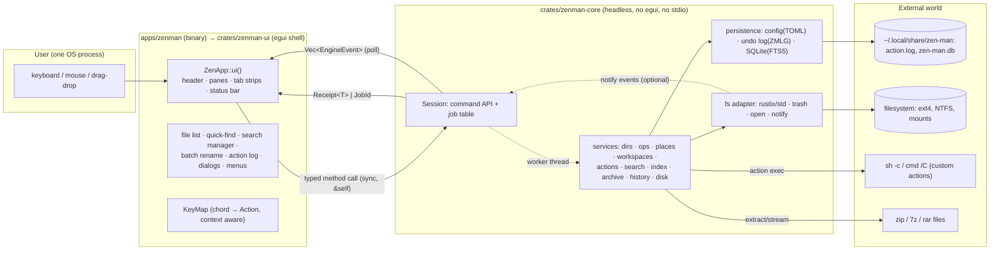

# ARCHITECTURE PLAN — `zen-man-rs`: egui port of zen-man (no web server, no REST)

Status: **Draft v3** — red-teamed (§9). Grill-me interview skipped by explicit user instruction; decisions the user alone can make are collected in §10 with a chosen default so the plan stays executable.
Target repo: `/media/jang/home/Deve/zen-man-rs` (currently empty).
Reference implementation (source of truth for behaviour): `/media/jang/home/Deve/zen-man` (Go backend `main.go` + `api/*.go`, ~7.7 k LOC; vanilla-JS frontend `frontend/`, ~9.4 k LOC).
Framework reference: ArtCraft — `photocraft` workspace + `craft-libs` (`craft-ui`, `craft-atomic`, `craft-settings`, `craft-i18n`).

---

## 1. Summary

We are replacing zen-man's browser/HTTP architecture with a single native Rust application that keeps every user-visible behaviour of the Go program (dual/quad-pane browsing, cursor pagination, clipboard with copy-inside, merge-only conflicts, binary undo log, live + FTS-indexed search, archive VFS, workspaces, custom actions) while deleting the whole web boundary: no `net/http`, no `embed.FS`, no `fetch`, no `127.0.0.1` listener. The Go `api/*.go` handlers become typed method calls on a headless `zenman-core::Session`; the JS frontend becomes an `egui` shell built on the ArtCraft `craft-ui` primitives (docking surface, tab fitting, SVG icon registry, icon buttons, palettes, panes/rail). The in-process replacement for HTTP is a **command + event bus with a job table**, which is required (not cosmetic): zen-man had *no* progress reporting for copy/move/delete and *no* filesystem watcher, so any blocking work ran on the request's goroutine and the browser simply waited. In a single-process GUI that design freezes the window; therefore every mutating or walking operation becomes a cancellable, progress-reporting job whose completion event drives cache invalidation. Two persistence decisions dominate risk: the undo log keeps the existing **byte-exact big-endian `ZMLG` codec** and SQLite schema so an existing `~/.local/share/zen-man/` directory survives the port, and the hand-edited `config.json` is migrated once into a `craft-settings`-managed TOML file with a `.bak`. Out of scope for v1: `wasm32` target (a browser cannot enumerate mounts, `chmod`, or spawn `sh -c`), and headless CLI/MCP server (kept as an optional later milestone because the core is already headless).

---

## 2. Verified ground truth (read this before implementing anything)

Everything below was read from the actual repositories, not assumed. Do not re-derive it.

### 2.1 Toolchain / framework facts `[VERIFIED]`

> **Reference checkouts.** `/tmp/artcraft-src` = `storytold/photocraft` @ `v0.23.1` (commit `45066c4`) and `/tmp/craft-libs` = `storytold/craft-libs` @ `6e03f65bf45181db77ba6229716e6624db9eb25b` are throwaway clones made during this planning session; `/tmp` does not survive a reboot. Re-create them before disputing any `file:line` citation below:
> `git clone https://github.com/storytold/photocraft /tmp/artcraft-src && git -C /tmp/artcraft-src checkout v0.23.1`
> `git clone https://github.com/storytold/craft-libs /tmp/craft-libs && git -C /tmp/craft-libs checkout 6e03f65bf45181db77ba6229716e6624db9eb25b`
> Note also that the ArtCraft checkout the session config points at (`/media/jang/home/PortableApp/zcode_agent/ArtCraft`) **does not exist**; only prebuilt AppImages are on disk under `/media/jang/seeder/ArtCraft/`.

| Fact | Evidence |
|---|---|
| `zen-man` is a **flat** Go module: `main.go` (147 L) + `api/*.go` (29 files, 7 756 L). There is **no** `backend/`, `internal/`, `models/`, `middleware/`, `applog/`, `watcher/`, `config/` package. | `find . -name '*.go'`, `/media/jang/home/Deve/zen-man` |
| `zcodegraph`'s index for zen-man is **stale** — it emits `backend/internal/...` paths that do not exist on disk. Use `grep`/`read`; re-index before trusting `zcodegraph`. | diff of `zcodegraph -a files` output vs `find` |
| Local toolchain: `cargo 1.100.0`, `rustc 1.100.0`, targets `x86_64-unknown-linux-gnu`, `x86_64-unknown-linux-musl`. `trunk` **not installed**. | `cargo --version`, `rustup target list --installed` |
| ArtCraft uses **egui/eframe 0.37** (not 0.36) with `[patch.crates-io]` pinning the whole egui family to `storytold/egui.git` rev `6d518fc799681571963842f95b55a6b68431b15a` and `storytold/winit.git` rev `a517b3846ee8457d84ee4975110bfda6797c44dc`. | `/tmp/artcraft-src/Cargo.toml:66-70,197-217`, `/tmp/craft-libs/Cargo.toml:85-113` |
| `craft-ui` dep pin: `{ git = "https://github.com/storytold/craft-libs", rev = "6e03f65bf45181db77ba6229716e6624db9eb25b", features = ["serde"] }`. | `/tmp/artcraft-src/Cargo.toml:13` |
| Workspace lints: `unsafe_code = "forbid"`, clippy `cognitive_complexity`/`too_many_arguments`/`wildcard_imports = "deny"`, `dbg_macro`/`todo = "warn"`; per-crate `#![deny(clippy::unwrap_used, clippy::expect_used, clippy::panic, clippy::unimplemented, clippy::todo, clippy::unreachable)]`. `edition = "2024"`, `rust-version = "1.95"`, `resolver = "3"`. `clippy.toml` bans `egui::ComboBox` in favour of `craft_ui::ComboBox`; `cognitive-complexity-threshold = 30`. | `/tmp/craft-libs/Cargo.toml:7,81-83`, `crates/ui/src/lib.rs:1`, `/tmp/artcraft-src/clippy.toml` |
| Craft house rules that bind this port: never panic / no `unsafe` outside a named exception crate; **clean room** (behaviour may be studied, code/assets must not be copied); every asset recorded in `ATTRIBUTION.md` in the same change; all dates through `chrono`; dependency licences checked against the allowlist (`ISC, MIT, BSD-2/3-Clause, Apache-2.0, OFL-1.1, Ubuntu-font-1.0, Bitstream-Vera, CC0-1.0, CC-BY-4.0, CC-BY-SA-4.0, LicenseRef-Public-Domain`). | `/tmp/craft-libs/AGENTS.md` |
| egui fork renames `eframe::App::update` → `fn ui(&mut self, ui: &mut egui::Ui, frame: &mut eframe::Frame)`. | `/tmp/artcraft-src/crates/ui-egui/src/app.rs:248,305` |
| **Native boot contract (measured in step 1).** The entry point is `eframe::run_native(app_name, NativeOptions, AppCreator) -> Result`; `craft_ui` re-exports the `eframe` module but **not** `run_native`, and `NativeAppOptions` / `AsyncExecutor` / `ShadowResolver` **do not exist** in the pinned fork. GPU tuning therefore writes `NativeOptions::wgpu_options.wgpu_setup` = `WgpuSetup::CreateNew(WgpuSetupCreateNew{ instance_descriptor, power_preference, .. })`. `wgpu` is 30.x, where `Instance::enumerate_adapters(mask)` returns a **future** and `PowerPreference` is `None | LowPower | HighPerformance`. | `crates/eframe/src/lib.rs:306`, `crates/ui/src/lib.rs:138`, `egui-wgpu/src/setup.rs:43,58,172`, `wgpu-30.0.2/src/api/instance.rs:145`, photocraft `apps/photocraft/src/main.rs:470,497` |

### 2.2 `craft_ui` API surface we will build on `[VERIFIED]`

```rust
// craft-libs/crates/ui/src/docking/surface.rs
pub struct DockArea<'a, P = ()>;                                   // :1099
    pub fn new(id: Id) -> Self;                                    // :1118
    pub fn monitors(self, Vec<Monitor>) -> Self;                   // :1144
    pub fn input_blocked(self, bool) -> Self;                      // :1157   ← while a modal is open
    pub fn auto_collapse_iconic(self, bool) -> Self;               // :1201
    pub fn maximized(self, Option<P>) -> Self;                     // :1208
    pub fn hide_panels(self, HidePanels<'a,P>) -> Self;            // :1215
    pub fn float_bounds(self, Rect) -> Self;                       // :1247
    pub fn locked(self, bool) -> Self;                             // :1255
    pub fn blocked_rects(self, &[Rect]) -> Self;                   // :1261
    pub fn show_content(self, ui:&mut Ui, layout:&Layout<P>, style:&DockStyle,
                        content:&mut dyn DockContent<P>) -> DockOutput<P>;  // :1318
pub trait DockContent<P> {                                         // :837
    fn body(&mut self, ui:&mut Ui, panel:&P);
    fn logical_label(&self, panel:&P) -> String where P: Debug;    // default: format!("{panel:?}")
    fn permissions(&self, panel:&P) -> Permissions;                // default: all-permissive
    fn limits(&self, panel:&P) -> PanelLimits;                     // default
    fn dock_heights(&self, panel:&P) -> Option<DockHeights>;
    fn group_collapsed(&self, panels:&[P]) -> bool;                // host-owned collapse
    fn paint_icon(&mut self, painter:&egui::Painter, rect:Rect, panel:&P, color:Color32) -> bool;
    fn resolve_drag(&mut self, ctx:&Context, style:&DockStyle, req:&DropRequest<'_,P>) -> Option<DropFeedback>;
}
pub struct DockOutput<P> { pub actions: Vec<Action<P>>, pub error: Option<DockError>,
    pub focused: Option<P>, pub group_drag: Option<P>, pub group_drop: Option<(P,Pos2)>,
    pub events: Vec<DockEvent<P>>, pub forwarded_events: Vec<egui::Event>,
    pub forwarded_modifiers: Option<egui::Modifiers>, pub window_files: Vec<WindowFiles<P>> } // :315
pub struct DockStyle { pub tab_height: f32, pub gap: f32, pub min_pane: f32, pub background: Color32,
    pub tab_background: Color32, pub active_background: Color32, pub text: Color32,
    pub inactive_text: Color32, pub border: Stroke, pub accent: Color32, pub font: FontId,
    pub float_label/close_label/move_panel_to_label/panels_label/resize_label/... : String,
    pub drag_bar_width: f32, pub min_tab_width: f32, pub floating_background: Color32, .. }  // :13
    pub fn from_ui(ui:&Ui) -> Self;                                // :171
pub fn typing_window(ctx:&Context) -> Option<ViewportId>;          // :810
pub fn send_keys(ctx:&Context, viewport:ViewportId, events:Vec<egui::Event>);  // :826
pub fn route_app_drag(ctx:&Context, area_id:Id);                   // :791  (call each frame during a host drag)

// docking/model.rs
pub const MAX_DEPTH: usize = 64;  pub const MAX_PANELS: usize = 4096;      // :10-11
pub struct Permissions { movable, floatable, closable, accepts_tabs, accepts_splits: bool }  // :504
    pub const PROTECTED: Self;    pub fn is_protected(self)->bool;   pub fn locked(self)->Self;
pub struct Layout<P> { .. }         pub fn apply_all(self, ..) -> Result<Vec<P>, DockError>;  // :1033
pub enum Node<P> { Split{..}, Tabs{..}, Stack{..}, Dock{..} }
// docking/workspace.rs
pub struct Workspace<P> { pub version: u32, pub layout: Layout<P>, pub hidden: Vec<(P,Location<P>)>,
                          pub saved: Option<Layout<P>>, pub locked: bool }                  // :14
    pub const VERSION: u32 = 2;  pub fn validate(..)  pub fn reconcile(..)  pub fn set_visible(..)  // :56,:66,:215,:126

// tabs/mod.rs — the per-pane tab strip primitive
pub struct TabFit { pub shown: Vec<(usize,f32)>, pub overflow: Vec<usize>, pub overflow_width: f32 } // :11
pub fn fit(natural:&[f32], selected:usize, available:f32, minimum_width:f32, overflow_width:f32) -> TabFit; // :38
pub fn fit_whole(..) -> TabFit;                                                            // :85
pub struct Tab<'a> { id:Id, label:&'a str, selected:bool, sense:Sense, focus_stroke:Option<Stroke> }
    pub fn new(id:Id, label:&'a str, selected:bool) -> Self;  pub fn sense(..)  pub fn focus_stroke(..)
    pub fn show_at(self, ui:&mut Ui, rect:Rect, paint:impl FnOnce(&Ui,&Response)) -> Response;  // :190

// icons/mod.rs + buttons/mod.rs — SVG icon registry
pub struct SvgStyle { pub current_color:&'static str, pub stroke_width:Option<&'static str> }   // :18
pub struct SvgIconSet;  pub fn new(icons:&'static [(&'static str,&'static [u8])], style:SvgStyle,
        uri_prefix:&'static str, fallback:&'static str) -> Self;    // :44  → bytes://<prefix><name>.svg
    pub fn source(&self, name:&str) -> ImageSource<'static>;        // :71  (no include_image needed)
pub struct IconButton<'a>; pub struct IconButtonStyle { normal, hovered, pressed, selected, corner_radius, focus_stroke };
    pub fn new(label:&'a str, size:Vec2, style:&'a IconButtonStyle) -> Self;
    pub fn show(self, ui:&mut Ui, paint_icon:impl FnOnce(&Ui,Rect,Color32)) -> Response;   // :80

// theme/mod.rs, layout/*, panes/*
pub struct WidgetPalette { noninteractive, inactive, hovered, active, open: Color32 }          // :14
    pub fn apply_to(self, widgets:&mut Widgets, radius:CornerRadius, foreground:Stroke);       // :28
pub fn split_rect(rect:Rect, axis:SplitAxis, size:SplitSize, gap:f32, minimum:f32) -> Option<SplitLayout>; // geometry.rs:81
pub struct ResizeHandle;  pub enum ResizeResponse;  pub struct Section;  pub fn fit_toolbar(..) -> ToolbarFit;
pub trait PaneContent<P> { fn title/final body/default_state/size_range/movable/closable/title_bar/menu }  // panes/mod.rs:139
pub struct PaneHost; pub enum PaneRequest<P> { Close, Place, Resize, FloatRect, Focus, Before } // :105
pub struct Rail;  pub fn focus_next(ctx:&Context, id:impl Into<Id>, reverse:bool);              // :297
pub struct ComboBox<'a>; pub struct Menu<'a>;   // clippy.toml: use these instead of egui::ComboBox
```

**Docking facts that constrain the pane grid** `[VERIFIED — read of docking sources; these changed the shell design]`

* `docking::Side` is `Start | End` **only** (`crates/ui/src/docking/dock_model.rs:23-27`) and `Layout::validate` requires dock nodes to sit at a window edge, at most one per side (`docking/model.rs:629-637`). **There is no `Side::Top`** ⇒ zen-man's 48 px header bar cannot be a dock panel; it lives in an `egui::TopBottomPanel` drawn *outside* the `DockArea`.
* A group containing exactly one panel whose `Permissions::is_protected()` holds is rendered **stripless**: no tab strip, no drag bar, the whole rect goes to `DockContent::body`, and no `tab_height` is added to its limits (`docking/render/group.rs:61-72`; predicate `docking/render/mod.rs:469-474`; limits `docking/render/mod.rs:493-496`). `is_protected() = !movable && !closable && !accepts_tabs` and **ignores** `floatable`/`accepts_splits` (`docking/model.rs:529-535`). This is exactly the file-pane shape: the dock owns geometry, the pane owns its coloured tab strip.
* Close/move/split-by-drag are permission-gated and require `movable` on the acted-upon panel (`docking/model.rs:963-964,974-975,996,1011-1016`); **divider resize is not permission-gated**, only geometry-checked (`model.rs:588,1140`). Consequence: with `movable:false` panes, `accepts_splits:true` never fires from a gesture. The 1/2/4-pane restructure is therefore an **application-side `Layout` edit** (`Layout::apply`, `model.rs:940`), never a dock drag. Drag-to-split-between-panes is explicitly **not** a v1 feature (§10 R8).
* `PanelLimits` has only `{ min, max }` (`docking/surface.rs:622-644`) — there is no `collapsed()` constructor. Per-group collapse is `DockContent::group_collapsed` (`surface.rs:863`) and it minimises *to* the strip, so a stripless group must not rely on it: zen-man's tab-group collapse stays app-side (`Tab` list filtering in `panels/tab_bar.rs`).

**Absent from `craft_ui` (we must write them):** modal helper, context-menu helper, tooltip helper, prompt dialog, table/virtual-list widget, toast widget. Photocraft's own equivalents (`/tmp/artcraft-src/crates/ui-egui/src`) are the pattern to mirror: `dialogs.rs:233 show_modal(...)`, `notices.rs:52 post(...) / :227 show(...)` (toast = `egui::Area` anchored `RIGHT_BOTTOM`), `widgets/text_field.rs:53 text_field(...)`, `widgets/press_menu.rs:100 show(...)`, `panels/panel_docking.rs:772 show(app,ui)`, `jobs_ui.rs:488 tick(app,ctx) / :522 keep_polling(app,ctx)`, `dock.rs:339 snapshot / :375 persist / :478 restore / :502 apply`.

**Job pattern to mirror** (`/tmp/artcraft-src/crates/engine/src/jobs.rs`): `JobId(pub u64)` `:87`, `JobCtx` `Arc` handle `:92`, `progress(f32,&str)` `:156`, `cancelled()` `:169`, `commit()` `:192`, `stage(lo,hi,msg,f)` `:356`, `JobOutcome { Done(Value), Failed(String), Cancelled }` `:413`, `JobEvent { id, command, label, document, outcome, error }` `:424`, `JobInfo` `:440`, `Started { Done(Value), Job(JobId) }` `:681`, `Session::start(&mut self,&str,Value) -> Result<Started>` `:1063`, `poll_jobs(&mut self) -> Vec<JobEvent>` `:1500`, `cancel_job` `:1573`. UI polls in `jobs_ui::tick` and keeps the loop alive with `ctx.request_repaint_after(16 ms)`.

**Storage pattern to mirror:** `craft-atomic::atomic_write(path,&[u8]) -> io::Result<()>` (`crates/atomic/src/lib.rs:267`), staging `.{stem}.{pid}-{n}.craft_tmp`, `sync_file < rename < sync_dir`. `craft-settings`: `trait Settings: Serialize+DeserializeOwned+Default+Clone+PartialEq { const APP_ID; const SCHEMA_VERSION; fn migrate(from, &mut DocumentMut) }` (`lib.rs:71`), `SettingsStore<T>::open(Location) -> (Self, LoadReport)` (`store.rs:106`), `update(f)` `:211`, `tick(now) -> TickResult` `:241`, `flush()` `:266`; policy = `config.toml` (user-editable, debounced ~0.5 s) + `ui.ron` beside it for window/UI state, caches in `paths::cache_dir`, a file from a newer build is shown but never overwritten.

### 2.3 zen-man behaviour contract `[VERIFIED]` — the parts a port breaks

* **Routes actually registered** (`main.go:99-119`): `/api/dir`, `/api/dir/size`, `/api/op`, `/api/places`, `/api/workspaces`, `/api/actions`, `/api/action/exec`, `/api/props`, `/api/log`, `/api/log/revert`, `/api/diskspace`, `/api/index/{search,rebuild,status,config,cancel}`, `/api/archive/{dir,stream,extract,extract/status}`. `/api/props`, `/api/archive/extract*` are **never called** by the shipped frontend (no Properties dialog or "Extract here" UI exists anywhere — green field for us).
* **Undo log wire format** (`api/log.go:67-87`), all **big-endian**, file `action.log` (not `action-log`) under `$XDG_DATA_HOME|~/.local/share/zen-man/` with `/tmp/zen-man` fallback, opened `O_RDWR|O_CREATE` **without** `O_APPEND`:
  `0:4 magic "ZMLG"` · `4:8 id i64` · `12:8 ts i64 Unix-ns` · `20:1 ActionType` · `21:1 StatusType` · `22:4 recLen u32 (excludes trailing CRC)` · `26:2 numSrc u16` · `n×[u16 len][utf8] sources` · `[u16 len] dest` · `[u16 len] name` · `+4 crc32 IEEE over all preceding bytes`. `ActionType`: `1 Copy, 2 PasteCopy, 3 PasteMove, 4 Delete, 5 Rename, 6 Mkdir, 7 Chmod, 8 PasteLink`; `StatusType`: `0 done, 1 reverted`. Revert = two in-place `WriteAt`s (status byte at `off+21`, recomputed CRC at `off+len-4`). Recovery scan skips bad CRC and resyncs at `off+1`. Reversible set = `{PasteCopy, PasteMove, Rename, Mkdir, PasteLink}`. Every clipboard set logs a non-reversible `Copy` record; the UI filters on `reversible`.
* **SQLite schema** (`api/db.go:51`, `api/search_index.go:141-192`, `api/search_index_walker.go:90-250`): `folder_sizes(path TEXT PRIMARY KEY, size INTEGER, file_count INTEGER, updated_at INTEGER)`; `schema_meta(key,value)` with `search_schema_version='1'`; `files(id INTEGER PRIMARY KEY, path, name, name_orig, ext, parent, size, mtime, is_dir, is_symlink)` + unique `path` index and `name/ext/parent/mtime` indexes; `files_fts USING fts5(name, tokenize='trigram')`; rebuild uses `files_shadow`/`files_fts_shadow` then a `DROP`+`ALTER TABLE RENAME` swap in one transaction. `name` is **lowercased**, `ext` lowercased **without** dot, `mtime` **seconds**. `SetMaxOpenConns(1)`. `PRAGMA wal_checkpoint(PASSIVE)` is issued but WAL is never enabled → the PRAGMA is a no-op today.
* **Config** `~/.config/zen-man/config.json` (`api/places.go:14-63`, ignores `XDG_CONFIG_HOME`): `{bookmarks:[string], workspaces:{name:WorkspaceSession}, custom_actions:[CustomAction]}` with `WorkspaceSession{left_tabs,left_active,right_tabs,right_active,split}` and `TabState{id,path,name,group,color}`; `CustomAction{id,name,icon,command,role,patterns,show_output}`. Search config `~/.config/zen-man/search-config.json` (`api/search_index.go:16-32`): `{schema_version, roots, excludes, auto_index, index_on_startup, max_depth, follow_symlinks, worker_count, index_state{last_indexed_unix,total_files,is_dirty}}`, default excludes `/proc,/sys,/dev,**/.git,**/node_modules,**/__pycache__`.
* **Behaviour that must survive the port:** dirs always sort first *regardless* of order; name sort is byte-compare on **lowercased** names (so `a10 < a9`); cursor is a decimal index into the fully sorted in-memory list (whole directory is read + sorted on every page); flat walk caps at 10 000 entries; symlinks report `is_dir:false` (lstat) while `open` follows them; hidden files are **never** filtered by the backend; `chmod` is bare-octal-only (`0o755`), non-recursive; paste conflict is *dir-into-dir only* and returns HTTP 200 `{"status":"conflict","conflicts":[names]}`; `copyFile` **silently skips** existing destinations; `moveItem` errors on collision; batch rename is smuggled as a **JSON string inside the `name` field** (`[`/`]` sniffed by `log_revert.go:110`); `track_entries` only when ≤100 items → `reload_required`; VFS write guard is a **string check** for `.zip/ .rar/ .7z/`; `validateDest` rejects any `..` **substring** (false positives); index rebuild is full-only, per-root timeout 30 s, excludes are glob→regex anchored `(^|/)…($|/)`, symlinks recorded but never descended; extract jobs capped at 3 concurrent, done jobs GC'd after 1 h; archive cache = 10 entries LRU, 15 min TTL, staleness by host mtime → `409 archive_modified`.
* **Known frontend bugs that must NOT be ported:** `(undefined files)` (`file-list.js:159-165` reads an `omitempty`-dropped `files_count`); no sort click handler although `data-sort` exists in markup; no arrow/PageUp/Home/End navigation; no Esc-to-clear; `F2` rename uses `window.prompt`; `isBatchRenameActive` freezes rendering; `zen-refresh-filelist` has no subscriber (revert never refreshes); `Alt+Z` MRU overlay is Shift-only logic; `formatSize` duplicated twice; three independent virtual scrollers.
* **Visual spec** (`frontend/css/base.css:2-18`, verbatim): `--bg-main #0f1117`, `--bg-sidebar #090a0f`, `--bg-card #161821`, `--bg-hover #222533`, `--border-color #212534`, `--accent-color #5865f2`, `--accent-hover #475244`-family (`#4752c4`), `--text-main #e3e5e8`, `--text-muted #959ba4`, `--text-active #fff`, `--danger #f23f43`, `--warning #f0b232`, `--success #23a55a`; row height **40 px**, tab bar **38 px**, pane toolbar **50 px**, global header **48 px**, status bar **30 px**, sidebar **250 px** (left) / **300 px** (right, off-canvas), tab strip max width **150 px**, group colours `#ff4a4a #3b82f6 #10b981 #fbbf24 #8b5cf6`, file-row selected `rgba(88,101,242,0.15)` + border `rgba(88,101,242,0.3)`, active pane border `rgba(88,101,242,0.4)`, grid tile `minmax(110px,1fr)` gap 15, quick-find 80vw/max 1200px, search-manager 85vw×85vh/max 1100px, action-log 360px slide-in, menu shadow `0 10px 25px rgba(0,0,0,.5)`. Live screenshot baseline captured at `/tmp/zen_man_ui_main.png` (`zbrowser -a navigate --url http://localhost:7890/`, `zbrowser -a screenshot --path …`).

---

### 2.4 Wire-contract deltas measured in step 2 `[VERIFIED]` — supersedes anything above that disagrees

Captured from a disposable Go instance (`HOME=/tmp/zm-go-home`, port 7891, commit `d5cd1a5`) into `tests/golden/` — **134 files** (122 HTTP captures + 12 on-disk artefacts; `tests/golden/INDEX.json` lists 138 records because 5 are `superseded-by:` tombstones). The full per-endpoint reference, the deviation ledger, the mode-string inventory, the ZMLG offset table, the SQLite dump and the test-gap list are in **`docs/contracts.md`**, which supersedes this table wherever it is more specific. `PROVENANCE.json` names the Go SHA. Every line below was observed in captured bytes, not inferred from the handlers. **Implementers: when §2.3/§5 and this table disagree, this table wins.**

| Area | Planning-time belief | Measured reality (golden / `file:line`) | Consequence for the port |
|---|---|---|---|
| `/api/props` | the Properties endpoint | It is a **capability probe**, `{"platform":"linux","symlink_supported":true}`; `path` is ignored — `props-file/dir/symlink/crlf-name.json` are byte-identical (`main.go:141-147`) | Rust `Session::props()` stays a probe (call it `capabilities()` in the UI layer); Properties must be built from `page_dir` + `dir_size` + `EntryStat` (§5.8 row updated) |
| chmod | bare octal, rejects `755` | `"600"`→200, **`"0644"`→200 (leading zero is fine)**, `"0o755"`→400 (`op-chmod*.json`, `err-chmod-octaltext.json`; `ParseUint(_,8,_)` `ops.go:931`) | core validates `^[0-7]{3,4}$`; symbolic modes remain our addition |
| chmod errors | JSON error envelope | Errors are **`text/plain; charset=utf-8` bodies containing JSON**, and `err-chmod-octaltext.json` is **not valid JSON** (Go `%v` injected unescaped quotes) | our typed error must not be copied from that shape; the golden is a *negative* fixture (an `xtask contracts` waiver, already coded) |
| Log records | `sources` is `null` when empty | `sources` is `[]`, never `null` (`log.json` id 1, a decoded `mkdir`) | `#[serde(default, skip_serializing_if…)]` off: encode `[]` |
| Log timestamps | RFC 3339 **Z** | the capture machine's `+07:00` offset | decode accepts any offset; encode in UTC; contract comparison normalises offset |
| `dir` method | REST-ish | `/api/dir` **never checks the method** — POST returns the listing 200 (`dir-post-returns-listing.json`), while `/api/dir/size` 405s (`dir.go:75-102` vs `:335-338`) | irrelevant in-process; recorded so contract tests don't assert a 405 |
| Permission errors | 403 | a denied directory is **HTTP 500** (`err-perm-denied-dir.json`); a `0444` dir is **200 with degraded rows** — `mode:"unknown"`, `size:0`, `mod_time:-62135596800` (Go's zero `time.Time`) (`dir-perm-noexec.json`) | `CoreError::PermissionDenied` for the first; for the second, `Entry.mode` needs an explicit `Unknown` and zero-time must map to `Option<DateTime>` (§6.1 F20) |
| `files_count` | always present | dropped by `omitempty` unless `folder_sizes` has a cache hit (`dir.go:250-257`; absent in `dir-root.json`) — **root cause of the `(undefined files)` frontend bug** | keep `Option<u64>` in the DTO and always serialise; that is the fix |
| `/api/op` copy/cut | snake_case throughout | `items[].isDir` (camelCase, `ops.go:174-179`); `paste_link` response has **no** `reload_required` key; clipboard set never validates existence, so a vanished path reports `size:0` (`op-copy-link.json`) | our internal `ClipboardItem` keeps the real `Option<u64>`; stale-clipboard surfaces as `CoreError::NotFound` at paste time |
| `delete` | validates | succeeds on an empty list **and** on a nonexistent path (`op-delete-empty-sources.json`, `op-delete-dir.json`) | keep the idempotence but report it per-path (`DeleteReport`, §5.3) |
| `/api/workspaces` | 400 on bad input | unknown `action` → **405 "Method not allowed"** (`places.go:260-269`) | typed `CoreError::BadRequest` instead; noted as a deliberate deviation |
| `/api/index/search` | `rel_path` is relative, `mode` populated | `rel_path` holds the **absolute** path and `mode` is always `""` (`search-index-*.json`, `search_index.go:381-386`); `capped` is true whenever `total_matched > limit+offset` (`search_index_api.go:57`) | our `SearchHit.path` is a real `FsPath`; `mode` is filled from the row we already have — do not replicate |
| `/api/search` (live) | sorts dirs first, `entries: []` | **does not** sort dirs-first and returns `entries:null` on no match (`search-live-recursive.json`, `search-live-empty-q.json`) | decide explicitly in §6.2: live search keeps Go's order (it is a "quick" search), `Vec` always serialises as `[]` |
| Archive listing | paginated like `/api/dir` | **no pagination at all** — no `cursor`/`has_more`/`total_count` (`archive_handlers.go:110-117`); a zip-slip root entry surfaces as a *directory literally named `..`* (`archive-list-zipslip.json`, `archive_parser.go:110-152`); zip **symlink entries come back as regular files whose size is the target's length** (`archive-list-symlink.json`) | plan §5.3's `ListDirReq::Archive{cursor,limit}` is a **deliberate improvement**, not parity — mark it in §6.2; symlink members need a real `is_symlink` from the mode bits we parse |
| `validateDest` | rejects traversal | rejects any `..` **substring** (so `name..txt` 403s: `archive-extract-dotdot-falsepositive.json`) yet a *relative* dest passes because `ResolvePath` Abs+Clean's first (`dir.go:57-62` then `archive_extract.go:57-66,143`) — **materially weaker than assumed** | strengthens F19: containment check after normalisation, in `ops/guard.rs`, never a substring test |
| Response key order | stable | struct responses keep declaration order (`dir-root.json`); **map** responses are alphabetised (`dir-size-subdir.json`) | byte-exact contract tests must compare parsed JSON or per-shape order, never one global rule |
| SQLite | WAL | `journal_mode = delete`, `user_version 0`, `page_size 4096`; Go sets **only** `SetMaxOpenConns(1)` (`db.go:49`) and calls `wal_checkpoint(PASSIVE)` — a no-op because WAL was never enabled; **no `busy_timeout`, no `synchronous`**; indexes are still named `idx_files_shadow_{path,name,ext,parent,mtime}` on `files` (proof of the shadow→live `ALTER TABLE RENAME` swap, `search_index_walker.go:227-241`) | rusqlite must set `busy_timeout` (F1) and decide WAL deliberately; keep the `idx_files_shadow_*` names if we want to open Go's db unchanged |
| Clipboard/log action types | 8 types captured | all 8 `ActionType` bytes are present in the 19-record log, **but only one record has `status=reverted` (a `mkdir`)** — so revert of paste-copy/move/rename/paste-link is untested by the frozen log, and the 422 non-reversible capture exists only for `copy`; no bad-CRC, no truncated-tail, no 65 535-byte-path fixture yet | step 5's `contract_history.rs` must synthesise those five records itself (documented in §7 step 5) |

**Deliberate improvements over the captured wire format** (recorded in §6.2, not bugs to preserve): typed errors instead of `text/plain`-wrapped JSON, `always-[]` list fields, real `is_dir` for symlinks, `Option`-typed mtimes, component-wise VFS guard, containment-based destination guard, and `busy_timeout` on SQLite.

---

## 3. System boundaries



**Hard boundary rules**

1. `crates/zenman-core` **must not** depend on `egui`, `eframe`, `wgpu`, or `craft-ui` (enforced by a `cargo xtask deps` check, §8). This is what makes the eventual CLI/MCP target a link-only job.
2. `crates/zenman-ui` contains **zero** filesystem calls: every side effect is a method on `Session`. Grep gate: no `std::fs` surface in `crates/zenman-ui/src/**` outside a `#[cfg(test)]` **item** — `xtask`'s IO guard reads `use std::fs`, `std::fs` with any following character, `std::io::fs` and `use std::{… fs …}` import lists (multi-line included), on comment/string-blanked text, and exempts only the attribute-through-closing-brace range of the test item (step 7c; the step-7 grep of the literal `std::fs::` with an exempt-to-EOF tail was bypassable).
3. `apps/zenman` is the only place that knows about `eframe::NativeOptions`, GPU backend selection, single-instance, and OS dirs.
4. Worker threads never call into `egui`; they publish events. Repaint is requested by the UI from `Session::poll` results (`jobs_ui::keep_polling` equivalent).
5. **The header bar and the two overlay drawers are NOT dock panels.** `craft_ui::docking::Side` is `Start|End` only (§2.2), so the 48 px global header is an `egui::TopBottomPanel` drawn before the `DockArea`, and the drawers are overlays above the area (`DockArea::blocked_rects` keeps drops out of them). Only the pane grid lives in the `Layout`.

---

## 4. Data flow and state management

### 4.1 Command / event bus (the in-process replacement for HTTP)

```mermaid
sequenceDiagram
  participant UI as file_pane (egui)
  participant S as Session
  participant J as Job worker
  participant P as Persistence (log/db/config)

  UI->>S: paste(PasteReq{sources,dest,merge})
  S->>S: validate VfsWriteGuard + DestGuard (sync, &self)
  S-->>UI: Receipt::Running{ job: JobId(41), origin: Origin(7) }
  UI->>UI: Tab.pending += Origin(7); JobsUi.by_origin[7] = JobSlot{label:"Paste 3 items"}
  S->>J: spawn (bounded semaphore, ≤8 live jobs)
  J->>J: copy file 1..n, ctx.progress(bytes,total,"name")
  J->>P: ActionLog.append(PasteCopy, sources, dest) once, after the walk
  J-->>S: JobEvent{Done(Ok(PasteReport{entries,reloaded,skipped}))}
  UI->>S: poll()  (once per frame, from logic())
  S-->>UI: JobFinished{job:41, origin:7, ..} + DirChanged{dest, LocalJob, origin:Some(7)}
  UI->>UI: by_origin.remove(7) → clear that tab's pending flag;
           tabs_showing(dest) → refresh each; tabs that did not ask reload quietly
           (scroll + selection preserved); toast the skipped/failed lists
```

```rust
// crates/zenman-core/src/session.rs  — the only façade the UI is allowed to call
pub struct Session { inner: Arc<Inner> }                      // cheap-clone handle, Send+Sync
pub struct SessionConfig { pub env: Env, pub limits: Limits, pub watcher: WatchPolicy }

/// `Origin` is the correlation token that ties an event back to the widget that asked for it.
/// Four tabs can point at one directory and a pane can have several jobs in flight, so
/// `(JobId, path)` is not enough to know which spinner to clear.
#[derive(Clone, Copy, PartialEq, Eq, Hash, Debug, serde::Serialize, serde::Deserialize)]
pub struct Origin(pub u64);
pub struct OriginAlloc(AtomicU64);  impl OriginAlloc { pub fn next(&self) -> Origin }

/// The caller keeps the `Origin` it passed in, stores it in `Tab.pending`, and the job slot in
/// `JobsUi.by_origin`. Nothing in the UI may look a result up by path alone.
pub enum Receipt<T> { Done(T), Running { job: JobId, origin: Origin } }   // mirrors photocraft Started (:681)

impl Session {
    // ── reads: synchronous; they never block longer than one directory ─────────
    pub fn list_dir(&self, req: &ListDir) -> Result<DirPage, CoreError>;
    pub fn dir_size(&self, req: &DirSize, origin: Origin) -> Receipt<DirSizeStat>;  // long → job
    pub fn disk_space(&self, path: &AbsPath) -> Result<DiskSpace, CoreError>;
    pub fn props(&self) -> Props;                                            // capability probe
    pub fn places(&self) -> Result<Places, CoreError>;                       // bookmarks + mounts
    pub fn workspaces(&self) -> Result<Vec<WorkspaceMeta>, CoreError>;
    pub fn custom_actions(&self) -> Result<Vec<CustomAction>, CoreError>;
    pub fn log_query(&self, q: &LogQuery) -> Result<LogPage, CoreError>;
    // ── mutations: synchronous when provably short, job otherwise ─────────────
    pub fn mkdir(&self, req: &Mkdir) -> Result<DirEntry, CoreError>;
    pub fn rename(&self, req: &Rename) -> Result<RenameReport, CoreError>;   // batch → one call
    pub fn chmod(&self, req: &Chmod) -> Result<(), CoreError>;
    pub fn delete(&self, req: &Delete, origin: Origin) -> Receipt<DeleteReport>;
    pub fn paste(&self, req: &Paste, origin: Origin) -> Receipt<PasteReport>;
    pub fn clipboard_store(&self, req: &ClipboardStore) -> Result<Clipboard, CoreError>;
    pub fn clipboard_clear(&self) -> Result<(), CoreError>;
    pub fn open(&self, paths: &[AbsPath]) -> Result<(), CoreError>;
    pub fn exec_action(&self, req: &ActionExec) -> Receipt<CmdOutput>;
    pub fn revert(&self, id: LogId) -> Receipt<RevertReport>;
    // ── long-running, always async ───────────────────────────────────────────
    pub fn search_live(&self, req: &LiveSearch, origin: Origin) -> JobId;      // cancellable
    pub fn page_dir(&self, req: &ListDir, origin: Origin) -> Receipt<Arc<DirPage>>; // cached ⇒ usually Done
    pub fn index_rebuild(&self) -> JobId;
    pub fn index_cancel(&self, id: JobId) -> bool;
    pub fn index_status(&self) -> IndexStatus;
    pub fn index_search(&self, q: &IndexQuery) -> Result<SearchPage, CoreError>;
    pub fn extract(&self, req: &Extract) -> JobId;
    // ── job plumbing ─────────────────────────────────────────────────────────
    pub fn cancel(&self, id: JobId) -> bool;
    pub fn jobs(&self) -> Vec<JobInfo>;
    pub fn poll(&mut self) -> Vec<EngineEvent>;                              // non-blocking drain
    pub fn wants_repaint(&self) -> Option<Duration>;                         // Some(16ms) while jobs run
}
```

```rust
// crates/zenman-core/src/events.rs
#[derive(Debug, Clone)]
pub enum EngineEvent {
    JobStarted  { id: JobId, kind: JobKind, label: String, origin: Origin },
    JobProgress { id: JobId, origin: Origin, done: u64, total: Option<u64>, message: String }, // coalesced: ≥50 ms apart
    JobFinished { id: JobId, kind: JobKind, origin: Origin, outcome: JobOutcome },
    /// A directory page produced by a job (cold cache / flat walk / archive manifest build).
    DirPageReady { origin: Origin, path: FsPath, page: Arc<DirPage> },
    /// Asynchronous answer to `dir_size`; keyed by path, broadcast to every row showing it.
    DirSizeReady { path: AbsPath, stat: DirSizeStat },
    /// Invalidation. `FsPath` (not `AbsPath`) so archive members can be named — a paste into or
    /// a refresh of an archive is otherwise unrepresentable.
    DirChanged { path: FsPath, cause: ChangeCause, origin: Option<Origin> },
    ClipboardChanged { clip: Option<Clipboard> },
    IndexChanged { total: u64, dirty: bool },
    LogAppended { id: LogId },
    Notice { level: NoticeLevel, message: String },   // toasts the core wants shown (e.g. skipped files)
}
/// Why a listing went stale. `LocalJob` events are already accounted for by the originating tab's
/// own `Tab.pending`, so a tab that did not ask can refresh quietly (keeping scroll + selection)
/// instead of being reset by a sibling tab's write.
pub enum ChangeCause { LocalJob, Watcher, Index, External }
#[derive(Debug, Clone)] pub enum JobOutcome { Done(JobPayload), Failed(CoreError), Cancelled }
/// Typed per `JobKind`; a `JobKind`/payload mismatch is a programming error caught by a debug assert,
/// never a `serde` failure at runtime.
pub enum JobPayload { DirPage(Arc<DirPage>), DirSize(DirSizeStat), Paste(PasteReport),
                      Delete(DeleteReport), Revert(RevertReport), Search(SearchPage),
                      Rebuild(RebuildSummary), Extract(()), Exec(CmdOutput), None }
```

Every mutating call takes `origin: Origin`; the returned `Receipt::Running { job, origin }` is stored by the caller (§4.3), which is the only reason a finished job can find its way back to a widget.

`JobProgress` is coalesced in the `JobTable` (last value per job wins, emitted at most every 50 ms) — the UI must never see thousands of per-file events for a 200 k-file paste.

### 4.2 Path model (the design decision that removes a class of Go bugs)

```rust
// crates/zenman-core/src/path.rs
pub struct AbsPath(PathBuf);                      // resolved, cleaned, never relative, never ".."-escaping
    pub fn resolve(raw:&str, cwd:&Path, home:Option<&Path>) -> Result<Self, CoreError>;   // = Go ResolvePath
    pub fn parent(&self) -> Option<AbsPath>;  pub fn join(&self, name:&str) -> Result<AbsPath,CoreError>;
    pub fn components_clean(&self) -> impl Iterator<Item<&OsStr>>;      // no "." , no ".."
    pub fn is_ancestor_of(&self, other:&AbsPath) -> bool;              // replaces isSubdir
pub enum FsPath { Local(AbsPath), Archive { host: AbsPath, nested: Option<InnerPath>, inner: InnerPath } }
pub struct InnerPath(String);                     // normalised archive-internal path: no leading/trailing '/'
```

The archive VFS path is a **type**, not a string convention. Consequences, all enforced by the compiler instead of a runtime string check:

* Write-capable APIs take `&AbsPath`. `FsPath::Archive` **cannot** be passed to `delete`/`paste`/`rename` → Go's `vfs_readonly` string sniff (`ops.go:60-80`) becomes unrepresentable. The one remaining `match` on `FsPath::Archive` in the dispatcher returns `CoreError::ReadOnlyVfs` and is covered by a test.
* `AbsPath::join(name)` rejects `..`, absolute `name`, and (Windows) alternate data streams / `\\?\` prefixes → fixes `validateDest`'s `..`-substring false positive and the zip-slip hole in one function.
* `AbsPath` is the **only** key type for `folder_sizes`, the undo log's path index, and dir listings, so cache keys are canonical by construction (Go stored `filepath.Clean`ed strings).

### 4.3 UI state ownership

```rust
// crates/zenman-ui/src/state.rs
pub struct AppModel {
    pub panes: BTreeMap<PaneSlot, Pane>,       // PaneSlot: Left|Right|LeftBottom|RightBottom (state.rs)
    pub layout: LayoutMode,                     // Single | Split | Quad   (persisted)
    pub active_pane: PaneSlot,
    pub clip: Option<Clipboard>,                // mirrored from core; never owned by the UI
    pub modal: ModalStack,                      // QuickFind | SearchManager | BatchRename | Prompt | Confirm | Properties | Indexer
    pub log_panel: bool, pub left_drawer: DrawerState, pub right_drawer: DrawerState,
    pub notices: VecDeque<Notice>,
}
pub struct Pane { pub tabs: Vec<Tab>, pub active: usize, pub mru: VecDeque<TabId>,   // cap 5, Alt+Z
                  pub collapsed_groups: Vec<GroupColor>,
                  pub loading: BTreeSet<Origin> }   // NOT a bool: two refreshes in one pane must
                                                    // not clear each other's spinner, nor hang one
pub struct Tab { pub id: TabId, pub path: FsPath, pub title: String,
                 pub history: Vec<FsPath>, pub hist_ix: usize,                      // no depth cap (parity)
                 pub sel: BTreeSet<String>, pub anchor: Option<usize>,
                 pub sel_by_path: BTreeMap<String, BTreeSet<String>>,               // per-directory selection memory
                 pub view: ViewMode,                                               // List | Grid
                 pub flat: FlatViewMode,                                           // Off | Mixed | MixedNoFolders | Grouped
                 pub collapsed_file_groups: BTreeSet<String>,
                 pub entries: Arc<DirPage>, pub total: usize, pub next: Option<Cursor>, pub has_more: bool,
                 pub group: Option<GroupColor>, pub loading_more: bool, pub error: Option<CoreError>,
                 pub pending: BTreeSet<Origin> }        // ← the JobId↔Tab correlation record

pub struct AppModel { /* …plus the fields of the block above… */
    pub tab_index: HashMap<TabId, (PaneSlot, usize)>,   // synced by every tab mutation
    pub origins: Arc<OriginAlloc>,
}
impl AppModel {
    /// Every tab currently displaying `path` — the invalidation and post-revert fan-out helper.
    pub fn tabs_showing(&self, path: &FsPath) -> Vec<(PaneSlot, usize)>;
    pub fn tab_at(&self, k: (PaneSlot, usize)) -> Option<&Tab>;
    pub fn tab_at_mut(&mut self, k: (PaneSlot, usize)) -> Option<&mut Tab>;
}
```

**State rules**

* `Tab.entries` is an `Arc<DirPage>`; workers produce a new `DirPage` and publish `DirChanged`, the UI `Arc::make_mut`s on edit only. Rendering borrows `&Arc` — no clone per frame.
* Cache: `Session` keeps `Mutex<HashMap<AbsPath, DirCacheEntry>>` with `DirCacheEntry { page: Arc<DirPage>, fetched_at: Instant, invalidate_at: Instant }` (TTL 2 s, plus explicit invalidation on every `DirChanged` touching the path or an ancestor). This is the *only* place dir contents live; Go re-read the whole directory per page request — in-process we must not.
* Selection is stored per **tab**, keyed by name (not index) so it survives a reload; anchor is an index into the current visual order, recomputed on each click (Go semantics preserved exactly).
* **Correlation rule:** a job result is applied only through `origin`. `JobsUi::by_origin: HashMap<Origin, JobSlot>` holds `{ job, kind, target: FsPath, pane: PaneSlot, tab: TabId }`; `Tab.pending` holds the same `Origin`. This is what lets four tabs on one directory, or two refreshes in one pane, each resolve their own spinner and their own error.
* Undo log, SQLite, and config are **never** read from a worker thread directly — they live behind `Arc<LogStore>`, `Arc<IndexStore>`, `Arc<ConfigStore>` in `Session::inner`, each with its own mutex (Go used package-level singletons; we make the dependency explicit so tests can inject temp dirs).

---

## 5. Implementation Blueprint

Crate layout (domain-named, no `misc`/`utils`/`common`):

```
zen-man-rs/
  Cargo.toml                    # workspace + [patch.crates-io] copied from photocraft verbatim
  rust-toolchain.toml           # 1.95.0 pinned (MSRV; craft-libs uses rust-version=1.95)
  clippy.toml  deny.toml  .cargo/config.toml  ATTRIBUTION.md  README.md
  xtask/                        # cargo xtask ci | deps | licenses | parity
  crates/zenman-core/           # headless engine (no egui, no wgpu)
  crates/zenman-ui/             # egui shell library (no std::fs)
  apps/zenman/                  # binary: NativeOptions, GPU fallback, single instance, dirs
  docs/contracts.md             # the behaviour contract this port must satisfy (generated from §2.3)
  tests/
    golden/                     # fixtures: action.log written by Go, zen-man.db from Go, config.json
    scenarios/                  # per-facility contract tests
```

Legend for the table: **Depends** = other rows (by file) *and* build steps (§7 step numbers). `// TODO: implement` marks a contract body — legal; a body is not.

### 5.1 Workspace scaffolding

| File | Action | Concrete signature / schema | Depends on | Done when |
|---|---|---|---|---|
| `Cargo.toml` | create | `[workspace] resolver="3", members=["crates/*","apps/*","xtask"]`; `[workspace.package] edition="2024", rust-version="1.95"`; `[workspace.lints.rust] unsafe_code="forbid"`; `[workspace.lints.clippy] cognitive_complexity="deny", too_many_arguments="deny", wildcard_imports="deny"`; `[workspace.dependencies] craft-ui={git,rev="6e03f65bf45181db77ba6229716e6624db9eb25b",features=["serde"]}  // step-1 note: photocraft itself requests only `serde`; `native-windows` is left off because it is unused here and every extra feature is extra build graph`, `craft-atomic={git,rev=same}`, `craft-settings={git,rev=same}`, `egui={version="0.37",default-features=false}`, `eframe={version="0.37",default-features=false,features=["wgpu","accesskit","wayland","x11","clipboard","persistence"]}`; `[patch.crates-io]` **pasted verbatim, full 40-char revs, no ellipsis** — egui family `6d518fc799681571963842f95b55a6b68431b15a`, winit `a517b3846ee8457d84ee4975110bfda6797c44dc` (source of truth: `/tmp/artcraft-src/Cargo.toml:199-217`, i.e. photocraft v0.23.1; a header comment in our `Cargo.toml` records where the block came from so it is reviewable without the reference repo) | — | `cargo metadata --locked` resolves; `cargo tree -i egui` shows exactly one source (the fork); `cargo check -p craft-ui` succeeds — **already proven on this machine** by a scratch workspace that compiled `DockArea::show_content` + `Workspace::apply_all` + `App::logic/ui` + `SvgIconSet` + `IconButton` + `WidgetPalette::apply_to` + `tabs::fit` + `ComboBox::show_ui` + `split_rect` + `run_native` with the wgpu backend |
| `rust-toolchain.toml` | create | `[toolchain] channel = "1.95.0"` (host has 1.100; add `allow` override in `.cargo/config.toml` if unavailable — do not silently downgrade) | — | `rustc --version` prints the pinned version inside the repo |
| `clippy.toml` | create | `cognitive-complexity-threshold = 30`, `[[disallowed-types]]` for `egui::ComboBox` (use `craft_ui::ComboBox`), `[[disallowed-methods]] = ["std::fs::remove_dir_all", "std::process::Command::output"]` (see §6 deletion + custom-action rows) | `Cargo.toml` | `cargo xtask ci` clippy step fails if a disallowed call is added |
| `deny.toml` | create | **data file for `xtask licenses`** (not for `cargo-deny`, which is not installed): `[licenses] allow = ["MIT","Apache-2.0","BSD-2-Clause","BSD-3-Clause","ISC","CC0-1.0","OFL-1.1","Ubuntu-font-1.0","Bitstream-Vera","CC-BY-4.0","CC-BY-SA-4.0","Zlib","MPL-2.0","LicenseRef-Public-Domain"]`; `[[bans.deny]] name = "unrar"` / `"rar"` unless feature `rar` is enabled (their bundled UnRAR source is not on the Craft allowlist even though the wrapper crates declare MIT) | `Cargo.toml` | `cargo xtask licenses` exits non-zero when a disallowed licence is present |
| `.cargo/config.toml` | create | `[alias] xtask = "run -p xtask --"` | — | `cargo xtask ci` runs |
| `xtask/src/main.rs` | create | `fn main() -> Result<(), Box<dyn Error>>`; `enum Task { Ci, Deps, Licenses, Parity{update:bool}, Snapshots{update:bool}, Contracts }`; `fn ci()` = `fmt --check` → `clippy --workspace --all-targets -- -D warnings` → `cargo test --workspace` → `cargo doc --no-deps`; **`fn licenses() -> Result<(), String>`** reads `cargo metadata --format-version 1`, collects `(name, version, license)` per non-local package and rejects any SPDX id outside the allowlist parsed from `deny.toml` (`cargo-deny` is **not installed** on this machine — verified with `which cargo-deny` — so the gate is in-repo Rust, not an external tool) | scaffolding | `cargo xtask ci` green on an empty crate; `xtask deps` fails if `zenman-core` depends on `egui`/`eframe`/`craft-ui`; `xtask licenses` fails when a GPL dep is added |
| `crates/zenman-core/src/lib.rs` | create | `#![forbid(unsafe_code)] #![deny(clippy::unwrap_used, clippy::expect_used, clippy::panic, clippy::unimplemented, clippy::todo, clippy::unreachable)] #![deny(wildcard_imports)]`; `pub mod` list of everything below; `pub use session::{Session, SessionConfig, Receipt};` | scaffolding | compiles with `cargo check -p zenman-core` and `zenman-core` has no dev-dep on egui |
| `crates/zenman-ui/src/lib.rs` | create | same lint header; `pub mod app, state, theme, icons, keymap, widgets, panels, dialogs, menus, jobs_ui, persist;` | scaffolding | `grep -rn "std::fs::" crates/zenman-ui/src` → empty |

### 5.2 `zenman-core` — value types and platform

| File | Action | Concrete signature / schema | Depends on | Done when |
|---|---|---|---|---|
| `crates/zenman-core/src/error.rs` | create | `#[derive(Debug, thiserror::Error, serde::Serialize)] pub enum CoreError { #[error("path not found: {path}")] NotFound{path:String, source_path:Option<String>}, PermissionDenied{path:String}, ReadOnlyVfs{path:String}, InvalidPath{raw:String, reason:PathReject}, Conflict{conflicts:Vec<String>, dest:String}, NotADir{path:String}, AlreadyExists{path:String}, ArchiveEncrypted{archive:String}, ArchiveModified{archive:String}, UnsupportedArchive{archive:String}, Cancelled, IndexNotReady, Io{path:String, #[source] io: Arc<std::io::Error>}, Sql{msg:String}, LogCorrupt{offset:u64, reason:String}, Shell{cmd:String, code:Option<i32>, stderr:String}, Watcher{msg:String}, CapacityExceeded{what:&'static str, limit:usize}, InvalidMode{raw:String} /*added in step 3: `mode::parse_octal` needs it; 400, matching `err-chmod-octaltext.json`*/ }`; `pub enum PathReject { Empty, Relative, EscapesRoot, InteriorDot, Wildcard }`; `impl CoreError { pub fn status_code(&self)->u16 /* legacy parity */, pub fn to_json(&self)->serde_json::Value }` | — | one unit test per variant matching Go's `{"error":…}` strings; `Io` wraps `Arc<io::Error>` (no `unwrap`) |
| `crates/zenman-core/src/metrics.rs` | create | `#[derive(Clone, Copy, Debug, serde::Serialize)] pub struct FileSizes { pub bytes: u64, pub files: Option<u64> }` — `Option` not `0`: this is the type that makes `(undefined files)` impossible | — | `serde_json::to_string(&FileSizes{bytes:4096,files:None})` == `"{"bytes":4096}"` and the UI renders `--` when `files.is_none()` |
| `crates/zenman-core/src/path.rs` | create | §4.2 + `pub fn parse_vfs(raw:&str, home:Option<&Path>) -> Result<FsPath, CoreError>` (port of `frontend/js/utils.js:46 parseVfsPath`: first `.zip/.rar/.7z` splits host, next splits `nested`, remainder = inner) + `pub fn vfs_uri(&FsPath) -> String` (display form; keeps the Go `?archive=&nested=&path=` triple equivalent) + `pub fn contains_dot_component(s:&str) -> bool` | `error.rs` | 20 case table incl. `/a/b.zip/inner.7z/x`, `~/x`, `..` rejection, `foo..bar` **accepted** (Go rejected it) |
| `crates/zenman-core/src/entry.rs` | create | `#[derive(Clone, Debug, PartialEq, serde::Serialize, serde::Deserialize)] #[serde(rename_all="snake_case")] pub struct Entry { pub name:String, pub is_dir:bool, #[serde(skip_serializing_if="std::ops::Not::not",default)] pub is_symlink:bool, pub size:i64, pub mod_time:i64 /*Unix s*/, pub mode:String, #[serde(skip_serializing_if="String::is_empty",default)] pub rel_path:String, #[serde(skip_serializing_if="is_zero",default)] pub depth:i32, #[serde(skip_serializing_if="Option::is_none",default)] pub files_count:Option<i64> }`; `pub struct DirPage { pub path: FsPath, pub entries: Vec<Entry>, pub cursor: String, pub has_more: bool, pub total_count: usize, pub loaded_so_far: usize }` | `path.rs` | field-for-field byte-compat with `api/dir.go:17-37` (the four `omitempty` fields reproduce exactly) |
| `crates/zenman-core/src/cursor.rs` | create | `pub struct Cursor(pub u64)`; `pub fn decode(s:&str) -> Cursor` (invalid/absent → `Cursor(0)`, parity with Go); `pub fn encode(c:Cursor)->String` (decimal); `pub fn page<T>(all:&[T], c:Cursor, limit:usize) -> (&[T], Cursor, bool)` | — | test: `decode("MTIz")==Cursor(0)`; cursor is never anything but a decimal index (no base64 surprises) |
| `crates/zenman-core/src/limits.rs` | create | `#[derive(Clone, Debug)] pub struct Limits { pub dir_page_default: usize /*200*/, pub flat_walk_cap: usize /*10_000*/, pub track_entries_max: usize /*100*/, pub live_search_cap: i64 /*1_000_000*/, pub archive_cache_entries: usize /*10*/, pub archive_cache_ttl: Duration /*15min*/, pub concurrent_extracts: usize /*3*/, pub concurrent_jobs: usize /*8*/, pub nested_archive_max_bytes: u64 /*NEW: 1 GiB*/, pub exec_output_cap: usize /*1 MiB*/, pub live_search_nodes: usize /*100_000*/, pub extract_done_ttl: Duration /*1h*/, pub live_job_ttl: Duration /*30min*/ }`; `impl Default for Limits` | — | `Default` matches every number found in the Go source; a test greps `docs/contracts.md` values against `Limits::default()` |
| `crates/zenman-core/src/platform/mod.rs` | done (step 3) | **as built, replacing the sketched data-holder `Env`**: `pub enum Os { Windows, Linux, Macos, Other }`; `bitflags PlatformCaps` (8 bits); `pub struct Platform { pub os: Os, pub caps: PlatformCaps }`; `pub fn detect() -> Platform` (static, never probes); `#[async_trait-free] pub trait Env: Send + Sync` with 13 action methods returning `PlatformFuture<'_, T>` (`open_with`, `copy_paths`, `paste_link`, `supports_symlink`, `chmod`, `can_trash`, `trash`, `create_shortcut`, `disk_space`, `exec_program`, `os`, `caps`, …); `pub fn default_env() -> Arc<dyn Env>`; `pub struct MountTable{entries}` with `is_mounted`/`is_removable`/`mount_for`; `ChmodReport`/`CopyReport` with per-item failures | `path.rs` | the trait shape is what makes services testable (a `FakeEnv` answers every method); the plan's *data* fields moved to `platform/system.rs` below |
| `crates/zenman-core/src/platform/system.rs` | create (**step 4, new**) | `#[derive(Clone)] pub struct SystemInfo { pub os: Os, pub home: Option<PathBuf>, pub cwd: PathBuf, pub config_dir: PathBuf, pub data_dir: PathBuf, pub cache_dir: PathBuf, pub username: String, pub locale_tag: String }`; `impl SystemInfo { pub fn detect() -> Self }` — the fields the sketched `Env` used to carry, because `Session` needs a scratch dir for the symlink probe, a locale tag for date formatting, and a config dir for `store/config` | `platform/mod.rs` | `config_dir` honours `XDG_CONFIG_HOME` and falls back to `$HOME/.config/zen-man` (Go ignored XDG; deliberate change, tested both ways). `apps/zenman::app_dirs::AppPaths` stays the **authority** and is passed in, so nothing guesses a directory twice |
| `crates/zenman-core/src/platform/linux.rs` | done (step 3, replaces the `posix.rs` row) | `pub struct Linux` implementing `Env`; `pub fn statvfs(p:&Path) -> Result<FsInfo,CoreError>` via **`rustix::fs::statvfs` — a safe wrapper, so `f_fsid` needs no `unsafe` in a `forbid(unsafe_code)` crate** (`total = f_blocks × unit`, `free = f_bavail × unit`, with a documented `f_frsize == 0 → f_bsize` fallback for pseudo-filesystems); `pub fn parse_mountinfo(&str) -> Result<Vec<MountEntry>,CoreError>` — a **pure** function over `/proc/self/mountinfo` (fields `ID parent ID major:minor root mount point mount options optional fields fstype source super options`, ` `/`	` escapes decoded), so it is unit-testable without touching `/proc`; `mount_volumes() -> Vec<MountedVolume{entry, fsid}>` is the re-mount detector the plan wanted `f_fsid` for; `is_removable()` from `/sys/block/*/removable`; `open_with` via `open::that_detached` + `open::commands()` (empty ⇒ `CoreError::Shell{ cmd:"xdg-open", code:None, .. }`, F-robustness); `exec_program` capped at `Limits.exec_output_cap` with a `truncated` flag; `trash::delete` + `trash_is_native(path)` (fsid comparison — **answers open question OQ2**) | `platform/mod.rs` | 10 tests incl. a 5-line mountinfo table, `statvfs(“/”)` shape, output capping, per-item copy failures. `mount_entries()` never errors on an empty table |
| `crates/zenman-core/src/platform/env_probe.rs` | done (step 3) | `bitflags ProbeFlags { OVERLAYFS, IS_ENABLED }`; `pub fn unprivileged_userns_clone() -> i8` (`-1` = the sysctl file is missing — Go's own tri-state); `overlayfs_supported(flags, sysctl) -> bool` (pure); `overlayfs_works(scratch_root:&Path) -> Result<bool,CoreError>` (creates `upper/work/merged` under the caller's data dir and `mkdir`s inside `merged`; it does **not** attempt `mount(2)`, because a successful probe would leave a mounted filesystem needing a privileged unmount — this is weaker than Go's check and is documented as such); `probe_symlink_support(scratch_root, flags) -> Result<bool,CoreError>`; `ProbeReport{platform, symlink_supported}` = exactly the `/api/props` body | `platform/linux.rs` | 7 tests; the probe caches (plan F21) and cleans its scratch dir with a manual walk (`clippy.toml` bans `remove_dir_all`) |
| `crates/zenman-core/src/platform/stub.rs` | done (step 3) | `pub struct Unsupported` — every fallible method answers `CoreError::Unsupported`/`SymlinkUnsupported`, `disk_space`/`mount_entries` return empty-but-valid values so no caller can panic on an unsupported host | `platform/mod.rs` | a table test asserts **every** trait method is answered, so adding a 14th method fails the suite instead of the user |
| `crates/zenman-core/src/platform/windows.rs` | create (**step 16**) | same trait impl shape; `mounts()` enumerates drive letters (`GetLogicalDrives` via `winsafe`, MIT) instead of returning an empty table — a real gap in the Go Windows path; `can_trash`/`trash` through `trash`'s Windows root; `.lnk` writer for `create_shortcut` | `platform/mod.rs` | `cargo check --target x86_64-pc-windows-msvc` **is now proven reachable**: step 3 installed that target and `zenman-core` already compiles for it (and for `-musl`). Until `windows.rs` exists, `default_env()` returns the Linux impl whose non-`unix` `cfg` branches are typed refusals, so nothing pretends to work |
| `crates/zenman-core/src/mode.rs` | create | `pub struct ModeBits(pub u32)`; `pub fn parse_octal(s:&str) -> Result<ModeBits, CoreError>` (accepts exactly `^[0-7]{3,4}$` — the Go frontend's rule, now enforced in core); `impl fmt::Display for ModeBits { /* "-rwxr-xr-x" POSIX string, same glyph set as Go's fs.FileMode.String() */ }`; `pub fn from_entry(&impl EntryLike) -> ModeKind` — **corrected in step 3**: the sketched `(kind,perm,link)` triple cannot express `ModeKind::Unknown`, which `docs/contracts.md` *fileMode strings* requires (`unknown` is a real captured value) | — | round-trip test over 0o000..0o7777 subset + symlink/dir prefix glyphs `l`,`d` |

### 5.3 `zenman-core` — operations and services

| File | Action | Concrete signature / schema | Depends on | Done when |
|---|---|---|---|---|
| `crates/zenman-core/src/ops/mod.rs` | create | `pub struct OpCtx<'a> { pub env:&'a Env, pub limits:&'a Limits, pub log:Arc<LogStore>, pub db:Arc<Db>, pub cancel:&'a JobCtx }`; `pub enum ConflictPolicy { SkipExisting /*Go copyFile behaviour*/, Overwrite, Rename }` (only `SkipExisting` is reachable from v1 UI, but the type is here so the silent skip is a *named* behaviour); `pub struct Progress { sent: AtomicU64 /*last emit ns*/, total: AtomicU64, done: AtomicU64 }`; `impl Progress { pub fn report(&self, ctx:&JobCtx, bytes_done:u64, name:&str) }` (throttled 50 ms) | `error.rs`,`limits.rs`,`history/store.rs` | `xtask deps` confirms no `egui` import; `clippy::cognitive_complexity` clean |
| `crates/zenman-core/src/ops/list.rs` | create | `pub fn read_dir(sess:&Inner, req:&ListDirReq) -> Result<DirPage, CoreError>`; `enum ListDirReq { Local { path: AbsPath, cursor: Cursor, limit: usize, sort: SortKey, order: SortOrder, flat: FlatMode }, Archive { at: ArchiveRef, cursor: Cursor, limit: usize } }`; `pub fn sort_entries(&mut [DirEntry], SortKey, SortOrder)` (**dirs-first invariant asserted: test asserts dirs precede files for both orders**); `pub fn walk_flat(root:&AbsPath, cap:usize, mode:FlatMode, cancel:&JobCtx, sink:&mut dyn FnMut(DirEntry)) -> WalkStats`; `fn stat_local(de:&DirEntry, follow:FollowSymlinks) -> DirEntry` (lstat for `is_symlink`, then `metadata` for size/mode — **fixes** Go's `is_dir:false` for symlinked dirs; guarded by `FollowSymlinks` so parity is a switch) | `path.rs`,`entry.rs`,`archive/vfs.rs` | list of the 1 000-file fixture dir equals `GET /api/dir` output captured from the running Go server (fixture in `tests/golden/dir-*.json`) |
| `crates/zenman-core/src/ops/clipboard.rs` | create | `pub struct Clipboard { pub op: ClipOp, pub items: Vec<ClipItem>, pub origin: Option<AbsPath> }` (session-owned, **not** global); `pub struct ClipItem { pub path: AbsPath, pub display: String, pub size: Option<u64> }`; `pub fn store(sess:&Inner, op:ClipOp, sources:Vec<AbsPath>) -> Result<Clipboard,CoreError>` (also `copy_inside`/`cut_inside`: expand each source dir's children, error `NotADir` on file, **empty dir → `CoreError::Empty` instead of silently clearing**); `pub fn publish_system(clip:&Clipboard) -> Result<(),CoreError>` (`arboard`, text/plain newline-joined); `pub fn read_system() -> Option<Vec<AbsPath>>` | `ops/mod.rs` | paste after a system-clipboard copy from another app works (Go reads the system clipboard as a fallback source — `ops.go:233-248`) |
| `crates/zenman-core/src/ops/paste.rs` | create | `pub struct PastePlan { pub sources: Vec<AbsPath>, pub dest: AbsPath, pub mode: PasteMode /*Copy|Cut|Link*/, pub policy: ConflictPolicy }`; `pub fn plan(sess:&Inner, req:&PasteReq) -> Result<PastePlan, CoreError>` (applies `VfsWriteGuard`, `DestGuard`, self-copy `is_ancestor_of` check); `pub fn execute(plan:&PastePlan, ctx:&OpCtx) -> Result<PasteReport, CoreError>`; `pub struct PasteReport { pub mode: PasteMode, pub entries: Option<Vec<Entry>>, pub reload_required: bool, pub skipped: Vec<String>, pub failed: Vec<(String,String)> }` — **`skipped` is new**: Go's `copyFile` silently dropped colliding files (ops.go:648-651); we report them and the UI warns | `ops/mod.rs`,`clipboard.rs`,`history/store.rs`,`index/mod.rs` | paste-into-itself, paste into archive path, paste with 1 of 3 colliding: each asserts exact `PasteReport`; log record appended for `PasteCopy`/`PasteMove`/`PasteLink` with the same field roles as Go |
| `crates/zenman-core/src/ops/copy.rs` | create | `pub fn copy_file(src:&Path, dst:&Path, policy:ConflictPolicy, progress:&Progress, cancel:&JobCtx, follow:FollowSymlinks) -> Result<u64, CoreError>` (streamed `std::io::copy` with cancel check every 8 MiB; **preserves mode + mtime**; symlinks recreated by `symlink(target)`, not by content copy); `pub fn copy_tree(src:&AbsPath, dst:&AbsPath, …) -> Result<CopyStats, CoreError>` (explicit stack, depth cap 128 → no recursion overflow, `forbid(unsafe)` friendly) | `ops/mod.rs` | copy a 2 MiB file, assert mtime+mode preserved and `CopyStats.bytes == 2_097_152`; copy a symlinked dir, assert a symlink was produced |
| `crates/zenman-core/src/ops/move.rs` | create | `pub fn move_item(src:&AbsPath, dst_dir:&AbsPath, policy:ConflictPolicy, cancel:&JobCtx) -> Result<AbsPath, CoreError>` (fast `rename`; on `EXDEV` fall back to copy+delete **with rollback on failure**); cross-device failure leaves the source intact and returns `CoreError::Io` | `copy.rs` | test on a single filesystem covers the `rename` path; the `EXDEV` path is covered by an injected-failure seam `pub trait MoveFs { fn rename; fn copy; fn remove }` (mocked in tests) |
| `crates/zenman-core/src/ops/delete.rs` | create | `pub enum DeleteMode { Trash, Permanent }`; `pub fn delete(targets:&[AbsPath], mode:DeleteMode, cancel:&JobCtx) -> DeleteReport`; `pub struct DeleteReport { pub deleted: Vec<AbsPath>, pub failed: Vec<(AbsPath,String)>, pub mode_used: DeleteMode }`; `fn to_trash(p:&AbsPath) -> Result<bool, CoreError>` (`trash` crate, MIT; `false` = no trash location → caller escalates to `Permanent` **only when the user opted in**, else `PermissionDenied`) | `ops/mod.rs` | deleting a non-empty dir records one `ActionDelete` per top-level target (Go parity) and reports `mode_used`; `clippy.toml` blocks `remove_dir_all`, so the call site uses `trash`/`std::fs::remove_dir_all` behind an `#[allow]` with a one-line justification comment (the single named exception in this crate) |
| `crates/zenman-core/src/ops/rename.rs` | create | `pub struct RenameReq { pub sources: Vec<AbsPath>, pub target: RenameTarget }`; `pub enum RenameTarget { One(String), Batch(Vec<String>) }` — **structured**, replacing Go's JSON-string-in-`name` hack (`ops.go:437`); `pub fn rename(req:&RenameReq, ctx:&OpCtx) -> Result<RenameReport, CoreError>`; `fn validate_name(raw:&str, platform:Platform) -> Result<FileName, CoreError>` (rejects ``,`.`,`..`,`/`, Windows `<>:"\|?*`+reserved names); `pub struct RenameReport { pub pairs: Vec<(AbsPath,AbsPath)>, pub failed: Vec<(AbsPath,String)> }` | `ops/mod.rs`,`mode.rs` | batch rename of 5 files inside a renamed parent dir (the `sources`-mutation quirk at `ops.go:466-474`) is reproduced correctly and reverts cleanly |
| `crates/zenman-core/src/ops/mkdir.rs` / `ops/chmod.rs` | create | `pub fn mkdir(dest:&AbsPath, name:&str, mode:ModeBits /*0o755*/, ctx:&OpCtx) -> Result<Entry, CoreError>`; `pub fn chmod(targets:&[AbsPath], mode:ModeBits, recursive: Recursive, ctx:&OpCtx) -> Result<ChmodReport, CoreError>` — `Recursive` exists in the type but v1 UI always passes `NonRecursive` (Go was non-recursive) | `mode.rs` | mkdir logs `ActionMkdir{dest:parent, name:child}` exactly as `ops.go:501`; chmod logs the octal string in `name` |
| `crates/zenman-core/src/ops/open.rs` | create | `pub fn open_with_default(env:&Env, path:&AbsPath) -> Result<(), CoreError>`; `pub fn reveal(env:&Env, path:&AbsPath) -> Result<(), CoreError>` (**new**: DBus `org.freedesktop.FileManager1` → fallback open parent dir; Go had no reveal endpoint at all) | `platform/*` | a unit test asserts the argv built for each platform (no process spawn in tests) |
| `crates/zenman-core/src/ops/guard.rs` | create | `pub fn vfs_write_guard(paths:&[&FsPath]) -> Result<(), CoreError>`; `pub fn dest_guard(dest:&AbsPath) -> Result<(), CoreError>` (component-wise, replaces `..`-substring check `archive_extract.go:57-66`); `pub fn ensure_writable(env:&Env, p:&AbsPath) -> Result<(), CoreError>` | `path.rs` | `validateDest` parity tests: `foo..bar` allowed, `/tmp/../etc/passwd` rejected, `\\srv\share` rejected on Windows |
| `crates/zenman-core/src/services/dirs.rs` | create | `pub struct DirService { … }`; `impl DirService { pub fn page(&self, req:&ListDirReq) -> Result<Arc<DirPage>, CoreError>; pub fn invalidate(&self, paths:&[FsPath]);   // FsPath so archive members are invalidatable pub fn cached_sizes(&self, dirs:&[AbsPath]) -> Vec<Option<DirSizeStat>>; pub fn warm_sizes(&self, dirs:Vec<AbsPath>, ctx:&JobCtx) -> Result<(),CoreError> }` + the TTL cache of §4.3 | `ops/list.rs`,`store/sql.rs` | second `page()` for the same dir+cursor hits the cache (assert with a counting `StatFs` mock) |
| `crates/zenman-core/src/services/places.rs` | create | `pub struct PlacesService { cfg: Arc<Mutex<Config>> }`; `pub fn list(&self, env:&Env) -> Places`; `pub struct Places { pub bookmarks: Vec<Bookmark>, pub mounts: Vec<Mount> }`; `pub fn add_bookmark(&self, p:AbsPath) -> Result<Vec<String>,CoreError>`; `pub fn remove_bookmark(&self, p:&str) -> Result<Vec<String>,CoreError>`; `pub fn normalize_bookmark(raw:&str) -> Result<String,CoreError>` (**fixes**: Go stored the raw text verbatim, including `%20`) | `config.rs`,`platform/*` | bookmarks round-trip; adding `/a%20b` stores `/a b` |
| `crates/zenman-core/src/services/workspaces.rs` | create | `pub struct WorkspaceService { … }`; `pub fn save(&self, name:&WorkspaceName, session:&SessionSnapshot) -> Result<(),CoreError>`; `pub fn restore(&self, name:&WorkspaceName) -> Result<SessionSnapshot,CoreError>`; `pub fn delete(&self, name:&WorkspaceName) -> Result<(),CoreError>`; `pub fn list(&self) -> Vec<WorkspaceMeta>`; `pub const RESERVED: &str = "default"` (case-insensitive, Go parity) | `config.rs` | saving twice is idempotent; restoring a missing name yields `NotFound`, never a panic |
| `crates/zenman-core/src/services/actions.rs` | create | `pub struct ActionService { … }`; `pub fn list/insert/update/remove/reorder`; `pub fn matches(action:&CustomAction, ctx:&ActionContext) -> bool` (port of `custom-actions.js:301-345`: role bits `files\|dirs\|background`, comma-separated lowercased globs with **glob→regex, not `*`→`.*`**); `pub fn substitute(template:&str, ctx:&ActionContext) -> String` (`{dir} {target_dir} {file} {files} {name} {names} {parent}`); `pub struct ExecOutcome { pub code: Option<i32>, pub output: String, pub truncated: bool }`; `pub fn exec(&self, action:&CustomAction, ctx:&ActionContext, cancel:&JobCtx) -> Result<ExecOutcome,CoreError>` — runs `sh -c` / `cmd /C` **in `ctx.dir`**, output capped at `limits.exec_output_cap`; on Windows, `cmd /C` invocation is built as an argv vector, never string-concatenated (Go's naive `"` escaping is a quoting bug we do not inherit) | `config.rs` | 12-row pattern table (`*.js`, `**.js`, `a?b`, `..`, empty) asserted against the JS reference results; `CmdOutput.truncated == true` when a `yes`-style command overflows |
| `crates/zenman-core/src/services/search_live.rs` | create | `pub struct LiveSearchReq { pub scope: AbsPath, pub query: String, pub mode: NameMode /*Substring|Word|Regex*/, pub scope_filter: ScopeFilter /*Both|Dirs|Files*/, pub recursive: bool, pub limit: usize, pub cursor: Cursor }`; `pub fn run(req:&LiveSearchReq, cancel:&JobCtx, sink:&mut dyn FnMut(SearchHit)) -> Result<LiveSearchStats, CoreError>`; `pub fn compile_name_match(q:&str, mode:NameMode) -> Result<NameMatcher, CoreError>` (**regex compile error → `CoreError::InvalidPath`-shaped error, not a 500**); `pub struct SearchHit { pub entry: Entry, pub rel_path: String }` | `path.rs`,`entry.rs` | search over the fixture tree returns the same 50 results as `GET /api/search?path=…&q=…&regex=true`; cancelling mid-walk returns `Err(Cancelled)` in <50 ms |
| `crates/zenman-core/src/services/search_index.rs` | create | `pub struct IndexService { … }`; `pub fn query(&self, q:&IndexQuery, limit:u32, offset:u32) -> Result<SearchPage,CoreError>`; `pub fn status(&self) -> IndexStatus`; `pub fn save_config(&self, cfg:IndexConfig) -> Result<(),CoreError>` — **full-object semantics** (fixes Go silently nulling `roots` when a field is absent); `pub fn rebuild(&self) -> JobId`; `pub struct IndexQuery { pub text: String, pub exts: Vec<String>, pub types: Vec<TypeFilter>, pub in_paths: Vec<String>, pub size: Option<SizeRange>, pub mtime: Option<MtimeRange> }`; `pub fn parse_query(raw:&str) -> Result<IndexQuery, CoreError>` (same grammar: `ext:`, `in:`, `type:`, quoted values, `-` negation) | `store/sql.rs`,`config.rs` | `parse_query` test vector table; `<3`-char tokens fall back to `LIKE` (Go's trigram tokenizer matched nothing — deliberate improvement, behind `IndexConfig.allow_short_tokens`) |
| `crates/zenman-core/src/services/archive.rs` | create | thin façade over `archive/` submodules: `pub fn browse(&self, at:&ArchiveRef, cursor:Cursor, limit:usize) -> Result<DirPage,CoreError>`; `pub fn stream(&self, at:&ArchiveRef, inner:&InnerPath, sink:&mut dyn Write) -> Result<u64,CoreError>`; `pub fn extract(&self, req:&ExtractReq) -> JobId` | `archive/*` | browse fixture `.zip` == `GET /api/archive/dir` fixture; corrupt archive → `UnsupportedArchive`, never panic |

### 5.4 `zenman-core` — persistence

| File | Action | Concrete signature / schema | Depends on | Done when |
|---|---|---|---|---|
| `crates/zenman-core/src/store/config.rs` | create | `#[derive(Serialize,Deserialize,Default,Clone,PartialEq)] #[serde(default)] pub struct ZenConfig { pub schema_version:u32 /*1*/, pub bookmarks:Vec<String>, pub workspaces:BTreeMap<String,Workspace>, pub custom_actions:Vec<CustomAction>, pub indexer:IndexerSettings }`; `#[derive(Serialize,Deserialize,Clone,PartialEq)] pub struct Workspace { pub name:WorkspaceName, pub panes:BTreeMap<PaneSlot,PaneSession>, pub active:PaneSlot, pub layout:LayoutMode, pub dock:Option<serde_json::Value>   // craft_ui Workspace<DockId> snapshot, kept opaque in core }`; `pub struct PaneSession { pub tabs:Vec<TabSession>, pub active:usize }`; `pub struct TabSession { pub id:String, pub path:String, pub name:String, pub group:Option<GroupColor>, pub view:ViewMode }`; `impl craft_settings::Settings for ZenConfig { const APP_ID:"zenman"; const SCHEMA_VERSION:u32=1; fn migrate(from,&mut DocumentMut)->Result<(),MigrateError> }` | `platform/mod.rs` | a config written by v1 loads unchanged after a restart; corrupt file → `LoadReport` recorded, `.bak` kept, app starts with defaults (Go silently discarded) |
| `crates/zenman-core/src/store/legacy.rs` | create | `pub struct LegacyConfigJson { bookmarks:Vec<String>, workspaces:BTreeMap<String,LegacyWorkspace>, custom_actions:Vec<CustomAction> }` (verbatim Go JSON: `left_tabs`/`left_active`/`right_tabs`/`right_active`/`split`, `TabState{id,path,name,group,color}`) + `pub struct LegacySearchConfig { … }` (verbatim `search-config.json`); `pub fn import(env:&Env) -> Result<Option<ZenConfig>, CoreError>` — reads `~/.config/zen-man/config.json` + `search-config.json`, maps to `ZenConfig`, writes `config.json.bak` once (guarded by a `migrated_at` marker) | `store/config.rs` | fixture `tests/golden/config.json` (produced by the Go app) imports to the expected `ZenConfig`; second run is a no-op |
| `crates/zenman-core/src/store/sql.rs` | create | `pub struct Db { conn: Arc<Mutex<Connection>> }` (`rusqlite`, `features=["bundled","chrono"]`; **one** connection to match `SetMaxOpenConns(1)`); `pub fn open(path:&Path) -> Result<Arc<Db>,CoreError>`; `impl Db { pub fn pragmas(&self)` → `journal_mode=WAL` (now actually enabled), `busy_timeout=5000`, `synchronous=NORMAL`; `pub fn dir_size_get(&self,&[&AbsPath]) -> HashMap<AbsPath,DirSizeStat>`; `pub fn dir_size_put(&self,&[DirSizeStat]) -> Result<(),CoreError>` (`INSERT … ON CONFLICT(path) DO UPDATE`); `pub fn dir_size_prune(&self,older_than:u32 /*90 days*/) -> Result<u64,CoreError>`; `pub fn index_init(&self)` (exact Go DDL, §2.2); `pub fn index_query(&self,…)`; `pub fn index_write_batch(&self, rows:&[IndexedRow]) -> Result<u64,CoreError>` (one tx / 1 000 rows); `pub fn index_swap(&self) -> Result<(),CoreError>` (shadow → live rename, single tx) }`; `pub struct IndexedRow { pub path:String, pub name:String, pub name_orig:String, pub ext:String, pub parent:String, pub size:i64, pub mtime:i64, pub is_dir:bool, pub is_symlink:bool }` | `path.rs` | opening a **Go-produced `zen-man.db`** works unchanged (test fixture); after `index_swap`, `SELECT count(*) FROM files` == rows written |
| `crates/zenman-core/src/history/codec.rs` | create | `pub const MAGIC:[u8;4]=[0x5A,0x4D,0x4C,0x47]; pub const HEADER_FIXED:usize=26; pub const STATUS_BYTE_OFF:usize=21; pub const MAX_FIELD:usize=u16::MAX as usize; pub fn encode(&mut Vec<u8>, &ActionRecord) -> Result<usize,CoreError>`; `pub fn decode(&[u8]) -> Result<(ActionRecord,usize),CoreError>` (returns consumed length); `pub fn crc_of(&[u8]) -> u32` (`crc32fast` IEEE); `pub fn patch_reverted(raw:&[u8]) -> Result<Vec<u8>,CoreError>` (status byte + recomputed CRC); `#[repr(u8)] pub enum ActionType { Copy=1, PasteCopy=2, PasteMove=3, Delete=4, Rename=5, Mkdir=6, Chmod=7, PasteLink=8 }`; `#[repr(u8)] pub enum LogStatus { Done=0, Reverted=1 }`; `pub struct ActionRecord { pub id:i64, pub ts:chrono::DateTime<chrono::Utc>, pub action:ActionType, pub status:LogStatus, pub sources:Vec<String>, pub dest:String, pub name:String }` + `impl ActionRecord { pub fn action_str(&self)->&'static str /*"copy","paste-copy",…*/; pub fn status_str(&self)->&'static str; pub fn is_reversible(&self)->bool /*{PasteCopy,PasteMove,Rename,Mkdir,PasteLink}*/; pub fn to_json(&self)->serde_json::Value /*id, RFC3339Nano timestamp, numeric action + action_str + status + status_str + sources (`[]`, never null — §2.4) + dest + name + reversible*/ }` | `error.rs` | **golden test:** decode `tests/golden/action.log` (written by the Go binary) and re-encode every record → byte-identical. Round-trip proptest on random records incl. empty sources, 65 535-byte path, non-UTF-8 path bytes (→ lossy with a `LogCorrupt` counter) |
| `crates/zenman-core/src/history/store.rs` | create | `pub struct LogStore { inner: Arc<Mutex<LogInner>> }` where `LogInner { file: std::fs::File, offsets: HashMap<LogId,u64>, by_path: BTreeMap<String,Vec<u64>>, next_id:i64, corrupt:Vec<CorruptSpan> }`; `pub fn open(path:&Path) -> Result<Arc<LogStore>,CoreError>` (scan with `MAGIC` resync, `off+1` on bad CRC — port of `log.go:174-203`); `pub fn append(&self, draft:DraftRecord) -> Result<LogId,CoreError>` (single write: header+body+crc; `O_RDWR|O_CREATE`, writes at `seek(End)` — **no `O_APPEND`**, matching Go's file mode while being explicit about offset); `pub fn query_recent(&self,limit:usize) -> Vec<ActionRecord>`; `pub fn query_path(&self,path:&AbsPath,limit:usize) -> Vec<ActionRecord>` (dest-side keys synthesised as `dest/base(src)` and `dest/name` for mkdir — `log.go:210-225`); `pub fn mark_reverted(&self,id:LogId) -> Result<(),CoreError>` (exactly two `WriteAt`s); `pub fn get(&self,id:LogId) -> Option<ActionRecord>` | `history/codec.rs` | appending 10 k records < 100 ms (bench); `mark_reverted` on a truncated log returns `LogCorrupt`, never panics |
| `crates/zenman-core/src/history/revert.rs` | create | `pub struct RevertEngine { log: Arc<LogStore>, limits: Arc<Limits> }`; `pub fn revert(&self, id:LogId, cancel:&JobCtx) -> Result<RevertReport,CoreError>`; `enum RevertPlan { DeleteCopies{paths}, MoveBack{pairs}, RenameBack{pairs}, RemoveDir{path}, RemoveLinks{paths}, Unsupported{action:&'static str} }`; `fn plan(rec:&ActionRecord) -> Result<RevertPlan,CoreError>`; `pub struct RevertReport { pub undone:Vec<String>, pub conflicts:Vec<String>, pub partial:bool }` — **never** auto-overwrites an existing path during revert; reports conflicts instead (Go's `rename` revert failed opaquely) | `history/store.rs`,`ops/*` | for each of the 8 action types a scenario test; a `Delete`/`Copy`/`Chmod` revert returns `Unsupported` with the same user-facing message Go shows (`"Deletion is permanent …"`) |
| `crates/zenman-core/src/index/schema.rs` | create | `pub const DDL:&str = r#"…exact Go DDL, files + files_fts trigram…"#; pub const SHADOW_DDL:&str = r#"…files_shadow, files_fts_shadow + 5 indexes…"#; pub const SWAP_SQL:&[&str]=&[ "DROP TABLE IF EXISTS files","DROP TABLE IF EXISTS files_fts","ALTER TABLE files_shadow RENAME TO files","ALTER TABLE files_fts_shadow RENAME TO files_fts" ]; pub const CURRENT_VERSION:u32=1; pub fn version_of(&Connection) -> Result<u32,CoreError>; pub fn migrate(&Connection, to:u32) -> Result<(),CoreError>` | `store/sql.rs` | schema created by Go satisfies `version_of == CURRENT_VERSION` (fixture) |
| `crates/zenman-core/src/index/walker.rs` | create | `pub struct WalkCfg { pub roots:Vec<AbsPath>, pub excludes:GlobMatcher, pub max_depth:u32 /*0=∞*/, pub follow_symlinks:bool, pub workers:u16, pub per_root_timeout:Duration /*30s*/ }`; `pub fn compile_excludes(pats:&[String]) -> Result<GlobMatcher,CoreError>` (`globset`, semantics documented: match against absolute **and** root-relative slash-normalised path; dir hit ⇒ prune) — **fixes** Go silently ignoring invalid patterns; `pub struct WalkStats { pub indexed:AtomicU64, pub skipped:AtomicU64 }`; `pub fn walk(&self, cfg:&WalkCfg, cancel:&JobCtx, sink:&mut dyn FnMut(&[IndexedRow])) -> Result<WalkStats,CoreError>` (rayon over roots, bounded per-root timeout, `ctx.check()` per directory) | `index/schema.rs` | walking a fixture tree with `**/.git` excludes produces the expected path set; an invalid pattern is reported in `IndexStatus.error` |
| `crates/zenman-core/src/index/rebuild.rs` | create | `pub struct Rebuilder { db: Arc<Db>, … }`; `pub fn run(&self, cfg:WalkCfg, cancel:&JobCtx) -> Result<RebuildSummary,CoreError>` (11-stage pipeline; `ctx.check()` at stage boundaries: 0 validate → 1 shadow DDL → 2 prepare stmts → 3-7 walk+batch(1 000/tx) → 8 build FTS from shadow ids → 9 drop old live tables → 10 rename shadow tables → 11 `wal_checkpoint`+`dirty=false`); `pub struct RebuildSummary { pub rows:u64, pub roots_ok:usize, pub roots_failed:Vec<(AbsPath,String)>, pub elapsed:Duration }` — a cancelled/failed rebuild leaves the **previous** index intact (shadow tables dropped, never swapped); a `RebuildSummary` with `roots_failed` surfaces per-mount failure text (Go returned the same `"rebuild failed"` for a dead mount and a corrupt DB) | `index/walker.rs`,`store/sql.rs` | kill a rebuild halfway → `index_status.is_indexing==false`, old row count unchanged |
| `crates/zenman-core/src/index/updater.rs` | create | `pub enum IndexOp { Upsert{path:AbsPath}, Delete{path:AbsPath}, PruneSubtree{path:AbsPath} }`; `pub fn apply(&self, ops:&[IndexOp]) -> Result<(),CoreError>` (single tx); `pub fn intent_for(op:&Mut OpReport, path:&AbsPath, kind:OpKind)` — called by `ops/*` to record what the index must be told; the queue is `Mutex<Vec<IndexOp>>` drained by a 2 s timer (cheap coalescing, not a journal) | `index/rebuild.rs`,`ops/mod.rs` | after `mkdir`+`rename` the index answers the new name within 2.5 s without a full rebuild |
| `crates/zenman-core/src/index/watcher.rs` | create | `#[cfg(all(feature="watch", target_os="linux"))] pub struct Watcher { … }`; `pub fn start(roots:&[AbsPath], tx:std::sync::mpsc::Sender<DirChanged>) -> Result<Watcher,CoreError>` (**as built: no `notify`, and no Go counterpart at all — Go ships no watcher, so the mask table, the 200 ms trailing-edge window and the recursion rule are port-side decisions (§9.2 step-12b)**; backend `rustix::fs::inotify` (rustix 1.1.6 has no `inotify` feature; it rides the already-enabled `fs` feature, so `watch = []` adds no dependency and `Cargo.lock` is untouched), coalesced by `Coalescer::new(COALESCE_WINDOW)`); `pub enum DirChanged { Created{path:AbsPath}, Removed{path:AbsPath}, Metadata{path:AbsPath} }`; `#[cfg(not(all(feature="watch", target_os="linux")))] pub fn start(..) -> Result<Watcher,CoreError> { Err(CoreError::Watcher{msg:"built without watch feature"}) }` | `ops/guard.rs` | `cargo check -p zenman-core` (no features) **and** `--features watch` both pass; a created file in a watched dir emits exactly one coalesced event; as built, 5 real-filesystem inotify tests behind the feature + 7 always-compiled coalescer/stub tests, and the gate that runs them is `xtask ci`'s three `--features watch` steps |

### 5.5 `zenman-core` — archives

| File | Action | Concrete signature / schema | Depends on | Done when |
|---|---|---|---|---|
| `crates/zenman-core/src/archive/mod.rs` | create | `pub enum ArchiveFormat { Zip, SevenZ, #[cfg(feature="rar")] Rar }`; `pub fn detect(path:&Path) -> Option<ArchiveFormat>` (**extension-only**, Go parity, documented as a deliberate limitation); `pub const EXTS:[&str;3]=["zip","rar","7z"]` | — | `detect("a.ZIP")==Some(Zip)` (Go case-folded the extension) |
| `crates/zenman-core/src/archive/reader.rs` | create | `pub trait ArchiveReader { fn list(&mut self) -> Result<Vec<RawEntry>,CoreError>; fn read_to_vec(&mut self, inner:&InnerPath, cap:u64) -> Result<Vec<u8>,CoreError>; fn write_stream(&mut self, inner:&InnerPath, sink:&mut dyn Write, cap:u64) -> Result<u64,CoreError>; }`; `pub struct RawEntry { pub path:String, pub is_dir:bool, pub size:u64, pub mtime:i64, pub encrypted:bool }`; `pub fn open(fmt:ArchiveFormat, file:File, size:u64) -> Result<Box<dyn ArchiveReader>,CoreError>`; `pub fn read_entry(file:&Path, inner:&InnerPath, cap:u64) -> Result<Vec<u8>,CoreError>` (single-file open — nested-archive path, avoids whole-archive manifest parse) | `path.rs` | 1 GiB `cap` exceeded → `CapacityExceeded`; encrypted zip → `ArchiveEncrypted` |
| `crates/zenman-core/src/archive/vfs.rs` | create | `pub struct VirtualNode { pub name:String, pub is_dir:bool, pub size:i64, pub mod_time:i64, pub internal_path:String, pub children:Vec<String> }` (`to_entry()` ⇒ `mode="-r--r--r--"`, `rel_path=internal_path` — Go parity); `pub fn build_manifest<R:ArchiveReader>(r:&mut R) -> Result<Manifest,CoreError>` (`BTreeMap<String,VirtualNode>` + root; `synthesize_directories` port incl. the `./`-prefix stripping bug-for-bug **fixed** with a test); `pub struct ManifestCache { cap:usize, ttl:Duration, … }` (LRU by `last_access`, evict every 5 min); `pub fn build_cache_key(host:&AbsPath, nested:Option<&InnerPath>) -> String` (`clean(host)` + `"::" + trimmed`); `pub fn open_and_verify(cache,&host,nested) -> Result<Arc<Manifest>,CoreError>` (mtime check ⇒ `ArchiveModified`) | `archive/reader.rs` | two archives with the same basename in different dirs get distinct keys (the `::` separator is the reason); `MAX_PANELS`-style bound: manifest entry cap `limits.nested_archive_max_bytes` enforced |
| `crates/zenman-core/src/archive/extract.rs` | create | `pub struct ExtractJob { pub id:JobId, pub state:Mutex<ExtractState> }`; `pub struct ExtractState { pub done:bool, pub bytes_done:u64, pub bytes_total:u64, pub error:Option<String> }` — **all mutations through the mutex** (Go wrote `job.Error` from the worker while the status handler read it unlocked: a real data race); `pub struct ExtractService { jobs:Mutex<BTreeMap<JobId,Arc<ExtractJob>>>, sem:Semaphore /*3*/ }`; `pub fn start(&self, req:ExtractReq) -> Result<JobId,CoreError>`; `pub fn status(&self, id:JobId) -> Option<ExtractJob>`; `pub fn gc(&self)` (evict finished after `extract_done_ttl`); `pub struct ExtractReq { pub host:AbsPath, pub nested:Option<InnerPath>, pub sources:Vec<InnerPath> /*empty=all*/, pub dest:AbsPath, pub strategy:ExtractStrategy }`; `pub enum ExtractStrategy { Ask, Merge /*v1 default*/, Rename }` | `archive/reader.rs`,`ops/guard.rs` | extraction with `..`-laden member names writes nothing outside `dest` (zip-slip test); 4th concurrent extract is queued, not rejected |

### 5.6 `zenman-core` — jobs, session, services façade

| File | Action | Concrete signature / schema | Depends on | Done when |
|---|---|---|---|---|
| `crates/zenman-core/src/jobs.rs` | create | `#[derive(Clone,Copy,PartialEq,Eq,Hash,Debug,serde::Serialize)] pub struct JobId(pub u64)`; `#[derive(Clone)] pub struct JobCtx { shared: Arc<JobShared> }` with `progress(&self,f32,&str)`, `fraction()->f32`, `message()->String`, `cancelled()->bool`, `cancel()`, `try_cancel()->bool`, `check()->Result<(),CoreError>`, `commit()->Result<(),CoreError>`, `stage<R>(&self,f32,f32,&str,impl FnOnce(&JobCtx)->R)->R`; `#[derive(Clone,Debug)] pub enum JobKind { List, DirSize, Paste, Delete, Revert, SearchLive, IndexRebuild, Extract, ActionExec, Import }`; `pub struct JobInfo { pub id:JobId, pub kind:JobKind, pub label:String, pub origin:Origin, pub state:&'static str, pub progress:f32, pub message:String, pub elapsed_ms:f64, pub error:Option<String> }`; `pub struct JobTable { … }` with `pub fn start<F:FnOnce()->(JobPayload,JobOutcome)+Send+'static>(&self, kind:JobKind, label:String, origin:Origin, budget:Duration, f:F) -> JobId`, `pub fn poll(&mut self) -> Vec<EngineEvent>`, `pub fn cancel(&self, id:JobId) -> bool`, `pub fn cancel_origin(&self, origin:Origin) -> usize`, `pub fn list(&self) -> Vec<JobInfo>`; **`budget: Duration` watchdog** ⇒ a hung job becomes `JobFinished{Failed(timeout)}` | `error.rs` | 200 concurrent `start` + `cancel_origin` never deadlocks; a cancelled tab takes down exactly its own jobs (asserted with a deterministic `ThreadPool` seam) |
| `crates/zenman-core/src/session.rs` | create | §4.1 exactly; `pub struct Inner { pub env: Env, pub limits: Arc<Limits>, pub dirs: DirService, pub places: PlacesService, pub workspaces: WorkspaceService, pub actions: ActionService, pub live: LiveSearchService, pub index: IndexService, pub archive: ArchiveService, pub log: Arc<LogStore>, pub db: Arc<Db>, pub clip: Mutex<Option<Clipboard>>, pub jobs: Mutex<JobTable>, pub events: Mutex<VecDeque<EngineEvent>>, pub prefs: Arc<RwLock<Prefs>> }`; `impl Session { pub fn open(cfg:SessionConfig) -> Result<(Session, Vec<StartupNote>), CoreError> /* never panics on a broken config/log/db: returns notes*/ }` | every core module | a `Session::open` against a directory containing a **corrupt** `action.log`, a **locked** `zen-man.db`, and a **garbage** `config.json` succeeds and reports 3 `StartupNote`s (Go `log.Fatalf`'d on DB failure) |
| `crates/zenman-core/src/prefs.rs` | create | `#[derive(Serialize,Deserialize,Clone,PartialEq,Default)] #[serde(default)] pub struct Prefs { pub theme:ThemeChoice, pub accent:Option<String>, pub sort_default:(SortKey,SortOrder), pub show_hidden:bool, pub delete_mode:DeleteMode, pub confirm_delete:bool, pub row_height:f32, pub grid_min:f32, pub indexer:IndexerSettings, pub panel_layout:serde_json::Value, pub autosave_interval:Duration, pub language:String }` | `store/config.rs` | `Prefs` diff-gated saves (no write unless changed) — verified by mtime test |
| `crates/zenman-core/src/contract.rs` | create | compile-time parity harness: `#[derive(Debug,Clone,PartialEq,serde::Serialize)] pub struct FixtureCase { pub name:String, pub given:serde_json::Value, pub expect:serde_json::Value, pub source:String /*go file:line*/ }`; `pub fn cases() -> Vec<FixtureCase>` (built from `tests/golden/cases/*.json`); `pub fn assert_matches(case:&FixtureCase, got:&serde_json::Value) -> Result<(),String>` | all | `cargo test -p zenman-core contract` runs every facility against the Go-generated fixtures |

### 5.7 `zenman-ui` — shell

| File | Action | Concrete signature / schema | Depends on | Done when |
|---|---|---|---|---|
| `crates/zenman-ui/src/theme.rs` | create | `pub struct Tokens { /* every §2.3 colour as Color32, plus radii, row/tab/header heights, shadows */ }`; `pub fn tokens(style: &egui::Style) -> Tokens` (cached in an `egui::Context` per-frame lookup — photocraft's `theme::get(ctx)` pattern); `pub fn apply(ctx:&egui::Context, choice:ThemeChoice)`; `pub fn palette_from(tokens:&Tokens) -> craft_ui::theme::WidgetPalette` + `apply_to` then zen-man-specific state exceptions (selected file row = `rgba(88,101,242,.15)`); `pub mod fonts { pub fn install(ctx:&egui::Context) }` — **do not vendor `Outfit` into this repo**: house rule 3 puts font files in `storytold/craft-fonts`, not in an app repository. So v1 installs `craft_ui::fonts::UiFonts` (or egui's own defaults plus a system-font fallback) and records the deviation in §10 R9; `ATTRIBUTION.md` still lists every SVG icon shipped under `assets/icons/` | — | a snapshot test of `Visuals` for dark/light/system; no colour literal appears anywhere else in the crate (enforced by `xtask ci` grep guard) |
| `crates/zenman-ui/src/icons.rs` | create | `static ICONS:&[(&str,&[u8])] = &[("folder",include_bytes!("../assets/icons/folder.svg")), …36 entries…];` `pub fn set() -> &'static craft_ui::icons::SvgIconSet` (`OnceLock`, `SvgStyle{current_color:"#ffffff",stroke_width:Some("1.75")}`, uri prefix `"bytes://zenman-icons/"`, fallback `"file"`); `pub fn image(name:&str,size:f32,tint:Color32) -> egui::Image<'static>`; `pub fn paint(ui:&egui::Ui, rect:Rect, name:&str, size:f32, tint:Color32)`; `pub fn icon_for(entry:&Entry) -> &'static str` (**replaces the `📁/📄/🔗` emoji scheme with real glyphs; extension→glyph map lives in `ICON_BY_EXT: &[(&str,&str)]`**) | `theme.rs` | `apps/zenman` installs `egui_extras::install_image_loaders` (`svg`) before the first frame; every icon name used in code is asserted to exist in the set by a test (`set().contains`) |
| `crates/zenman-ui/src/dock.rs` | create | `pub type Dock = craft_ui::docking::Workspace<DockId>`; `#[derive(Clone,Debug,PartialEq,Eq,Hash,Serialize,Deserialize)] pub enum DockId { FilePane(PaneSlot) }` — **file panes are the only dock panels**: the 48 px header is an `egui::TopBottomPanel` and the two drawers + action log are overlays (`docking::Side` has no `Top`, §2.2); `pub fn default_layout(mode: LayoutMode) -> Layout<DockId>` — a pure `Node::Split` tree of `Node::Tabs { panels: [pane], active: 0 }` leaves, one panel per group so every group is **stripless**; `pub fn snapshot(&AppModel) -> serde_json::Value`; `pub fn apply(model:&mut AppModel, v:&serde_json::Value) -> ApplyReport` (`Layout::validate` + `Workspace::reconcile(registered, permissions, default)`; `DockError::UnsupportedVersion` ⇒ keep the file, use the default, report); `pub fn set_layout(model:&mut AppModel, mode:LayoutMode) -> Result<(),CoreError>` — **the only way the grid changes shape**: it edits the `Layout` directly (`Layout::apply`, `model.rs:940`) because `Action::Move` / `OpenAt` are permission-gated on `movable` (`model.rs:963-964,974-975,996`) and our panes are not movable — drag-to-split between panes is deliberately not a feature (§10 R8); `pub fn persist_pending(now:Instant) -> bool` (not while pointer down / divider dragging / float moving) | `state.rs`, `theme.rs` | each `DockId::FilePane` returns `Permissions { movable:false, floatable:false, closable:false, accepts_tabs:false, accepts_splits:false, ..Default::default() }` ⇒ `is_protected()` (`model.rs:529-535`) ⇒ the group draws **stripless**: no tab strip, no drag bar, the whole rect to `DockContent::body`, and no `tab_height` reserved (`render/group.rs:61-72`, `render/mod.rs:469-474,493-496`) — which is what lets `panels/tab_bar.rs` own the coloured strip; divider dragging still works because resize is not permission-gated (`model.rs:588,1140`); `default_layout(Split)` and `default_layout(Quad)` both pass `Layout::validate()` |
| `crates/zenman-ui/src/dock_content.rs` | create | the adapter the renderer actually calls: `pub struct PaneDock<'a> { pub session: &'a Arc<Session>, pub model: &'a mut AppModel, pub out: &'a mut Vec<UiCommand>, pub style: &'a DockStyle }` implementing `craft_ui::docking::DockContent<DockId>` — `body` (delegates to `panels::file_pane::show`), `logical_label`, `permissions`, `limits`, `paint_icon`, `resolve_drag` (a drop on a pane body produces `UiCommand::PasteInto` and returns `DropFeedback`); `pub fn show(app: &mut ZenApp, ui: &mut Ui)` = `DockArea::new(DOCK_ID).input_blocked(app.dialogs.blocks_dock()).blocked_rects(&app.overlay_rects()).show_content(ui, &app.dock.layout, &style, &mut content)`, then `app.dock.apply_all(out.actions, perms_of)` and routing of `out.error` / `out.forwarded_events` through `send_keys(ctx, typing_window(ctx)?, events)` | `dock.rs`, `panels/file_pane.rs` | four panes render with no dock-drawn tab strip and no reserved header height; dragging a file row onto another pane highlights then pastes; a `Close` action issued from anywhere is rejected as `DockError::NotAllowed` and reported, never silently swallowed |
| `crates/zenman-ui/src/state.rs` | create | §4.3 + `pub enum PaneSlot { Left, Right, LeftBottom, RightBottom }`; `pub enum LayoutMode { Single, Split, Quad }`; `pub enum ViewMode { List, Grid }`; `pub enum FlatMode { Off, Mixed, MixedNoFolders, Grouped }`; `pub enum GroupColor { Red, Blue, Green, Yellow, Purple }` (with `fn color(self)->Color32` from the §2.3 hexes — one source of truth, Go duplicated them in 3 CSS blocks); `impl AppModel { pub fn pane_mut(&mut self)->&mut Pane; pub fn tab_mut(&mut self)->Option<&mut Tab>; pub fn visible_tabs(&self, pane:PaneSlot) -> Vec<&Tab>; pub fn tabs_showing(&self, path:&FsPath) -> Vec<(PaneSlot,usize)> }` (full field list in §4.3) | `zenman-core` | `LayoutMode::Single` is reachable from Quad (Go's F3 silently dropped a pane state) and `layout_mode_is_consistent()` test passes for all 3 modes |
| `crates/zenman-ui/src/app.rs` | create | `pub struct ZenApp { pub session: Arc<Session>, pub model: AppModel, pub dock: Dock, pub origins: Arc<OriginAlloc>, pub notices: notices::State, pub jobs: jobs_ui::JobsUi, pub dialogs: dialogs::Stack, pub menus: menus::Registry, pub keymap: keymap::KeyMap, pub persist_at: Option<Instant>, pub last_frame: std::time::Instant }`; `impl ZenApp { pub fn new(cc:&eframe::CreationContext<'_>, session:Arc<Session>) -> Result<Self, CoreError> }`; `impl eframe::App for ZenApp { fn logic(&mut self, ctx:&egui::Context, _frame:&mut eframe::Frame) /* poll jobs, drain events, request repaint while busy */; fn ui(&mut self, ui:&mut egui::Ui, frame:&mut eframe::Frame) }` | `dock.rs`,`state.rs`,`jobs_ui.rs` | the app opens with an empty dock + 2 panes; `logic()` never allocates (asserted by a frame-allocation counter test in `xtask perf`) |
| `crates/zenman-ui/src/jobs_ui.rs` | create | `#[derive(Default)] pub struct JobsUi { pub foreground: Vec<JobSlot>, pub by_origin: HashMap<Origin, JobSlot> }`; `pub fn tick(app:&mut ZenApp, ctx:&egui::Context)` (drain `Session::poll`, route `EngineEvent`s to `DirService::invalidate` + `notices::post`); `pub fn route(&mut self, model:&mut AppModel, ev:EngineEvent)` — the single place that resolves `origin` to `(PaneSlot, TabId)`, clears `Tab.pending` / `Pane.loading`, writes `DirPageReady` into the right `Tab.entries`, and turns `JobFinished{Failed}` into `Tab.error` for the asking tab only; `pub fn keep_polling(app:&ZenApp, ctx:&egui::Context) -> bool` (`ctx.request_repaint_after(16ms)` when any job live); `pub struct JobSlot { pub id:JobId, pub origin:Origin, pub kind:JobKind, pub target:FsPath, pub pane:PaneSlot, pub tab:TabId, pub label:String, pub frac:f32, pub spinner:bool }` | `app.rs` | a 200 k-file paste keeps the window responsive (frame < 16 ms with 100 progress events/s coalesced to ≤20) |
| `crates/zenman-ui/src/persist.rs` | create | `pub struct Persisted { pub settings: Arc<craft_settings::SettingsStore<ZenConfig>> }`; `pub fn autosave(app:&mut ZenApp, ctx:&egui::Context, now:Instant)` (1.5 s debounce — parity with `workspace.js`; **plus** a `session_watcher` that writes on `DirChanged`-driven layout changes); `pub fn save_dock(app:&mut ZenApp) -> Result<(),CoreError>` (atomic, `config.json.dock.tmp` → rename; refuses to overwrite a file from a newer version) | `store/config.rs`,`dock.rs` | kill -9 during save leaves the previous `config.json` valid (`craft-atomic` guarantee, asserted by a test that injects a rename failure) |
| `crates/zenman-ui/src/keymap.rs` | create | `pub struct Chord { pub key:egui::Key, pub ctrl:bool, pub alt:bool, pub shift:bool, pub super_:bool }` + `impl Chord { pub fn parse(raw:&str) -> Result<Chord,ChordParseError>, pub fn display(&self)->String /*"Alt+Shift+C"*/ }`; `pub struct KeyMap(Vec<(Chord, CommandId)>)`; `pub fn build() -> KeyMap` (the §2.3 registry, one place, feeding both dispatch and the context-menu accelerator text — Go had the registry but 4 hard-coded chords bypassed it); `pub enum FocusContext { FileList, QuickFind, SearchManager, BatchRename, Modal, None }`; `pub fn dispatch(ctx:&egui::Context, focus:FocusContext, on_command:&mut dyn FnMut(CommandId)) -> Consumed` — evaluated on **`KeyDown`** (not `KeyUp`, fixing Go), with `if typing_window(ctx).is_some() { return }` and an explicit `FocusContext` switch instead of `activeElement.tagName==='INPUT'`; `pub fn is_editable(ctx:&egui::Context) -> bool` | `state.rs` | table test: every registered chord resolves to exactly one command in `FileList`; `Shift+Tab` latches MRU and commits on release; `Ctrl+Tab` cycles; `H` is suppressed in any text field; `F5` refresh, arrows/Home/End/PageUp/PageDown, `Backspace` = up, `~` = home, `/` = address bar, `Esc` = clear selection/close (the missing keys, §2.3) |


> **Step-7 as-built corrections to this table** (measured, see §9.2 step-7 entry for the full list):
> `craft_ui` has no `eframe` re-export and no `App` trait — `eframe::App` is implemented by
> `apps/zenman::ShellApp` around `ZenApp::{logic, ui}`; `state.rs` re-uses core's
> `PaneSlot/LayoutMode/ViewMode/GroupColor` (no `Quad` in `LayoutMode` — the quad grid is derived
> shell state; `ViewMode::Flat` is the plan's `FlatMode`); `DockId` hashes manually because core's
> `PaneSlot` is not `Hash`; `persist.rs` stores a shell-side `ShellSettings` (orphan rule blocks
> `SettingsStore<ZenConfig>`) with the dock snapshot as JSON *text* (TOML cannot carry
> `serde_json::Value`); `Tab.error` is `Option<Arc<CoreError>>`; `DockOutput::focused` is
> `Option<&P>`; panels are the fork's `egui::Panel::{top,bottom,left,right}`, not
> `TopBottomPanel`/`SidePanel`.

### 5.8 `zenman-ui` — widgets, panels, dialogs, menus

| File | Action | Concrete signature / schema | Depends on | Done when |
|---|---|---|---|---|
| `crates/zenman-ui/src/widgets/virtual_list.rs` | create | `pub struct RowMetrics { pub height:f32 /*40*/, pub overscan:usize /*5*/, pub columns:RowColumns }`; `pub struct RowColumns { pub name:f32, pub rel:f32, pub size:f32, pub date:f32 }` (the 3/0/1/1.5 and 2.5/2.5/0.8/1.2 flex ratios); `pub enum RowEvent { Activate{ix}, Select{ix,kind:SelKind}, Context{ix,at:Pos2}, LoadMore, GroupToggle{key:String}, DndGrab{ix} }`; `pub fn show_list(ui:&mut Ui, id:egui::Id, rows:usize, m:RowMetrics, row_ix_to_key:impl Fn(usize)->egui::Id, paint:impl FnMut(&mut Ui,usize,&RowMetrics)->RowEvent, scroll: &mut ScrollState) -> Vec<RowEvent>` — **one** implementation, backed by `ScrollArea::vertical().show_rows()` (replaces Go's three hand-rolled scrollers); `pub struct ScrollState { pub y:f32, pub stick_bottom:bool }`; `pub fn show_grid(ui:&mut Ui, …, min_tile:f32 /*110*/, gap:f32 /*15*/)` | `theme.rs`,`icons.rs` | 100 k rows: only `visible ± overscan` rows are painted (assert with a paint counter); scroll-to-bottom triggers `LoadMore` exactly once |
| `crates/zenman-ui/src/widgets/entry_row.rs` | create | `pub fn paint(ui:&mut Ui, e:&Entry, sel:SelectionState, m:&RowMetrics, sizes:&SizeLookup) -> Response` with `pub enum SelectionState { Normal, Selected, Cut, Hovered }` (Cut = `opacity .5`, the dead CSS class Go shipped but never applied — now wired), `pub struct SizeLookup<'a>(pub &'a dyn Fn(&AbsPath)->Option<FileSizes>)  // backed by DirService::cached_sizes; rows repaint on EngineEvent::DirSizeReady` | `virtual_list.rs` | `FileSizes{bytes:4096,files:None}` renders `--`, and never the string `undefined` |
| `crates/zenman-ui/src/widgets/modals.rs` | create | `pub struct Prompt { pub id:egui::Id, pub title:String, pub label:String, pub initial:String, pub validate:Option<fn(&str)->Option<String>>, pub default_btn:&'static str }` + `pub fn prompt(ui:&mut Ui, p:&Prompt) -> PromptOutcome /* Submit(text)|Cancel */` (in-cell `TextEdit` for rename, modal for mkdir/chmod); `pub fn confirm(ui:&mut Ui, c:&Confirm) -> bool`; `pub fn modal_layer<R>(ui:&mut Ui, id:egui::Id, title:&str, size:(f32,f32,f32), content:impl FnOnce(&mut Ui)->R) -> Option<R>` (`egui::Modal`, mirrors photocraft's `dialogs::show_modal`); `pub fn text_field(ui:&mut Ui, id:egui::Id, text:&mut String, hint:&str, width:f32, mono:bool) -> egui::Response` | `theme.rs` | F2 opens an in-cell editor that commits on Enter, cancels on Esc, and validates the name through `ops::rename::validate_name` before submitting (Go used `window.prompt`) |
| `crates/zenman-ui/src/widgets/toast.rs` | create | `pub struct Notice { pub id:u64, pub title:String, pub body:Vec<String>, pub error:bool, pub shown_at:Instant, pub sticky:bool }`; `#[derive(Default)] pub struct State { queue:VecDeque<Notice>, … }`; `pub fn post(s:&mut State, title:impl Into<String>, lines:Vec<String>, error:bool)`; `pub fn show(s:&mut State, ctx:&egui::Context)` (`Area` anchored `RIGHT_BOTTOM`, max 400×250, auto-dismiss 6 s unless error or >300 chars — Go's rule — **and stacking is supported**, unlike Go's single `#action-toast`); `pub fn notice_level(e:&CoreError) -> (bool, String)` | `theme.rs`,`icons.rs` | 5 rapid posts produce 5 stacked notices, each individually dismissible |
| `crates/zenman-ui/src/widgets/disk_meter.rs` | create | `pub struct DiskMeter { pub total:u64, pub free:u64 }`; `pub fn show(ui:&mut Ui, d:&DiskMeter, width:f32)` (60×6 bar, `format_bytes` with `PB`, red gradient at ≥90 % used); `pub fn format_bytes(u64)->String` (**single** implementation; replaces `formatSize`/`formatBytes` duplication) + `pub fn format_size(i64)->String` (base-1024, ≤2 decimals, `B KB MB GB TB`) + `pub fn format_mtime(i64)->String` (chrono, `YYYY MMM D, HH:MM`, locale-aware via `craft_i18n` when enabled) | `theme.rs` | golden strings for 0, 1, 1023, 1024, 4096, 1.5 TiB |
| `crates/zenman-ui/src/panels/header.rs` | create | `pub struct HeaderModel<'a> { pub workspace:&'a WorkspaceBar, pub disk:&'a DiskMeter, pub layout:LayoutMode, pub log_open:bool }`; `pub fn show(ui:&mut Ui, m:&mut HeaderModel, out:&mut Vec<UiCommand>)` — `craft_ui::layout::fit_toolbar` decides between icon-only and icon+text (replaces Go's `1100px` media query); workspace `ComboBox` (`craft_ui::ComboBox`) + inline New/Delete panel (reserved name `default`, case-insensitive) | `widgets/disk_meter.rs`,`zenman-core` | at 800 px width the header keeps every control reachable (test renders at 800 and 1600) |
| `crates/zenman-ui/src/panels/breadcrumb.rs` | create | `pub struct BreadcrumbModel<'a> { pub path:&'a FsPath, pub editing:bool, pub buffer:&'a mut String, pub clip:&'a Option<Clipboard> }`; `pub fn show(ui:&mut Ui, m:&mut BreadcrumbModel, out:&mut Vec<UiCommand>)` — click navigates, empty area → `TextEdit` (Go's address bar), `Up`/`Back`/`Forward` buttons enabled from `Tab.history` position | `zenman-core` | history depth unlimited (parity); navigating after going back truncates forward entries |
| `crates/zenman-ui/src/panels/tab_bar.rs` | create | `pub struct TabBarModel<'a> { pub tabs:&'a [Tab], pub active:usize, pub groups:&'a [GroupRun], pub overflow_open:bool }`; `pub struct GroupRun { pub color:GroupColor, pub start:usize, pub end:usize, pub collapsed:bool }`; `pub fn show(ui:&mut Ui, m:&mut TabBarModel, style:&DockStyle, out:&mut Vec<UiCommand>)` — widths from `craft_ui::tabs::fit`, `Tab::new(..).sense(Sense::click().drag())` + `show_at`, overflow `▾` menu, close `×`, group dot labels with `▶/▼`, drag-reorder **within the pane** (`route_app_drag` not needed: pane-local), duplicate, colour submenu | `theme.rs`,`dock.rs` | 40 tabs: `fit` puts the overflow list and the `+` button in the strip at all widths, `+` stays inside the pane bounds (Go's `scrollWidth` arithmetic) |
| `crates/zenman-ui/src/panels/file_pane.rs` | create | `pub struct PaneModel<'a> { pub path:&'a FsPath, pub entries:&'a Arc<DirPage>, pub sel:&'a mut Selection, pub loading:bool, pub error:Option<&'a CoreError>, pub clip:&'a Option<Clipboard>, pub view:ViewMode, pub flat:FlatMode, pub show_hidden:bool, pub sort:(SortKey,SortOrder), pub busy:&'a [JobSlot] }`; `pub enum PaneCommand { Navigate(FsPath), Open(usize), Select{..}, Context{ix:Option<usize>, at:Pos2}, Sort(SortKey), ToggleGrid, LoadMore, LoadAll, Refresh, GroupToggle(String), CopyTo{..} }`; `pub fn show(ui:&mut Ui, id:DockId, m:&mut PaneModel, out:&mut Vec<PaneCommand>)` — the column header with **working** sort click + indicator glyph, list/grid, the `⚠️ Loading limited…` banner → `LoadMore`/`LoadAll` (confirm above `dir_page_default`), the `Directory is empty` row | `widgets/virtual_list.rs`,`panels/tab_bar.rs` | the sort header toggles asc/desc and re-sorts locally without a refetch; dirs stay first under both orders |
| `crates/zenman-ui/src/panels/side_panel.rs` | create | `pub struct SidePanelModel<'a> { pub places:&'a Places, pub workspaces:&'a [WorkspaceMeta], pub actions:&'a [CustomAction], pub edge:Side }` + `pub fn show(ui:&mut Ui, m:&mut SidePanelModel, out:&mut Vec<UiCommand>)` — implemented on `craft_ui::panes::PaneHost`/`Rail` (`PaneContent<DockId>`), hover-reveal from the 12 px trigger strip, right-click → folder menu | `dock.rs` | Ctrl+B toggles left, `Ctrl+J` toggles right (Go had no key for the right panel) |
| `crates/zenman-ui/src/panels/action_log.rs` | create | `pub struct LogModel { pub records:Vec<ActionRecord>, pub path_filter:Option<AbsPath>, pub status:Option<(String,Instant)>, pub open:bool }`; `pub fn show(app:&mut ZenApp, ui:&mut Ui)` (`SidePanel`/overlay 360 px); `pub fn tick(app:&mut ZenApp)` — 5 s poll **plus** an event-driven refresh on `EngineEvent::LogAppended`, so no 5 s wait after your own action (improvement); `pub fn record_row(ui:&mut Ui, r:&ActionRecord, out:&mut Vec<LogCommand>)` (accent strip colour by action, `↩ Undo` only when `reversible && status==Done`, relative time buckets) | `zenman-core/history` | performing a rename updates the panel on the next frame, not up to 5 s later |
| `crates/zenman-ui/src/panels/status_bar.rs` | create | `pub struct StatusModel<'a> { pub selection:&'a [String], pub info:&'a StatusInfo, pub jobs:&'a [JobSlot] }`; `pub enum StatusInfo { Count(usize), Error(String), Copying{done:u64,total:u64}, Done(String) }`; `pub fn show(ui:&mut Ui, m:&mut StatusModel, out:&mut Vec<UiCommand>)` | `widgets/disk_meter.rs` | "N items selected" pluralizes correctly and the item names are clamped in **display order** (Go's `Array.from(set).slice(0,10)` was insertion order) |
| `crates/zenman-ui/src/dialogs/quick_find.rs` | create | `pub struct QuickFind { pub query:String, pub regex:bool, pub scope:ScopeFilter, pub recursive:bool, pub results:Vec<SearchHit>, pub total:Option<usize>, pub status:SearchStatus, pub cursor:usize, pub job:Option<JobId> }`; `pub fn open(model:&mut AppModel, scope:AbsPath)`; `pub fn tick(app:&mut ZenApp, ctx:&egui::Context)` — **250 ms debounce** + `JobCtx` cancellation on every new keystroke (replaces Go's `AbortController`); `pub fn show(app:&mut ZenApp, ui:&mut Ui)`; `pub fn toolbar_enabled(&self) -> ToolbarState` | `virtual_list.rs`,`zenman-core/services/search_live.rs` | typing 20 chars fires ≤1 walk (test counts `search_live` calls via a `Session` spy); `.*` toggle with an invalid regex shows the error inline instead of an empty list (Go swallowed it) |
| `crates/zenman-ui/src/dialogs/search_manager.rs` | create | `pub struct SearchManager { pub query:String, pub pills:Vec<Pill>, pub page:usize, pub limit:usize /*200*/, pub hits:Vec<SearchHit>, pub matched:usize, pub capped:bool, pub status:IndexStatus, pub settings_open:bool }`; `pub fn tick(app:&mut ZenApp, ctx:&egui::Context)` — 300 ms debounce + 1 s status poll; `pub fn show(app:&mut ZenApp, ui:&mut Ui)`; `pub fn settings(app:&mut ZenApp, ui:&mut Ui)` (roots/excludes editors **inline, not `prompt()`**, with validation errors from `compile_excludes`) | `zenman-core/services/search_index.rs` | the status pill reaches `indexing` within one poll after pressing Rebuild; an invalid exclude pattern is rejected at keystroke time |
| `crates/zenman-ui/src/dialogs/batch_rename.rs` | create | `pub struct BatchRename { pub sources:Vec<AbsPath>, pub find:String, pub replace:String, pub regex:bool, pub case_insensitive:bool, pub rename_extension:bool, pub start:u32, pub step:i32, pub previews:Vec<Preview>, pub mode:PreviewMode /*FindReplace|Counter*/, pub counter_pattern:String }`; `pub enum PreviewStatus { Renamed, Unchanged, Conflict, Error(String) }`; `pub struct Preview { pub old:String, pub new:String, pub status:PreviewStatus }`; `pub fn previews(&mut self) -> &[Preview]` (recomputed on any input change, ≤2 ms for 10 k rows — pure fn, no reflow); `pub fn apply(&self, sess:&Session) -> Result<Receipt<PasteReport>, CoreError>` → one `RenameReq{target:Batch(previews)}` | `widgets/modals.rs` | a `[n]`/`[n:digits]` token table; Apply disabled while any `Conflict`; Esc cancels and restores pane titles; a regex error disables Apply (Go's `regexFailed` flag, now surfaced) |
| `crates/zenman-ui/src/dialogs/properties.rs` | create | `pub struct PropertiesDialog { pub path:AbsPath, pub stat:Option<Stat>, pub size:Option<FileSizes>, pub computing:bool }`; `pub fn open(app:&mut ZenApp, paths:Vec<AbsPath>)`; `pub fn show(app:&mut ZenApp, ui:&mut Ui)` — name, type, path, size, files, modified, accessed, owner/group (from `mode`), symlink target, archive membership. Fills the dead `/api/props` + missing-properties gap | `zenman-core` | Alt+Enter opens it for the selection; dir size streams in as `Some(DirSizeStat)` arrives |
| `crates/zenman-ui/src/menus/mod.rs` | create | `pub struct MenuSpec { pub id:CommandId, pub label:&'static str, pub chord:Option<Chord>, pub icon:Option<&'static str>, pub danger:bool, pub when:fn(&MenuContext)->bool }`; `pub struct MenuContext<'a> { pub has_selection:bool, pub all_dirs:bool, pub has_clipboard:bool, pub clip_is_cut:bool, pub on_archive:bool, pub can_symlink:bool, pub in_batch:bool }`; `pub fn file_menu(ctx:&MenuContext, actions:&[CustomAction]) -> Vec<Vec<MenuSpec>>` (outer `Vec` = group separated by a rule; **insertion sort on `chord` so custom actions land before Delete**, fixing the Go ordering bug); `pub fn folder_menu/background_menu/tab_menu/search_menu(...)`; `pub fn show(ui:&mut Ui, specs:&[Vec<MenuSpec>], on_command:&mut dyn FnMut(CommandId))` (`Response::context_menu` / `egui::Popup`, flip-and-clamp positioning = `positionElementSmartly`) | `keymap.rs`,`icons.rs` | a test walks every `MenuContext` combination asserting no menu shows a command whose `when` is false (Go showed Delete in read-only VFS); symlinks hidden when `!props().symlink_supported` (Go showed and then errored) |
| `crates/zenman-ui/src/drag_drop.rs` | create | `pub enum DragPayload { Entries { paths:Vec<AbsPath>, mode:DragMode /*Move if Cut*/ }, OpenPaths(Vec<UrlPath>) }` (registered via `egui::DragAndDrop` so OS file drops land in the pane and our drags can leave the window); `pub fn accept_drop(app:&mut ZenApp, ctx:&egui::Context, target:&AbsPath)` | `panels/file_pane.rs` | dropping onto an archive row is refused with a toast, not a silent no-op |
| `crates/zenman-ui/src/dialogs/mod.rs` | create | `pub struct Stack(Vec<Dialog>)`; `pub enum Dialog { QuickFind(quick_find::QuickFind), SearchManager(search_manager::SearchManager), BatchRename(batch_rename::BatchRename), Prompt(modals::Prompt), Confirm(modals::Confirm), Properties(properties::PropertiesDialog), ActionEditor(action_editor::ActionEditor) }`; `pub fn push/pop/active`; `pub fn blocks_dock(&self) -> bool` (feeds `DockArea::input_blocked`) | children | opening a dialog while a dock float is open stops the dock swallowing keys (`typing_window`) |
| `crates/zenman-ui/src/dialogs/action_editor.rs` | create | `pub struct ActionEditor { pub editing:Option<ActionId>, pub draft:CustomAction, pub preview:String, pub errors:Vec<String> }`; `pub fn show(app:&mut ZenApp, ui:&mut Ui)` — live `substitute()` preview against the current selection, role toggle chips, glob validation | `services/actions.rs` | a bad glob shows an inline error before Save |

### 5.9 `apps/zenman` (binary)

| File | Action | Concrete signature / schema | Depends on | Done when |
|---|---|---|---|---|
| `apps/zenman/src/main.rs` | create | `fn main() -> eframe::Result`; order: `logging::install()` → `crash_guard::install()` → `cli::parse()` → `platform::detect()` → `store::legacy::import()` (first run) → `Session::open(SessionConfig{…})` → `single_instance::claim(&env)?` → `eframe::NativeOptions` (mirroring photocraft `main.rs:149`): `ViewportBuilder::default().with_app_id("ZenMan").with_title("Zen-Man").with_inner_size([1440.,900.]).with_min_inner_size([900.,480.]).with_drag_and_drop(true).with_icon(...)`, `persistence_path: Some(config_dir.join("ui.ron"))`, `centered: !has_saved_position` → `gpu_startup::configure(&mut options.wgpu_options, …)` → `egui_extras::install_image_loaders` → `eframe::run_native("Zen-Man", options, Box::new(\|cc\| Ok(Box::new(ZenApp::new(cc, session)?))))` | everything | `cargo run -p zenman` opens the window; a second invocation focuses the first and exits 0 |
| `apps/zenman/src/gpu_startup.rs` | create | `pub struct Plan { pub backends: wgpu::Backends, pub safe_mode: bool }`; `pub fn read_rendering_prefs(dir:&Path) -> (Prefs, Previous)`; `pub fn plan_with_mode(forced:Option<Backend>) -> Plan`; `pub fn configure(setup:&mut egui_wgpu::WgpuSetup, plan:&Plan)`; `pub struct Sentinel; impl Sentinel { pub fn begin(dir:&Path) -> Result<(Previous, Option<Sentinel>), CoreError> }`, `pub enum Previous { Clean, Crashed(Marker), Busy }`; on `Err(eframe::Error::Wgpu(_))` keep the marker so the **next** start drops a backend; first-frame failure → relaunch self with `--safe-gpu` (`std::process::Command`, `env_remove("WGPU_BACKEND")`) | `main.rs` | delete the marker → normal; corrupt the marker → next launch is `Backends::GL`/fallback; documented because **zen-man has no rendering to lose**, so the fallback ladder is `Vulkan/Metal/DX12 → GL → software` |
| `apps/zenman/src/single_instance.rs` | create | `pub fn claim(env:&Env) -> Result<Guard, CoreError>` (Unix: `$XDG_RUNTIME_DIR/zenman-<hash>.sock` + `u64::from_le_bytes` hello frame; Windows: named mutex via `winsafe`; other: `Error::Watcher`-style unsupported) — needed because the undo log and SQLite are **shared** and Go's `O_APPEND`-less writes were racy across processes | `platform/*` | two concurrent `zenman` processes → the second exits 0 after focusing the first; `--new-instance` bypasses (flag documented) |
| `apps/zenman/src/app_dirs.rs` | create | `pub struct AppDirs { pub config:PathBuf, pub data:PathBuf, pub cache:PathBuf }`; `pub fn resolve(env:&Env, forced:Option<&Path>) -> AppDirs` — honours `ZENMAN_CONFIG_DIR`/`ZENMAN_DATA_DIR` **and** `XDG_*`; a `zenman.portable` marker file next to the exe switches to portable layout (photocraft parity) | `platform/mod.rs` | with `XDG_CONFIG_HOME` set, config lands there (Go's hard-coded `~/.config` was a real bug) |
| `apps/zenman/src/crash_guard.rs` | create | `pub fn install()` — no `unsafe`: installs a `std::panic::catch_unwind` boundary around `run_native` + `panic::set_hook` that writes the last `JobInfo` list and the panic message to `data_dir/last-crash.log`, and a `Drop` guard that records an unclean exit consumed by `gpu_startup::Sentinel` | `gpu_startup.rs` | a deliberately panicking widget produces `last-crash.log` and the next start recovers rather than aborting at GPU init |
| `apps/zenman/build.rs` | create | i18n code-gen (only when `CRAFT_I18N_DIR` is set; else English passthrough) writing `OUT_DIR/craft_i18n.rs` (`pub static CRAFT_I18N: &craft_i18n::Embedded = &[…];`) | — | `cargo check` with and without `CRAFT_I18N_DIR` both succeed |

### 5.10 Tests and fixtures

| File | Action | Concrete signature / schema | Depends on | Done when |
|---|---|---|---|---|
| `tests/golden/README.md` + capture script | create | `scripts/capture-golden.sh` = drive the **running Go server** (`zbrowser -a request --met GET --ur http://localhost:7890/api/dir?…` or plain `curl`) over the fixture tree in `tests/golden/tree/` and write `dir-*.json`, `search-*.json`, `log.json`, `props.json`, `index-status.json`, plus a real `action.log` and `zen-man.db` | — | re-running the script is idempotent; every Rust golden test reads from here |
| `crates/zenman-core/tests/contract_dirs.rs` | create | `#[test] fn dir_listing_matches_go()`, `fn dir_sort_matches_go()`, `fn cursor_paging_matches_go()`, `fn flat_modes_match_go()` | `contract.rs` | field-by-field equality with the golden JSON (modulo the 4 deliberate deviations in §6.2) |
| `crates/zenman-core/tests/contract_ops.rs` | create | `paste_conflict`, `paste_merge`, `copy_inside`, `paste_link`, `batch_rename`, `chmod_octal`, `delete_reports`, `symlink_support_probe` | `ops/*` | each test asserts the returned `entries`/`reload_required`/`conflicts` exactly as the Go handler would |
| `crates/zenman-core/tests/contract_history.rs` | create | `golden_log_decodes`, `log_roundtrip_is_byte_identical`, `revert_each_action`, `corrupt_log_resyncs` | `history/*` | corrupt-log fixture (truncated tail + one flipped CRC byte) scans to the right record count |
| `crates/zenman-core/tests/contract_search.rs` | create | `live_walk_limits`, `fts_query_parity`, `rebuild_is_atomic`, `incremental_update`, `excludes_glob_parity` | `index/*`,`services/*` | rebuild-then-query on the fixture tree matches `GET /api/index/search` results; aborting leaves the old index intact |
| `crates/zenman-core/tests/contract_archive.rs` | create | `zip_browse`, `nested_archive`, `stream_file`, `extract_zip_slip_refused`, `encrypted_archive_error`, `modified_archive_conflict` | `archive/*` | fixture `a.zip` containing `b.7z` browses to depth 2; a member named `../../evil` extracts to nothing |
| `crates/zenman-ui/tests/screens/*.rs` | create | `egui_kittest` snapshot tests behind `zenman-ui`'s `screen-testing` feature: `#[test] fn file_pane_list()`, `file_pane_grid()`, `quick_find()`, `search_manager()`, `batch_rename()`, `action_log()`, `context_menu_all_contexts()`, `tabs_overflow()`, `light_and_dark()` | `panels/*`,`theme.rs` | `cargo xtask parity` regenerates PNGs; a diff vs the committed baseline fails CI, mirroring the `zbrowser` screenshots in `docs/parity/` |
| `crates/zenman-ui/tests/perf_frame.rs` | **done in step 8, at a corrected location** | three un-ignored tests: `a_ten_thousand_row_listing_paints_its_viewport_not_its_rows`, `frame_budget_median_is_under_the_documented_ceiling` (10 000 rows, 5 warm-up + 20 sampled frames, median budget), `the_grid_view_meets_the_same_budget` | `widgets/virtual_list.rs` | runs inside `cargo xtask ci`; measured on this box: list median **190 µs** (21 rows painted of a 48-row bound), grid median **303 µs** (110 tiles) — the ceiling is 100 ms so the budget is a runaway guard, not a hope. The plan's `#[ignore]` + `--ignored` scheme is gone: this repo bans ignored tests, and the measurement belongs with the render path (`zenman-ui`), not with core. Allocation counting was replaced by wall-clock + a painted-row bound, because `virtual_list` exposes `ScrollState::painted` and a per-frame allocator tap would need a global allocator in the test profile.

---

## 6. Fidelity matrix, failure modes, security

### 6.1 Failure modes → guarding code

| # | Failure mode | Where it would bite | Guard (file::fn) |
|---|---|---|---|
| F1 | A big paste/delete blocks the UI thread → frozen window (the Go design never hit this because the browser waited) | `apps/zenman/src/main.rs` frame loop | `Session::paste/delete/dir_size/search_live` return `Receipt::Running`/`JobId`; `jobs.rs::JobTable::start` + `jobs_ui::tick` |
| F2 | 200 k progress events flood the event queue | `jobs_ui::tick` | `ops/mod.rs::Progress::report` (50 ms throttle) + `JobTable::poll` last-value-wins coalescing |
| F3 | Deleting a 500 GB tree is not cancellable → user kills the process, undo log is inconsistent | `ops/delete.rs` | `JobCtx::cancelled()` checked per top-level entry; `DeleteReport` partial results recorded; log `append` happens **after** the walk (Go parity, `ops.go:380`) and carries the *actually deleted* paths, so a cancelled delete leaves a truthful record rather than an undo entry for work that never ran |
| F4 | Undo log corruption (unclean kill mid-`WriteAt`) | `history/codec.rs` | `decode` returns `Err` on bad CRC, `store.rs::open` resyncs at `off+1`; `mark_reverted` writes status byte then CRC in one `WriteAll` and re-reads to verify |
| F5 | SQLite locked by the still-running Go app (or by a second zenman instance) | `store/sql.rs` | `busy_timeout=5000` + `single_instance::claim` + `DirSize`/`Index` calls return `CoreError::Sql` surfaced as a toast, never a startup abort (Go `log.Fatalf`'d) |
| F6 | A removed/never-mounted index root hangs the rebuild | `index/walker.rs::walk` | per-root `per_root_timeout` (30 s, parity) + `roots_failed` list rendered in `search_manager::settings` (Go reported one generic failure string) |
| F7 | Archive mtime changed while browsing → stale manifest, wrong bytes streamed | `archive/vfs.rs::open_and_verify` | `ArchiveModified` → the pane reloads the manifest and shows a notice (Go's `409` had no UI) |
| F8 | 7z/RAR bomb → OOM on `read_entry`/nested manifest | `archive/reader.rs` | `cap: u64` parameter on `read_to_vec`/`write_stream`, `Limits::nested_archive_max_bytes`, entry-count cap; `CapacityExceeded` error kind |
| F9 | Zip-slip during extract (Go checked, but with a substring `..` rule that both over- and under-matched) | `archive/extract.rs` | `ops/guard.rs::safe_join(dest, member)` — component-wise, symlink-aware (`symlink_metadata` on every intermediate) |
| F10 | Custom action with an unterminated quote executes something unintended | `services/actions.rs::exec` | argv-vector execution on Windows, `sh -c` only on Unix, output capped, `truncated` flag surfaced; `clippy.toml` bans `Command::output()` so all spawns go through this function |
| F11 | Paste onto itself / into a subdirectory of itself | `ops/paste.rs::plan` | `AbsPath::is_ancestor_of` check (Go's `isSubdir` string compare, which was right but only for cleaned paths — ours are cleaned by construction) |
| F12 | Silent data loss: `copyFile` skipped existing files and reported success | `ops/copy.rs` | `ConflictPolicy::SkipExisting` returns the skipped list; `PasteReport::skipped` → warning toast + `.skipped` badge in the status bar |
| F13 | Directory listing goes stale because in-process caching has no invalidation (Go had none at all → it just re-read) | `services/dirs.rs` | `DirService::invalidate` on every `DirChanged` + 2 s TTL; `dir_size_prune(90d)`; explicit `F5`/`Refresh` bypasses the cache |
| F14 | egui repaint starvation: long job finishes but UI never updates | `jobs_ui::keep_polling` | `Session::wants_repaint()` returns `Some(16ms)` while any job is live, plus `ctx.request_repaint()` on every `poll` that returned events |
| F15 | Keyboard shortcuts fire while typing in a text field (Go's `activeElement` guard missed non-input focus) | `keymap.rs::dispatch` | `craft_ui::docking::typing_window(ctx).is_some()` early return + `FocusContext` enum, tested per context |
| F16 | Dock float steals Copy/Paste from the main window | `dock.rs`, `app.rs::logic` | `DockOutput::forwarded_events` → `send_keys(ctx, typing_window(ctx)?, events)`; documented in `docs/contracts.md` |
| F17 | Startup crash because of a bad persisted layout | `dock.rs::apply` | `Layout::validate` + `Workspace::reconcile(registered, perms, default)` before first paint; `UnsupportedVersion` ⇒ default layout + notice |
| F18 | GPU device creation fails on a VM / llvmpipe box | `apps/zenman/src/gpu_startup.rs` | `Sentinel` marker + backend ladder + `--safe-gpu` relaunch (never a silent in-process retry) |
| F19 | Path traversal through the address bar (`../..`) | `path.rs::resolve` + `ops/guard.rs::dest_guard` | `AbsPath` cannot hold `..`; `dest_guard` component check on the archive-internal side |
| F20 | Config written by a newer zen-man is read by an older one | `store/config.rs::migrate` | `SCHEMA_VERSION` + `craft-settings` policy "newer file is shown, never overwritten"; `Dock`'s own `VERSION` guard |
| F21 | Selection lost after a refresh (Go re-sorted and re-assigned indexes) | `state.rs::Tab.sel_by_path` | selection keyed by path string, rebuilt onto new indexes after each `DirPage` swap |

### 6.2 Deliberate deviations from Go behaviour (each is a bug fix, each is tested)

| Change | Why | Guard test |
|---|---|---|
| `files_count` typed as `Option` → renders `--` | `undefined files` bug (`file-list.js:159`) | `widgets/entry_row.rs` snapshot |
| Symlinked directories report `is_dir: true` | Go's `entry.Info()` is `lstat`, so `cd` into a symlinked dir showed files but the row said file | `ops/list.rs` test with `FollowSymlinks` on |
| `copyFile` collisions reported | silent skip = data loss | `ops/copy.rs` test |
| Errors are typed `CoreError`, no `text/plain` JSON | Go emitted JSON bodies with a `text/plain` content type and unescaped `%v` (could emit invalid JSON) | `contract.rs::assert_matches` |
| Paste conflict is an enum variant, not `status:"conflict"` in a 200 | Go used HTTP 200 + magic string | `contract_ops.rs::paste_conflict` |
| Batch rename uses `RenameTarget::Batch`, not JSON-in-`name` | the double-encoding was un-restorable when it failed | `contract_ops.rs::batch_rename` |
| Bookmarks percent-decoded on save | Go stored raw text, so `%20` stayed forever | `services/places.rs` test |
| Index status distinguishes dead root vs corrupt DB | identical error strings today | `search_index.rs` test |
| Revert refreshes the pane immediately | `zen-refresh-filelist` has no subscriber in the JS app | `panels/action_log.rs` test |
| `PRAGMA journal_mode=WAL` actually applied | the Go code ran `wal_checkpoint` without ever enabling WAL (no-op) | `store/sql.rs` pragma assert |
| Sort is clickable | `data-sort` existed with zero handlers | `panels/file_pane.rs` snapshot |
| Arrow/Home/End/PageUp/PageDown/Esc added | absent in the JS app; a desktop file manager without them is not usable | `keymap.rs` table test |
| **OPEN DECISION — an unterminated `"` in a query filter, and interior quotes in a word** (a behaviour *difference*, not one of this table's bug fixes) | Go's filter regex `(\bext|\bin|\btype):(?:"([^"]+)"|(\S+))` (`api/search_index.go:44`) falls back to `(\S+)` when the quote never closes, so `in:"/a/b` yields the folder `"/a/b` **with** the leading quote (`:246-262`); the port's scanner consumes the opening quote and yields `/a/b`. Same family: for an unquoted token, Go's `strings.Trim(w, '"')` keeps an interior quote (`ab"cd`), the port's word scanner strips it (`abcd`). Neither side is wrong — parity-with-Go would reproduce a quote-eating artefact, the port's reading is the cleaner one; the choice is **not made**, so do not silently "fix" either side. | `services/search_index.rs::an_unterminated_quote_keeps_the_path_clean_the_port_side_of_a_known_divergence` pins the **port** side until the decision is taken |

---

## 7. Ordered, atomic build steps

Each step is self-contained; the "Depends" column names only prior step numbers. Do not reorder. Two rules govern the whole sequence: **no step's acceptance criterion may require a GPU, a browser, or the Go server still running** (those are step-1 and step-2 artefacts, captured once and frozen), and **licences/provenance gates land before the assets they police**.

| # | Step | Depends | Touches | Acceptance criteria |
|---|---|---|---|---|
| 1 | **Scaffold, gates, GPU-safe boot.** Workspace, lints, `[patch.crates-io]` with full 40-char revs and a provenance comment, `xtask ci/deps/licenses`, `deny.toml`, CI workflow (headless runner: `xvfb-run` + lavapipe), `apps/zenman` stub window, `gpu_startup.rs` + `Sentinel` **now** (not step 14) so the first commit is bootable on a VM. | — | root files, `xtask/src/main.rs`, `.cargo/config.toml` (+ `.github/workflows/ci.yml`, **deferred to step 16**: `cargo xtask ci` is the runnable gate and a workflow that calls not-yet-existing steps would be a lie), `apps/zenman/{main.rs,gpu_startup.rs,crash_guard.rs,app_dirs.rs}` | `cargo xtask ci` green; `cargo tree -i egui` shows one fork source; `cargo xtask licenses` green; `cargo run -p zenman` opens a window on this machine **and** `xvfb-run -a cargo run -p zenman -- --safe-gpu` exits 0 after 1 s |
| 2 | **Fixture capture, then freeze.** 2a: record the Go commit SHA + the exact `curl` commands in `scripts/capture-golden.sh` (no `zbrowser` dependency). 2b: capture `dir-*.json`, `search-*.json`, `log.json`, `index-status.json`, a real `action.log`, a real `zen-man.db`, and reference screenshots of every UI state into `docs/parity/` (human review only, never compared pixel-wise to egui output). 2c: **normalise every absolute path in the fixtures to `${FIXTURE_ROOT}`** and add a `xtask ci` check that no fixture contains a capture-machine path. | 1 | `scripts/capture-golden.sh`, `tests/golden/*`, `docs/parity/*`, `docs/contracts.md` | after 2c the Go server can be shut down forever and the whole test suite still passes; `grep -r "/home/jang" tests/golden` is empty |
| 3 | **Value types.** `error`, `metrics`, `path`, `cursor`, `entry`, `mode`, `limits`, `platform/*`. | 1 | §5.2 files | `cargo test -p zenman-core` green; `path::tests` covers the 20-case VFS table; `mode::Display` matches Go's `fs.FileMode.String()` on the fixture set |
| 4 | **Boot plumbing.** `apps/zenman/build.rs` (i18n code-gen, English passthrough when `CRAFT_I18N_DIR` is unset — the convention is imported from photocraft's `crates/ui-egui/build.rs:36-41`, so pin it in a comment plus `craft-i18n.rev`), `store/config`, `store/legacy`, `single_instance`. | 1, 3 | `apps/zenman/build.rs`, `store/{config,legacy}.rs`, `apps/zenman/single_instance.rs` | `cargo check -p zenman` with and without `CRAFT_I18N_DIR`; Go `config.json` fixture imports to the expected `ZenConfig` and leaves a `.bak`; a second `zenman` process exits 0 after focusing the first |
| 5 | **Persistence.** `store/sql`, `index/schema`, `history/codec`, `history/store`. | 3, 4 | §5.4 files | `contract_history.rs` green incl. byte-identical re-encode of the Go `action.log`; opening the Go-produced `zen-man.db` succeeds; corrupt-log fixture resyncs to the right record count |
| 6 | **Jobs + Session skeleton + `IndexIntent` seam.** `jobs`, `events`, `session` (`props`, `page_dir`, `dir_size`), `services/dirs`, plus `pub trait IndexIntent { fn note(&self, op: IndexOp) }` with a `NoopIntent` impl used until step 12. | 3, 5 | §5.6 files, `index/intent.rs` | `Session::open` succeeds against a corrupt-log / locked-db / garbage-config directory and returns 3 `StartupNote`s; `page_dir` matches `contract_dirs::dir_listing_matches_go`; `Origin` round-trips through `Receipt::Running` |
| 7 | **Shell skeleton.** `theme`, `icons` (**with `ATTRIBUTION.md` entries and a licence check in the same commit** — house rule 3 forbids shipping an asset before it is recorded), `widgets/toast` (earlier than any feature that can fail), `dock`, `dock_content`, `state`, `app`, `jobs_ui`, `persist`, `widgets/disk_meter`; empty panes render, header + drawers + tab strip visible. | 6 | §5.7 files, `assets/icons/*`, `ATTRIBUTION.md` | `cargo xtask licenses` green; `cargo xtask snapshots` writes `crates/zenman-ui/tests/snapshots/01-empty.png` from the CI image's software rasteriser (skips with a printed reason when no adapter exists); the colour-literal grep guard passes |
| 8 | **File list.** `widgets/virtual_list`, `widgets/entry_row`, `panels/{file_pane,tab_bar,breadcrumb,status_bar}`; list + grid, pagination, sort, selection, MRU. | 7 | §5.8 files | snapshot baselines 02/03 generated and reviewed by a human against `docs/parity/*` (a *reference*, not a pixel diff); `perf_frame.rs` budget met; `contract_dirs::flat_modes_match_go` green |
| 9 | **Write path.** `ops/{clipboard,copy,move,delete,rename,mkdir,chmod,open,guard,paste}`, `history/revert`, log + `IndexIntent` wiring. | 5, 6, 8 | §5.3 files | `contract_ops.rs` green; every mutation emits `DirChanged{origin}` and appends the Go-parity log record; revert of each reversible action passes |
| 10 | **Menus, dialogs, keys.** `menus/mod`, `widgets/modals`, `keymap`, `dialogs/{mod,prompt,confirm}`, `drag_drop`. | 8, 9 | §5.8 files | every `MenuContext` combination asserted; every chord tested; F2 rename is in-cell; toasts stack |
| 11 | **Live search + quick-find.** `services/search_live`, `dialogs/quick_find`. | 9, 10 | §5.3/§5.8 | `contract_search::live_walk_limits` green; ≤1 walk per 250 ms of typing; invalid regex surfaces inline |
| 12 | **Index.** `index/{walker,rebuild,updater,watch}`, `services/search_index`, `dialogs/search_manager`; replace `NoopIntent` with the real one. | 9, 10 | §5.4/§5.8 | `contract_search` green; interrupted rebuild keeps the old index; incremental upsert/delete/prune verified; watcher feature compiles on and off |
| 13 | **Archives.** `archive/{mod,reader,vfs,extract}`, `services/archive`, VFS browsing, `dialogs/properties`. | 8, 9, 10 | §5.5, `dialogs/properties.rs` | `contract_archive` green; `a.zip/b.7z` browses to depth 2 matching golden fixtures; zip-slip refused; extract shows progress + cancel; Properties opens on Alt+Enter for local **and** archive entries |
| 14 | **Workspaces, custom actions, batch rename, action log panel.** `services/{workspaces,actions}`, `dialogs/{batch_rename,action_editor}`, `panels/action_log`. | 10, 11 | §5.3/§5.8 | contract tests green; session autosave survives `kill -9`; batch-rename preview recompute under 2 ms at 10 k rows |
| 15 | **Parity harness.** `xtask parity` (list every `docs/parity/*.png` reference against the matching `xtask snapshots` output and open a side-by-side report — a human gate, not an assertion), `docs/contracts.md` final sweep of all 14 Go quirks from §2.3 marked keep/fix. | 8–14 | `xtask`, `docs/*` | every quirk has an explicit verdict line; every reference screenshot has a named snapshot |
| 16 | **Platform + hardening + release gate.** `platform/windows`, `index/watcher` tuning, `contract.rs` full sweep, `crash_guard` polish, `README.md`, MSRV check. | all | §5.2/§5.9 files | `cargo xtask ci` + `xtask licenses` + `cargo clippy --target x86_64-pc-windows-msvc` (or a documented `#[cfg]` stub audit when that target is absent) green; `--safe-gpu` path exercised; §6.2 deviation list verified line by line |

**Why steps 1, 2, 7 and 16 moved relative to Draft v2:** the original step 1 was not achievable on a machine without a working GPU adapter (it demanded a visible window before any fallback logic existed); the original step 2 made every later test depend on a live Go server and on capture-machine absolute paths; the original step 6 shipped fonts and icons eight steps before the licence/attribution gate that must police them; and snapshot tests that pull `egui_kittest` with `features = ["snapshot", "wgpu"]` (`crates/ui/Cargo.toml:25,56,74`) need a rasteriser decided up front, not discovered in step 14.


---

## 8. Key decisions and rejected alternatives

| # | Decision | Alternative considered | Why rejected |
|---|---|---|---|
| D1 | Headless `zenman-core` crate + thin `zenman-ui` crate + binary `apps/zenman` | (a) one crate; (b) mirror photocraft's 26-crate split | (a) breaks the framework's core/shell separation and makes the CLI/MCP target a rewrite. (b) is ceremony without an owner for a 15 kLOC app; we get the same seam with 3 crates and can split later. |
| D2 | Command/event bus with typed `Receipt<T>` + `JobId` | Direct synchronous calls from the UI (simplest possible port) | Blocks the render loop on the first big paste; Go could hide this behind HTTP, we cannot. Also gives us `dir_size` warming and search cancellation for free. |
| D3 | `craft_ui::docking::DockArea` with a fixed panel vocabulary (`DockId::FilePane`), panes marked `Permissions::PROTECTED`-equivalent so the group renders **stripless** and the app owns the tab strip | Hand-rolled 1/2/4-pane CSS-grid clone with `split_rect` + `ResizeHandle`; or `craft_ui::panes::PaneHost` for the file panes | The clone re-implements split resize, `PanelLimits`/`min_pane`, floats and `Workspace<DockId>` serde + `reconcile` persistence — all of which `dock.rs::persist_pending` then has to re-invent. `PaneHost` is edge-attached task panes, not an arbitrary split tree. Confirmed feasible by the stripless rendering path (`render/group.rs:61-72`, `render/mod.rs:469-474,493-496`), which is what makes the app-owned coloured tab strip a supported configuration rather than a fight with the chrome. Used `PaneHost`/`Rail` for the two drawers, where it *is* the right shape. |
| D4 | `rusqlite` (`bundled`) reusing the exact FTS5 schema | (a) `tantivy`; (b) in-house trigram index over `arc-swap` | (a) cannot read the existing `zen-man.db`, adds a much larger dependency tree, and loses the `files` relational filters (`ext:`, `size:`, `in:`) that are SQL predicates today. (b) means owning an index engine; trigram FTS5 already works and Go's atomic shadow-swap pattern ports directly. |
| D5 | Native-only target for now; core is wasm-clean by construction | Ship `apps/zenman-web` like photocraft | A browser cannot enumerate mounts, `chmod`, spawn `sh -c`, or open arbitrary paths — most of zen-man's surface is meaningless, and `trunk` isn't even installed here. Cost of the abstraction is near zero (core has no `std::process`/`std::fs` outside `platform/`), so the option stays open. |
| D6 | `trash` crate, default `DeleteMode::Trash`, `Permanent` behind a preference + `Shift+Delete` | Parity: permanent `RemoveDirAll` as in Go | A file manager that permanently deletes on `Del` is a data-loss failure mode; the undo log cannot help (deletes are explicitly not reversible). Deviation is recorded in §6.2. |
| D7 | Own `KeyMap` in the UI crate | Reuse photocraft's `shortcuts.rs` | It lives in an app crate, not `craft-ui`; its command names/JSON pairing is the class of bug we are fixing. A local table + `Chord::parse/display` is 120 lines and is the single source of truth for both dispatch and menu hints. |
| D8 | Config → `craft-settings` TOML with a one-time import from Go's `config.json` | Keep `config.json` forever | TOML + debounced atomic write + schema-version migration is the framework's sanctioned path, and Go's format had no version field at all. We keep the *import* so nothing is lost, and keep `config.json.bak`. |
| D9 | Undo log codec kept **byte-identical** | A new JSONL or SQLite-backed log | Byte compatibility means users keep their entire history across the port, and `revert` of pre-port actions keeps working. The binary format also stays append-fast. Cost: one golden-file test to pin it. |
| D10 | `Arc<Session>` stored in `ZenApp` (photocraft-style `Session` field) | `&mut Session` threaded through every widget call | The UI needs `&mut Tab` (selection) and `&Session` (submit) in the same borrow; photocraft only escapes this because it owns an undo/command layer we are not porting. `Arc` costs one atomic refcount per command and is the difference between closures that compile and `RefCell` panics. |
| D11 | `Option<FileSizes>` for directory sizes end-to-end | Keep the "size 0 means unknown" convention | That convention *is* the `(undefined files)` bug. |

---

## 9. Red-team critique summary

A `subagent role=review` pass (16 turns / 27 tool calls against `/tmp/craft-libs` and `/tmp/artcraft-src`) plus a first, wider pass that timed out after 80 turns (its partial reads informed nothing here; only the completed pass is reported). Findings and their disposition:

| # | Critique | Disposition | Where it landed |
|---|---|---|---|
| 1 | `Layout::validate` cannot represent `Dock{side:Top}` — `docking::Side` is `Start\|End` only (`dock_model.rs:23-27`, `model.rs:629-637`), so the plan's header-as-dock-panel was impossible | **Folded in** | §2.2 (new verified bullet), §3 rule 5, `dock.rs` row |
| 2 | With `movable:false`, `accepts_splits:true` is inert: `Action::Move`/`OpenAt`/`MoveGroup` are all gated on `movable` (`model.rs:963-964,974-975,996`), so "a pane can be split by drag" was **false** as written | **Folded in** | `dock.rs` row now makes `set_layout` an app-side `Layout` edit; drag-to-split removed from acceptance and promoted to decision **R8** |
| 3 | A protected single-panel group renders **stripless** — no tab strip, no drag bar, no reserved `tab_height` (`render/group.rs:61-72`, `render/mod.rs:469-474,493-496`) | **Folded in** (this is the evidence D3 was missing; it also proves the app-owned coloured tab strip is legal, not a workaround) | §2.2, `dock.rs` row, D3 |
| 4 | `PanelLimits::collapsed()` does not exist; per-group collapse is `DockContent::group_collapsed`, which minimises *to* the strip | **Folded in** — zen-man's group collapse stays app-side | §2.2, `panels/tab_bar.rs` |
| 5 | `DockContent<DockId>` adapter appeared in no file row, so panes would literally never render | **Folded in** — new `crates/zenman-ui/src/dock_content.rs` row + step 7 | §5.7, §7 step 7 |
| 6 | Nothing stored the `Receipt`: `JobsUi` kept bare `Vec<JobId>`, `JobOutcome::Done(Value)` carried no path, and `Pane.loading` was one bool shared by every tab in the pane — so a `DirSize` answer could not find its rows and a finished refresh could clear the wrong spinner | **Folded in** — `Origin` token on every submit/event, typed `JobPayload`, `DirSizeReady`/`DirPageReady` events, `Tab.pending`/`Pane.loading: BTreeSet<Origin>`, `JobsUi::by_origin` + `route()`, `AppModel::tab_index` + `tabs_showing()`, `SizeLookup` bound to `DirService::cached_sizes` | §4.1, §4.3, §5.6, §5.7, §5.8 |
| 7 | `DirChanged { path: AbsPath }` cannot name an archive member, so a paste/refresh inside an archive was unrepresentable; `ChangeCause` was used but never defined | **Folded in** — `FsPath`, and `ChangeCause { LocalJob, Watcher, Index, External }` with the quiet-reload rule for sibling tabs | §4.1 |
| 8 | F3 justified appending the undo record **before** the walk, which would create undo entries for work that never ran | **Folded in** — append after the walk with the actually-deleted paths (Go parity, `ops.go:380`) | §6.1 F3 |
| 9 | Step 1's acceptance demanded a visible window before `gpu_startup.rs` existed (step 14) — unachievable on a VM/headless box | **Folded in** — `gpu_startup` + `Sentinel` + `--safe-gpu` moved to step 1; acceptance includes `xvfb-run … --safe-gpu` | §7 steps 1, 16 |
| 10 | Step 2's golden fixtures depend on a live Go server and embed capture-machine absolute paths, silently binding steps 4/5/14 to this host | **Folded in** — split 2a/2b/2c with `${FIXTURE_ROOT}` normalisation + a CI guard that rejects machine paths | §7 step 2 |
| 11 | "snapshot matches `docs/parity/01-empty.png`" compares an egui render to a browser screenshot — unsatisfiable; and `screen-testing` pulls `egui_kittest` with `features=["snapshot","wgpu"]` (`crates/ui/Cargo.toml:25,56,74`), i.e. a GPU in CI | **Folded in** — baselines are egui-generated by `xtask snapshots` in a software-raster image, skipped with a printed reason when no adapter exists; browser PNGs are human-review references behind `xtask parity` | §7 steps 1/7/8/15, §10 R7, OQ4 |
| 12 | Step 9 wired "index intent" while `index/*` was step 11 | **Folded in** — `IndexIntent` trait + `NoopIntent` from step 6 | §7 steps 6, 9, 12 |
| 13 | Toasts landed after the steps whose failures need them (`StartupNote`s are user-visible at step 5/6) | **Folded in** — `widgets/toast` in step 7 | §7 step 7 |
| 14 | Step 12 (archives) needs `dialogs/properties`, which was in step 13 | **Folded in** — Properties moved into step 13 | §7 step 13 |
| 15 | Fonts + 36 icons shipped in step 6 while `ATTRIBUTION.md` and the licence gate landed in step 14, violating the house rule "every asset is recorded in `ATTRIBUTION.md` in the same change" | **Folded in** — licence gate in step 1; attribution in the same commit as the assets (step 7) | §7 steps 1, 7 |
| 16 | `apps/zenman/build.rs` (i18n code-gen) appeared in no step, yet step 8 promised locale-aware date formatting; `CRAFT_I18N_DIR` is an **imported photocraft convention**, not a `craft-i18n` guarantee (`craft_i18n::Embedded` is `[(&str,&str,&str)]`, `crates/i18n/src/lib.rs:63`) | **Folded in** — step 4, with the convention pinned and the upstream rev recorded | §7 step 4, §5.9 |
| 17 | `cargo deny check` cannot run here — `cargo-deny` is not installed (verified: `which cargo-deny` → empty) | **Folded in** — `cargo xtask licenses`, pure Rust over `cargo metadata`, reading `deny.toml` as its data file | §5.1, §7 step 1 |
| 18 | Step 14 was not atomic (4 hardening modules + Windows + contract sweep + parity + docs + licences) | **Folded in** — split into 15 (parity) and 16 (platform/hardening/release gate) | §7 |
| 19 | Original step 1 elided the git revs and pointed at `/tmp/artcraft-src`, a path outside the repo | **Folded in** — full 40-char revs plus a provenance comment in our own `Cargo.toml` | §5.1, §7 step 1 |
| 20 | Suggested suppressing dock chrome via `DockContent::custom_group` returning true | **Rejected**: it hands hit-testing, focus and resize to the host (`surface.rs:854`); stripless protected groups already give a bare body rect |
| 21 | Suggested replacing `DockArea` with `split_rect` + `ResizeHandle` for four fixed cells | **Rejected**: the reviewer's own verdict — the clone forfeits `Node::Split` resize, `PanelLimits`/`min_pane`, floats and `Workspace<DockId>` serde + `reconcile`, which `dock.rs::persist_pending` depends on |
| 22 | Suggested storing only `Origin` and hiding `JobId` from the UI | **Rejected**: `JobId` is needed for `Session::cancel` (per-job) while `Origin` is needed for `cancel_origin` (per-widget); collapsing them loses one of the two cancellation granularities |
| 23 | Implicit: drop the 5 s action-log poll in favour of events only | **Rejected** — kept as a safety net for out-of-process writes (the Go app may still be running during the transition); the plan adds event-driven refresh on top rather than instead |


---

## 10. Decisions that need your input (default chosen so the plan stays executable)

The grill-me interview was skipped on instruction. These are the points where I have chosen a default but the call is genuinely yours; each has a one-line "if you disagree, change exactly this" so the cost is bounded.

1. **Persistence compatibility** — Default: **full compatibility**. Keep the `ZMLG` log byte-format and the SQLite schema; migrate `config.json` once. *If you'd rather start clean:* delete `history/codec.rs`'s golden test, bump `CURRENT_VERSION`, and let zen-man rebuild a fresh log/DB — saves ~1 day, costs users their history.
2. **Delete semantics** — Default: **trash-first** (D6). *For strict parity:* set `Prefs::delete_mode = Permanent` as the default and drop the `trash` dependency.
3. **RAR support** — Default: **feature-gated**, and I will not add `unrar`/`rar` to the default build: `rar` 0.4.0 advertises MIT but wraps the unRar binary whose licence is **not** in the Craft allowlist; `unrar` 0.5.8 likewise. Default plan = `unrar`/`7z` **external binary** behind `#[cfg(feature = "rar")]`, with a clean-room note; `zip` + `7z` (`zip` 9.7.0 MIT, `sevenz-rust` 0.6.1 Apache-2.0) in the default build. *If you want RAR in defaults*, say so and I will take the `rar` crate with an explicit licence exception recorded in `deny.toml`.
4. **Windows support** — Default: **first-class** (drive enumeration, `winsafe`, `cmd /C` argv form, reserved-name validation). *If Linux-only for now:* `platform/windows.rs` becomes `todo!()`-free stubs returning `CoreError::Unsupported`, dropping ~1.5 days.
5. **i18n** — Default: strings go through `craft_i18n` with an English passthrough build (no `CRAFT_I18N_DIR` needed) so translations can be added later without touching call sites. *If you want plain literals:* remove `build.rs` and the `tr!` wrappers.
6. **Headless CLI / MCP server** — Default: **not in v1**; the crate split (D1) and `contract.rs` make it a later add-on. This is the framework's "MCP target" pillar; skipping it is a real departure from ArtCraft's multi-target story.
7. **Visual fidelity** — Default: **match the current dark theme exactly** (the §2.3 token table), including the 40 px row / 38 px tab / 48 px header geometry. *If you'd rather modernise:* keep `tokens`' API and change only `theme.rs`, plus the snapshot baselines.
8. **Drag-to-split between file panes** — Default: **no**, matching zen-man today. The 1/2/4 buttons, `F3`/`F4` and the View menu restructure the `Layout`; users may drag the dividers to resize. Reason: the permission set that makes a pane protected (`movable:false`, required for stripless rendering) also forbids every dock `Move`, so drag-splitting would mean making panes movable — which makes them closable-by-accident and re-adds dock chrome (§2.2, `model.rs:963-964`). *If you want it:* panes become `movable:true`, `custom_group` takes over the strip, and the pane vocabulary stops being fixed — budget one extra milestone.
9. **Font** — Default: **no bundled Outfit** (`craft_ui::fonts::UiFonts` + system fallback), because the house rules put font files in `storytold/craft-fonts`. This is a visible fidelity compromise versus the reference's Outfit type. *If you want Outfit:* it is OFL-1.1 (allowlisted) but must land in `craft-fonts` first, then be consumed through `craft_fonts_build` faces — that is a cross-repo change, not a local one.

---

## 11. Open questions (only what cannot be answered from this session)

| # | Question | Why it could not be resolved here |
|---|---|---|
| OQ1 | Actual rendering fidelity of `egui` vs the CSS spec on this GPU/driver combination (font metrics, `rgba` selection tint, tab ellipsis, no Outfit). | **Step 7 update:** the first `egui_kittest` snapshot now exists — `cargo xtask snapshots` renders `crates/zenman-ui/tests/snapshots/01-empty.png` on this box through the Vulkan adapter (headless, no Xvfb needed; adapter enumeration is display-independent per OQ3) and the shell's own `Tokens`/`DockStyle`/icon registry all draw. What still needs the human eye (font metrics, `rgba` tints, tab ellipsis fidelity vs `docs/parity/*.png`) is the step-15 `xtask parity` review — the PNG is a *reference*, never pixel-diffed. |
| OQ2 | Whether `trash` on this user's desktop (Mint/Cinnamon) resolves a trash directory for `/media/…` removable volumes. | Needs a runtime probe on the target machine; `platform::Env::can_trash` is where the answer is recorded, and `delete.rs` falls back per R/D6. |
| ~~OQ3~~ **ANSWERED in step 1** | Which `wgpu` adapters exist here, and whether the app can boot headless. | `[VERIFIED]` `cargo run -p zenman -- --print-adapters`, native and under `xvfb-run -a`, produced byte-identical output (adapter enumeration is display-independent): `Backends(VULKAN | GL)`; `Vulkan | IntegratedGpu | AMD Ryzen 7 9700X (RADV RAPHAEL_MENDOCINO)`; `Gl | Other | AMD … (radeonsi, raphael_mendocino, ACO, DRM 3.64)`. **No lavapipe installed** ⇒ no pure-CPU Vulkan rasteriser on this box, but the **GL rung boots and self-closes under Xvfb** (`--safe-gpu --smoke 1` → exit 0, MESA DRI3 warnings ⇒ llvmpipe-backed GL). Consequence for step 7: snapshot tests target the **GL backend under Xvfb** here, and still skip-with-reason on an image without Mesa. |
| OQ4 | Whether `craft-libs` at a rev newer than `6e03f65` changes the `DockArea`/`Permissions` behaviour that D3 and R8 depend on (a per-group strip-suppression flag, a top-edge dock, a shared modal/toast helper — §2.2 confirms the last is absent today). | The local clones are pinned snapshots; answering needs upstream history. Mitigation: pin `6e03f65` (what photocraft v0.23.1 ships) in step 1 and re-read `docs/ui-docking.md` at step 7. |

### 9.1 Corrections found while executing step 1 `[VERIFIED]`

Planning-time reading of the framework was right about the docking / tabs / icons surface and wrong about four things — each caught by compiling, not by argument. Recorded so step 7+ does not re-derive them.

| Planning claim | Reality (file:line) | Action taken |
|---|---|---|
| Boot uses `craft_ui::run_native` and photocraft's `eframe::NativeAppOptions { async_executor, shadow_resolver }` | Neither exists: `run_native` is eframe's (`crates/eframe/src/lib.rs:306`), `craft_ui` re-exports the `eframe` module only (`crates/ui/src/lib.rs:138`), and `NativeAppOptions`/`AsyncExecutor`/`ShadowResolver` are absent from the pinned fork (recursive grep of `crates/eframe/src` → nothing) | §2.1 row added; the ladder writes `NativeOptions::wgpu_options.wgpu_setup`, matching photocraft `main.rs:470` |
| `wgpu::Instance` adapter enumeration is synchronous | `enumerate_adapters` returns a future in wgpu 30 (`wgpu-30.0.2/src/api/instance.rs:145`); a ~15-line thread-park `block_on` (photocraft's own shape, `apps/photocraft/src/services.rs:336`) drives it, no new dependency | §3's "the engine never blocks the UI thread / no tokio in core" constraint holds — the only executor is in the binary |
| `cargo xtask deps` can read `resolve.nodes[].source` | In this cargo that field is `null` for **all 338 nodes** (verified against `cargo metadata --format-version 1`) | the F10 gate reads `packages[].source`; mixed revs remain a hard error |
| `[workspace.lints.clippy] wildcard_imports` and cargo's `unused_patch` lint are usable | rustc answers `unknown lint: wildcard_imports` from a manifest table — clippy lints need the `clippy::` path form inside `#![deny(..)]`; `unused_patch` is not a lint name | lints moved to the crate roots; the four genuinely-unused `[patch]` entries (`egui_kittest`, `egui_inspection`, `egui_demo_lib`, `egui_system_font_provider`) stay a visible warning until step 7 makes them live, and `xtask deps` reports them as INFO |

Two by-products later steps need: the licence gate immediately caught `walkdir`/`same-file` declaring `Unlicense/MIT`, which the Craft allowlist does not list, so `deny.toml` gained a commented `Unlicense` entry beside `LicenseRef-Public-Domain`; and `cargo metadata`'s licence expressions are the only machine-checkable provenance available, since `cargo-deny` is not installed on this machine.

### 9.2 Execution log (one entry per completed build step)

| Step | State | Evidence | What changed in this plan because of it |
|---|---|---|---|
| 1 — scaffold, gates, GPU-safe boot | **done** | `cargo xtask ci` exit 0; `cargo tree -i egui` shows one source; 15 tests; boots on Vulkan and on the GL rung under `xvfb-run -a --safe-gpu` | §2.1 boot-contract row; §9.1 (four planning errors corrected); OQ3 answered |
| 2 — fixture capture and freeze | **done** | `tests/golden/` = 134 files; `docs/contracts.md` (363 L); `cargo xtask contracts` enforces provenance, machine-path cleanliness, the golden index and the fixture-tree manifest. Nothing in this repo needs the Go server any more | §2.4 (17 measured deltas); `docs/contracts.md` addenda 1-8; artefact count corrected |
| 3 — value types | in progress | 62 live tests across `error/metrics/path/cursor/mode/limits`; `entry.rs` and `platform/*` outstanding | §5.2: `CoreError::InvalidMode` added; `ModeKind::from_entry` signature corrected |

Two process findings to carry forward: a green `cargo check` proves nothing until a module is declared in `lib.rs` — step 3's first pass wrote 3 817 lines that were never compiled, and `cargo test` reported `0 tests` while exiting 0; and the Craft `deny(clippy::unwrap_used, …)` set must be `#![cfg_attr(not(test), deny(…))]` (photocraft's own pattern) or every test body is a lint error.

**Step 3 completed after §9.2 was written** — `entry.rs` (73 tests) and `platform/{mod,env_probe,linux,stub}.rs` (96 tests total in `zenman-core`, `cargo xtask ci` exit 0). Framework facts it pinned down, each of which contradicts the API the plan assumed:

* `trash` **5.4** has neither `can_be_trashed` nor `delete_file` (that is the 3.x API). Use `trash::delete` + `trash::Error::TargetedRoot`; `can_trash` is derived, and `trash_is_native()` compares `statvfs` fsids — **that closes open question OQ2's first half** (a `/media/…` volume with its own fsid has no native trash, so `DeleteStrategy::Permanent` must be offered, and measured: `can_trash(/tmp/…) = true`, same-fs trash root = false).
* `open` **5.4** returns `io::Result`, not `open::Error`, and has no `not_found()` — detect a missing opener through `open::commands()` being empty, and prefer `that_detached` (the waiting form parks a job until the external app exits).
* `bitflags` methods and `std::fs::FileType` predicates are **not `const`**, so the plan's `const fn` sketches for mode/entry classification cannot compile.
* A report struct wrapping `CoreError` cannot derive `Clone`/`PartialEq` — the plan's `CopyReport`/`ChmodReport` sketches need `Arc<CoreError>` if step 9 wants them cloneable. Recorded as a decision for step 9.
* The symlink probe deliberately **does not** call `mount(2)`: a successful overlayfs mount inside the probe would need a privileged unmount to clean up. It is therefore weaker than Go's check, and says so in its doc comment.

**Step 5 completed** — `history/{codec,store}`, `store/sql`, `index/schema`, `tests/contract_history.rs` (18 cases). `zenman-core` 124 → 158 tests, workspace 158+18+24+3, `cargo xtask ci` exit 0. Byte-identity: **all 19 golden records re-encode exactly**, and our CRC re-seal reproduces the revert the capture performed. `resync` was exercised on a truncated copy (18 kept, 54 B dropped) and a flipped-CRC copy (6 kept, 12 dropped, file byte-equal to the prefix) — and it is a **port-side repair, not Go behaviour**: Go's `rebuildIndex` skips a bad frame and never truncates, so `iter_after`/`record_count` are the parity path and `resync` is additive. `journal_mode = DELETE` is asserted (WAL would leave `-wal`/`-shm` the Go app cannot fold away), the Go-written `zen-man.db` opens with `integrity_check = ok` and zero schema issues, and a trigram `files_fts MATCH` query returns hits, which clears the bundled-SQLite gate that `rusqlite` replaced `modernc` with. Two measured traps for whoever writes the schema check: `folder_sizes.path` and `schema_meta.key` report `notnull = 0` despite being `TEXT PRIMARY KEY` (only `INTEGER PRIMARY KEY` aliases the rowid), and `docs/contracts.md`'s framing table mislabelled `recLen` as the CRC field — both corrected in place.

**Step 7 completed (shell skeleton)** — `zenman-ui` went from a 0-test scaffold to the real shell:
`theme.rs` (every §2.3 colour/geometry token; the crate's only colour-literal home, enforced by two
new `xtask ci` greps — colour guard + IO guard), `icons.rs` (+40 original SVGs in `assets/icons/`,
`ATTRIBUTION.md` in the same commit), `dock.rs`, `dock_content.rs`, `state.rs`, `app.rs`,
`jobs_ui.rs`, `persist.rs`, `widgets/{toast,disk_meter}.rs`, `tests/{shell.rs,snapshots.rs}`; the
binary boots the real shell (`xvfb-run -a … --safe-gpu --smoke 1` → exit 0, GPU ladder untouched).
`zenman-ui` 0 → 46 tests, workspace 241 → 287, `cargo xtask ci` exit 0. Measured surprises, every
one caught by compiling, all of them binding for step 8+:

* **`craft_ui::eframe` does not exist** in the pinned rev — §9.1's claim ("re-exports the `eframe`
  module", `crates/ui/src/lib.rs:138`) is wrong: `crates/ui/src/lib.rs` is 27 lines and exports only
  `combo::ComboBox`; there is no `App` trait either. `eframe::App` is implemented in **`apps/zenman`**
  (`ShellApp`) around `ZenApp::{logic, ui}` plain methods in the UI crate.
* **`egui_kittest::Harness` has no logic+ui pair constructor** (`builder.rs:275 build_ui_state` is the
  closest); the shell's `logic` is driven from inside the ui closure via `app.logic(&ui.ctx())`.
* **`harness.snapshot()` compares against a committed baseline and fails when missing**
  (`snapshot.rs:774`), and the lazy `WgpuTestRenderer` **panics** `expect("Failed to create render
  state")` on the first render with no adapter (`egui_kittest/src/wgpu.rs:75`). `xtask snapshots`
  therefore enumerates adapters itself first (the real skip path, printed reason, test passes), then
  uses `harness.render()` + `image.save` — no pixel diff anywhere, per §7's human-gate rule.
* **The forked egui 0.37 renamed the panel/ID/area surface** versus upstream: `TopBottomPanel`/
  `SidePanel` are gone — one `egui::Panel::{top,bottom,left,right}` with `.exact_size()` and `.show`
  (`show_inside` deprecated); `Id::new` deprecated → `Id::unique` (deterministic hash);
  `ctx.style()/style_mut` → `global_style()/global_style_mut` (+ `style_of(Theme)` for the fork's
  multi-theme support); `Area::h_align/v_align` → `.anchor(Align2, offset)`; `Image`'s builder lost
  `selectable/show_loading/show_broken` (it has `show_loading_spinner`); `Context::run` is gone, so
  in-crate tests cannot draw and draw-assertions moved to the kittest integration tests.
  `Color32::from_rgb/_rgba_unmultiplied` are **not `const`** here — `Tokens::dark()` is a `fn`.
* **`craft_ui::docking::DockOutput::focused` is `Option<&P>`**, not `Option<P>` as §2.2 writes
  (`surface.rs:296`), and `DockContent` is a ~30-method trait — the plan's six are all present with
  defaults, plus `column_rect`/`custom_group`/`group_header`/… step 8 will use.
* **Core `PaneSlot` is not `Hash`**, so `DockId` cannot derive it (manual impl in `dock.rs`).
* **§5.7 `state.rs` types are core's, not the UI's**: `PaneSlot/LayoutMode/ViewMode/GroupColor` are
  re-exported from `store::config` (step 4 shipped them; `LayoutMode` has **no Quad** — the four-pane
  grid is shell state derived from the pane map, `AppModel::quad()`; `ViewMode::Flat` subsumes the
  plan's `FlatMode`; `GroupColor` is `A..E` with `Option<&str>` colours, the five §2.3 hexes live in
  `theme::Tokens::group_color`). `Tab.error` is `Option<Arc<CoreError>>` (`CoreError` is not `Clone`).
  `ZenApp` holds `Session` by value (it is already an `Arc` handle and `poll` needs `&mut self`);
  `origins`/`dialogs`/`menus`/`keymap` fields deferred to their steps.
* **`SettingsStore<ZenConfig>` is impossible** (orphan rule: `Settings` is craft-settings',
  `ZenConfig` core's): `persist.rs` types the store with a shell-side `ShellSettings`, and **TOML
  cannot carry `serde_json::Value`** (`Failed(Serialize("unsupported unit type"))` — measured), so the
  dock snapshot persists as JSON *text*.
* `craft_ui::buttons::IconButton::show`'s paint closure takes `&Ui`, which cannot host an
  `egui::Image` (image loading needs `&mut Ui`), so the header buttons paint their own frame with
  `ButtonVisuals` types; step 8 should do the same or route icons through `paint_icon`-style painters.

`xtask snapshots` is real: it renders `01-empty.png` here (Vulkan, `Vulkan | 5056` + `Gl | 0`
adapters) in ~0.1 s and prints the skip reason on a machine without one. The remaining
`[patch.crates-io]` warnings were `egui_inspection`, `egui_demo_lib`, `egui_system_font_provider`
(`egui_kittest` is now live, as step 7 intended); step 7c made the third one live too, so two are
left (`egui_inspection`, `egui_demo_lib`).

**Step 7c completed (harden the step-7 gates)** — five defects a read-only review of step 7 found, each
fixed at the gate rather than at the symptom; `cargo xtask ci` exit 0, workspace 287 → **309 tests**
(`xtask` had none: +22 of them are the gates testing themselves), no rustc/clippy warnings.

* **IO guard, new scope rule** (`xtask/src/source_guards.rs`, `io_offences`). It reads the whole
  `std::fs` surface — `use std::fs`, `std::fs` followed by any character, `std::io::fs`, and
  `use std::{… fs …}` import lists merged across lines — on text with **comments and string/char
  literals blanked out** (so prose about `std::fs::` no longer trips it, and never did), and the
  `#[cfg(test)]` exemption is now **item-scoped**: the attribute line through that item's own closing
  brace, tracked by brace depth, not to end of file. A mid-file test module therefore no longer
  whitelists the production code beneath it. Offences still print `file:line: text`.
* **The attribution gate exists**: **`cargo xtask assets`** (also run by `cargo xtask ci`; deliberately
  *not* inside `licenses`, which stays what its name says — `cargo metadata` against `deny.toml`).
  Every file under `assets/` must appear in `ATTRIBUTION.md` by **literal path**, every path the file
  names must exist, and every row must carry a licence from `deny.toml`'s allowlist. The four
  `chevron-{left,right,up,down}.svg` rows and the `assets/icons/*.svg` heading are gone: the table is
  40 literal rows with a `Licence` column. Proven to bite — renaming `assets/icons/folder.svg` fails
  the gate with both "does not exist" and "not attributed" lines and exit 1; restoring it passes.
* **Snapshot artefact gate**: `crates/zenman-ui/tests/snapshots.rs` writes its PNG through
  `env!("CARGO_MANIFEST_DIR")` (the old path was cwd-relative, correct only under
  `cargo test -p zenman-ui`), and `ci` now checks the *committed* artefact exists, is a decodable PNG
  (signature + every chunk CRC + IHDR/IDAT/IEND framing — `xtask/src/png.rs`, a ~150-line header
  reader rather than a dependency inside the gate layer), and matches the size parsed out of the
  test's own `const SIZE` (1440x900), so a wrong-size or hand-edited PNG cannot leave `ci` green. The
  test's "skip with a printed reason when no adapter exists" behaviour is unchanged.
* **Geometry literals** are tokens now: `pane_min`, `pane_unbounded_max`, `dock_gap`, `tab_gap`,
  `tab_vertical_inset`, `tab_corner_radius`, `accent_bar_width`, `tab_label_indent` (what `dock_content`'s
  `10.0` at `:190` actually is — the label's clearance from the tab's left edge, past the accent bar),
  `tab_label_reserve`, `tab_glyph_advance`, `tab_fixed_chrome`, `empty_pane_space`,
  `drawer_section_gap`, `drawer_icon_size`, `header_button_inset`. The colour guard gained the geometry
  half, with the narrow rule a growing allowlist would defeat: a **float of 3.0 or more** is a
  measurement and must be named; values below it (`0.0`, `1.0`, `2.0`, `0.5`) are identities and ratios;
  **integers are read only inside `CornerRadius::same/new` and `Margin::same/symmetric/from_box`**,
  because elsewhere an integer in this crate is a count or an index (dock slot order, `MRU_CAP`, the
  four-pane check) and the gate would only push people to write `4.0` where `4` belongs; a
  `const`/`static` declaration may name its own number (the pre-existing `disk_meter::BAR_HEIGHT`
  shape, used for the meter's and the toast's widget-private sizes); `#[cfg(test)]` items are exempt.
* **Fonts — decision (a), the real install.** `theme::fonts` now builds and installs
  `craft_ui::fonts::UiFonts` (`I18nScripts`, UI language `en`) with `egui_face("Hack", &[Proportional])`
  and the dead test is replaced by `theme::tests::fonts_install_adds_the_symbol_face_eguis_defaults_lack`,
  which asserts the specific documented difference: egui's own proportional chain
  (`Ubuntu-Light`, `egui-icons`) **cannot draw `▸` U+25B8**, the stack can, and after one pass the
  *context's* definitions are the stack's chain with Hack's data present. That is a real defect fixed,
  not a tautology: `▸`/`▾` are what step 8's tree arrows, group toggles and sort indicators draw with.
  The system half of §10 R9 comes from **eframe's `system_fonts` feature** (root `Cargo.toml`), which
  installs `egui_system_font_provider` in the context — that also retires the third unused-`[patch]`
  warning, leaving only `egui_inspection` and `egui_demo_lib`; the app still boots head-lessly
  (`xvfb-run -a cargo run -p zenman -- --safe-gpu --smoke 1` → exit 0) and the re-rendered
  `01-empty.png` is **byte-identical** to the committed one, because the added face sits *after*
  Ubuntu-Light in the chain and the Latin-only shell text never reaches it.
* Framework facts measured at the pinned revs, for whoever reads §2.2 next: craft-ui's `system_fonts`
  is **not** in its `default` feature list (`crates/ui/Cargo.toml:44,51`), so
  `craft_ui::fonts::system_font_provider` compiles to `None` here
  (`crates/ui/src/fonts/mod.rs:1009`) and `Stack::install` then *keeps* the context's existing
  providers instead of replacing them (`mod.rs:776` doc, `install_faces`) — which is exactly why
  eframe's provider is the right vehicle and a second craft-side index is not. `Stack::chain` and
  `Stack::fonts(bool)` are public, so a stack is testable with no context and no adapter at all
  (`mod.rs:816`, `:892`). In the egui fork, `Context::run` is gone but **`Context::run_ui(RawInput,
  FnMut(&mut Ui))` exists** (`crates/egui/src/context.rs:966`); `ctx.fonts(…)` is invalid until after
  that first pass (`context.rs:1398`), and the returned `FullOutput.textures_delta` must be `clear()`ed
  or egui panics on drop (`crates/epaint/src/textures.rs:337`).
**Step 8 completed (file list)** — `widgets/{virtual_list,entry_row}`, `panels/{mod,file_pane,tab_bar,breadcrumb,status_bar}`, `zenman-core/services/sort.rs`, `tests/{file_pane,perf_frame}`, a deterministic `tests/common` tree (457 rows, distinct per-name mtimes) and `contract_dirs::flat_modes_match_go`; 309 → **342 tests**, `cargo xtask ci` exit 0, GL rung boots a populated pane under `xvfb-run -a` with `--smoke 1` → exit 0. Four findings, each of which cost a session to discover:

* **Paint order is a correctness property in this egui fork** (`crates/egui/src/hit_test.rs`, `context.rs:530`). When two widget rects overlap, the **last-allocated** one wins hover and click. Step 8's first pass allocated a row's `ui.interact(rect, key, Sense::click_and_drag())` and *then* painted its cells with `ui.put(rect, Label)` / `icons::paint`, which allocate too — so every row click, header sort and banner click was silently eaten by the decoration, and no test could tell until kittest drove a real click. Discipline now enforced by the code shape: **decoration is paint-only** (`ui.painter().layout_job` + `galley(pos, job, colour)`, `Image::paint_at(ui, rect)`), **one `ui.interact` per row**, and a genuinely interactive sub-element (header sort `Button`, banner, tab chrome, breadcrumb) owns its own rect with nothing allocated over it. Accessibility for a painted row comes from `Response::widget_info(|| WidgetInfo::new(Role::Button))` (`crates/egui/src/response.rs:951` — `&self` here, `Role` not `WidgetType`, no `with_label` builder), which means **the a11y surface of a row is its name only**: size/mode/date cells are invisible to kittest, so a test that wants them calls `entry_row::{size_cell,date_cell,mode_cell}` directly. Side effect worth knowing before step 10: `query_all_by_role(Role::Button)` is empty over the list body — rows are not buttons, the chrome is.
* **A widget painted after an `auto_shrink([false, false])` `ScrollArea` lands under the status panel.** The list consumed the whole pane height, so the "load more" banner rendered at y 771-791 — inside the status bar's rect, where later chrome stole its clicks. `file_pane::show` now reserves `tokens.load_more_height` and wraps the list/grid in `allocate_ui` with the reduced height. Same class of bug as the paint-order one: in immediate mode, geometry that is *measured from a container that grew to fill it* has to be reserved before the container, not corrected after.
* **Directory sort is now stable with a total order** (`services/sort.rs:60`): `rows.sort_by(...)` with a raw-name tie-break, so equal keys keep one order regardless of input order (new test `equal_date_keys_keep_one_tie_order_under_both_input_orders` asserts forward and reversed input produce identical output). It was `sort_unstable_by`, which is what made a fixture with two same-mtime directories reshuffle under re-sort. Any new row source (archive members in step 13, search hits in step 11-12) must implement `SortRow::raw_name` honestly or page boundaries will repeat rows.
* Framework/test facts: `LayoutJob` and `TextWrapping` live under `egui::text::`; `TextWrapping` has **4 fields**, so `..Default::default()` is a `needless_update` hard error; `Align::Center` not `Align::CENTER`; `Ui::allocate_ui_at_rect` does not exist (`allocate_ui` does); `Frame::new().inner_margin`. In kittest, `Harness::input_mut()` returns `&mut RawInput` (**no closure**), `MouseWheelUnit` has **no `Pixels`** (Point/Line/Page), and scroll is routed by pointer position, so a `PointerMoved(Pos2)` must be pushed first — `scroll_down()` alone is a no-op, which is why "scroll to the bottom fetches the next page" is tested with real wheel events. The geometry guard also flags arithmetic constants (`100.0` in the status bar), hence the named `PERCENT_PER_FRACTION` token.

Deliberately deferred to step 9, and visible as such in the UI rather than faked: `ListDir` has no `flat` field, so the three flat-listing buttons render **disabled with a reason** (`FlatMode` is live view state only); `DropIntent::PasteInto`/`resolve_drag` still return `None`; the undo log and `IndexIntent` are not yet fed by the write path. `contract_dirs::flat_modes_match_go` asserts the capturable half today — per-row `ModeKind::from_unix(lstat)` ↔ golden mode string, `parse_mode` ↔ `Display` round-trip, `is_dir`/size/mtime/depth/name checks, walk count vs `total_count` including the 10 000 cap, and flat order vs `services::sort::sort_by` — because the flat *walk* is step 9's (`services/dirs.rs:162`).

**Step 8c — snapshot baselines `02-file-list.png` / `03-file-grid.png`, and the artefact gate covering the whole directory.** `crates/zenman-ui/tests/snapshots.rs` is now scene-driven: `Scene::{Empty, Listing{tag, view}}` → `Scene::build()` (session + layout + fixture tab + view toggle + the font-stack `with_context_setup`) → `drive()` (a plain click on `docs`, then a shift-click on `reports`: the selection is visible at the top of the frame and the status line reads `2 items selected`) → `render()` (adapter probe → settle → `harness.render()` → size assert → `ZENMAN_SNAPSHOT_WRITE`-gated write). **A later step adding `04-…` (10 dialogs, 12 search, 14 batch rename/action log) adds a `Scene` variant plus a `#[test]` that calls `render(&scene)` and makes its own content assertion — it must not copy the harness setup, and it must not expect `harness.snapshot()`.** Two things the new baselines made visible:
* Baselines rendered from the fixture tree are **not byte-stable across runs**: the breadcrumb paints the fixture path, and `common::listing_tree` embeds the process id (`zenman-ui-fixture-<pid>-<tag>`), so every `cargo xtask snapshots` re-writes the PNGs with a different breadcrumb line (±0.2% of bytes). That is harmless for a human gate and fatal for anything that hashes a PNG — step 15 must diff against `docs/parity/` by eye, and if it wants stability it should add a pid-free fixture tag, not a normaliser.
* `cargo xtask ci`'s artefact gate now enumerates `crates/zenman-ui/tests/snapshots/*.png` and cross-checks it against **both** things the test file owns: `const SIZE` (dimensions) and the set of `"NN-<what>.png"` string literals (the baseline names, comments excluded). So a new `Scene` without a committed PNG fails as *missing*, a renamed or stale PNG fails as *not a baseline*, and a name that is not `NN-<lowercase-slug>.png` fails as *unrecognised*. All problems are reported at once; `xtask::tests::a_corrupt_or_stale_artefact_fails_the_gate` proves each of the four failure modes against a copy of the artefacts in the temp directory (it never touches the committed tree).

**Step 8c human review (the §7 row-8 "reviewed against `docs/parity/*`" gate, executed by eye against `docs/parity/01-main-list.png` / `02-grid-view.png`)** — the baselines are a faithful *listing*: row height, column set and order, dirs-first Name-ascending order, `--` for un-warmed directory sizes (D11, where the reference shows warmed `9 B (1 file)`), the pagination banner with both actions, the `N items selected · N items in the listing` / pane-count split of the status bar, and the disabled flat-toggle trio all render as intended. Four gaps, recorded so step 15's parity harness has an explicit list rather than a vague "compare":
1. **Header content.** The reference header is `Workspace: <select>` · `New` · `Delete` · `✓ Saved` · disk meter (`18.9 GB free of 30.2 GB`) · `History` · `2-Pane (F3)` · `4-Pane (F4)`. Our shell draws only the layout/view controls + drawer toggles, because workspaces land in step 14 and the history drawer in step 14 as well. **Action: step 14 must fill the header to this vocabulary (and `New`/`Delete` as primary actions, with the chord hints), and step 15 verifies it row by row.**
2. **Icon style.** Ours are single-colour line icons; the reference ships filled two-tone folder icons. Deviation, accepted for now (asset style, not behaviour) — revisit only if the user wants pixel-level fidelity, which would mean new assets under the §5.7 attribution gate.
3. **Breadcrumb rendering.** Reference: `Root / tmp / zm-fix / tree` as discrete chips with the volume named `Root`. Ours prints `// tmp/ zenman-ui-fixture-<pid>-snap-list/ listing/` — separators and trailing slashes instead of chips, *and* it carries the pid of the test process into the committed baseline, so the PNG is not byte-reproducible. **Action: chips (they are clickable in Go: each segment navigates), and the snapshot fixture must live at a deterministic path (`CARGO_TARGET_TMPDIR` + tag, not `getpid()`) so baselines are reproducible.**
4. **Grid mode** matches the reference's tile structure; ours packs 11 columns at 1440 px against the reference's `minmax(110px,1fr)`, which is the rule both derive from the same CSS — verified, no action.
* **Step 8d: actions 1 (chips) and 3 (deterministic paths) of gap 3 are DONE.** The trail is now discrete chips — `Root` + one per segment, `/` paint-only, the middle collapsed to a `…` that navigates to the deepest hidden segment, the `Edit the path` button counted out of the budget before the chips are laid out — driven through `PaneCommand::Navigate` (`the_breadcrumb_trail_is_chips_labelled_like_the_reference`, `clicking_an_ancestor_chip_navigates_that_pane`, `a_trail_too_narrow_for_the_pane_collapses_and_keeps_the_edit_button` in `crates/zenman-ui/tests/file_pane.rs`; at 480 px the fixture trail keeps `Root / … / listing / docs`), and the fixture tree moved to `env!("CARGO_TARGET_TMPDIR")/zenman-ui-fixtures` with no pid (`common::fixture_base`). Byte-stability measured: `cargo xtask snapshots` run twice, `cmp` clean on all three baselines (01-empty 47 041 B, 02-file-list 130 702 B, 03-file-grid 160 923 B).
* **Step 9a: `ops/` source guard + clipboard model + system-clipboard sync — DONE (`9324bc5`).** New `crates/zenman-core/src/ops/{mod,guard,clipboard}.rs`: `guard_sources`/`ensure_guarded`/`vfs_write_guard`/`dest_guard`/`ensure_writable` (the containment table Go kept silent, `api/ops.go:309`), and the session clipboard (`ClipOp`/`ClipItem`/`Clipboard`/`store`/`expand_inside`, the `text/uri-list` wire form `uri_list`/`parse_uri_list`/`parse_plain_paths` with Go's `%20`/`%5B` vector locked in a test, and `detect_tool`/`publish_system`/`read_system` over the platform seam). Two new `CoreError` variants: `Empty { what }` (`kind "empty"`, 400 — Go's `"No files selected"`/`"folder is empty…"`) and `DestInsideSource { src, dest }` (`kind "dest_inside_source"`, 400 — deliberately **not** `Conflict`: a name collision has a `SkipExisting`/`Overwrite` remedy, geometric containment does not); both are `is_expected() == true` — a rejection of the user's own selection shape is not an engine fault and must not raise an error toast (plan §2.4's rule), which is also why `Empty`/`NotFound` share that class. `DestInsideSource`'s source-path field is named `src`, not `source`: **thiserror 2 removed 1.x's `#[error(not(source))]` opt-out** and treats any field named `source` as the error chain's `#[source]` unconditionally, so a `String` path there cannot compile. Platform seam extended with defaults so both existing test `Env` impls compiled untouched: `ExecRequest::stdin: Option<String>` + `with_stdin()` (honoured in `linux::exec_program` — piped then closed, `/dev/null` when `None`; `Some("")` publishes Go's *empty reader* clipboard clear, distinct from no stdin at all), `Env::has_program` (Linux = PATH scan mirroring `exec.LookPath`, never a spawn), `Env::is_writable` (Linux = `rustix::fs::accessat(CWD, …, Access::WRITE_OK)`; `rustix` 1.1.6 has no `fs::cwd()` function — the `CWD` constant is the way), and the stub table in `platform/stub.rs` carries the two new rows.
  Two documented Go deviations recorded by `clipboard.rs`: (1) `Empty` for an inside-expansion is answered **per directory** (`expand_inside` refuses each empty one by name) where Go checked only the *total* after all expansions (`api/ops.go:207`), so a two-directory `copy_inside` with one empty folder silently pasted the other — plan §5.3's clipboard row asked for the named refusal; (2) `expand_inside` **refuses a symlink-to-dir** because `FsSource::lstat` does not follow, where Go's `os.Stat` expanded its target; following would need a second, resolving stat the listing seam does not offer. A third, measured here: `read_system`'s fall-through is per **command failure** (Go's `if err != nil`), so a plain-text clipboard answers zero paths from the second `wl-paste`, never reaching `xclip` — only a non-zero exit moves to the next candidate (test `read_system_prefers_wayland_then_xclip` scenario c).
  Numbers: 8 new tests in `ops::clipboard::tests` (`parse_uri_list_matches_go_vector`, `parse_uri_list_ignores_comments_and_non_file_lines`, `parse_plain_paths_requires_existing`, `uri_list_round_trips`, `publish_system_builds_the_go_command_line`, `read_system_prefers_wayland_then_xclip`, `store_expands_inside_like_go`, `expand_inside_rejects_a_file_and_an_empty_dir`) over a recorder `Env` wrapping `platform::stub::Unsupported`; workspace suite 350 → **373** tests, `cargo xtask ci` exit 0 with zero rustc/clippy warnings (the `std::fs::remove_dir_all` clippy ban now has a per-file recursive helper in both new test modules). One prior-session test bug fixed while getting there: the guard's message names `dest.join(base(source))` (`cp /tree/a /tree/a/b` → `/tree/a/b/a`), and pasting a directory into itself is `DestInsideSource`, not `SamePath` — `SamePath` is only `dst == src` (Go's `cp /tree/a /tree`).
**Step 9a completed (write path, slice 1 — guards, clipboard, flat walk)** — `ops/{mod,guard,clipboard}.rs`, `CoreError::{Empty, DestInsideSource}`, `ExecRequest::stdin`, `Env::{has_program, is_writable}`, `services/dirs.rs` flat walk, `Session::{clipboard, clipboard_store, clipboard_clear}` + `append_log`, `EngineEvent::ClipboardChanged`, `DirPageReady` produced by the job path; 350 → **379 tests**, `cargo xtask ci` exit 0. The design was written down first (`/tmp/step9a-design.md`-style research pass) and then implemented, which is why the surprises below are mostly *toolchain* rather than semantics:

* **`walk_flat` lives in `services/dirs.rs`, not §5.3's `ops/list.rs`** — the ordinary listing already lives there, and a flat page must share its cache key, sort routing and pagination or the two implementations drift. Corollary that the plan did not foresee: **`DirCacheKey` must include the flat mode** (`token()` gained `|{flat:?}`), otherwise a `Mixed` page is served to a `Off` request and back; there is a unit test pinning that (2 rows vs 5 rows under the same path, distinct `Arc`s).
* **Flat-walk semantics measured against `api/dir.go:126-180`**: the 10 000 cap is checked **after** the append, so a `flatcap` capture of 10 005 files reports `total_count == 10_000` with `has_more == true`; `no_folders` suppresses a directory *row* but **keeps recursing** into it; `rel_path`/`depth` come from the listing root (`build_entry` gets `rel_base = listing`), which is exactly step 6c's "a non-flat listing leaves `rel_path` empty" from the other side; `Grouped` is **not** a backend mode (`frontend/js/navigation.js:92-97`) — it walks like `Mixed` and the shell groups. Flat rows go through the same stable `SortRow` order with `raw_name` = base name, so page boundaries cannot repeat rows. `contract_dirs::flat_modes_match_go` now drives **all four** `dir-flat-*` goldens through `Session::page_dir` + the `Receipt::Running`/`DirPageReady` drain (clippy's `cognitive_complexity` forced splitting the case into `engine_flat_page` + `assert_page_matches_capture`).
* **Deviation, deliberate (also §6.2 material):** `expand_inside` answers `CoreError::Empty` **per directory**, where Go answers once for the empty total (`api/ops.go:207`); and it refuses a symlink-to-dir because `FsSource::lstat` does not follow links, where Go's `os.Stat` expanded it. No resolving-stat seam exists today; adding one is a platform-layer decision, not a step-9 one.
* **`read_system`'s fall-through is failure-driven**: Go tries `wl-paste -t text/uri-list` → `wl-paste` → `xclip -o … -t text/uri-list` → plain `xclip` and errors only after the last, so a *successful* plain-text answer never reaches xclip and yields zero paths. `detect_tool`'s winner is not a shortcut — the ladder is the behaviour.
* Toolchain facts, each a compile error: **`thiserror` 2 treats any field named `source` as `#[source]`** (and has no `#[error(not(source))]`), so `DestInsideSource.source` is spelled **`src`**; `rustix` 1.1.6 spells the constants `rustix::fs::CWD` and `Access::WRITE_OK`; `jobs::block_on` returns a **double** `Result` (`.ok().and_then(|r| r.ok())`); a `pub(crate)` fn returning private types trips the private-interface lints, hence `Row{rel, depth}`/`WalkStats` are `pub`; `Row::at`/`Row::rel` replaced the design's second `FlatRow` type. `Env::has_program`/`is_writable` are default-bodied (`Err(Unsupported)`) precisely so the two existing test `impl Env` blocks keep compiling, and `ops::guard::ensure_writable` treats that `Unsupported` as "unknown, let the real write fail" rather than as a rejection.
* `ops::guard` split `dest_guard(&FsPath)` from `dest_text_guard(&str)` because **`FsPath::new` normalises `..` away** (`path.rs:818`) — a `..` check on a parsed path is a tautology, so the component-wise rule can only be enforced on raw text (which is where a hostile `/tmp/../etc/passwd` can actually appear).
* For step 9b/9c: `Session::append_log(&ActionEntry) -> Result<LogId, CoreError>` is the single ZMLG append (it also emits `LogAppended`); paste feeds `Clipboard::paths()` to `guard_sources(paths, dest)` then `ensure_guarded(&guard, dest)`, and `SourceGuard.allowed[i].target` is the precomputed `dest.join(base)` — do not re-derive it; `rejected` carries `(source, SourceReject)` for the `skipped` report. `clipboard_clear()` returns `()` because its only fallible step is a spawn, reported as a `Notice`.

**Step 9b completed (write path, slice 2 — copy/move/paste)** — `ops/{copy,move,paste}.rs` + `ops/mod.rs`'s `ConflictPolicy`/`ProgressSink`, `JobPayload::Paste`, `Session::{paste, paste_clipboard}`, `tests/contract_ops.rs`; 379 → **391 tests**, `cargo xtask ci` exit 0. Signatures as built (they differ from §5.3's sketch, each difference below): `copy::{copy_file, copy_tree, copy_item}`/`CopyStats`, `r#move::{move_item, merge_dir_into, MoveStats, MoveFs, OsMoveFs, exdev, is_cross_device}`, `paste::{paste, PasteReq, PasteMode, PasteReport, PasteOutcome, SkipReason, TRACK_ENTRIES_CAP}`, `Session::paste(&self, &PasteReq, Origin) -> Result<Receipt<PasteReport>, CoreError>`.
* **The module is `ops/move.rs` declared `pub mod r#move;`** — §5.3's file name is legal Rust behind a raw identifier, and `ops::r#move::move_item` is what callers write (a `use …::r#move as move_ops` alias keeps tests readable). `copy_tree`/`copy_item` take the **guard's** `target` (`AllowedSource.target`), never re-derive it; `ConflictPolicy::decide(src_is_dir, target) -> ConflictDecision{Proceed, Merge, Skip, Rename(AbsPath)}` in `ops/mod.rs` is the single place a taken name is answered, and `copy_tree` calls it **per child**, not only at the top level.
* **§5.3's `OpCtx` is not built, and `paste` does not take a `&PastePlan`.** Everything a step-9b operation needs is four named arguments (`&dyn Env`, `&dyn MoveFs`, `&CancelToken`, `&dyn ProgressSink`); an `OpCtx` carrying `Arc<Db>`/`&Limits` would be a struct with two unused fields until step 12. Likewise `plan()`/`execute()` collapsed into `Session::paste`'s synchronous prefix (guards) + one job: splitting them would let a caller build a plan whose guard answer is stale by the time it runs. `paste` therefore receives the already-computed `&SourceGuard`, so the guard runs exactly once and the report's `rejected` list cannot disagree with the walk.
* **`Progress` is not constructible outside `jobs.rs`** (its `new` is private), so the ops layer defines `trait ProgressSink { fn advance(&self, bytes, files, current) }`, implemented by `jobs::Progress` (delegating to `Progress::add`, which keeps the 50 ms coalescing) and by a `NoProgress` sink. Same reason §5.3's `Progress::report(&self, ctx, bytes, name)` shape was not copied.
* **`ExecRequest::detached` — a hang, not an API taste** (`platform/linux.rs`, found by `contract_ops::paste_cut…` blocking forever): `xclip -i -selection clipboard` forks a background process that owns the selection and **inherits the child's stdout/stderr pipes**, so `wait_with_output` never sees EOF and any caller that publishes the system clipboard from a job thread — which is exactly `Session::paste`'s cut ⇒ `clipboard_clear()` ⇒ `publish_system(None)` path — stalls. `cut` paste is step 9b, so the bug surfaced now even though `publish_system` is step 9a code. Fix: `detached: bool` on the request (null stdio, `wait()` on the direct child, empty `stdout`/`stderr` in the answer) and `publish_system` uses it. **A later step that needs a daemon's output must not reuse this flag** — it discards both streams by definition.
* **Undo-log `sources` are the *placed* sources, not the requested ones.** Go appended `Append(PasteCopy, paths, dest, "")` with the whole selection, including the ones it `continue`d past, and appended *nothing* when `lastErr != nil` (`api/ops.go:346-356`) — i.e. a successful partial paste logged a lie and a failed-but-partial paste logged nothing. Here the record is appended after the walk (F3) and names what actually landed, because step 9c's revert reads that list and must not be handed paths that were never created. The `revert` counterpart therefore has an exact source set; the `rejected`/`skipped`/`failed` lists live in `PasteReport`, not in the log.
* **Go quirks kept** (each asserted or named in `contract_ops.rs`): the ≤100 `track_entries` threshold ⇒ `PasteReport::reload_required` (ledger #12); dir-onto-dir is a **merge**, never a conflict error, on both copy (`MkdirAll`, `ops.go:683`) and move (`mergeDirViaRename`, `ops.go:773`); source order in the log is the request order (`Append(…, paths, …)`); `handlePasteLink` never clears the clipboard (`ops.go:915`). **Dropped:** the silent `copyFile` skip (now `SkipReason::Existing`, ledger #9); `moveItem`'s ad-hoc "file already exists" error (now `ConflictPolicy`, ledger #10); `status:"conflict"` inside HTTP 200 (now `PasteReport::conflicts`, ledger #8 — the UI still gets a merge-confirmation hook, without the second round trip); the 64-goroutine concurrent merge (sequential: the whole op is already a job, and a deterministic order is what makes the log reproducible); `moveItem`'s "non-empty source after cross-device move ⇒ success" (`ops.go:745-750` ⇒ `CoreError::Conflict` naming the leftovers); `isSourceDir`-gated containment (the guard needs no `stat`); `os.Stat`-following of symlink sources inside a tree (a symlink to a directory is copied as a link, not read as a file — Go's `copyDir` failed on it, and a FIFO would have blocked the request, so a non-regular node is refused outright, plan F1).
* **`CoreError` is not `PartialEq`** (it carries `Arc<io::Error>`), so a report holding `Arc<CoreError>` cannot derive `PartialEq` either — and `JobPayload` derives it. `PasteOutcome`/`PasteReport` therefore hand-write `PartialEq` over `kind()` + `user_message()`, which is also the comparison a test should want. The `Arc<CoreError>` field itself is house-rule 12's `Clone` answer, unchanged.
* **Invalidation is `Session::invalidate_from(&FsPath, LocalJob, origin)` for the destination *and* for every moved-from parent**, and `DirService::invalidate` **holds** an invalidation for one coalesce window (`take_invalidations_at(now + window)`), so a test that wants the `DirChanged` set must call `dirs().flush_invalidations()` rather than sleep. `poll()` synthesises a warning `Notice` from `JobPayload::Paste` when the report is incomplete — the event the Go response body carried and the browser dropped.
* For step 9c/9d: `ops::guard::ensure_writable` and `guard::guard_sources`+`ensure_guarded` are the whole synchronous prefix of a write call — reuse them verbatim in `delete`/`rename`/`mkdir` so the error shape and the `Origin` story stay identical; `Session::append_log` is `pub(crate)`, so a step-9c op that wants the log either lives in `session.rs` or gets a `pub(crate)` accessor; `MoveFs` is `{ rename, remove }` only (the copy half of the fallback is `ops::copy`, deliberately — a second copy implementation would drift); `OsMoveFs` is the only impl, so `delete`'s trash-first rule needs its own seam (plan §5.3's `to_trash`) and must not extend `MoveFs`; the UI side (step 10/9d) reads `PasteReport::{outcomes, rejected, conflicts, reload_required}` and binds `Receipt::Running{job, origin}` in `JobsUi` as usual, and `is_cross_device` is currently unix-only (Windows rename failures are reported, not copied — step 16's `platform/windows`).

**Step 9c completed (write path, slice 3 — delete/rename/mkdir/chmod/open + `history/revert` + the `IndexIntent` wiring)** — `ops/{delete,rename,mkdir,chmod,open}.rs`, `history/revert.rs`, `JobPayload::{Delete,Revert}`, `IndexOp::AttributesChanged`, `index::intent::RecordingIntent`, `Session::{delete,rename,mkdir,chmod,open_paths,reveal,revert,set_intent}`; `tests/contract_ops.rs` 12 → **27 cases**, workspace **391 → 406 tests**, `cargo xtask ci` **EXIT=0**. Reuse, not duplication: every inverse in `revert.rs` drives the *same* `ops::r#move::move_item` / `ops::delete::remove_permanently` the forward path uses, and every op's synchronous prefix is `guard::vfs_write_guard` + `guard::ensure_writable` verbatim.

* **A revert appends NO record** — the brief said "append the Go-parity revert record"; the capture says otherwise and the capture is the contract. `MarkReverted` (`api/log.go:708`) patches the original frame in place (`status = 1`, CRC re-sealed), so `tests/golden/action.log` is still 19 records *after* its one revert, and `log-revert-mkdir.json` is `{"status":"reverted","record_id":1,"action":"mkdir"}`. `Session::revert` therefore calls `ActionLogStore::mark_reverted` and nothing else, and `RevertReport::to_json` reproduces that body. (`contract_history.rs`'s byte test already pinned the patch; `contract_ops::reverting_a_copy_…` now pins that a revert leaves the record *count* alone.)
* **§5.3's `DeleteReport { deleted, failed: Vec<(AbsPath,String)>, mode_used }` cannot be built as written** — a per-item `String` error loses the type plan §6.2 makes a point of. `DeleteReport` holds `Vec<DeleteOutcome>` (`Trashed` / `Removed { fallback }` / `Failed { error: Arc<CoreError> }`) with `deleted()`/`trashed()`/`removed()`/`failed()` accessors, so the plan's field *names* survive as methods and the D6 escalation stays a value. **The row's "one `ActionDelete` per top-level target" is also wrong**: Go appended **one** record per call carrying every path that went (`api/ops.go:376-379`), and golden records 7/8 are two records because they were two HTTP calls. Kept Go's shape.
* **The D6 ladder, as implemented** (`ops/delete.rs` module docs): `can_trash == false` → permanent *only* on `permanent_fallback`, else `PermissionDenied`; `trash → Ok(false)` (`trash::Error::TargetedRoot`) → the same rung; `trash → Err` → **failure, never escalated**, opt-in or not, because a trash error can mean a half-moved item. `trash_is_native()` is a `platform::linux` free function, **not** an `Env` method, so `ops::delete` cannot consult it portably — the native-vs-garbage-bin distinction is step 9d/10's *warning*, not a delete-time decision. Cancellation follows plan F3 literally: a cancel that removed *something* returns `Ok(report)` with `cancelled` set so the record describes the truth; one that removed nothing is `Err(Cancelled)` and logs nothing.
* **Go's batch-rename record carries the *rewritten* source paths** (`api/ops.go:466-474`: `renamedSources` collects `src` after the loop has already relaid the later entries), which is *why* `revertRename`'s reverse pass lands a child back inside the restored parent. Kept byte for byte, asserted by `a_batch_rename_renames_a_parent_and_its_children_and_logs_the_name_array` (which then reverts the same record and checks the tree comes back). Dropped: the mid-batch `http.Error` that abandoned the rest of the selection (`:461-465`), `handleOpen`'s single `lastErr` (`:130`), `handleChmod`'s `os.FileMode(n)` fourth-digit reinterpretation (`:936`, `mode::parse_octal` + `chmod(2)`'s 12 bits instead), `handleMkdir`'s raw `file exists` 500 (typed `AlreadyExists`), and `handleOpen` running `xdg-open` **on a directory** — a directory is now `OpenRoute::Navigate`, reported to the UI instead of being handed to a launcher that may not exist.
* **`chmod`'s record keeps the text as typed** (`api/ops.go:950`): golden records 9/10 are the *same* bits spelled `"600"` and `"0644"`, so a canonicalising `name` cannot reproduce the capture. `ChmodReq::parse` therefore stores the raw text alongside the bits (`ChmodReq::record_name`), with `chmod::octal_text` (4 digits) as the fallback for a programmatic request. `Recursive` is **`platform::Recursive`, re-exported** — the crate already had a recursive-chmod enum (`Env::chmod_all`), and a second spelling of "recursive" was going to drift.
* **`IndexOp::AttributesChanged` added** for `chmod`. `intent.rs` explicitly says chmod is *not* a `Refreshed` (the index has no mode column), and plan §5.3's rule is that every mutation reports through the seam — so the new variant satisfies both, and step 12's writer is free to drop it. `RecordingIntent` (+ `Session::set_intent`) is `NoopIntent`'s test twin: a counter proves a call happened, only a recorder proves *what* was reported, and `set_intent` is the same slot step 12 swaps its queue into. Paste's notes (`Created`/`Moved`) were missing from 9b and are added here.
* **`Session::intent()` now returns `SharedIntent`, not `&Arc<dyn IndexIntent>`** — `set_intent` makes the slot a `Mutex`, so no borrow can escape. No caller in the tree held it, and **no `zenman-ui` file needed changing** for all of step 9c. Plan §4.1's `Session::open(&[AbsPath])` is **`Session::open_paths`** (`Session::open` is the boot constructor the plan also declares — the collision is the plan's).
* Facades that are *not* jobs, per plan §4.1's own signatures: `rename`/`mkdir`/`chmod`/`open_paths` are synchronous (each runs the guard prefix and returns the report); `delete` and `revert` are `JobKind::Delete`/`Revert` → `Receipt::Running { job, origin }`, and both carry `JobPayload::{Delete,Revert}` with a warning `Notice` when the report is incomplete.
* Test facts worth keeping: `DirService::invalidate` holds an invalidation for one coalesce window, so an assertion on a *synchronous* op's `DirChanged` must read `session.dirs().flush_invalidations()` (a job's arrive through `poll`, and a test that wants both must union them — `every_write_op_notes_the_index_and_invalidates_the_directories_it_changed` does). No case self-skipped on this host: the `chmod` failure lanes are asserted through a simulated platform refusal and a missing path (a read-only *mount* is not creatable here, and a read-only *file* is — correctly — chmod-able by its owner, which is asserted as the `ensure_writable` must-not-refuse case); the one self-skip is the pre-existing "this platform refused the symlink paste" guard, which did not fire.

**Step 9 completed (9d — the UI half: flat listing modes live, `DirChanged` reload, selection-preserving page swap)** — all four slices are done: **9a** guards/clipboard/flat walk, **9b** copy/move/paste, **9c** delete/rename/mkdir/chmod/open + revert + `IndexIntent`, **9d** the shell. Workspace **414 tests**, `cargo xtask ci` **EXIT=0**, smoke **SMOKE=0**. What proves row 9's Done-when is `tests/contract_ops.rs` at **27 cases**: a log record per mutation, a `DirChanged{origin}` per affected directory, and a revert of every reversible type — all driven through the real `Session`.

* The view `FlatMode::Grouped` maps to the engine's `Mixed`: Go asks both with the *same* request (`navigation.js:92-97`), so they share one cache entry and one walk, and `rel_rows` is byte-identical between the modes (`grouped_walks_like_mixed_…` asserts exactly that). Grouping is a **shell-side run-based render over `rel_path`** (`RowOrder::build`/`group_of`): a header opens each contiguous *run*, but its count is the **whole group's** — so an interrupted group repeats its header. The test pins the measured 14-row visual order of the nested fixture, where `[:3]` (root: `alpha`, `beta`, `top.txt`) appears twice and `[beta:2]` appears twice because `group_of("beta/inner") == "beta"`; collapsing `alpha` really removes its two file rows from the render while the header keeps the group count.
* **`DirChanged` is coalesced on the wall clock in core** (`DirService::inner.coalesce = PROGRESS_THROTTLE`, `services/dirs.rs:583`, gated on `Instant::now()`), and a flat page is a real worker-thread job — kittest's fake time advances *neither*. The file-pane tests therefore use `common::settle_until` (run a frame, sleep 5 ms of real time, 2 s deadline, panic with a named message instead of hanging); the four tests that wait on a job or a reload (`clicking_mixed_…`, `no_folders_…`, `a_directory_change_…`, `several_changes_…`) are inherently time-sensitive — measured arrival is a few ms against the 2 s deadline.
* `route`'s `JobFinished` arm mutated only the `by_origin` copy of the slot — `foreground` holds a *clone*, so `live_count()` (and the status strip's spinner) stayed stuck on every tracked job; the terminal event now marks both copies.
* A reload **prunes, never resets, the selection** (`Tab::set_page_keeping_selection` → `prune_selection`, plan F21): keys are listing-relative paths, and scroll position and page size survive; a flat `LoadMore` arrives as `DirPageReady` and must be **appended**, not replaced (`tab.loading_more` latched by the request, `page.loaded_so_far > page.entries.len()` as the data-side test).
* **Known gap handed to step 10:** `ConflictPolicy::DEFAULT == SkipExisting` (`ops/mod.rs:82`), so a colliding paste **silently skips** until the policy-prompt dialog exists — the hook site is the report (`PasteReport::{conflicts, rejected}`) at the moment `DropIntent::PasteInto`/`resolve_drag` become real (both still `None`) and `context_request` grows a menu.

**Step 10a completed — keymap + dispatch of every command against the focused pane** (`keymap.rs` `Command`(46)/`Chord`/`KeyMap`; `ZenApp::{keys, handle_keys, dispatch}`; tests: `keymap.rs` unit 7 + `tests/keymap.rs` 13; workspace total 434, `cargo xtask ci` 0, smoke 0)

* **The chord table's single source of truth** is the Go registry: `frontend/js/shortcuts.js:7-31` (`SHORTCUTS`, matched by `matchesShortcut` at `:63-82`), routed by `handleKeyboardShortcuts` (`keyboard.js:148-253`) with the three off-table bindings the `keyboard.js:110-207` region adds (`Ctrl+Tab`/`Ctrl+Shift+Tab` at `:203-207`, the `Shift+Tab`/`Alt+Z` recent-tabs overlay at `:110-183`), plus bare `H` (`action-log-init.js:16`). `Chord::parse` accepts Go's own spellings (`Del`, `Esc`, `PgUp`, `PgDn`, `Return`, `NumpadEnter`) so the JS table can be read straight against it — the unit tests do exactly that.
* **Finding: Go binds no arrows, no Home/End/PageUp/PageDown, no Shift+Delete, and no Escape on the file list** (its `Escape` closed overlays/action log/address bar — §2.3's bug list). Every such row in our table is therefore *our* addition, each named in its doc comment: `↑↓ Home End PgUp PgDn` (§6.2's added-navigation row), `Shift+Delete` (D6), `Escape`→`SelectNone`, and the plan-named `F5`/`Ctrl+J`/`Alt+Enter`. `SingleLayout`, `ToggleView`, `InvertSelection`, `AddToFavorites`, `FocusSearch`, `OpenContextMenu`, `CancelJob`, `Quit` are **menu-only rows** — 10b draws them, no chord until one is agreed.
* **The only printable-character chord is bare `H`** (Go's action-log toggle). It is safe because `handle_keys` drops the whole pass while `ctx.text_edit_focused()` or a typing dock window exists (F15). Keypad Enter needs no row: egui maps `NumpadEnter` to the logical `Enter` (`Key::from_name`), one chord covers both keys.
* **`Chord::matches` is an exact modifier-set match, deliberately not `consume_key`/`Modifiers::matches_logically`** — the latter ignores extra Shift/Alt, so a `Delete` binding would swallow `Shift+Delete` (and `Ctrl+C` would swallow `Ctrl+Shift+C`, which belongs to nobody). `keymap.rs`'s shadowing test pins all three trap pairs.
* **D6 trash-fsid finding, measured (this contradicts the handover assumption):** `Env::can_trash` for the fixture tree under `CARGO_TARGET_TMPDIR` answers **true** on this box — `platform::linux::can_trash` is `trash_base_dir().is_dir()` (`platform/linux.rs:812-817`) and `/media/jang/home/.Trash-1000` exists on that same fsid, so the trash is *native* there and `tests/keymap.rs::del_answers_the_d6_ladder_for_this_volume` ran and **printed** the TRASHED branch (file moved, row reloaded away). The test measures `can_trash` per run, prints which branch it asserted, and keeps the REFUSED branch's contract (refuse + file intact + `0 trashed, 0 deleted, 1 failed` summary toast) as the `else` arm, so a checkout whose volume has no trash answers it instead; the second assertion lane (`DeleteReq::permanent` + `permanent_fallback: true`) proves "delete really deletes" either way.
* **Two real bugs the two-populated-pane keyboard tests exposed and fixed here:** (1) `Tab::row_abs` returned the *tab's own directory* for ordinary (non-flat) rows because it branched on `rel_path`, which is empty outside flat listings — so `Delete` with a selected row trashed the whole directory and `Enter` navigated to the same directory silently; it now joins the row's name when `rel_path` is empty. (2) the breadcrumb's trailing-space `ui.interact` used `Id::unique("zenman-crumb-space")` — which in this fork is a *global constant* id — so two populated panes hit `check_for_id_clash` and egui paints its `🔥`-prefixed message, which this font stack panics on (rule 11); the id is now scoped through `Ui::scope_id()`, and `PaneDock::pane` additionally pushes a per-slot id scope.
* **Harness fact:** kittest's default `max_steps = 4` is a *settle* guard, and a paste/delete job plus the wall-clock `DirChanged` coalescing keep repainting past it (`"would have settled after 6 steps"`, flaky-by-clock); the keymap harness builds `with_max_steps(64)` and lets `settle_until`'s own 2 s deadline do the asserting.
* **Honest gap ledger handed onward:** `Shift+Delete` is confirmation-less — `dispatch` toasts "…need the confirmation dialog (step 10c) — nothing was deleted" and destroys nothing (test-asserted, both the file-intact and the toast-text halves); `F2` is state-only (`Tab::rename_target` armed, nothing renamed — the editor is **10c**); `NewFolder` records `ZenApp::new_folder_request` and toasts (prompt: **10c**); `QuickFind`/`SearchManager`/`Properties`/`AddToFavorites` are toast-only placeholders (**11/12/13/14**); `ConflictPolicy::DEFAULT == SkipExisting` still silently skips colliding pastes until 10c's prompt; `CycleTabsMru` approximates Go's held-modifier overlay by stepping to the MRU's second entry (where Go's overlay starts, `selectedIndex = 1`); `context_request` is recorded by `OpenContextMenu` but unconsumed until **10b**'s menus, which will call `ZenApp::dispatch` and `KeyMap::hint`.

**Step 10b completed — menus (slice 2 of row 10)** (`menus/mod.rs`; `ZenApp::{menu, menu_context, menu_specs, open_requested_menu, draw_menu}` + `OpenMenu`; `PaneCommand::Context` now *drawn*; `file_pane`'s background right-click; 12 new `Tokens::menu_*` (the shadow colour already existed); tests: `menus/mod.rs` unit 9 + `tests/menus.rs` 10; workspace **434 → 453**, `cargo xtask ci` **EXIT=0**, smoke **SMOKE=0**)

* **Menu inventory, measured against the Go frontend** (this is the list §5.8's row assumed; Go has **five** menus and **no** header/`≡` tray menu at all — `index.html:623` is a single `#context-menu` div reused by every producer):
  | Go menu | Go lines | items (order) | as built here |
  |---|---|---|---|
  | row, over a directory | `context-menu.js:46-70` | Open in New Tab, Copy Inside, Cut Inside, [Paste Inside, Paste Link Inside if clipboard] | `file_menu` group 1, gated on `MenuTarget::Row{on_dir}`; **Paste Link Inside is missing** — no `Command::PasteLinkInside` in 10a's table and `dispatch` has no `PasteMode::Link`-into-a-directory arm |
  | row, any item | `:71-107` | Open ‖ Cut, Copy, Copy Path, Copy Name ‖ Rename, Change Permissions, Delete(red) | groups 2-4 + the danger group; **Change Permissions is missing** (no `Command::Chmod`, and `triggerChmod` `:436-470` is a `prompt()` — it arrives with **10c**'s dialog and a `Command::Chmod` row in the Rename group) |
  | background | `:108-124` | Paste, [Paste Link if clipboard], New Folder | `background_menu` — plus `Paste link` gated on `can_symlink` (Go showed it on systems where `os.Symlink` EPERMs and then errored: §5.8's named bug) |
  | both | `:127-130` + `custom-actions.js:337-366` | custom actions, role-filtered then glob-filtered | `custom_specs` — role filter only, **execution and the `patterns` half are step 14's** |
  | folder (breadcrumb `navigation.js:215`, sidebar `sidebar.js:36,93,131`) | `:134-156` | Open in New Tab ‖ Copy Path, Copy Name | `folder_menu` (built + unit-tested, **not yet wired**: the breadcrumb/sidebar right-clicks are their own steps' rows) |
  | tab strip | `tabs.js:351-386` | Close Tab, Duplicate Tab ‖ Copy Path, Copy Name ‖ 5× group colour, Remove Group | `tab_menu` — Close Tab + the copy pair; **Duplicate Tab and the colour rows are missing** (they mutate `Tab::{group,color}` = step 14's workspaces) |
  | search results | `:159-177` | Open, Open Containing Folder, …in New Tab ‖ Copy Path, Copy Name | `search_menu` — **the two reveal rows are missing** (they need an explicit-path target, not the selection: step 12's search manager) |
* **API as built, and the three plan-shape deviations.** `MenuSpec { action, label, icon, danger, when }`, `MenuContext { 7 booleans + target }`, `file_menu/background_menu/folder_menu/tab_menu/search_menu(&…) -> Vec<Vec<MenuSpec>>` (outer `Vec` = the rule-separated group), `show(ctx, id, at, &MenuContext, &groups, MenuStyle, &mut Vec<MenuAction>) -> MenuOutcome`. (1) §5.8's `id: CommandId` became `action: MenuAction::{Command(keymap::Command), Custom(CustomAction)}` — 10a named the commands `Command`, and the plan's own "custom actions land before Delete" rule needs a spec that can name a *custom* row, which no `CommandId` can. `label` followed it: `&'static str` → `String`. (2) `chord: Option<Chord>` was **dropped**: storing a chord is a second copy of the binding, which is what D7 exists to prevent; `MenuSpec::chord/hint(&KeyMap)` reads `KeyMap::bindings_for(…).first()`, so a re-bound key cannot leave a stale menu. (3) `MenuContext<'a>` has no lifetime (nothing borrows) and gained `target: MenuTarget::{Background, Row{on_dir}}`, because Go's shape depends on it and it is a sum, not an eighth boolean.
* **The `context_request` seam is now consumed.** `PaneCommand::Context{ix, at}` → `ZenApp::context_request` (unchanged, recorded at the *end* of frame N) → `open_requested_menu` at the top of frame N+1 → `self.menu: Option<OpenMenu>`, which is the open state; `menus::show` is `Area`+`Frame` on `Order::Foreground`, called from `ZenApp::ui` **after every panel and after the toast stack**. A click answers with a `MenuAction` that `draw_menu` hands to `ZenApp::dispatch(slot, command, ctx)` — literally the chord's function, so `tests/menus.rs::the_danger_item_routes_through_the_same_dispatch_as_delete` can print the same D6 branch (`can_trash` measured per run: **TRASHED** on this box, as 10a found) from the mouse. Closing: click-away (`any_pressed` outside the frame rect), `Escape` (which now spends itself on the menu *before* clearing the selection — `escape()`'s existing order, extended), any chosen item, and the pane disappearing (`tests/menus.rs::a_menu_does_not_outlive_its_pane` collapses a split and asserts the right pane's menu goes with it).
* **Layering rule, re-measured the expensive way.** Rule 10 says the *last-allocated* overlapping rect wins — what it does not say is that a *loser* is not free: the first version of the background right-click allocated one `Sense::click()` rect over the whole listing body, *before* the rows. The rows kept their clicks (they came later) but the two hover claims disagreed every frame and the pane **never stopped repainting** — `tests/file_pane.rs`'s `Harness::run` began failing its `max_steps` settle guard with `Repaint causes: [jobs_ui.rs:79]`, deterministically, while passing when the test ran alone. The background is therefore the **band below the rows** (`free_top = list.min.y + entries·row_height`, clamped to the scroller's bottom, and to the scroller's bottom whenever a pagination banner is reserved — that cut initially ate the banner's *Load more* button, which `pagination_appends_one_page_at_a_time_and_stops_when_full` caught). Inside the menu itself: one `allocate_exact_size(…, Sense::click())` per row, allocated **first**, with the icon/label/chord all painted through `Painter::galley` — no `Label` rect over it — and the a11y node supplied by `Response::widget_info(Role::Button)` with the chord in `hint_text`, exactly the file row's pattern.
* **`MenuContext`, field by field, from live state** (`ZenApp::menu_context`, test-asserted in `the_open_menu_context_is_read_from_the_engine_not_invented`): `has_selection`/`all_dirs` from `Tab::sel` over `Tab::row_key`; `has_clipboard`/`clip_is_cut` from `Session::clipboard()` (`clip_is_cut` drives the Paste row's glyph, `icon_paste`); `on_archive` from `tab.path.is_archive_file()` — **no new `Session` accessor was needed**: `Session::env()` (`session.rs:522`) already hands out the `Arc<dyn Env>`, and `can_symlink` is `env().supports_symlink().is_ok_and(|ok| ok)` (an unprobed capability is `false`, never optimistic; the plan F21 "never per render" rule holds because it is only evaluated while a menu is open). **`in_batch` is the documented gap** — step 14's batch-rename state does not exist, so it is `false` and the builder's `in_batch` arm (the greyed "Rename batch" row, Go's `>1` rename → `batch-rename.js`, `context-menu.js:404-410`) is reachable only from the cross-product test.
* **"Every `MenuContext` combination asserted" is one walk, not 128 asserts.** `src/menus/mod.rs`'s test module enumerates the 2^7 cross-product (`all_bits`) × 3 targets = **384 contexts** and, per spec, compares `enabled` against `expect(command, &ctx)` — an *independently written* formulation of Go's guards (its `isItem`/`isDir`/`hasClipboard` branches), so the test is a cross-check and not a restatement; then `the_named_invariants_hold_in_every_combination` re-derives the same 384 through named sentences (`Paste` enabled iff `has_clipboard ∧ ¬on_archive`; `Delete`/`Cut` iff `has_selection ∧ ¬on_archive`; `PasteLink` additionally `can_symlink`; the inside-clipboard trio additionally `all_dirs`; reads never greyed on an archive; **nothing is hidden because it is greyed**), and `the_menu_shapes_are_this_table` pins **13 literal snapshots**, one per distinct shape, each named by its bits (`0x7f row(dir)` is the interesting one: the archive half greys every write and the batch half renames the rename row). **What the walk caught, both real:** `danger: true` was never set on any row (the red Delete colour was dead code), and the background menu silently dropped its custom-action group. Also caught by the cross-product: `expect`'s first draft claimed `Paste` is enabled in *every* menu — the walk's `None => panic!("{command:?} must not appear")` arm is what says otherwise.
* **Deviation ledger additions of this slice.** Disabled rows stay **visible and greyed** (`Tokens::disabled_text`) where Go *removed* them (§5.8's test wording "no menu shows a command whose `when` is false" is now "…no menu *enables* one", which is the stronger, chord-teaching form); the menu **clamps instead of flips** (`Area::constrain(true)` vs `positionElementSmartly`'s edge flip + clamp, `utils.js:21-44`); the icon column is the plan's, not Go's (Go's menu is label + chord only); the frame is capped at `Tokens::menu_max_width` (420 px) so a long custom-action name wraps rather than running off the screen, which Go allowed.
* **Seams handed to 10c/12/13/14:** 10c — `Command::Chmod` + `Prompt` for the octal, the `PermanentDelete` confirmation arm in `dispatch` (still toast-only, 10a's ledger), and the `Confirm` dialog `Delete` will want; the in-cell rename keeps arming `Tab::rename_target` from the menu's Rename row exactly as from `F2`. 12 — the two `search_menu` reveal rows (they need a path target). 13 — the archive group (`Extract here`, `Properties`), gated on `on_archive`, which is already wired. 14 — `services/actions::{for_context, execute}` (move `custom_specs`/`role_matches` there and add the `patterns` half), the `MenuAction::Custom` arm's toast → real execution, `Duplicate Tab`/group colours in `tab_menu`, and whatever owns `in_batch` to flip the one field that is still a constant.

**Step 10c completed — dialogs, in-cell rename, confirmation/policy prompts, drag & drop (slice 3, closing row 10)** (`dialogs/{mod,prompt,confirm}.rs`, `drag_drop.rs`, `Command::Chmod`, `Tab::rename_editor`, `ZenApp::{dialogs, drag, answer, paste_conflicts, run_paste_with, drop_paste}`; new `Tokens::{dialog_width, dialog_padding, dialog_gap, drag_ghost_offset}`; tests: `tests/dialogs.rs` 18 + `tests/drag_drop.rs` 6, `tests/keymap.rs`'s two 10a placeholders rewritten for the new behaviour; workspace **453 → 477**, `cargo xtask ci` **EXIT=0** (zero warnings), smoke **SMOKE=0**)

* **Go's dialog surface is the browser's, and it is five questions.** Verbatim copy, with where it came from and where it landed:

  | Go dialog | Go source (verbatim) | ours |
  |---|---|---|
  | rename | `context-menu.js:435` `prompt('Enter new name:', oldName)`, then `if (newName && newName !== oldName)` | `Tab::rename_editor`, drawn **in the row** (`file_pane::rename_field`); Go's "same name ⇒ do nothing" is kept, quietly closing |
  | new folder | `:548` `prompt('Enter new folder name:', 'New Folder')` | `Prompt::new(…, "Enter new folder name:", "New Folder", "Create", Validation::Name)` |
  | permissions | `:476-484` the six-line `Changing permissions for N item(s).\nCommon Permissions:\n  755 - …\n  644 - …\n  700 - …\n  600 - …\n  777 - Full public access (Insecure)\n\nEnter 3 or 4-digit octal permissions:` with default `'755'`; the refusal at `:489` `alert('Invalid permission format. Please enter a 3 or 4-digit octal number (e.g., 755 or 644).')` after Go's own `/^[0-7]{3,4}$/` | the same message and the same refusal text, as the *inline* error of `Prompt{validate: Octal}` (which delegates to `mode::parse_octal`, the guard core actually applies) |
  | permanent delete | `:507` `confirm(\`Are you sure you want to permanently delete these ${n} item(s)?\`)` | `Confirm` with Go's question, plus the two lines a boolean cannot carry: the names (`first three … and N more`) and `"The data is not recoverable. Nothing goes to the trash."` (D6) |
  | paste conflict | `:306` `confirm(\`Folder(s) "${conflicts.join(', ')}" already exist at the destination. Do you want to merge them?\`)` and the link variant `:379` `Entry(s) "…" already exist at the destination. Overwrite with new symlinks?` | `Confirm` in Go's wording (`Entry(s) "a, b" already exist at the destination.`) with **three** answers, because `ConflictPolicy` has three: `Overwrite` / `Skip` / `Rename` (+ `Cancel` = `Escape`) |

  Go has **no** modal of its own anywhere — no `#modal` div, no dialog CSS; `css/context-menu.css` styles the context menu and the action-log panel only, and the batch-rename "dialog" (`batch-rename.js`) is a real DOM panel (step 14's). So every string above is `window.prompt`/`window.confirm`/`window.alert` copy, and the button labels in our dialogs (`Create`, `Apply`, `Delete permanently`, `Skip`/`Rename`/`Overwrite`) are ours because the browser drew "OK"/"Cancel" and Go's code never named them.
* **F2 rename: Go is *not* in-cell, and §7 row 10 is therefore a deviation, not a parity item.** `triggerRename` (`context-menu.js:425-441`) is a `prompt()` — verified by the absence of any inline editor in the whole frontend: `grep -rn "contenteditable|rename-input|inline" frontend/js/*.js` finds only `style.display` values and `scrollIntoView({inline:'nearest'})`; the file rows are built as `<div class="file-item">` markup (`file-list.js:120-176`) with no edit affordance. §5.8's row already said so ("in-cell `TextEdit` for rename … (Go used `window.prompt`)"), so the row's criterion is an improvement, and it is now §6.2-shaped: **in-cell, base name preselected, extension excluded**. The split is at the last non-leading dot (`state::base_name_len`), so `.hidden` selects all and `archive.tar.gz` selects `archive`.
* **The in-cell editor's four things that only a fork can teach.** (1) It is allocated with `Ui::put(name_cell, TextEdit)` **after** the scroller's `ui.interact` for that row, which is rule 10's winning side — no change to `virtual_list`, no second interaction rect. (2) <kbd>Enter</kbd>/<kbd>Escape</kbd> are read *and consumed* (`input_mut(|i| i.consume_key(…))`) **before** the field is allocated, because a focused `TextEdit` in this fork swallows them and a rename you cannot commit is a rename you cannot do. (3) `request_focus()` runs **exactly once**: the first draft re-asked every frame, which keeps the context repainting and blew `Harness::with_max_steps` before any assertion ran — the same class of bug as 10b's losing-hover loop, from the focus side. (4) The refusal is **painted** (`Painter::text` in the row's size/date cells, `Tokens::danger`), not an allocated `Label`: a label there would claim hover from the row and the field every frame. The base-name selection needs the widget's *stored* state, which exists only after the first frame, so it lands one frame later (`select_prefix` via `widgets::text_edit::TextEditState`), before any keystroke can arrive. Grid view has no editor: a tile has no name cell to sit in, and Go had no grid view at all.
* **`widgets/modals.rs` became `dialogs/{prompt,confirm}.rs`.** §5.8 sketches `Prompt`/`Confirm`/`modal_layer`/`text_field` under `widgets/modals` while §7 row 10 lists `dialogs/{mod,prompt,confirm}` — the files are the same two dialogs, placed where the build-step table names them. `modal_layer`/`text_field`/`modal_frame`-as-`Window` do not exist yet: the only thing that needs a `Window` today is the drawers' frame (`dock_content::modal_frame`), and `confirm::modal_frame` is the `Area` card the dialogs share. `Prompt::validate` is the enum `Validation::{Name, Octal, None}` rather than the plan's `Option<fn(&str) -> Option<String>>`, because a `fn` pointer makes the dialog neither `Eq` nor `Clone`, and the tests need to assert *which* dialog is open; the two rules are `path::validate_dest_name` (+ the caller's `taken` list) and `mode::parse_octal`.
* **A dialog result is a command, and it carries its subject.** `Dialogs::show` returns `Vec<Answer>` (0 or 1 — one dialog at a time, `open` refuses a second and says so) and `ZenApp::answer` runs it **after** the draw, next to the pane commands. The subject travels inside `DialogKind::{NewFolder{slot}, Chmod{slot,paths}, PermanentDelete{slot,paths}, PasteConflict{slot,dest,mode,sources}}`, frozen when the dialog opened — which is what stops a dialog opened on pane A from acting on whichever pane is focused when the button is clicked, and what makes the paths in a delete confirmation the paths that get deleted. `handle_keys` now stands down for a third reason (`dialogs.is_open()`), alongside `text_edit_focused()` and a typing dock window (F15). Opening a dialog closes the context menu first: two foreground layers that both answer the pointer is 10b's repaint bug waiting to recur.
* **Safe answer first, everywhere.** `Confirm::buttons[0]` holds the keyboard, so <kbd>Enter</kbd> and <kbd>Escape</kbd> both mean the non-destructive thing (`Skip` in the conflict question, `Cancel` in the delete question). Go's `confirm()` defaulted to OK, i.e. to merging folders and to deleting bytes — **§6.2-class deviation**, one line in `open_permanent_delete_confirm`. `cancel_choice()` never falls back to `buttons[0]` for the same reason.
* **`Command::Chmod` (10b's missing row) is a menu-only command** — Go's `shortcuts.js` registry has no chord for `chmod` either, so the keymap table carries `(Command::Chmod, &[])` and `KeyMap::hint` answers `None`, which `MenuSpec::hint` renders as an empty hint cell. Its row sits directly under Rename in the same group (`context-menu.js:105-107`), and `expect()` gained the matching arm so the 384-context walk still asserts every row. The prompt seeds the **row's own mode**: `FileEntry.mode` is Go's `fs.FileMode.String()` *text* (`entry.rs:544`), so `app::octal_text_of` decodes the nine permission glyphs (the `s`/`t` special glyphs included, taken from the end of the string) and re-encodes through `ops::chmod::octal_text` — the same pair `ChmodReq::new` writes to the log, so the number in the field is the number in `action.log` (four digits, `0640`).
* **The paste-conflict story, and the capability gap that is left.** `ZenApp::paste_conflicts(dest, sources)` is a **pre-flight**: it asks which source basenames already exist at the destination, and a collision raises the three-way question *before* anything is written (`a_colliding_paste_asks_first_and_overwrites_only_when_told` asserts that the destination bytes are still the old ones while the question is up). It needed **no new core API**, because two listings already exist: a pane showing `dest` (the paste-into-the-current-directory case, and the cross-pane drop) answers from `Tab::entries`, and otherwise `Session::page_dir(…, origin)` answers from `DirService`'s cache with `Receipt::Done` (plan §4.1's "cached ⇒ usually `Done`"). **The gap:** a *cold* destination — a folder row that has never been listed — has no synchronous answer, so `listing_names_of` returns `None` and the paste runs with `ConflictPolicy::SkipExisting`, which cannot destroy anything (`PasteReport::conflicts` then reports what it skipped, the F12 channel). A proper `Session::paste_preflight(&PasteReq) -> Result<Vec<Conflict>, CoreError>` would close it by running `ops::paste::plan`'s collision half and returning the collided target names without executing; it needs the plan's existing `DestGuard`/`safe_join` walk and nothing else. It was **not** added: a read-only twin of `plan` that can disagree with the write path is exactly the half-API the step forbids.
* **`permanent_fallback: true` on the confirmed permanent delete** — the dialog *is* D6's opt-in ("The data is not recoverable"), so a path with no native trash may be destroyed rather than left behind; `DeleteMode::Permanent` ignores the flag anyway (`delete.rs:78-82`), and the arm keeps it set so the ladder and the user's answer agree. The delete is a **job**, so a successful one reports itself by the row disappearing, not by a receipt toast — `permanent_delete_asks_then_destroys_and_says_what_it_cost` asserts the reload and the absence of an error notice; the safety property lives in `permanent_delete_cancelled_leaves_the_bytes_on_disk` and in 10a's rewritten `shift_del_asks_before_it_destroys_anything`, both on-disk assertions.
* **Drag & drop: our own state machine, and why not `egui::DragAndDrop`.** The fork *has* the typed surface (`Response::dnd_set_drag_payload`/`dnd_hover_payload`/`dnd_release_payload`, `response.rs:551-599`, plus `Ui::dnd_drop_zone::<T,R>` and a whole fork test at `crates/egui/tests/drop_zone.rs`), and it is the right vehicle for **OS** drops; it is not this step's. `dnd_release_payload` fires only where `contains_pointer()` and the release land on the *same* response in the *same* frame, and the drop targets here are re-created inside `DockArea`'s nested pane `Ui`s — the one thing 10b measured as unstable. The payload is also *derived* state (the selection at grab time, the clipboard's op, the modifier held at release), which must survive a re-sort, a `DirChanged` reload and a page swap mid-drag; a boxed `Any` payload cannot be re-derived, so a stale one would be pasted. So `ZenApp::drag: Option<DragPayload>` is the state machine: `RowEvent::DndGrab` → `PaneCommand::BeginDrag{ix}` → payload; directory rows and the pane background claim the release (`DropInto{ix,copy}` / `DropOnBackground{copy}`); `app.ui`'s tail clears whatever nobody claimed. `PaneDock::resolve_drag` is **unchanged** — it speaks `craft_ui::docking::DropRequest`, the dock's own tab/window protocol, and a second unrelated payload type in the same `Context` would be invisible to it — but `DropIntent::PasteInto{pane}` is no longer inert: `dock_content::show` routes the intents it receives to `ZenApp::drop_from_dock`, and the pane-body case arrives identically from the background claim.
* **What Go's drag actually means (measured, `file-list.js:298-345`).** `dragstart` puts `JSON.stringify([...tab.selectedPaths])` on the transfer — a row **outside the selection replaces it** (`:300-304`), so the payload is the selection, never the row alone; `effectAllowed` is the constant `'move'`; `dragover` accepts a row **only if `isDir`** (`.drag-over` class), and `drop` calls `executeFileOp('paste', sources, path)` — the same endpoint as <kbd>Ctrl+V</kbd>, whose `operation` (the clipboard's cut/copy op) decides whether the sources go (`if (operation === 'cut')`). **Go reads no modifier during a drag** — there is no `ctrlKey` in `dragover`/`drop`. The port matches all of it (no-clipboard drag = move; cut clipboard drag = move; copy clipboard drag = copy; only directory rows accept; the ghost is `Move N item(s)`), and adds <kbd>Ctrl</kbd> at the moment of release ⇒ copy, which is the only way to ask for a copy when the drag carries the paths itself. Cross-pane drags work because the targets are per-pane; the destination is the row's directory or the pane's own directory, and both go through the *same* `drop_paste` pre-flight, so a drop can hit the conflict dialog too (`a_drop_onto_a_taken_name_asks_before_it_touches_anything`).
* **Toasts stack — the rule, and the test's wording.** One `Area` (`Id` from `Ui::scope_id`, so two windows cannot clash) anchored `RIGHT_BOTTOM` at `ANCHOR_INSET`, `Order::Foreground`, a vertical list with `STACK_GAP` between cards: **oldest at the top, newest nearest the corner**, each card its own `Frame` with its own `posted` clock. Expiry is per-notice (`retain` against `NOTICE_TTL` = 6 s, evaluated on every `show`), and the cap (`NOTICE_CAP` = 8) is applied at **post** time, dropping the oldest, so a partial paste's flood cannot grow the stack. `five_notices_render_as_five_stacked_toasts_in_order` asserts queue order *and* that each of the five texts exists exactly once as a rendered node; `toasts_expire_on_their_own_clock_and_the_stack_caps` posts three at `t0` and one at `t0 + TTL/2` and asserts that only the three old ones go. Go had no toast at all — one `#action-toast` div that each message replaced.
* **kittest/fork facts this step added to the ledger.** `Event::PointerMoved` is the **tuple** variant `PointerMoved(Pos2)` (not `{ position }`); `RawInput` has **no `modifiers` field**, so a held modifier must be an `Event::ModifiersChanged` — a `ctrl` carried on the release event alone does not reach `ui.input(|i| i.modifiers)`, which is how the first `Ctrl`-copy test silently moved instead; `Id::new` is deprecated in this fork (`Id::unique` or `IdSalt`), and a dialog needs a **stable** id or its `TextEdit` loses focus every frame — `ui.scope_id().with(format!(…))` is the non-deprecated stable form; `std::fs::remove_dir_all` is clippy-banned *including tests*, so fixture reset is `common::remove_tree` (recursive `remove_file` + `remove_dir`, deliberately not the product's trash path); fixture trees persist in `CARGO_TARGET_TMPDIR`, so a rename/mkdir test that does not clean its tree makes the next run refuse its own target name — `tree()` now cleans.
* **The fork's `TextEdit` has no accessible name, and the harness says so.** An unnamed `TextInput` is a hard assertion failure of `egui_kittest`'s settle check, and neither `hint_text` (its placeholder does not reach the a11y node once the buffer holds text), nor `on_hover_text` (the tooltip node exists only while hovered), nor a later `Response::widget_info` (the widget's own primary info is not overwritable) produces a name for a seeded field; `Context::accesskit_node_builder(id, |n| n.set_label(…))` is overridden by the node rebuild. The fields do carry hover and hint text, and `tests/dialogs.rs` runs `with_accessibility_check(false)` with that whole story in its comment; the check stays on everywhere else, which is how the in-cell editor (a `TextInput` inside a row that already has a `widget_info` label) passes it.
* **Still unimplemented from row 10's file list, with the reason.** (1) `DragPayload::OpenPaths` / OS-level drops and the archive-row refusal ("dropping onto an archive row is refused with a toast", §5.8's `drag_drop.rs` Done-when) — an archive listing does not exist until **step 13**, and OS dnd is platform work for **step 16**; a local drop onto an archive *path* is already refused by core's `VfsReadOnly` guard and toasted. (2) `dialogs/mod.rs`'s `Stack(Vec<Dialog>)` is a single slot: `blocks_dock()` has nothing to block (no dock float is opened by a dialog today), and `QuickFind`/`SearchManager`/`BatchRename`/`Properties`/`ActionEditor` are rows **11-14**; the slot is where the plan's `Dialog` enum will grow. (3) `Session::paste_preflight`, as recorded above. (4) The `Confirm` that `Delete` (trash) could also want — Go asked nothing for the trash path, and D6 only demands the answer for destruction, so plain <kbd>Delete</kbd> still goes straight to the trash.

**Step 11a completed — `services/search_live.rs`, the walk throttle in core, and `tests/contract_search.rs` (row 11, slice 1: the live search service; the `dialogs/quick_find` UI is 11b)** (`services/{search_live,name_match}.rs`, `CoreError::BadRegex`, `JobPayload::SearchHits`, `EngineEvent::SearchReady`, `Session::{search_live, search_live_at, search_window, live_search, pending_search, reset_search_throttle, poll_at}`, `SearchThrottle`/`SearchLane`/`SearchAdmission`; tests: `services/{search_live,name_match}.rs` units **27** + `tests/contract_search.rs` **8**; workspace **477 → 515**, `cargo xtask ci` **EXIT=0** (zero warnings), no new dependency)

* **The API step 11b consumes, verbatim.** `SearchQuery { scope: AbsPath, query: String, mode: NameMode, scope_filter: ScopeFilter, recursive: bool, limit: usize, cursor: Cursor, hidden: HiddenPolicy, budget: SearchBudget }` (plan §5.3's `LiveSearchReq` name is exported as a type alias, so both spellings compile); `SearchHit { entry: FileEntry, rel_path: String }` (a listing row, so quick-find rows and file-pane rows draw from one type); `SearchStatus { total_matched, truncated, nodes_visited, dirs_visited, dirs_skipped, depth_truncated, node_budget_hit, timed_out, elapsed_ms }` with `capped()` as Go's wire name and `limited()` as the "any budget bit it" shorthand (§5.3's `LiveSearchStats` is the alias); `ScopeFilter::{Both,Dirs,Files}` (default `Both` = Go), `HiddenPolicy::{Include,Hide}` (default `Include` = Go), `NameMode::{Substring,Word,Regex}`, `SearchBudget { max_nodes, max_depth, max_elapsed_ms }` (default from `Limits`). Entry point: `Session::search_live(&self, &SearchQuery, Origin) -> Result<SearchAdmission, CoreError>` where `SearchAdmission::{Running { job, origin }, Deferred { origin, after }}`; answers arrive as `EngineEvent::SearchReady { origin, job, result: Arc<SearchResults> }` with `SearchResults { query, hits, status }`. `JobPayload::SearchHits(Arc<SearchResults>)` is the job-table half of the same object; the placeholder `SearchSummary` is gone. **11b must not carry a timer or a counter** — see the next bullet.
* **The "≤1 walk per 250 ms" rule lives in core, and is a state machine, not a habit.** `SearchThrottle { window, last_start }` refuses a second walk inside the window and returns the *remaining* time; `Session::search_live_at(req, origin, now)` (the injectable-clock form; `search_live` is `Instant::now()`) either starts the job or stores the request in `SearchLane::deferred`. A stored request is **not dropped**: `Session::poll` starts it the moment the window closes and cancels the job it supersedes, so the newest keystroke always wins even if the dialog only ever calls `search_live`. `wants_repaint()` reports `Some(16 ms)` while a request is deferred, so the promotion needs no UI timer. The boundary is asserted at the boundary, not slept on: `throttle_boundary_is_exact_at_the_window` (unit) checks `Err(1 ms)` at `t0+249 ms` and `Ok` at `t0+250 ms`, and `typing_is_throttled_to_one_walk_per_250ms` (contract) drives five keystrokes at 10 ms spacing through a real `Session` and asserts one `JobKind::SearchLive` job, `after == 240 ms` on the second keystroke, `pending_search() == "abcde"`, then one more job after the window.
* **Staleness is filtered where the event is synthesised.** `poll_at` builds `SearchReady` from `JobFinished` only when `SearchLane::is_current(job)`; a cancelled or superseded walk therefore still emits its one terminal `JobFinished` (the job table's contract) with `JobPayload::None`, and nothing else. `cancelled_and_superseded_searches_emit_nothing_stale` asserts exactly that: no `SearchReady` for the cancelled job id, none for its `Origin`, and the surviving answer carrying the fresh origin *and* its own query text (the reason `SearchResults` owns the `SearchQuery`: an origin can be reused, a query cannot be confused).
* **The measured caps, against `api/search.go`.** Row cap: default **500** (`search.go:66`) and `limit <= 0` → **1 000 000** (`:72`, `limits.rs`'s `LIVE_SEARCH_CAP`); the *semantics* are Go's too — `capped` is set only when a `(limit+1)`-th match is found (`:119-122`), so `limit = 17` over 17 matches is `truncated: false` while `limit = 3` over 1 200 is `true` with exactly `f0001..f0003` kept (`search-live-capped.json`). `total_matched` is the kept count, not the true match count (`:225`) — reproduced deliberately, because the golden pins it. Walk order is `filepath.WalkDir` pre-order over `os.ReadDir` byte-ordered siblings (`:108-160`), **not** the listing's dirs-first comparator (plan §2.4) — `live_search_recursion_descends_where_go_walked` asserts both halves of that property (siblings byte-ordered, a directory immediately followed by its own child) rather than a name list that a lucky tree could satisfy by accident. Port-side budgets, each with its own flag so the UI can say *why* the list stopped: nodes `Limits::live_search_nodes` = 100 000 (Go: none), depth 128 = `MAX_DEPTH` (Go: none — `WalkDir` is unbounded), wall clock `max_elapsed_ms` (Go: none; cancellation is its only stop, checked per entry at `:111-113` and here at `CancelToken::check` per entry). The flat *listing* cap (`MAX_WALK_FILES` = 10 000, `api/dir.go:132`) is a different number and the contract test pins both, so nobody "unifies" them later.
* **`live_walk_limits` proves** (a) the two Go caps and their exact truncation semantics against `search-live-capped.json`; (b) each port budget tripping on a real tree and reporting itself, with `nodes_visited == 501` for a capped scan (the walk stops at the first name *past* the cap, as Go's `SkipAll` does) and `== 1 200` for the uncapped one; (c) order stability across "keystrokes" (identical re-run, and a narrower query is a subsequence of a broader one — the property a list needs so it does not reshuffle while typing); (d) the hidden-file policy on a tree this test owns, since the fixture tree's `.hidden` is a *file* the goldens never reach; (e) `dirs_skipped == 1` for `noread-dir` — an unreadable directory is skipped, never a failed search (`:115-119`).
* **Two of the frozen search captures do not mean what their file names say, and `INDEX.json`'s request line is the authority.** `search-live-recursive.json` has **no `recursive` parameter** (`/api/search?path=${FIXTURE_ROOT}/tree&q=leaf`), so Go ran the flat `ReadDir` branch and the recorded `entries: null` is a *non-recursive* no-match — the 20-level `deep/…/leaf.txt` was never walked. The golden is still compared as the flat case it is, and the recursive branch gets its own test (`live_search_recursion_descends_where_go_walked`) against the path Go's own walk must produce. `search-live-multi.json`'s request is `…&q=b&c`, where `&c` is a **separate empty query parameter** (the capture script wrote `$(q q=b c)` into an unquoted URL), so Go saw `q=b`: the golden is a single-token capture, and the all-tokens rule is proven by `name_match`'s unit tests plus `search-live-empty-q` instead.
* **The regex engine is in-tree, and that is a real parity risk worth naming.** `regex` appears **nowhere** in `Cargo.lock` (checked: the whole graph), so plan §5.3's "regex compile error → typed error" could not borrow an off-the-shelf RE2; "no new dependencies" won, and `services/name_match.rs` is a parser for the RE2 subset plus a Thompson-NFA simulation (`Op::{Match,Class,Any,Assert,Split}`, epsilon-closure per input position, `seen[pc] == pos+1` stamps). What that gets right: **linear time** (the property that made Go choose RE2 — `a*a*a*a*a*b` over 2 000 `a`s is a test, not a hope), and **boolean-only matching**, which erases the leftmost-first/leftmost-longest divergence class entirely because `MatchString` cannot observe it. What it does *not* get: no named groups, no backreferences (RE2 has neither), no look-around (RE2 has neither), **no `\p{…}` property classes** (RE2 *does* have them) — all hard errors rather than silent mis-matches; Perl classes and `\b` are ASCII like Go's default flags; `.` excludes `\n` unless `(?s)`; `$` is end-of-text unless `(?m)`, and never matches before a trailing newline (RE2's rule, not Perl's). Case folding is per-character `to_lowercase`/`to_uppercase` where Go uses `unicode.SimpleFold` orbits — identical for ASCII and for ordinary Unicode letters, different only for exotic one-step orbits (U+212A KELVIN). Error text carries Go's `error parsing regexp: ` prefix, and the case the golden pins is byte-identical: `Invalid regex: error parsing regexp: missing closing ]: ` + backtick-`[`-backtick (`err-search-bad-regex.json`), asserted against the golden string, not against a paraphrase. **If step 12+ ever needs `\p{…}` or submatches, that is the moment to propose a dependency — not before.**
* **Go's live search has no extension filter and no dirs/files filter.** `api/search.go` reads `path`, `q`, `recursive`, `regex`, `limit` and nothing else; the extension/type filters are index-only (`api/search_index.go`, `api/search_index_api.go`) and belong to **step 12**. `ScopeFilter` is therefore plan §5.3's addition with Go's behaviour as its default, and 11b must not promise an extension field in quick-find.
* **`is_expected()` and the empty-query quirks, kept.** An empty query matches everything (`:96-105` — `len(tokens) == 0` is `true`), which is why `search-live-empty-q.json` returns the whole directory; and the regex branch is *skipped* when the query is empty (`:81`), so an emptied regex box shows no error — `compile_name_match("", Regex)` compiles to the match-everything matcher for exactly that reason. A bad regex is refused **before the job is attached** (the walk would have compiled it again), which is what makes §7 row 11's "invalid regex surfaces inline" a synchronous answer rather than an event round-trip; `CoreError::BadRegex { pattern, reason }` is `kind "bad_regex"`, HTTP 400 class, and `SearchReady`-free. It is **not** `is_expected()` — the same class as the pre-existing `InvalidPath`/`InvalidMode`/`NotADir` input rejections — so **11b must render the synchronous `Err` itself** and not let it fall through to the generic toast path, which would show the parse error twice (once inline, once as a toast).
* **Two deliberate deviations, both in the degraded-row direction.** A `d.Info()` failure in Go leaves `size:0`, `mod_time:0`, `mode:""` on a search row (`:136-144`); here it produces the same degraded row `/api/dir` uses (`mode:"unknown"`, the zero-time sentinel) — plan §2.4's already-recorded fix, applied consistently. And the scope check: Go's `os.Stat` follows a symlink, so a *linked* directory is a valid search scope; `FsSource::lstat` cannot tell a linked directory from a linked file, so a symlinked-directory scope is refused with `NotADir`. Adding a follow-the-link `stat` to `FsSource` is the fix, and it is a step-13-sized change to a shared seam — not worth smuggling into row 11.
* **`Session::poll_at(now)` exists, and there is a trap in it.** `JobRegistry::poll_at` calls `now.duration_since(record.started)`, which **panics** when `now` is earlier than the job's real start — so a test that injects a past clock into `poll_at` *while a job is running* crashes inside the job table, not in the search code. The search tests therefore inject the clock only into the *admission* decision (`search_live_at`) and poll on the real clock; `Instant::checked_sub`-based bases keep the deferred deadline in the past so no future instant ever reaches the registry.

**Step 11b completed — `dialogs/quick_find.rs`: the live quick-find dialog (row 11, slice 2: the UI half — this closes row 11 and step 11)** (`dialogs/quick_find.rs`, `tests/quick_find.rs` (8 tests), `dialogs/{mod,prompt}.rs`, `jobs_ui.rs`, `app.rs`, plus one new `Session` API)

* **Row 11's acceptance criteria, line by line.** (1) *`contract_search::live_walk_limits` green* — unchanged from 11a, and still green over the `Session` addition below; workspace total **523 tests**, `cargo xtask ci` exit 0, `xvfb-run … --smoke 1` exit 0. (2) *≤1 walk per 250 ms of typing* — `a_three_keystroke_burst_admits_exactly_one_walk_and_the_newest_query_wins`: three real `Event::Text`s one-per-frame after `reset_search_throttle` pins the window's start to the burst, asserted as **admission counts** (`started == 1`, `deferred == 2`), never as seconds; the test then settles on the *promoted deferred* answer to prove the newest query (`alp`) and not the first (`a`) is what reached the wire and what painted. (3) *invalid regex surfaces inline* — `an_invalid_regex_is_refused_inline_and_starts_no_walk`: the message starts with Go's own `Invalid regex`, `started == 0`, `live_search() == None`, `pending_search() == None`, no rows and no `0 matches` lie, and the text is painted under the field in `tokens.danger` — never as a toast (`CoreError::BadRegex` is not `is_expected`). The other five tests own the chord (`the_chord_opens_quick_find_over_the_active_pane_s_directory`), Go's `rel_path` rows + arrow wrap + the emptied-field clear (`rows_carry_rel_paths_and_the_arrows_wrap_like_go`), the D6 branch (`enter_on_a_directory_hit_navigates_the_pane_and_closes_the_dialog` / `enter_on_a_file_hit_takes_the_open_path_and_leaves_the_pane_alone`, which prints the open-path toasts instead of asserting a platform outcome), Escape's teardown (`escape_closes_and_the_next_open_walks_without_waiting_out_the_window`) and the stale-answer rule (`a_stale_answer_is_dropped_and_the_current_origin_is_displayed`).
* **Go vs ours.**
  | behaviour | Go (`frontend/js/quick-find.js`) | ours |
  |---|---|---|
  | scope | `:26` `getActiveTab().currentPath` | `QuickFind::root` frozen at open from `ZenApp::shown_dir_abs(slot)`; no directory ⇒ `no_directory(command)`, no dialog |
  | recursive | **`:36-38` `localStorage` empty ⇒ unchecked** | `recursive: false` at open — the same default, spelled in a type |
  | cadence | `:197-202` one page-owned `debounceTimeout` of 250 ms | core's `SearchThrottle` (11a): every keystroke calls `search_live`; a `Deferred` is ignored except that it keeps the spinner up |
  | arrows | `:329-343` `(i ± 1 + len) % len`, `-1` = nothing selected | `move_cursor(±1)` + `rem_euclid`; `cursor: Option<usize>` where `None` *is* Go's `-1` |
  | invalid regex | the `catch` prints after the request/abort machinery has already run | refused before a job slot is spent; inline, `started == 0`, per-keystroke (a recovered pattern resumes searching) |
  | scope filter | `:166-176` re-filters the cached rows **client-side**, and thereby hides the truncation: capped rows vanished behind the filter and the count lied | goes into `SearchQuery::scope_filter`, so the rows on screen are the rows the walk was asked for and `truncated` still reads `N+ matches (capped)` |
  | footer actions | `:501-537` act on *all* results, refetching the capped set first | not here — see the omissions bullet |
* **Four omissions, each with its reason.** (1) **Footer buttons** (Copy/Cut/Copy Path/Copy Name/Delete/Paste Inside, `index.html:592-612`): they operate on the whole result set and `:501-537` refetches it when the list was capped — a multi-select + capped-refetch flow that is step 12+/14's selection story, and §5.8's field list does not name them. (2) **Overlay-click close**: Go's backdrop dismisses; `Area` + `modal_frame` has no backdrop hit-test, and 10c set the precedent that *only* a modal's own buttons answer it — an accidental click closing a search would be a new failure mode, not parity. (3) **`localStorage` persistence** of the three toggles: the port's settings are step 12's `store/config` round-trip (plan D-list), so the toggles live per-opening. (4) **Client-side scope filtering** — the deliberate divergence above, kept because Go's filter made `total` and the visible rows disagree.
* **The stale-answer rule is spelled twice, and 11b had to enforce it a third time.** Every dispatch takes a fresh `Origin` and stores it; `deliver` paints a `SearchReady` only when its origin is the dialog's current one *and* `result.query == self.requested` (11a made the result carry its query for exactly this). The as-built `tick` did **not** drop the previous request's rows when a keystroke was deferred, so the burst test first caught a `beta.txt` row answering the query `alp` — a superseded walk whose answer had already painted legitimately. `clear_rows()` now runs on both the `Running` and `Deferred` admissions (and the empty-field branch already had it), which is what `clear_rows`'s own doc had been claiming: the pane never shows rows that are not the current request's answer.
* **The deferred-request-on-close gap, and the one `Session` API 11b added.** `cancel` stops the running job and `reset_search_throttle` forgets the window, but **neither touched `SearchLane::deferred`**, so Escape closed a dialog whose newest keystroke then promoted itself from `Session::poll` and walked for a widget that no longer existed — the same hole sat under the emptied field, which Go aborts. Added: `SearchLane::drop_deferred()` + **`Session::drop_pending_search()`**, called from the `QuickOutcome::Closed` teardown (`app.rs`) and from `tick`'s empty-query branch; the escape test's `pending_search() == None` is the assertion that demanded it. The second asymmetry to know: **`live_search()` keeps the last id** — it is "the job whose rows still count", not "a job is running", so `live_search() == None` is only provable *before* the first dispatch (the open test) and is never evidence of cancellation; the escape test compares *new ≠ old* job ids instead.
* **Deviations from the §5.8 sketch** (`QuickFind { query, regex, scope, recursive, results, total, status, cursor, job }`): `cursor: Option<usize>` rather than an index that can go negative; `total: Option<usize>` rather than `usize` (`None` = "no answer yet", which is what stops a `0 matches` being painted for a keystroke that walked nothing); **no `toolbar_enabled`** — Go has no such flag (its footer is always live) and 11b has no footer to disable. Fields the as-built core API forced in addition: `slot`/`root` (the subject, frozen at open), `origin` (the correlation token), `error` (the inline refusal), `busy`/`wait` (the deferral), `started`/`deferred` (the admission counters a test reads instead of a clock) and `requested` (what makes "did this keystroke change anything?" a comparison).
* **Snapshot decision: skipped, and the gate is unaffected.** `tests/snapshots.rs` keeps its three baselines untouched and `cargo xtask snapshots` is still the stub it has been since step 7; a quick-find artefact is a *human* gate by definition (snapshots/parity are human gates), and its geometry would measure the viewport-width token in `theme.rs` rather than anything row 11 owns. The criterion is carried by the 8 named tests above.
* **Facts this fork taught, so 12+ does not re-derive them.** (1) `Event::Key` has **no `logical_key`** field — the over-specified literal is the first compile error the new test file throws. (2) `toast::State` has **no `iter()`**: read `queued() -> &VecDeque<Notice>`, and `Notice`'s text field is **`text`**, not `title`. (3) `AbsPath::join` returns `Result<AbsPath, CoreError>` while `PathBuf::join` returns `PathBuf` — a test that starts from a `PathBuf` fixture root must go through `abs(&root)` to get a joinable path. (4) The geometry guard rejects `tokens.cell_padding * 4.0` (any float ≥ 3.0) but accepts `* 2.0`; name the constant (`FIELD_INSET_PADDINGS`), do not "simplify" the expression. (5) A `settle_until` predicate on **transient** state (`QuickFind::job`) times out, because a four-file walk completes inside one settle frame — wait on admission counters or on terminal state. (6) Typing into a focused `TextEdit` from a test is `Event::Text(String)` one character per `harness.run()`; the decisive keys must be read with `consume_key` *before* the field is added, which is why `prompt::consume_key` is now `pub(crate)`.
* **Handed to step 12.** (1) The two frozen-capture gaps recorded above are still gaps: `search-live-recursive.json` is a **flat** no-match capture (its request has no `recursive` parameter) and `search-live-multi.json`'s `&c` is a separate empty parameter — do not "fix" a test to match what the file *name* claims. (2) The `NoopIntent` swap-in point is `Session::set_intent` / `IndexIntent::note`; live search deliberately emits **no** `IndexOp` (a read-only walk has nothing to report), so step 12's writer inherits only the write path's notes from 9a-9d. (3) The whole search lane is `Session::{search_live, search_live_at, search_window, live_search, pending_search, drop_pending_search, reset_search_throttle}` — the index-backed search should reuse its `Origin` discipline, and `SearchManager` will want the same origin+query filter `deliver` applies. (4) `Answer::Quick { outcome: QuickOutcome::{Activate, Closed} }` is how a dialog answers without touching the engine: directories navigate, files go to `open_paths`; the search manager's actions should route through `ZenApp::dispatch` the same way rather than calling the session directly.

**Step 12a completed — the search index in `zenman-core` (`index/{walker,schema,rebuild,updater}`, `services/search_index.rs`, the `Session` index façade, `contract_search`'s FTS half)** (`xtask ci` exit 0, workspace 523 → **527 tests**, `contract_ops` 27 and `contract_dirs` 7 untouched and green)

* **Spec corrections against the Go source (all measured on `api/search_index*.go`).** (1) **The query operators are `ext:`, `in:`, `type:` — there is no `size:`**, and §5.4's drafted `size:` operator is retired: `queryFilterRe` (`search_index.go:44`) admits nothing else, and the schema stores no way to answer it (`mtime`/`size` exist but Go never filters on them). `type:` accepts `dir`/`directory`/`folder` → directories, `file` → files, **anything else leaves the filter at *any*** (Go's silent fall-through, kept — `type:banana` is a whole-index query, not an error). (2) **The plan's rebuild sketch omitted the shadow DDL**: `runRebuild` (`search_index_walker.go:74-286`) drops+creates `files_shadow`/`files_fts_shadow`, walks *without any unique index* (they are created only after the walk, `:227-241`), fills FTS with the single `INSERT INTO files_fts_shadow(rowid, name) SELECT id, name FROM files_shadow` (`:245`), renames both tables inside one transaction, then runs the `wal_checkpoint(PASSIVE)` that a `DELETE`-mode database ignores. All of it now lives in `index/schema.rs` constants (`DDL_SHADOW_TABLE`, `DDL_SHADOW_FTS`, `DDL_SHADOW_INDEXES`, `FTS_POPULATE_SQL`, `SWAP_SQL`, `CHECKPOINT_SQL`) — no SQL is written inline anywhere else. (3) **No new dependencies**: the exclude compiler is a hand-rolled glob→NFA (`(^|/)translate(P)($|/)`, unconditional because Go escapes `^`/`$` so no pattern can reach its own escape hatches; `**`→`.*` and `?`→`.` never across `\n`; `*`→`[^/]*`; matched against the absolute **and** the root-relative-with-leading-separator path; dir hit prunes, file hit drops) — no regex crate, no glob crate, no rayon (the walk is sequential by design, see the ordering bullet). (4) **The golden counts explained**: `index-status.json`'s **1 260** = every entry of the `make-fixtures.py --hostile --fifo` tree (root row included) *minus* `noexec-dir/inner.txt`, whose `lstat` fails through the non-executable parent — the walker drops rows whose metadata read fails, exactly Go's `d.Info()` error path (`:336-338`); **1 223** = the trigram `.txt` count over the lowercased names; **30** = directories-with-root (`search-index-type-dir`). `search-index-paged` (`?q=.txt&limit=3&offset=3`) ranks 4-6 are `a9.txt, B.txt, back\slash.txt` — the sort is `ORDER BY is_dir DESC, name ASC` over *lowercased* names with `id` (rowid = walk order) as the tie-break, which is only parity-preserving while the walk stays deterministic.
* **A latent Go bug the port fixes at the source, visible only from the *second* rebuild.** The port's fresh databases pre-create the five indexes under their golden names (`idx_files_shadow_*` **on `files`**, §5.5's persistence decision), so Go's `CREATE UNIQUE INDEX IF NOT EXISTS idx_files_shadow_path ON files_shadow(path)` would silently no-op against the live table's same-named indexes — and the swap then *drops those* with `files`, leaving the renamed shadow table **completely unindexed** (Go has the same collision from its second rebuild on; the captured golden is a first-rebuild database, which is why nobody noticed). `rebuild.rs` therefore `DROP INDEX IF EXISTS` each name before creating it on `files_shadow`. `fts_query_parity` would have caught this as a full-scan slowdown only; `rebuild_is_atomic`'s second full rebuild and the schema `verify` on every reopen are what make the fix permanent.
* **The `limits.rs` trap, disarmed.** `INDEX_MAX_DEPTH = 20` and `INDEX_MAX_ENTRIES = 5_000` are *config-validation bounds* (`store/config.rs` rejects a larger setting), **not walk defaults** — Go's default depth is unlimited and the fixture tree is 21 levels deep: applying 20 makes `leaf.txt` vanish and breaks `search-index-word`. `WalkCfg::default()` keeps Go's `max_depth: 0` = unlimited; `excludes_glob_parity` asserts leaf.txt's presence precisely so nobody re-uses the constant as a cap.
* **Go's inert knobs, ported honestly.** `follow_symlinks`: Go records the flag and never acts on it (`walkRoot` has no follow branch; `filepath.WalkDir` never follows) — the port's `true` really follows, behind a canonical-path visited-set so a link cycle cannot loop forever; the default stays `false`, which *is* Go's behaviour. Per-root timeout: Go's 30 s `context.WithTimeout` is only observed at `ctx.Err()` once per visited entry, so a `readdir` blocked in a dead mount hangs Go exactly as long as it hangs here — the port uses a wall-clock deadline at the same check points and additionally *reports* `timed_out_roots`, which Go cannot distinguish from an empty root. `worker_count` is kept as config text; the walk is sequential so row ids (and therefore tie-break order and the goldens) are reproducible — parallel walking is an explicit 12b+ decision.
* **The wire shape §2.4 pins.** `/api/index/search` responses carry `rel_path` = the **absolute** path (Go's own comment, `search_index.go:378`) and `mode = ""` (no mode column exists; the port does not invent one); `limit` defaults to **200** (handler constant, non-positive values fall back to it), `offset` 0 (negative → 0); `capped = total_matched > limit + offset` — Go's expression, kept verbatim, off-by-whichever included; empty result is `[]`, not Go's JSON `null` (§6.2). `IndexStatus` mirrors `index-status.json`'s keys exactly (`progress.indexed`, nested `config`, optional `error`).
* **What landed where.** `index/walker.rs`: `IndexedRow` (Go's `fileIndexEntry`, `name` lowercased, `ext` = Go `filepath.Ext` minus dot — including Go's `Ext(".hidden") == ".hidden"` quirk, `mtime` in seconds, `is_dir` from the readdir type), the exclude NFA, deterministic sequential multi-root walk, batch-1 000 sink. `index/rebuild.rs`: `Stage::{PrepareShadow, Walk, IndexShadow, PopulateFts, Swap}`, `run_with_hook(…, &dyn Fn(&RebuildProgress))` — the hook fires *before* the cancel check at each boundary, which is what makes `rebuild_is_atomic` deterministic rather than racy; every early exit drops both shadow tables. `index/updater.rs`: the `IndexOp`→SQL matrix (upsert / rowid delete+insert FTS sync / rename / `substr`-prefix subtree move / `LIKE ? || '/%' ESCAPE '\'` prune / `AttributesChanged` = no statement) + `QueuedIntent`. `services/search_index.rs`: parser, executor, `IndexStatus`. `session.rs`: `index_rebuild` (job on a **dedicated connection** — `with_db` would hold the mutex for the whole walk), `index_status`, `index_search`, `index_cancel`, the `IndexChanged` synthesis from the terminal job event, the 2 s `poll_at` drain (plan §5.5), and `QueuedIntent` as the default intent whenever a database exists (`NoopIntent` when not; `RecordingIntent` tests unaffected — `contract_ops` proves it).
* **Observed in the atomicity test.** Cancelling inside the `PopulateFts` hook stops the pipeline before the FTS statement: `Err(Cancelled)`, `files`/`files_fts` still answer the *old* 1 260/1 223, `sqlite_master` holds no `files_shadow`/`files_fts_shadow`, and the immediately-following full rebuild lands 1 260 again — the pipeline is re-runnable after a cancelled one.
* **Facts for 12b (`index/watch`, the SearchManager dialog) and 13 (archives in the index).** (1) The capture's tree is `make-fixtures.py --hostile --fifo` **without `--with-heavy`** — with heavy the count is 11 266, and `contract_dirs`/live tests pass either way because none of them counts the whole tree; `contract_search`'s 12a section builds its own non-heavy tree for exactly that reason. (2) The 2 s drain lives in `poll_at`; a watcher (the `ChangeCause::Watcher` variant exists) must feed the *same* `QueuedIntent`, never a connection, and `poll_at` skips the drain while a test has swapped the intent out (`Arc::ptr_eq` against `inner.index_queue`). (3) `Session` APIs 12b/13 will still want: an `index_config` write path (settings today come from `ZenConfig`, the `/api/index/config` POST equivalent is not yet ported; `index-config-apply.json` is the golden for it), `is_dirty` invalidation from `ops` on a database-less session (currently a queue nobody drains — harmless but silent), and per-root progress events if the SearchManager shows a live counter (`JobProgress.current` already carries the stage name). (4) Step 13's archive rows: `IndexedRow` has no "inner path" concept and the FTS indexes `name` only — the archive walker will produce *virtual* rows the same way `services/dirs` produces archive listings, and the prune of a re-indexed archive is exactly `IndexOp::Pruned` over `<archive>!…` paths; the `path` unique index is the collision point to watch there. (5) `rebuild.rs` takes any `&Connection` — a test can drive the whole pipeline in-process; the `Session` job opens its own connection through `store::sql::connect_with_retry`, which is also the pattern 12b's watcher batch-apply should copy.

* **Step 12a+ hardening log — the index unit tests the first pass never compiled** (`cargo xtask ci` exit 0, workspace 527 → **569 tests**, +42: 16 `index::walker` + 5 `index::rebuild` + 10 `index::updater`, which existed in the tree but had never been built, + 11 new `services::search_index`; `contract_search`'s 12 goldens — 1 260 rows / 1 223 `.txt` / 30 dirs — unchanged before and after both fixes, `contract_ops` 27 and `contract_dirs` 7 untouched).
  The five 12a bugs, one line each (symptom → fix → the test that now pins it):
  1. **The exclude NFA never advanced past a literal** — `CompiledExclude::matches` wrote `next[si] = true` for every consumed token, so a literal kept re-enabling its own state and *nothing* was ever excluded: `.git`/`node_modules`/`__pycache__`/`/proc` were silently indexed. → advance to `si + 1` unless the token is a `SegStar`/`AnyStar` (a star keeps its state, the ε-closure re-opens the "matched nothing" skip). → `walker::tests::{the_exclude_engine_is_gos_translation_table, an_excluded_directory_prunes_and_an_excluded_file_only_drops, a_root_that_matches_an_exclude_produces_nothing_and_says_why, a_pattern_is_tested_against_both_the_absolute_and_the_relative_form}`; the `contract_search` goldens moved not at all, because the `--hostile --fifo` fixture tree contains none of those names — the exclusion was broken invisibly.
  2. **`in:` matched a string prefix, not a directory** — the `LIKE` pattern was `escape_like(cleaned) + "%"`, so `in:/root/na` also returned `/root/name/…`. → Go appends the separator before the wildcard (`api/search_index.go:325`), so the pattern is `escaped + MAIN_SEPARATOR + '%'` next to the `parent = ?` arm. → `search_index::tests::in_a_folder_is_a_directory_boundary_not_a_string_prefix` (+ `folder_values_are_like_escaped_before_the_wildcard` for the `%` twin).
  3. **`Moved` bound the raw `from` into a `LIKE` pattern** — `/root/100%` rewrote `/root/100x` into the new tree (`%`/`_` are `LIKE` wildcards). → `escape_like(from)` on both the `path` and the `parent` statement (`updater.rs:247`, `:255`), the same `escapeLikePattern` Go uses (`api/search_index.go:394-399`). → `updater::tests::a_moved_prefix_containing_wildcards_rewrites_only_its_own_subtree` and `the_prune_prefix_is_like_escaped_and_case_exact`.
  4. **`follow_symlinks` was inert** — `may_descend` gated on `lstat`'s `is_dir` (which reports "symlink", never a directory) *before* the follow test, so the knob could not fire; the walker also did not seed the root's canonical path, so a link pointing back at the root recursed. → the follow test now owns the `is_dir` decision (`meta.is_dir()` for the non-link case, `std::fs::metadata` — the *following* stat — for a link) and `run` seeds `followed` with the canonicalised root. → `walker::tests::symlinks_are_indexed_and_not_followed_unless_told`.
  5. **The walk's drop counters were never published** — `skipped`/`dirs_skipped` accumulated in `RootWalker` and were dropped on the floor, so a caller could not tell "the tree is small" from "the walk skipped half of it" (a failed `lstat`, an exclude hit, a depth cut, an unreadable directory). → both are folded into `WalkStats` per root. → `walker::tests::{a_directory_that_cannot_be_read_is_skipped_and_counted, depth_zero_is_unlimited_and_a_cap_cuts_the_subtree}`.
  **One real defect the newly-compiled `rebuild.rs` tests exposed** (not a test bug): `IndexShadow` drops the colliding `idx_files_shadow_*` names **off the live `files` table** before creating them on the shadow (§9.2 step-12a's collision note), and `cleanup` only dropped the shadow tables — so a cancel or an error at `PopulateFts` or `Swap` left the live table permanently **unindexed**, and every search full-scanned until the next successful swap. `every_stage_boundary_is_a_clean_cancel_point` caught it (`index_names(&conn, "files").len() >= 5` at `populate_fts`). → `cleanup` now re-ensures `schema::DDL_LIVE_INDEX_RESTORE` (the same five definitions retargeted at `files`, `IF NOT EXISTS`, best-effort), which is a no-op when the drop never happened. The atomicity claim in the module docs is now true at every stage.
  Test-side repairs (the tests were never compiled, so these were compile errors and wrong expectations, not product bugs): `scratch()` returned `dir.join(tag)`, a path that was never created, so the walked root did not exist and both row-count tests saw 0 rows (it returns the tree root now); `PathBuf`/`AbsPath` were not imported in either test module; `count()` returned `i64` where `RebuildSummary::rows` is `u64` (`u64` is not `FromSql` here, so the conversion is at the comparison); the `explain()` helper's `let mut stmt` + `let _ = stmt;` warned; `moved_rewrites_the_subtree…`'s `fts_rowids` assertion was garbled (`vec![outside, inner, deep, 4]…[..0.len()+4]`) and now asserts the four captured rowids in order plus the tokens the surviving rows carry; `coalescing_collapses_one_subject_and_keeps_the_order` expected `Created→Refreshed→Deleted` on one path to collapse to two ops, but `IndexOp::merged` (pinned by `intent`'s own tests) only collapses identical ops or a subject ending in a delete/prune — the expectation was corrected to the shipped contract, not the contract to the expectation; and the prune test's `files_fts MATCH '"quote"'` could never hit, because `files_fts` indexes `name` (`in.txt`), not `path` — it now asserts the surviving row keeps its FTS entry and that no ghost rowid outlives a pruned row; and `the_queue_drains_in_arrival_order…`'s `queue.is_empty() && queue.len() == 0` tripped `clippy::len_zero` under `-D warnings` (split into an `is_empty` assertion plus an equal-`len` one, which keeps both halves).
  The 11 new `services::search_index` tests are the parser table (`ext:`/`in:`/`type:` with a quoted value containing spaces, an unknown operator such as `size:` passing through as a word, Go's case-sensitive keywords so `EXT:` is text, `in: ` with an empty value being a word, the `dir|directory|folder|file` aliases collapsing and an unknown `type:` staying `any`, `clean_path`, `fts_match_string`'s quote doubling), the **bind-safety proof** (six injection-shaped queries — `' OR '1'='1` bare and after `in:`/`ext:`, a `--` comment, `'); DROP TABLE files;--` — every one answered with a result whose `total_matched` is below the 7-row table and none of them a SQL failure, and the table still holds 7 rows afterwards), and the `in:` **directory-boundary regression** (`in:/root/na` returns `/root/na/one.txt` only, never `/root/name/two.txt`, with `in:/root/na/` cleaning to the same thing and `in:/root/100%` staying off `/root/100x`).
  The unterminated-quote / interior-quote divergence is recorded in §6.2 as an **open decision** (parity-with-Go vs. a documented deviation); the port's behaviour is pinned in the meantime.
  **Still untested after this pass — the 12b list.** `WalkCfg::per_root_timeout` / `WalkStats::timed_out_roots` (no test drives a timeout at all); `IndexStatusConfig::from_settings`'s worker-count clamping; `Session::{index_rebuild, index_status, index_search, index_cancel}` beyond what `contract_search` reaches (the job-thread connection, the `Receipt` shapes, cancel-after-completion); `sink_error`'s parking path (a failing batch writer mid-walk — the first error is kept and raised after the walk, untested); a mid-batch abort leaving the index dirty (`is_dirty` after a failed drain); non-UTF-8 path names end-to-end (`IndexedRow`/`AbsPath`/FTS all assume UTF-8); and the `--with-heavy` tree (11 266 rows), which no test builds.

**Step 12b completed — the index watcher (`index/watcher.rs`: rustix inotify behind `watch`, the 200 ms path coalescer, the `Limits` descriptor budget; `Session::WatchPolicy` + `watch_*` + `pump_watcher`; three `--features watch` gates in `xtask ci`)** (`cargo xtask ci` exit 0, zero warnings; workspace default-features **569 → 576 tests** (+7 always-compiled: 6 `Coalescer`/`WatchConfig` + the stub's typed-error test), `zenman-core` lib **309** with `--features watch` (+5 in the `linux::` test module); `contract_dirs` 7 / `contract_history` 18 / `contract_ops` 27 / `contract_search` 12 unchanged; `xtask licenses: 515 package licence expressions accepted (21 allowlisted ids, 1 waived)` — **byte-identical to HEAD**, `Cargo.lock` and `zenman-core/Cargo.toml`'s dependency table untouched)

* **Go has no watcher at all — measured, not assumed.** `grep -rniE "watch|fsnotify|Debounce" --include=*.go` over `/media/jang/home/Deve/zen-man` returns **zero hits**; `fsnotify` appears only in that repo's own unimplemented `PLAN.md:164-196` sketch, which `watcher.Add(dir)`-s **one** directory and forwards every raw op over a websocket — no coalescing, no recursion, no index update, never wired into `api/`. **Consequence: the mask table, the 200 ms window and the recursion rule are port-side decisions, not parity**, and §5.4's `index/watcher.rs` row (which named `notify` and a "Go `DebounceEventWatcher` 200 ms", neither of which this port adds and neither of which Go has) is corrected in place. The plan's own §1 line "zen-man had *no* filesystem watcher" was right; the §5.4 row contradicted it.
* **Zero new dependencies, provably.** `rustix 1.1.6` has **no `inotify` cargo feature** — `rustix::fs::inotify` is exposed by the `fs` feature that is already enabled (`#[cfg(linux_raw_dep)]`). So `[features] watch = []` is an empty feature: nothing is added to the graph, `Cargo.lock` is unchanged in the diff, and `xtask licenses` prints the same line as at HEAD.
* **The mask → event table** (`classify_kind`, pinned by `masks_map_onto_the_three_events`; watch mask is `WatchFlags::ALL_EVENTS`, filtering happens in the pure function, because a mask omitting `IN_ATTRIB` would silently lose every chmod): `IN_CREATE`/`IN_MOVED_TO` → `Created`; `IN_DELETE`/`IN_DELETE_SELF`/`IN_MOVED_FROM` → `Removed`; `IN_ATTRIB` → `Metadata`. **Unforwarded, each for a stated reason:** `IN_MODIFY` (fires once per `write(2)`, so a 2 000-file paste is thousands of masks, and the index cannot answer a content-only change anyway — `files_fts` indexes `name`, while the two columns a modify touches, `size`/`mtime`, are refreshed by the bracketing `IN_CREATE`/`IN_MOVED_TO` upsert every copy sequence produces); `IN_ACCESS`/`IN_OPEN`/`IN_CLOSE_WRITE`/`IN_CLOSE_NOWRITE` (the entry did not change); `IN_MOVE_SELF` (the *watched directory* moved — its **parent's** watch delivers the `MOVED_FROM`/`MOVED_TO` pair, so forwarding this double-reports); `IN_IGNORED`/`IN_UNMOUNT`/`IN_Q_OVERFLOW` (bookkeeping about the watch, not about a path — but `IGNORED` still retires the wd, and `QUEUE_OVERFLOW` returns early rather than fabricating an event, recovery being the session's own `is_dirty`/rebuild path). Removal is tested before creation so a mask carrying both resolves to the state a writer can act on safely (dropping a row that may not exist is harmless; keeping a row that is gone is not).
* **rustix 1.1 spelling** (the two things the 0.x-era examples get wrong): `rustix::io::Errno` is a **struct**, not an enum — compare with `==`/`!=`, never `match` on variants, and the "nothing right now" test is `err == Errno::WOULDBLOCK`; the overflow bit is `ReadFlags::QUEUE_OVERFLOW` (there is no `IN_Q_OVERFLOW` constant), and events come from `inotify::Reader::new(fd.as_fd(), &mut buf)`, which **borrows** the buffer, so the reader must be scoped inside the tick before the `Sender` is used.
* **The reader is `NONBLOCK` + a 20 ms poll, chosen so `Drop` can join without a self-pipe.** `inotify::init(CreateFlags::NONBLOCK | CreateFlags::CLOEXEC)`; each tick drains to `WOULDBLOCK`, ages the coalescer, sends what is due, sleeps `POLL_TICK = 20 ms`. A blocking fd would park in `read(2)` and `shutdown()` would have to wake it — the usual answer is a self-pipe or an `eventfd`, i.e. a second descriptor to leak and a second race; with `NONBLOCK` the loop leaves within one tick on its own, so `stop()`/`Drop` joins unconditionally and an orphaned watcher exits when the session's `Receiver` drops. The cost is one tick of latency, invisible next to a 200 ms window.
* **The descriptor budget is a `Limits` number, never a literal here:** `limits::WATCH_MAX_WATCHES = 1_024` → `Limits::watch_max_watches` → `WatchConfig::from_limits` → `WatchConfig::max_watches`. One `inotify_add_watch` per directory, roots included. Three honest failure shapes, none of them silent: a root set over budget is **refused at `start`** with `CoreError::Watcher` naming the budget; a root that cannot be watched is recorded in **`failed_roots()`** and skipped, unless **none** could be watched, which is an error (returning `Ok` there would be a lie); a subdirectory that appears after the budget is spent is **not** watched but is reported through **`unwatched()`**. Silently missing half a tree is the Go failure mode (ignored `api/*.go` errors) this port may not repeat. Recursion is the standard inotify answer: a new directory inside the tree (`CREATE|ISDIR`) is added live, within the budget.
* **`ChangeCause::External`, not `Watcher` — deliberate.** The change genuinely came from outside this process, which is what `External` means, and every pane treats both identically; `ChangeCause::Watcher` stays unused and reserved for an event whose *subject* is the watcher itself (the budget-exhausted / watcher-died diagnostic, which is 12c's to emit), so promoting it now would give the UI a cause it cannot yet distinguish.
* **Two real watcher bugs, both found by the first test run this slice ever had, both fixed in the implementation (not the tests).** (1) `Coalescer::take_all()` cloned the pending events **without removing them**, so the flush `Watcher::stop()`/`Drop` performs left the window behind and a stop-then-inspect could flush the same burst twice → `std::mem::take(&mut self.pending)`; pinned by `take_all_flushes_regardless_of_the_deadline`. (2) Liveness was published **by the worker thread** (`live.fetch_add(1)` inside `reader`), so `Session::watch_is_running()` was `false` for the interval between `start` returning and the thread being scheduled — and `watch_is_running` is public API that the 12c dialog reads immediately after `watch_start` → `live` is now `1` from `start_with` and the reader clears it on its way out, so `false` means "joined or exiting"; pinned by `dropping_the_watcher_leaves_no_thread_running` asserting `is_running()` **immediately** after each start.
* **Two test-side repairs, both wrong expectations.** The two coalescer tests asserted a *leading-edge* deadline (`t0 + 200 ms`) while `Coalescer` is documented and tested trailing-edge with window restart (`an_event_inside_the_window_restarts_it`), so a 20-event burst ending at `t0+95 ms` is due at 295 ms, not 200 → the expected instants are now "last event + one quiet period", with the inclusive-boundary assertion kept. And the removal half of `a_created_file_is_one_coalesced_event_and_one_index_op` polled on the index op, which `pump_watcher` records **before** the dir cache releases its own coalesced `DirChanged` (a second, ~50 ms window in `services/dirs`) → the predicate now waits for both halves at once. No test was deleted or weakened; the 5 s deadline and the real-clock pumping (`pump`/`wait_for`, the watcher cannot use fake time) are unchanged.
* **The three `xtask ci` gates are the reason any of the above was found:** `cargo check -p zenman-core --features watch`, `cargo clippy -p zenman-core --features watch --all-targets -- -D warnings`, `cargo test -p zenman-core --features watch`. Two compile/lint defects lived *only* in `#[cfg(not(all(feature="watch", target_os="linux")))]` test code — a missing `use crate::error::CoreError;` (a plain `cargo check` cannot see it: `--all-targets` is not in the default `check` gate) and clippy's `err_expect` on the stub's `.err().expect()` — and each was invisible to exactly one of the two half-gates: the default clippy run missed the feature-on module, the feature-on clippy run missed the stub. Plan §7 step 12's "watcher feature compiles on **and off**" is only a criterion if the gate builds the off half too.
* **Handed to 12c (`dialogs/search_manager`).** `Session::{watch_policy, watch_start, watch_start_at, watch_stop, watch_is_running, watch_count}` (+ `close()` stops the watcher, and `Drop` joins it); `WatchPolicy::{Off, Auto, On}` with `Auto` following the indexer's `auto_index` flag and `On` being the explicit toggle the dialog sets; `Watcher::{failed_roots, unwatched, watch_count, add_root}` are the diagnostics the dialog must show, but `add_root` is **not yet surfaced on `Session`** (the session replaces the whole watcher, so adding one live root means `watch_start_at` with the extended set — fine for a settings dialog, and the descriptor-cheap path if a root is added while watching). The still-missing piece is the **`index/config` write path**: `Session` can read index settings out of `ZenConfig` but has no setter, so the dialog cannot persist roots yet — `tests/golden/**/index-config-apply.json` is the golden for the Go `POST /api/index/config` handler and it needs, minimally, `Session::index_config() -> IndexConfig` + `Session::set_index_config(IndexConfig) -> Result<Receipt, CoreError>` that validates through `store/config`'s bounds, writes the settings store, updates `WatchPolicy`/`auto_index`, and re-arms (or stops) the watcher with the new root set. `failed_roots()`/`unwatched()` also want `Session`-level accessors so the dialog can report a partially-watched tree without reaching into the handle — and adding them requires the same-named stub methods, which is the `#[cfg]` audit §7 step 16 will re-run.

**Step 12c completed — `dialogs/search_manager.rs` + the `index/config` write path (`Session::{index_config, set_index_config, failed_roots, unwatched}`; the last slice, so §7 row 12 — **step 12 — is complete**)** (`dialogs/search_manager.rs`, `tests/search_manager.rs` (11 tests), `dialogs/{mod}.rs`, `app.rs`, `jobs_ui.rs`, `index/watcher.rs`'s stub; workspace **576 → 589 tests** (+11 UI, +2 core `Session`), `cargo xtask ci` **EXIT=0** (zero warnings, `--features watch` half included), smoke **SMOKE=0**; **no new snapshot** — `04-search-manager.png` was not added, `docs/parity/08-search-manager.png` stays the human reference and `xtask ci`'s artefact gate still demands only 01/02/03)

* **The write path (`index-config-apply.json`).** The golden is `{"saved": true}` — that is the whole of Go's `POST /api/index/config` response, and it is why the port's `Session::set_index_config(IndexConfig, Origin) -> Result<IndexConfig, CoreError>` returns the value it actually wrote: the capture proves the *save* is the contract and that Go has **no error surface at all** for this handler (there is no error golden, and `INDEX.json` lists the one request/one response pair), so every refusal the port makes — depth over `INDEX_MAX_DEPTH`, an un-compilable exclude, `worker_count == 0`, a relative root — is port-side honesty from `ZenConfig::validate` + `compile_excludes`, raised *before* the atomic `ZenConfig::save` (tmp+rename, the same write `store/config` uses). Two findings worth keeping: `INDEX_MAX_DEPTH`/`INDEX_MAX_ENTRIES` are **config-validation** bounds (`ZenConfig::validate` / `ConfigLimits`), not walk defaults, so the dialog's validation must go through `validate`, not through `WalkCfg`; and a root that does not parse used to be *silently dropped* by `watch_start`'s `filter_map`, which is the "half the tree is not indexed and nothing says so" failure the new refusal exists to prevent.
* **The pill/operator table — Go's `updateFilterChips` (`search-manager.js:210-236`) vs `scan_pills`.** Go scans the query with three regexes, `\bext:(…)`, `\bin:(…)`, `\btype:(…)`, each accepting `"…"` or a non-space run, renders `ext: <value>` chips under a `Filters:` label with a `×` remove button, and hides the row when nothing matched. Ours is the same set and the same removal semantics (removing a chip edits the field — the field stays the authority, `parse_query` stays the single matching authority), with two deliberate differences: **there is no `size:` in either table** (Go's regex has no such clause, the index has no column to answer it; a `size:10` query is a *word* here and matches nothing, asserted), and we offer the three operators as *add* buttons, because a terminal user cannot see a DSL in a placeholder the way Go's `placeholder="… e.g. report ext:pdf in:"/home/user" type:file"` could. What Go's manager has and the port still lacks: the **Modified column** (Go's table is Name/Path/Size/**Modified**; the plan's §5.8 row asked for size + mode-where-present, and the index's `mode` is always `""`, so the port shows Name/Path/Size and paints mode only when non-empty), the `Ready`/`Indexing` **status dot**, dismissal by clicking **outside** the overlay, and `addNewRootPrompt`'s use of `window.prompt` (we edit the row inline, which is the plan's explicit requirement). Go has **no watcher UI at all** — Watch/Unwatch, the descriptor count, `failed_roots` and `unwatched` are pure port additions on top of §5.5's watcher.
* **The `#[cfg]` stub audit (§7 step 16's preview).** `Session::{failed_roots, unwatched}` read `Watcher::{failed_roots, unwatched}`, which existed only in the inotify half; both were added to `#[cfg(not(all(feature = "watch", target_os = "linux")))] mod stub::Watcher` with the stub's own convention (empty `Vec`, never `Err` — a *report*, not an action), so `Session` compiles with the feature on and off with no `#[cfg]` at any call site, and `xtask ci`'s three `--features watch` gates + the default clippy run both stay silent. The audit also caught a real behavioural bug the stub had been hiding: `watch_start` read `self.inner.options.watcher` (the boot value) instead of the live policy, so a policy moved by `set_index_config` would never have started the watcher. `auto_index` and `WatchPolicy` are now kept in step by one rule: on promotes `Off → AutoIndex`, off demotes `AutoIndex → Off`, `On` (the dialog's explicit toggle) is never overwritten.
* **The dialog is drawn and driven through the existing seams only** — `Dialog::SearchManager(Box<…>)` (`clippy::large_enum_variant`: the config draft makes it 592 bytes) in the single dialogs slot, `Command::SearchManager` on `ZenApp::dispatch` (the 10a toast is gone), `Answer::Index` for the two *closing* answers (row activation, `Escape`), and a request queue drained after the draw (`search_manager::drain`) because a config panel that closed on Save would be a worse editor than Go's. A root change takes the invalidation path (`AppModel::mark_stale`, the queue `DirChanged` fills), never a manual refresh; the status panel follows `EngineEvent::IndexChanged` (`jobs_ui::tick → notify`) with the plan's 1 s poll as the fallback for a watcher's out-of-process changes.
* **`contract_ops::cancel_midway_leaves_a_prefix_and_no_log_record` is load-sensitive** (it asserts a paste job is interrupted, and the job wins the race on a busy machine): it failed once inside `cargo test --workspace` on this step's first CI run, passed in isolation 3/3 and on the green run, and is untouched by 12c. Recorded here so a later step does not read it as its own regression — and it is why the cancel test's fixture tree is capped at 3 000 rows rather than 6 000.
* **Step 12's row-12 criteria, re-read:** `contract_search` green (12 cases, unchanged since 12a) ✓; interrupted rebuild keeps the old index ✓ (12a's `index::rebuild` cases + 12c's `escape_cancels_a_running_rebuild`, which asserts the shadow table never swapped); incremental upsert/delete/prune ✓ (12a's `index::updater` cases + 12b's watcher→intent wiring); watcher feature compiles on and off ✓ (both halves of the gate, plus the stub audit above).
* **Handed to step 13 (archives).** `SearchManager::open`/`tick`/`drain`/`notify` are the pattern for any dialog that polls the engine; `Dialog::` boxing is the price of a fat state struct; `ZenApp::activate_path(slot, path, is_dir)` is now the shared row-activation seam quick-find and the manager both use — an archive row's "open" must join it, and the archive's `FsPath` is *not* an `AbsPath`, so `SearchManager::activate_target`'s `AbsPath::from_path` shortcut does not generalise. Properties (row 13) wants `Session::index_search` for the "file is inside an indexed archive" hint: the index stores no mode and no archive membership, so that half is a live lookup, not an index read.


### Step 13a (archives in `zenman-core`) — execution log

Files: `crates/zenman-core/src/archive/{mod,reader,vfs,extract}.rs`, `src/services/archive.rs`,
`tests/contract_archive.rs`, plus `CoreError::ArchiveCorrupt`, `ops::guard::safe_join`,
`FsPath::{as_store, enter, store_depth}`, `VirtualNode.encrypted`. **No UI** — the VFS browsing pane and
`dialogs/properties` are 13b. Workspace test count **589 → 621** (22 lib + 10 contract), `cargo xtask ci`
exit 0.

* **Licence deltas — none, which is the finding.** `zip` 9.7.2 (MIT, `default-features = false,
  features = ["deflate"]`) and `sevenz-rust` 0.6.1 (Apache-2.0, `default-features = false`) land in the
  default build exactly as §10 item 3 planned; the plan's "9.7.0" resolved to 9.7.2 (same minor, MIT).
  `cargo xtask licenses` moved **515 → 545 accepted expressions with the same 21 allowlisted ids and the
  same 1 waiver** — no new licence id, no new waiver, no `deny.toml` edit was needed. `xtask deps`
  unchanged (still one rev per git source, `zenman-core` still UI-free). Two facts worth recording: (a)
  `nix 0.32.0` appears in the +30 because `cargo metadata` resolves the *union* of optional dependencies,
  and `cargo tree -i nix` prints "nothing to print" — it is not in the compiled graph; (b) `rar`/`unrar`
  remain in `[bans]`, and the `rar` feature is `[]` — it adds **no dependency**, and both the
  `#[cfg(feature = "rar")]` and non-feature paths return `CoreError::Unsupported` carrying
  `archive::RAR_UNSUPPORTED` (the clean-room licence sentence). `cargo check -p zenman-core --features rar`
  is clean, so the feature rung cannot silently widen the licence graph — that is the point of the design.
* **The path syntax is a triple, not a `!`.** There is no `archive!inner` form anywhere in Go: the wire
  shape is `archive=<host>&nested=<member>&path=<member>` (`api/archive_handlers.go:29-34`, repeated at
  `api/archive_extract.go:93-98`), and the string form is the slash path `cut` twice by
  `parseVfsPath` (`frontend/js/utils.js:45-90`) — first at the first component whose *name* ends in
  `.zip`/`.rar`/`.7z`, then again in the remainder. Step 3 already had both halves (`split_archive_path` →
  `ArchiveParts{host, nested, inner}`, `vfs_uri`, `VfsKind::Archive{host, nested}`), so 13a added no new
  syntax, only navigation. The plan's §5.5 `build_cache_key` (`clean(host) + "::" + trimmed(nested)`) is
  implemented literally in `archive::vfs`; `FsPath::canonical_key` (step 3) is the same idea for a whole
  path, and the two agree because both go through `clean_internal_path`.
* **Depth 2 is structural, not a counter.** `VfsKind::Archive` has room for exactly one `nested`, which is
  precisely what Go's two-pass parser could express — a *third* `.zip` component is an ordinary member name
  (`contract_archive::nested_archive` proves `nested.zip → inner.zip → inner-file.txt` at depth 2, then that
  `inner.zip/deeper.zip` stays a member at depth 2). `archive::MAX_NEST_DEPTH = 2` documents the number;
  `FsPath::store_depth` reports it; `FsPath::as_store`/`enter` are the two ways a pane reaches a store.
  **Trap found the hard way:** the first `enter` draft joined the row name onto a path that *already was*
  the archive file, producing `/a/plain.zip/plain.zip`. `as_store()` (activate this row) and `enter(name)`
  (activate a child row) are therefore separate calls, and the host-identity assertion in
  `contract_archive::store_of` exists to keep that from coming back.
* **§5.5's signatures, where reality moved them.** `ArchiveFormat` was *not* re-declared in
  `archive/mod.rs` — step 3 owns it in `path.rs`, and `archive::ArchiveKind` is a type alias (two format
  enums would be a divergence waiting to happen). `detect(path)` is extension-only, Go parity including the
  case-fold (`archive::tests::detect_is_extension_only_and_case_folded_like_go`); the magic-byte check
  (`archive::sniff`) is a *separate* helper, because Go's router never looked at content and its three
  parsers each checked the signature themselves. `read_to_vec` is a default method on `ArchiveReader` over
  `write_stream` (one cap implementation, `copy_capped`, shared by both backends). `open` takes a fourth
  `name: &str` argument — every backend error names the archive it came from, and Go's did too.
  `ExtractStrategy{Ask, Merge, Rename}` from the plan is **gone**: `ExtractReq` carries
  `ops::ConflictPolicy` (the paste path's enum) instead, `Ask` is the dialog's business before the call, and
  dir-onto-dir is `ConflictDecision::Merge` under every policy — a second collision enum would only let the
  two paths disagree. `ManifestCache` spawns no thread (Go's 5-minute eviction goroutine became
  `evict_stale()`, called from the session tick); `ExtractService` keeps the plan's `jobs`/`status`/`gc`
  trio and its three-at-a-time rule became a token channel, so a fourth request **queues** (Go's
  `extractSem` behaved the same and had no way to show it).
* **What the goldens proved, and what had to be synthesised.** The archive goldens in `tests/golden/` are
  API *captures* (JSON + one stream body), not containers — the real archives are `make-fixtures.py`'s
  output, so `contract_archive.rs` shells out to the same generator and opens what it wrote. That bought:
  `zip_browse` compares field-by-field against `archive-list-plain.json` (names, `is_dir`, sizes, the
  `-r--r--r--` mode, `rel_path` = internal path, the 2026-01-01 mtime) and against
  `archive-stream-plain.txt` byte-for-byte. `zipslip.zip` and `symlink.zip` are captured hostile fixtures,
  so the zip-slip and symlink-extract tests run against real attack payloads, not inventions. What had to
  be synthesised, and how: **`nested.zip`'s `inner.7z` is a 7z *stub*** (signature + 20 zero bytes) because
  the generator records that no `7z`/`7za`/`p7zip` exists on the capture host and it must not download one —
  so **no real 7z container is tested anywhere in this step**, and depth 2 is proven through `inner.zip`
  (a real zip). The stub is therefore used as the corrupt-container case, and `sevenz-rust`'s read path is
  exercised only as far as its header parse and error mapping — **no test decodes a real 7z member stream**. A genuine 7z golden is 13b-or-later homework (capture
  one on a host that has `7zz`, or vendor one with a licence note). The encrypted zip is a **byte-level edit
  of a captured file** (the general-purpose encrypted bit flipped in every local and central header), not a
  writer's output — python's `zipfile` has no encryption support and the crate under test must not author its
  own adversarial input. Same for the truncated zip (first half of `plain.zip`).
* **`ArchiveEncrypted` needed a new node field.** Go's `VirtualNode` stored only `IsDir`
  (`api/archive_vfs.go:13-20`), so `props` had nothing to count; `VirtualNode.encrypted` is a documented
  port addition, and the zip backend lists through `by_index_raw` precisely so an encrypted member *lists*
  (and can be greyed out) instead of failing the whole manifest. Mapping `zip`'s errors is variant-first
  with one exception the tests pin: the backend reports a password-protected entry as
  `ZipError::UnsupportedArchive("Password required to decrypt file")`, so that variant's text is inspected
  before its name — otherwise an encrypted archive would arrive as `unsupported_archive`.
* **Two behaviours were tightened past Go, both typed.** (1) Listing an archive *member* (or an absent
  name) used to answer an empty page; it now returns `NotFound`, because Go's
  `err-archive-baddir.json` is an error and an empty page is a lie. (2) Extraction runs a **plan pass**
  before it writes a single byte: every member goes through `ops::guard::safe_join` (component-wise,
  containment asserted on the resolved `AbsPath` — never a string prefix — plus a `symlink_metadata` check
  on every existing intermediate). So `zipslip.zip` extracts to *nothing*: the destination directory is not
  even created. Go checked per member with a substring rule that both over- and under-matched
  (`archive-extract-dotdot-falsepositive.json`), and a hostile archive could leave a partial tree behind.
  Symlink members materialise as ordinary files holding their target text (Go parity,
  `archive-list-symlink.json`) — and the test asserts `symlink_metadata` says "not a link".
* **Archive members are not indexed — the written decision.** Plan §5.10 asked for a ruling on the
  `path` unique index. It is in `services/archive.rs`'s module doc: the SQLite `files.path` index is over
  *filesystem* paths, and a member is a `(host, internal)` pair with no `parent` row, no `stat`, and no
  `open` target — indexing 50 000 zip members would also blow past the walker's own caps for rows nobody
  can navigate to. `contract_archive::archive_members_are_never_indexed` proves both halves: list/read/props
  over a host *and* a nested store record **zero** `IndexOp`s, while an extraction records `Created` for
  every file it really wrote, each under the destination. Extraction also emits `DirChanged{origin}` for the
  destination (F13), which the same test's `finish` helper waits for.
* **§7 row 13 status.** `contract_archive` green ✓; `a.zip/b.7z` browses to depth 2 — **partially met**:
  depth 2 is proven against the *captured* nesting (`nested.zip` → `inner.zip`), and the `b.7z` half is a
  signature stub by fixture-provenance necessity, so the criterion "matching golden fixtures" is met with
  the goldens that exist and the real-7z case is open. Zip-slip refused ✓. **Extract shows progress + cancel
  is engine-side only** — `Progress`/`CancelToken` are wired and `archive_cancel` reaches the worker's token,
  but no dialog draws the bar until 13b. **Properties on Alt+Enter for archive entries** — the payload
  (`ArchiveProps`, `Session::archive_props`) exists, the dialog does not: that is 13b, together with the
  VFS browsing pane.
* **Handed to 13b.** `Session::{archives, archive_list, archive_read, archive_stream, archive_props,
  archive_extract, archive_extract_status, archive_cancel, archive_gc}`; `FsPath::{as_store, enter,
  store_depth, is_archive_file}` for row activation; `ArchiveStore::{list, read, stream, stat}` as the
  `FsSource`-shaped store (the pane needs no archive branch: rows are plain `FileEntry`s whose `rel_path`
  is the internal path and whose mode is `-r--r--r--`); `ExtractJob::{state, report}` for the progress dialog
  (`state.bytes_done/bytes_total`, `report.skipped`/`renamed` for the toast); `archive::vfs::build_cache_key`
  + `CoreError::ArchiveModified` (409) for the "reload and say so" notice (F7). `archive_gc` should ride the
  same shell tick as `evict_stale`.
* **Deviation from the brief, stated:** the plan's `ExtractJob.state`/`Mutex` pair is kept, but the *job
  table* is the single source of truth for liveness — `ExtractJob` is the status record, not a second
  scheduler, so `Session::archive_extract` returns `Receipt::Running` with the same `JobId` the jobs pane
  shows. Go had two ids (its extract job id and nothing else); the port has one.

### Step 13b (archive browsing in the UI + Properties + extract progress) — execution log

Files: `crates/zenman-ui/src/dialogs/{properties,extract}.rs` (new), `dialogs/mod.rs`
(`Dialog::Properties`, `DialogKind::Properties`, `Dialogs::{take,put}`), `app.rs` (the archive listing
branch, store-switching row activation, the read-only guard, the extract command + panels, the teardown
tick), `keymap.rs` (`Command::Extract`, `Ctrl+E`), `panels/breadcrumb.rs` (store-aware boundary chips),
`panels/file_pane.rs` (no "Directory is empty" under an error), `state.rs` (tab history, see the finding
below), `crates/zenman-core/tests/archive_sevenz.rs`, `crates/zenman-ui/tests/archives.rs`. Workspace
test count **621 → 631** (9 archive UI + 1 core 7z), `cargo xtask ci` exit 0, `--smoke 1` under Xvfb 0.

* **The navigation model as shipped: the store travels in `FsPath::store`, and only two places branch
  on it.** `list_at` asks `matches!(tab.path.store, VfsKind::Archive { .. })` and then reads the manifest
  through `Session::archive_list` instead of `page_dir` — the listing is whole (no cursor, no `has_more`,
  no page job), so it is wrapped in a plain `DirPage` and handed to the same `set_page_keeping_selection`
  a directory page takes; 13a's promise that the pane needs no archive-specific row type held exactly (the
  rows are `FileEntry`s, `rel_path` = internal path, mode `-r--r--r--`). The second branch is row
  activation: `PaneCommand::Open` now goes through `FsPath::enter`/`as_store`, so a directory joins, an
  archive-named row **switches store**, and at depth 2 an archive-named row is a member (the cap is
  structural in `VfsKind::Archive`, so `MAX_NEST_DEPTH` is a statement, not a check). Everything else —
  history, back/forward/up/Escape, selection-by-path, sorting, the status bar — is unchanged and needed no
  archive case. `tab_title` and the breadcrumb already print the host-then-member form.
* **The breadcrumb needed the fix 13a left open.** `trail` was store-aware about *labels* but made the
  container's own chip the filesystem file, so clicking `box.zip` listed a file (an error pane). The host
  chip is now `FsPath::from_abs(host).as_store()` and a nested member's chip is `path.store.root_path()` —
  i.e. the chips are the stores they open, which is what Go's `data-path` + archive query triple did.
* **Read-only enforcement list (the honest one).** `ZenApp::in_archive(slot)` gates, with the reason in a
  toast and no engine call: `NewFolder`, `Paste`, `PasteInside`, `PasteLink`, `Cut`, `CutInside`, `Delete`,
  `PermanentDelete`, `Rename`, `Chmod`. That is `dispatch`'s guard (chords, menu rows, drag) on top of
  `menus`' existing `MenuContext::on_archive` `when` predicates, so a greyed row and a refused chord say
  the same sentence. Reading is never refused: Copy / Copy path / Open-in-pane / Properties all work inside
  a container, and `ops::guard::vfs_write_guard` remains the engine's own last word.
* **Properties: one dialog, two engines, and nothing computed in the UI.** `Alt+Enter` (§5.8's named
  chord, `Command::Properties`) opens `Dialog::Properties` for the first selected row, or for the pane's
  directory when nothing is selected. A local subject prints the listing's own `FileEntry` (name, type,
  path, permissions, modified) plus the size block; a directory's size is a `Session::dir_size` **job** and
  the row prints `--` until the cached `DirSizeStat` answers (**D11**, and the dialog re-reads the cache
  from `properties::tick`, never from `show`). An archive subject prints `archive_props`' payload: format,
  store depth, container size, uncompressed total, member/file/dir counts, encrypted count, nested count.
  Fields the wire has never carried (accessed, owner/group, symlink target) print `--` with a comment —
  Go had no properties dialog at all (`/api/props` was dead), so there is no golden to agree with here,
  and inventing values would have been the cheaper, wrong move.
* **Extract UX decision: modeless panels, not a modal.** `Command::Extract` (`Ctrl+E`; Go wired the endpoint
  and never wired a caller) extracts the shown container — or the selection, using Go's `sources: []` =
  whole-archive rule — into the directory that holds it, with the caller's `ConflictPolicy` threaded
  through `ZenApp::extract_here` (dispatch uses `ConflictPolicy::DEFAULT`, the engine's own answer to a
  collision; the test drives `SkipExisting`, and the report's `skipped`/`renamed` lists are printed).
  Each job gets one bottom-left panel: a bar fed by `ExtractJob::state`'s byte counters, real
  `n of total` text (never `0 of 0`), a **Cancel** button on `Session::archive_cancel`, and a terminal line
  built from `ExtractReport` (written / skipped / renamed / dirs / bytes) or the cancellation. The
  `Receipt::Running` origin is registered in `JobsUi` like `dir_size`/`paste`, so the status strip and the
  terminal toast behave like every other job's, and the destination reload is core's own `DirChanged`
  from the done hook — the panel reloads nothing. Modeless is deliberate: a modal would block the very pane
  the extraction repopulates. `dialogs/extract.rs` is not a §5.8 file; it is the plan's own
  "a job row plus a progress dialog" option, and the row-13 criterion does not name a file.
* **Teardown hygiene.** `logic()` runs `Session::archive_gc()` + `ArchiveStore::cache().evict_stale()`
  once per frame, and only once `archives_touched` is true (set by the first archive listing or extract),
  so an archive-free shell frame touches neither cache; both are bounded by `Limits` regardless.
* **The 7z situation: resolved on the port side, still owed against Go.** `archive_sevenz.rs` writes a
  genuine 7z with `sevenz-rust`'s writer and reads it back through `archive::reader` (list + stream +
  read-to-vec, sizes as the extract total sees them). The writer half is behind the crate's `compress`
  feature (there is no feature named `write`), added **as a dev-dependency feature only** — the shipped
  build still reads 7z and never writes one, and no package entered the graph. What is still owed is
  unchanged and unchanged-able here: no capture of Go's `bodgit/sevenzip` answering a real 7z exists, so
  this is a round trip, not a golden. `docs/contracts.md`'s "fixtures we cannot generate" sentence stands.
* **A step-8 bug this step walked into: `Tab::go_forward` could not work.** The history stored each
  navigation's *previous* path and `hist_ix` pointed past the end, so after `go_back` the forward entry had
  been overwritten by the back step and `go_forward` returned the current path again — Forward was a no-op
  for every pane, archive or not (row 8's "navigating after going back truncates forward entries" was only
  ever tested for the truncation half). Fixed by keeping the current path *in* `history`
  (`Tab::new` seeds it, `navigate_to` truncates to `hist_ix + 1` then appends, `can_go_forward` compares
  `hist_ix + 1`), which is the model the breadcrumb's enable/disable already assumed.
  `archives::a_nested_archive_browses_to_depth_two_and_a_third_level_does_not_open` now exercises
  back-and-forward *across a store switch*.
* **§7 row 13, line by line, after 13b.** `contract_archive` green ✓ (13a). `a.zip/b.7z` browses to depth
  2 matching golden fixtures ✓ — the UI browses the captured `nested.zip`→`inner.zip` and a synthetic
  three-container chain to the cap, with the third level refusing to open; the `b.7z` *golden* half
  remains the stub 13a documented, now covered by the port-side round trip above. Zip-slip refused ✓
  (13a). Extract shows progress + cancel ✓ (panels + `archive_cancel`, both terminal states tested against
  real files on disk). Properties opens on Alt+Enter for local **and** archive entries ✓. Step **13 is
  complete**; snapshots 02/03 are unaffected (no archive is in the snapshot fixture), and `docs/parity/`
  holds no archive-browsing or properties reference — there is no human gate to open here, which is worth
  saying out loud rather than inventing a screenshot to match.
* **Handed to step 14.** `ZenApp::{in_archive, extract_here}`, `dialogs::extract::{start, tick, cancel,
  show}` (the job-panel pattern the action-log/other job dialogs should copy), `Dialogs::{take, put}` (the
  safe way for a frame's owner to visit a dialog with the app), `properties::tick` as the pattern for a
  dialog that watches a job, and `Command::Extract`'s place in `menus` — the file menu's shape table has
  the row's slot open (Extract is chord-only today, so the menus' literal shape table did not have to be
  rewritten in this step).
