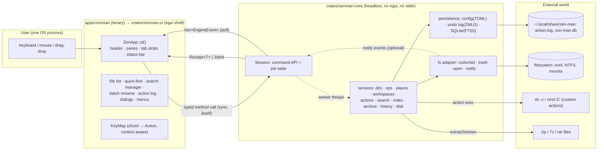

# ARCHITECTURE PLAN — `zen-man-rs`: egui port of zen-man (no web server, no REST)

Status: **Draft v3** — red-teamed (§9). Grill-me interview skipped by explicit user instruction; decisions the user alone can make are collected in §10 with a chosen default so the plan stays executable.
Target repo: `/media/jang/home/Deve/zen-man-rs` (currently empty).
Reference implementation (source of truth for behaviour): `/media/jang/home/Deve/zen-man` (Go backend `main.go` + `api/*.go`, ~7.7 k LOC; vanilla-JS frontend `frontend/`, ~9.4 k LOC).
Framework reference: ArtCraft — `photocraft` workspace + `craft-libs` (`craft-ui`, `craft-atomic`, `craft-settings`, `craft-i18n`).

---

## 1. Summary

We are replacing zen-man's browser/HTTP architecture with a single native Rust application that keeps every user-visible behaviour of the Go program (dual/quad-pane browsing, cursor pagination, clipboard with copy-inside, merge-only conflicts, binary undo log, live + FTS-indexed search, archive VFS, workspaces, custom actions) while deleting the whole web boundary: no `net/http`, no `embed.FS`, no `fetch`, no `127.0.0.1` listener. The Go `api/*.go` handlers become typed method calls on a headless `zenman-core::Session`; the JS frontend becomes an `egui` shell built on the ArtCraft `craft-ui` primitives (docking surface, tab fitting, SVG icon registry, icon buttons, palettes, panes/rail). The in-process replacement for HTTP is a **command + event bus with a job table**, which is required (not cosmetic): zen-man had *no* progress reporting for copy/move/delete and *no* filesystem watcher, so any blocking work ran on the request's goroutine and the browser simply waited. In a single-process GUI that design freezes the window; therefore every mutating or walking operation becomes a cancellable, progress-reporting job whose completion event drives cache invalidation. Two persistence decisions dominate risk: the undo log keeps the existing **byte-exact big-endian `ZMLG` codec** and SQLite schema so an existing `~/.local/share/zen-man/` directory survives the port, and the hand-edited `config.json` is migrated once into a `craft-settings`-managed TOML file with a `.bak`. Out of scope for v1: `wasm32` target (a browser cannot enumerate mounts, `chmod`, or spawn `sh -c`), and headless CLI/MCP server (kept as an optional later milestone because the core is already headless).

---

## 2. Verified ground truth (read this before implementing anything)

Everything below was read from the actual repositories, not assumed. Do not re-derive it.

### 2.1 Toolchain / framework facts `[VERIFIED]`

> **Reference checkouts.** `/tmp/artcraft-src` = `storytold/photocraft` @ `v0.23.1` (commit `45066c4`) and `/tmp/craft-libs` = `storytold/craft-libs` @ `6e03f65bf45181db77ba6229716e6624db9eb25b` are throwaway clones made during this planning session; `/tmp` does not survive a reboot. Re-create them before disputing any `file:line` citation below:
> `git clone https://github.com/storytold/photocraft /tmp/artcraft-src && git -C /tmp/artcraft-src checkout v0.23.1`
> `git clone https://github.com/storytold/craft-libs /tmp/craft-libs && git -C /tmp/craft-libs checkout 6e03f65bf45181db77ba6229716e6624db9eb25b`
> Note also that the ArtCraft checkout the session config points at (`/media/jang/home/PortableApp/zcode_agent/ArtCraft`) **does not exist**; only prebuilt AppImages are on disk under `/media/jang/seeder/ArtCraft/`.

| Fact | Evidence |
|---|---|
| `zen-man` is a **flat** Go module: `main.go` (147 L) + `api/*.go` (29 files, 7 756 L). There is **no** `backend/`, `internal/`, `models/`, `middleware/`, `applog/`, `watcher/`, `config/` package. | `find . -name '*.go'`, `/media/jang/home/Deve/zen-man` |
| `zcodegraph`'s index for zen-man is **stale** — it emits `backend/internal/...` paths that do not exist on disk. Use `grep`/`read`; re-index before trusting `zcodegraph`. | diff of `zcodegraph -a files` output vs `find` |
| Local toolchain: `cargo 1.100.0`, `rustc 1.100.0`, targets `x86_64-unknown-linux-gnu`, `x86_64-unknown-linux-musl`. `trunk` **not installed**. | `cargo --version`, `rustup target list --installed` |
| ArtCraft uses **egui/eframe 0.37** (not 0.36) with `[patch.crates-io]` pinning the whole egui family to `storytold/egui.git` rev `6d518fc799681571963842f95b55a6b68431b15a` and `storytold/winit.git` rev `a517b3846ee8457d84ee4975110bfda6797c44dc`. | `/tmp/artcraft-src/Cargo.toml:66-70,197-217`, `/tmp/craft-libs/Cargo.toml:85-113` |
| `craft-ui` dep pin: `{ git = "https://github.com/storytold/craft-libs", rev = "6e03f65bf45181db77ba6229716e6624db9eb25b", features = ["serde"] }`. | `/tmp/artcraft-src/Cargo.toml:13` |
| Workspace lints: `unsafe_code = "forbid"`, clippy `cognitive_complexity`/`too_many_arguments`/`wildcard_imports = "deny"`, `dbg_macro`/`todo = "warn"`; per-crate `#![deny(clippy::unwrap_used, clippy::expect_used, clippy::panic, clippy::unimplemented, clippy::todo, clippy::unreachable)]`. `edition = "2024"`, `rust-version = "1.95"`, `resolver = "3"`. `clippy.toml` bans `egui::ComboBox` in favour of `craft_ui::ComboBox`; `cognitive-complexity-threshold = 30`. | `/tmp/craft-libs/Cargo.toml:7,81-83`, `crates/ui/src/lib.rs:1`, `/tmp/artcraft-src/clippy.toml` |
| Craft house rules that bind this port: never panic / no `unsafe` outside a named exception crate; **clean room** (behaviour may be studied, code/assets must not be copied); every asset recorded in `ATTRIBUTION.md` in the same change; all dates through `chrono`; dependency licences checked against the allowlist (`ISC, MIT, BSD-2/3-Clause, Apache-2.0, OFL-1.1, Ubuntu-font-1.0, Bitstream-Vera, CC0-1.0, CC-BY-4.0, CC-BY-SA-4.0, LicenseRef-Public-Domain`). | `/tmp/craft-libs/AGENTS.md` |
| egui fork renames `eframe::App::update` → `fn ui(&mut self, ui: &mut egui::Ui, frame: &mut eframe::Frame)`. | `/tmp/artcraft-src/crates/ui-egui/src/app.rs:248,305` |
| **Native boot contract (measured in step 1).** The entry point is `eframe::run_native(app_name, NativeOptions, AppCreator) -> Result`; `craft_ui` re-exports the `eframe` module but **not** `run_native`, and `NativeAppOptions` / `AsyncExecutor` / `ShadowResolver` **do not exist** in the pinned fork. GPU tuning therefore writes `NativeOptions::wgpu_options.wgpu_setup` = `WgpuSetup::CreateNew(WgpuSetupCreateNew{ instance_descriptor, power_preference, .. })`. `wgpu` is 30.x, where `Instance::enumerate_adapters(mask)` returns a **future** and `PowerPreference` is `None | LowPower | HighPerformance`. | `crates/eframe/src/lib.rs:306`, `crates/ui/src/lib.rs:138`, `egui-wgpu/src/setup.rs:43,58,172`, `wgpu-30.0.2/src/api/instance.rs:145`, photocraft `apps/photocraft/src/main.rs:470,497` |

### 2.2 `craft_ui` API surface we will build on `[VERIFIED]`

```rust
// craft-libs/crates/ui/src/docking/surface.rs
pub struct DockArea<'a, P = ()>;                                   // :1099
    pub fn new(id: Id) -> Self;                                    // :1118
    pub fn monitors(self, Vec<Monitor>) -> Self;                   // :1144
    pub fn input_blocked(self, bool) -> Self;                      // :1157   ← while a modal is open
    pub fn auto_collapse_iconic(self, bool) -> Self;               // :1201
    pub fn maximized(self, Option<P>) -> Self;                     // :1208
    pub fn hide_panels(self, HidePanels<'a,P>) -> Self;            // :1215
    pub fn float_bounds(self, Rect) -> Self;                       // :1247
    pub fn locked(self, bool) -> Self;                             // :1255
    pub fn blocked_rects(self, &[Rect]) -> Self;                   // :1261
    pub fn show_content(self, ui:&mut Ui, layout:&Layout<P>, style:&DockStyle,
                        content:&mut dyn DockContent<P>) -> DockOutput<P>;  // :1318
pub trait DockContent<P> {                                         // :837
    fn body(&mut self, ui:&mut Ui, panel:&P);
    fn logical_label(&self, panel:&P) -> String where P: Debug;    // default: format!("{panel:?}")
    fn permissions(&self, panel:&P) -> Permissions;                // default: all-permissive
    fn limits(&self, panel:&P) -> PanelLimits;                     // default
    fn dock_heights(&self, panel:&P) -> Option<DockHeights>;
    fn group_collapsed(&self, panels:&[P]) -> bool;                // host-owned collapse
    fn paint_icon(&mut self, painter:&egui::Painter, rect:Rect, panel:&P, color:Color32) -> bool;
    fn resolve_drag(&mut self, ctx:&Context, style:&DockStyle, req:&DropRequest<'_,P>) -> Option<DropFeedback>;
}
pub struct DockOutput<P> { pub actions: Vec<Action<P>>, pub error: Option<DockError>,
    pub focused: Option<P>, pub group_drag: Option<P>, pub group_drop: Option<(P,Pos2)>,
    pub events: Vec<DockEvent<P>>, pub forwarded_events: Vec<egui::Event>,
    pub forwarded_modifiers: Option<egui::Modifiers>, pub window_files: Vec<WindowFiles<P>> } // :315
pub struct DockStyle { pub tab_height: f32, pub gap: f32, pub min_pane: f32, pub background: Color32,
    pub tab_background: Color32, pub active_background: Color32, pub text: Color32,
    pub inactive_text: Color32, pub border: Stroke, pub accent: Color32, pub font: FontId,
    pub float_label/close_label/move_panel_to_label/panels_label/resize_label/... : String,
    pub drag_bar_width: f32, pub min_tab_width: f32, pub floating_background: Color32, .. }  // :13
    pub fn from_ui(ui:&Ui) -> Self;                                // :171
pub fn typing_window(ctx:&Context) -> Option<ViewportId>;          // :810
pub fn send_keys(ctx:&Context, viewport:ViewportId, events:Vec<egui::Event>);  // :826
pub fn route_app_drag(ctx:&Context, area_id:Id);                   // :791  (call each frame during a host drag)

// docking/model.rs
pub const MAX_DEPTH: usize = 64;  pub const MAX_PANELS: usize = 4096;      // :10-11
pub struct Permissions { movable, floatable, closable, accepts_tabs, accepts_splits: bool }  // :504
    pub const PROTECTED: Self;    pub fn is_protected(self)->bool;   pub fn locked(self)->Self;
pub struct Layout<P> { .. }         pub fn apply_all(self, ..) -> Result<Vec<P>, DockError>;  // :1033
pub enum Node<P> { Split{..}, Tabs{..}, Stack{..}, Dock{..} }
// docking/workspace.rs
pub struct Workspace<P> { pub version: u32, pub layout: Layout<P>, pub hidden: Vec<(P,Location<P>)>,
                          pub saved: Option<Layout<P>>, pub locked: bool }                  // :14
    pub const VERSION: u32 = 2;  pub fn validate(..)  pub fn reconcile(..)  pub fn set_visible(..)  // :56,:66,:215,:126

// tabs/mod.rs — the per-pane tab strip primitive
pub struct TabFit { pub shown: Vec<(usize,f32)>, pub overflow: Vec<usize>, pub overflow_width: f32 } // :11
pub fn fit(natural:&[f32], selected:usize, available:f32, minimum_width:f32, overflow_width:f32) -> TabFit; // :38
pub fn fit_whole(..) -> TabFit;                                                            // :85
pub struct Tab<'a> { id:Id, label:&'a str, selected:bool, sense:Sense, focus_stroke:Option<Stroke> }
    pub fn new(id:Id, label:&'a str, selected:bool) -> Self;  pub fn sense(..)  pub fn focus_stroke(..)
    pub fn show_at(self, ui:&mut Ui, rect:Rect, paint:impl FnOnce(&Ui,&Response)) -> Response;  // :190

// icons/mod.rs + buttons/mod.rs — SVG icon registry
pub struct SvgStyle { pub current_color:&'static str, pub stroke_width:Option<&'static str> }   // :18
pub struct SvgIconSet;  pub fn new(icons:&'static [(&'static str,&'static [u8])], style:SvgStyle,
        uri_prefix:&'static str, fallback:&'static str) -> Self;    // :44  → bytes://<prefix><name>.svg
    pub fn source(&self, name:&str) -> ImageSource<'static>;        // :71  (no include_image needed)
pub struct IconButton<'a>; pub struct IconButtonStyle { normal, hovered, pressed, selected, corner_radius, focus_stroke };
    pub fn new(label:&'a str, size:Vec2, style:&'a IconButtonStyle) -> Self;
    pub fn show(self, ui:&mut Ui, paint_icon:impl FnOnce(&Ui,Rect,Color32)) -> Response;   // :80

// theme/mod.rs, layout/*, panes/*
pub struct WidgetPalette { noninteractive, inactive, hovered, active, open: Color32 }          // :14
    pub fn apply_to(self, widgets:&mut Widgets, radius:CornerRadius, foreground:Stroke);       // :28
pub fn split_rect(rect:Rect, axis:SplitAxis, size:SplitSize, gap:f32, minimum:f32) -> Option<SplitLayout>; // geometry.rs:81
pub struct ResizeHandle;  pub enum ResizeResponse;  pub struct Section;  pub fn fit_toolbar(..) -> ToolbarFit;
pub trait PaneContent<P> { fn title/final body/default_state/size_range/movable/closable/title_bar/menu }  // panes/mod.rs:139
pub struct PaneHost; pub enum PaneRequest<P> { Close, Place, Resize, FloatRect, Focus, Before } // :105
pub struct Rail;  pub fn focus_next(ctx:&Context, id:impl Into<Id>, reverse:bool);              // :297
pub struct ComboBox<'a>; pub struct Menu<'a>;   // clippy.toml: use these instead of egui::ComboBox
```

**Docking facts that constrain the pane grid** `[VERIFIED — read of docking sources; these changed the shell design]`

* `docking::Side` is `Start | End` **only** (`crates/ui/src/docking/dock_model.rs:23-27`) and `Layout::validate` requires dock nodes to sit at a window edge, at most one per side (`docking/model.rs:629-637`). **There is no `Side::Top`** ⇒ zen-man's 48 px header bar cannot be a dock panel; it lives in an `egui::TopBottomPanel` drawn *outside* the `DockArea`.
* A group containing exactly one panel whose `Permissions::is_protected()` holds is rendered **stripless**: no tab strip, no drag bar, the whole rect goes to `DockContent::body`, and no `tab_height` is added to its limits (`docking/render/group.rs:61-72`; predicate `docking/render/mod.rs:469-474`; limits `docking/render/mod.rs:493-496`). `is_protected() = !movable && !closable && !accepts_tabs` and **ignores** `floatable`/`accepts_splits` (`docking/model.rs:529-535`). This is exactly the file-pane shape: the dock owns geometry, the pane owns its coloured tab strip.
* Close/move/split-by-drag are permission-gated and require `movable` on the acted-upon panel (`docking/model.rs:963-964,974-975,996,1011-1016`); **divider resize is not permission-gated**, only geometry-checked (`model.rs:588,1140`). Consequence: with `movable:false` panes, `accepts_splits:true` never fires from a gesture. The 1/2/4-pane restructure is therefore an **application-side `Layout` edit** (`Layout::apply`, `model.rs:940`), never a dock drag. Drag-to-split-between-panes is explicitly **not** a v1 feature (§10 R8).
* `PanelLimits` has only `{ min, max }` (`docking/surface.rs:622-644`) — there is no `collapsed()` constructor. Per-group collapse is `DockContent::group_collapsed` (`surface.rs:863`) and it minimises *to* the strip, so a stripless group must not rely on it: zen-man's tab-group collapse stays app-side (`Tab` list filtering in `panels/tab_bar.rs`).

**Absent from `craft_ui` (we must write them):** modal helper, context-menu helper, tooltip helper, prompt dialog, table/virtual-list widget, toast widget. Photocraft's own equivalents (`/tmp/artcraft-src/crates/ui-egui/src`) are the pattern to mirror: `dialogs.rs:233 show_modal(...)`, `notices.rs:52 post(...) / :227 show(...)` (toast = `egui::Area` anchored `RIGHT_BOTTOM`), `widgets/text_field.rs:53 text_field(...)`, `widgets/press_menu.rs:100 show(...)`, `panels/panel_docking.rs:772 show(app,ui)`, `jobs_ui.rs:488 tick(app,ctx) / :522 keep_polling(app,ctx)`, `dock.rs:339 snapshot / :375 persist / :478 restore / :502 apply`.

**Job pattern to mirror** (`/tmp/artcraft-src/crates/engine/src/jobs.rs`): `JobId(pub u64)` `:87`, `JobCtx` `Arc` handle `:92`, `progress(f32,&str)` `:156`, `cancelled()` `:169`, `commit()` `:192`, `stage(lo,hi,msg,f)` `:356`, `JobOutcome { Done(Value), Failed(String), Cancelled }` `:413`, `JobEvent { id, command, label, document, outcome, error }` `:424`, `JobInfo` `:440`, `Started { Done(Value), Job(JobId) }` `:681`, `Session::start(&mut self,&str,Value) -> Result<Started>` `:1063`, `poll_jobs(&mut self) -> Vec<JobEvent>` `:1500`, `cancel_job` `:1573`. UI polls in `jobs_ui::tick` and keeps the loop alive with `ctx.request_repaint_after(16 ms)`.

**Storage pattern to mirror:** `craft-atomic::atomic_write(path,&[u8]) -> io::Result<()>` (`crates/atomic/src/lib.rs:267`), staging `.{stem}.{pid}-{n}.craft_tmp`, `sync_file < rename < sync_dir`. `craft-settings`: `trait Settings: Serialize+DeserializeOwned+Default+Clone+PartialEq { const APP_ID; const SCHEMA_VERSION; fn migrate(from, &mut DocumentMut) }` (`lib.rs:71`), `SettingsStore<T>::open(Location) -> (Self, LoadReport)` (`store.rs:106`), `update(f)` `:211`, `tick(now) -> TickResult` `:241`, `flush()` `:266`; policy = `config.toml` (user-editable, debounced ~0.5 s) + `ui.ron` beside it for window/UI state, caches in `paths::cache_dir`, a file from a newer build is shown but never overwritten.

### 2.3 zen-man behaviour contract `[VERIFIED]` — the parts a port breaks

* **Routes actually registered** (`main.go:99-119`): `/api/dir`, `/api/dir/size`, `/api/op`, `/api/places`, `/api/workspaces`, `/api/actions`, `/api/action/exec`, `/api/props`, `/api/log`, `/api/log/revert`, `/api/diskspace`, `/api/index/{search,rebuild,status,config,cancel}`, `/api/archive/{dir,stream,extract,extract/status}`. `/api/props`, `/api/archive/extract*` are **never called** by the shipped frontend (no Properties dialog or "Extract here" UI exists anywhere — green field for us).
* **Undo log wire format** (`api/log.go:67-87`), all **big-endian**, file `action.log` (not `action-log`) under `$XDG_DATA_HOME|~/.local/share/zen-man/` with `/tmp/zen-man` fallback, opened `O_RDWR|O_CREATE` **without** `O_APPEND`:
  `0:4 magic "ZMLG"` · `4:8 id i64` · `12:8 ts i64 Unix-ns` · `20:1 ActionType` · `21:1 StatusType` · `22:4 recLen u32 (excludes trailing CRC)` · `26:2 numSrc u16` · `n×[u16 len][utf8] sources` · `[u16 len] dest` · `[u16 len] name` · `+4 crc32 IEEE over all preceding bytes`. `ActionType`: `1 Copy, 2 PasteCopy, 3 PasteMove, 4 Delete, 5 Rename, 6 Mkdir, 7 Chmod, 8 PasteLink`; `StatusType`: `0 done, 1 reverted`. Revert = two in-place `WriteAt`s (status byte at `off+21`, recomputed CRC at `off+len-4`). Recovery scan skips bad CRC and resyncs at `off+1`. Reversible set = `{PasteCopy, PasteMove, Rename, Mkdir, PasteLink}`. Every clipboard set logs a non-reversible `Copy` record; the UI filters on `reversible`.
* **SQLite schema** (`api/db.go:51`, `api/search_index.go:141-192`, `api/search_index_walker.go:90-250`): `folder_sizes(path TEXT PRIMARY KEY, size INTEGER, file_count INTEGER, updated_at INTEGER)`; `schema_meta(key,value)` with `search_schema_version='1'`; `files(id INTEGER PRIMARY KEY, path, name, name_orig, ext, parent, size, mtime, is_dir, is_symlink)` + unique `path` index and `name/ext/parent/mtime` indexes; `files_fts USING fts5(name, tokenize='trigram')`; rebuild uses `files_shadow`/`files_fts_shadow` then a `DROP`+`ALTER TABLE RENAME` swap in one transaction. `name` is **lowercased**, `ext` lowercased **without** dot, `mtime` **seconds**. `SetMaxOpenConns(1)`. `PRAGMA wal_checkpoint(PASSIVE)` is issued but WAL is never enabled → the PRAGMA is a no-op today.
* **Config** `~/.config/zen-man/config.json` (`api/places.go:14-63`, ignores `XDG_CONFIG_HOME`): `{bookmarks:[string], workspaces:{name:WorkspaceSession}, custom_actions:[CustomAction]}` with `WorkspaceSession{left_tabs,left_active,right_tabs,right_active,split}` and `TabState{id,path,name,group,color}`; `CustomAction{id,name,icon,command,role,patterns,show_output}`. Search config `~/.config/zen-man/search-config.json` (`api/search_index.go:16-32`): `{schema_version, roots, excludes, auto_index, index_on_startup, max_depth, follow_symlinks, worker_count, index_state{last_indexed_unix,total_files,is_dirty}}`, default excludes `/proc,/sys,/dev,**/.git,**/node_modules,**/__pycache__`.
* **Behaviour that must survive the port:** dirs always sort first *regardless* of order; name sort is byte-compare on **lowercased** names (so `a10 < a9`); cursor is a decimal index into the fully sorted in-memory list (whole directory is read + sorted on every page); flat walk caps at 10 000 entries; symlinks report `is_dir:false` (lstat) while `open` follows them; hidden files are **never** filtered by the backend; `chmod` is bare-octal-only (`0o755`), non-recursive; paste conflict is *dir-into-dir only* and returns HTTP 200 `{"status":"conflict","conflicts":[names]}`; `copyFile` **silently skips** existing destinations; `moveItem` errors on collision; batch rename is smuggled as a **JSON string inside the `name` field** (`[`/`]` sniffed by `log_revert.go:110`); `track_entries` only when ≤100 items → `reload_required`; VFS write guard is a **string check** for `.zip/ .rar/ .7z/`; `validateDest` rejects any `..` **substring** (false positives); index rebuild is full-only, per-root timeout 30 s, excludes are glob→regex anchored `(^|/)…($|/)`, symlinks recorded but never descended; extract jobs capped at 3 concurrent, done jobs GC'd after 1 h; archive cache = 10 entries LRU, 15 min TTL, staleness by host mtime → `409 archive_modified`.
* **Known frontend bugs that must NOT be ported:** `(undefined files)` (`file-list.js:159-165` reads an `omitempty`-dropped `files_count`); no sort click handler although `data-sort` exists in markup; no arrow/PageUp/Home/End navigation; no Esc-to-clear; `F2` rename uses `window.prompt`; `isBatchRenameActive` freezes rendering; `zen-refresh-filelist` has no subscriber (revert never refreshes); `Alt+Z` MRU overlay is Shift-only logic; `formatSize` duplicated twice; three independent virtual scrollers.
* **Visual spec** (`frontend/css/base.css:2-18`, verbatim): `--bg-main #0f1117`, `--bg-sidebar #090a0f`, `--bg-card #161821`, `--bg-hover #222533`, `--border-color #212534`, `--accent-color #5865f2`, `--accent-hover #475244`-family (`#4752c4`), `--text-main #e3e5e8`, `--text-muted #959ba4`, `--text-active #fff`, `--danger #f23f43`, `--warning #f0b232`, `--success #23a55a`; row height **40 px**, tab bar **38 px**, pane toolbar **50 px**, global header **48 px**, status bar **30 px**, sidebar **250 px** (left) / **300 px** (right, off-canvas), tab strip max width **150 px**, group colours `#ff4a4a #3b82f6 #10b981 #fbbf24 #8b5cf6`, file-row selected `rgba(88,101,242,0.15)` + border `rgba(88,101,242,0.3)`, active pane border `rgba(88,101,242,0.4)`, grid tile `minmax(110px,1fr)` gap 15, quick-find 80vw/max 1200px, search-manager 85vw×85vh/max 1100px, action-log 360px slide-in, menu shadow `0 10px 25px rgba(0,0,0,.5)`. Live screenshot baseline captured at `/tmp/zen_man_ui_main.png` (`zbrowser -a navigate --url http://localhost:7890/`, `zbrowser -a screenshot --path …`).

---

## 3. System boundaries



**Hard boundary rules**

1. `crates/zenman-core` **must not** depend on `egui`, `eframe`, `wgpu`, or `craft-ui` (enforced by a `cargo xtask deps` check, §8). This is what makes the eventual CLI/MCP target a link-only job.
2. `crates/zenman-ui` contains **zero** filesystem calls: every side effect is a method on `Session`. Grep gate: no `std::fs::` in `crates/zenman-ui/src/**`.
3. `apps/zenman` is the only place that knows about `eframe::NativeOptions`, GPU backend selection, single-instance, and OS dirs.
4. Worker threads never call into `egui`; they publish events. Repaint is requested by the UI from `Session::poll` results (`jobs_ui::keep_polling` equivalent).
5. **The header bar and the two overlay drawers are NOT dock panels.** `craft_ui::docking::Side` is `Start|End` only (§2.2), so the 48 px global header is an `egui::TopBottomPanel` drawn before the `DockArea`, and the drawers are overlays above the area (`DockArea::blocked_rects` keeps drops out of them). Only the pane grid lives in the `Layout`.

---

## 4. Data flow and state management

### 4.1 Command / event bus (the in-process replacement for HTTP)

```mermaid
sequenceDiagram
  participant UI as file_pane (egui)
  participant S as Session
  participant J as Job worker
  participant P as Persistence (log/db/config)

  UI->>S: paste(PasteReq{sources,dest,merge})
  S->>S: validate VfsWriteGuard + DestGuard (sync, &self)
  S-->>UI: Receipt::Running{ job: JobId(41), origin: Origin(7) }
  UI->>UI: Tab.pending += Origin(7); JobsUi.by_origin[7] = JobSlot{label:"Paste 3 items"}
  S->>J: spawn (bounded semaphore, ≤8 live jobs)
  J->>J: copy file 1..n, ctx.progress(bytes,total,"name")
  J->>P: ActionLog.append(PasteCopy, sources, dest) once, after the walk
  J-->>S: JobEvent{Done(Ok(PasteReport{entries,reloaded,skipped}))}
  UI->>S: poll()  (once per frame, from logic())
  S-->>UI: JobFinished{job:41, origin:7, ..} + DirChanged{dest, LocalJob, origin:Some(7)}
  UI->>UI: by_origin.remove(7) → clear that tab's pending flag;
           tabs_showing(dest) → refresh each; tabs that did not ask reload quietly
           (scroll + selection preserved); toast the skipped/failed lists
```

```rust
// crates/zenman-core/src/session.rs  — the only façade the UI is allowed to call
pub struct Session { inner: Arc<Inner> }                      // cheap-clone handle, Send+Sync
pub struct SessionConfig { pub env: Env, pub limits: Limits, pub watcher: WatchPolicy }

/// `Origin` is the correlation token that ties an event back to the widget that asked for it.
/// Four tabs can point at one directory and a pane can have several jobs in flight, so
/// `(JobId, path)` is not enough to know which spinner to clear.
#[derive(Clone, Copy, PartialEq, Eq, Hash, Debug, serde::Serialize, serde::Deserialize)]
pub struct Origin(pub u64);
pub struct OriginAlloc(AtomicU64);  impl OriginAlloc { pub fn next(&self) -> Origin }

/// The caller keeps the `Origin` it passed in, stores it in `Tab.pending`, and the job slot in
/// `JobsUi.by_origin`. Nothing in the UI may look a result up by path alone.
pub enum Receipt<T> { Done(T), Running { job: JobId, origin: Origin } }   // mirrors photocraft Started (:681)

impl Session {
    // ── reads: synchronous; they never block longer than one directory ─────────
    pub fn list_dir(&self, req: &ListDir) -> Result<DirPage, CoreError>;
    pub fn dir_size(&self, req: &DirSize, origin: Origin) -> Receipt<DirSizeStat>;  // long → job
    pub fn disk_space(&self, path: &AbsPath) -> Result<DiskSpace, CoreError>;
    pub fn props(&self) -> Props;                                            // capability probe
    pub fn places(&self) -> Result<Places, CoreError>;                       // bookmarks + mounts
    pub fn workspaces(&self) -> Result<Vec<WorkspaceMeta>, CoreError>;
    pub fn custom_actions(&self) -> Result<Vec<CustomAction>, CoreError>;
    pub fn log_query(&self, q: &LogQuery) -> Result<LogPage, CoreError>;
    // ── mutations: synchronous when provably short, job otherwise ─────────────
    pub fn mkdir(&self, req: &Mkdir) -> Result<DirEntry, CoreError>;
    pub fn rename(&self, req: &Rename) -> Result<RenameReport, CoreError>;   // batch → one call
    pub fn chmod(&self, req: &Chmod) -> Result<(), CoreError>;
    pub fn delete(&self, req: &Delete, origin: Origin) -> Receipt<DeleteReport>;
    pub fn paste(&self, req: &Paste, origin: Origin) -> Receipt<PasteReport>;
    pub fn clipboard_store(&self, req: &ClipboardStore) -> Result<Clipboard, CoreError>;
    pub fn clipboard_clear(&self) -> Result<(), CoreError>;
    pub fn open(&self, paths: &[AbsPath]) -> Result<(), CoreError>;
    pub fn exec_action(&self, req: &ActionExec) -> Receipt<CmdOutput>;
    pub fn revert(&self, id: LogId) -> Receipt<RevertReport>;
    // ── long-running, always async ───────────────────────────────────────────
    pub fn search_live(&self, req: &LiveSearch, origin: Origin) -> JobId;      // cancellable
    pub fn page_dir(&self, req: &ListDir, origin: Origin) -> Receipt<Arc<DirPage>>; // cached ⇒ usually Done
    pub fn index_rebuild(&self) -> JobId;
    pub fn index_cancel(&self, id: JobId) -> bool;
    pub fn index_status(&self) -> IndexStatus;
    pub fn index_search(&self, q: &IndexQuery) -> Result<SearchPage, CoreError>;
    pub fn extract(&self, req: &Extract) -> JobId;
    // ── job plumbing ─────────────────────────────────────────────────────────
    pub fn cancel(&self, id: JobId) -> bool;
    pub fn jobs(&self) -> Vec<JobInfo>;
    pub fn poll(&mut self) -> Vec<EngineEvent>;                              // non-blocking drain
    pub fn wants_repaint(&self) -> Option<Duration>;                         // Some(16ms) while jobs run
}
```

```rust
// crates/zenman-core/src/events.rs
#[derive(Debug, Clone)]
pub enum EngineEvent {
    JobStarted  { id: JobId, kind: JobKind, label: String, origin: Origin },
    JobProgress { id: JobId, origin: Origin, done: u64, total: Option<u64>, message: String }, // coalesced: ≥50 ms apart
    JobFinished { id: JobId, kind: JobKind, origin: Origin, outcome: JobOutcome },
    /// A directory page produced by a job (cold cache / flat walk / archive manifest build).
    DirPageReady { origin: Origin, path: FsPath, page: Arc<DirPage> },
    /// Asynchronous answer to `dir_size`; keyed by path, broadcast to every row showing it.
    DirSizeReady { path: AbsPath, stat: DirSizeStat },
    /// Invalidation. `FsPath` (not `AbsPath`) so archive members can be named — a paste into or
    /// a refresh of an archive is otherwise unrepresentable.
    DirChanged { path: FsPath, cause: ChangeCause, origin: Option<Origin> },
    ClipboardChanged { clip: Option<Clipboard> },
    IndexChanged { total: u64, dirty: bool },
    LogAppended { id: LogId },
    Notice { level: NoticeLevel, message: String },   // toasts the core wants shown (e.g. skipped files)
}
/// Why a listing went stale. `LocalJob` events are already accounted for by the originating tab's
/// own `Tab.pending`, so a tab that did not ask can refresh quietly (keeping scroll + selection)
/// instead of being reset by a sibling tab's write.
pub enum ChangeCause { LocalJob, Watcher, Index, External }
#[derive(Debug, Clone)] pub enum JobOutcome { Done(JobPayload), Failed(CoreError), Cancelled }
/// Typed per `JobKind`; a `JobKind`/payload mismatch is a programming error caught by a debug assert,
/// never a `serde` failure at runtime.
pub enum JobPayload { DirPage(Arc<DirPage>), DirSize(DirSizeStat), Paste(PasteReport),
                      Delete(DeleteReport), Revert(RevertReport), Search(SearchPage),
                      Rebuild(RebuildSummary), Extract(()), Exec(CmdOutput), None }
```

Every mutating call takes `origin: Origin`; the returned `Receipt::Running { job, origin }` is stored by the caller (§4.3), which is the only reason a finished job can find its way back to a widget.

`JobProgress` is coalesced in the `JobTable` (last value per job wins, emitted at most every 50 ms) — the UI must never see thousands of per-file events for a 200 k-file paste.

### 4.2 Path model (the design decision that removes a class of Go bugs)

```rust
// crates/zenman-core/src/path.rs
pub struct AbsPath(PathBuf);                      // resolved, cleaned, never relative, never ".."-escaping
    pub fn resolve(raw:&str, cwd:&Path, home:Option<&Path>) -> Result<Self, CoreError>;   // = Go ResolvePath
    pub fn parent(&self) -> Option<AbsPath>;  pub fn join(&self, name:&str) -> Result<AbsPath,CoreError>;
    pub fn components_clean(&self) -> impl Iterator<Item<&OsStr>>;      // no "." , no ".."
    pub fn is_ancestor_of(&self, other:&AbsPath) -> bool;              // replaces isSubdir
pub enum FsPath { Local(AbsPath), Archive { host: AbsPath, nested: Option<InnerPath>, inner: InnerPath } }
pub struct InnerPath(String);                     // normalised archive-internal path: no leading/trailing '/'
```

The archive VFS path is a **type**, not a string convention. Consequences, all enforced by the compiler instead of a runtime string check:

* Write-capable APIs take `&AbsPath`. `FsPath::Archive` **cannot** be passed to `delete`/`paste`/`rename` → Go's `vfs_readonly` string sniff (`ops.go:60-80`) becomes unrepresentable. The one remaining `match` on `FsPath::Archive` in the dispatcher returns `CoreError::ReadOnlyVfs` and is covered by a test.
* `AbsPath::join(name)` rejects `..`, absolute `name`, and (Windows) alternate data streams / `\\?\` prefixes → fixes `validateDest`'s `..`-substring false positive and the zip-slip hole in one function.
* `AbsPath` is the **only** key type for `folder_sizes`, the undo log's path index, and dir listings, so cache keys are canonical by construction (Go stored `filepath.Clean`ed strings).

### 4.3 UI state ownership

```rust
// crates/zenman-ui/src/state.rs
pub struct AppModel {
    pub panes: BTreeMap<PaneSlot, Pane>,       // PaneSlot: Left|Right|LeftBottom|RightBottom (state.rs)
    pub layout: LayoutMode,                     // Single | Split | Quad   (persisted)
    pub active_pane: PaneSlot,
    pub clip: Option<Clipboard>,                // mirrored from core; never owned by the UI
    pub modal: ModalStack,                      // QuickFind | SearchManager | BatchRename | Prompt | Confirm | Properties | Indexer
    pub log_panel: bool, pub left_drawer: DrawerState, pub right_drawer: DrawerState,
    pub notices: VecDeque<Notice>,
}
pub struct Pane { pub tabs: Vec<Tab>, pub active: usize, pub mru: VecDeque<TabId>,   // cap 5, Alt+Z
                  pub collapsed_groups: Vec<GroupColor>,
                  pub loading: BTreeSet<Origin> }   // NOT a bool: two refreshes in one pane must
                                                    // not clear each other's spinner, nor hang one
pub struct Tab { pub id: TabId, pub path: FsPath, pub title: String,
                 pub history: Vec<FsPath>, pub hist_ix: usize,                      // no depth cap (parity)
                 pub sel: BTreeSet<String>, pub anchor: Option<usize>,
                 pub sel_by_path: BTreeMap<String, BTreeSet<String>>,               // per-directory selection memory
                 pub view: ViewMode,                                               // List | Grid
                 pub flat: FlatViewMode,                                           // Off | Mixed | MixedNoFolders | Grouped
                 pub collapsed_file_groups: BTreeSet<String>,
                 pub entries: Arc<DirPage>, pub total: usize, pub next: Option<Cursor>, pub has_more: bool,
                 pub group: Option<GroupColor>, pub loading_more: bool, pub error: Option<CoreError>,
                 pub pending: BTreeSet<Origin> }        // ← the JobId↔Tab correlation record

pub struct AppModel { /* …plus the fields of the block above… */
    pub tab_index: HashMap<TabId, (PaneSlot, usize)>,   // synced by every tab mutation
    pub origins: Arc<OriginAlloc>,
}
impl AppModel {
    /// Every tab currently displaying `path` — the invalidation and post-revert fan-out helper.
    pub fn tabs_showing(&self, path: &FsPath) -> Vec<(PaneSlot, usize)>;
    pub fn tab_at(&self, k: (PaneSlot, usize)) -> Option<&Tab>;
    pub fn tab_at_mut(&mut self, k: (PaneSlot, usize)) -> Option<&mut Tab>;
}
```

**State rules**

* `Tab.entries` is an `Arc<DirPage>`; workers produce a new `DirPage` and publish `DirChanged`, the UI `Arc::make_mut`s on edit only. Rendering borrows `&Arc` — no clone per frame.
* Cache: `Session` keeps `Mutex<HashMap<AbsPath, DirCacheEntry>>` with `DirCacheEntry { page: Arc<DirPage>, fetched_at: Instant, invalidate_at: Instant }` (TTL 2 s, plus explicit invalidation on every `DirChanged` touching the path or an ancestor). This is the *only* place dir contents live; Go re-read the whole directory per page request — in-process we must not.
* Selection is stored per **tab**, keyed by name (not index) so it survives a reload; anchor is an index into the current visual order, recomputed on each click (Go semantics preserved exactly).
* **Correlation rule:** a job result is applied only through `origin`. `JobsUi::by_origin: HashMap<Origin, JobSlot>` holds `{ job, kind, target: FsPath, pane: PaneSlot, tab: TabId }`; `Tab.pending` holds the same `Origin`. This is what lets four tabs on one directory, or two refreshes in one pane, each resolve their own spinner and their own error.
* Undo log, SQLite, and config are **never** read from a worker thread directly — they live behind `Arc<LogStore>`, `Arc<IndexStore>`, `Arc<ConfigStore>` in `Session::inner`, each with its own mutex (Go used package-level singletons; we make the dependency explicit so tests can inject temp dirs).

---

## 5. Implementation Blueprint

Crate layout (domain-named, no `misc`/`utils`/`common`):

```
zen-man-rs/
  Cargo.toml                    # workspace + [patch.crates-io] copied from photocraft verbatim
  rust-toolchain.toml           # 1.95.0 pinned (MSRV; craft-libs uses rust-version=1.95)
  clippy.toml  deny.toml  .cargo/config.toml  ATTRIBUTION.md  README.md
  xtask/                        # cargo xtask ci | deps | licenses | parity
  crates/zenman-core/           # headless engine (no egui, no wgpu)
  crates/zenman-ui/             # egui shell library (no std::fs)
  apps/zenman/                  # binary: NativeOptions, GPU fallback, single instance, dirs
  docs/contracts.md             # the behaviour contract this port must satisfy (generated from §2.3)
  tests/
    golden/                     # fixtures: action.log written by Go, zen-man.db from Go, config.json
    scenarios/                  # per-facility contract tests
```

Legend for the table: **Depends** = other rows (by file) *and* build steps (§7 step numbers). `// TODO: implement` marks a contract body — legal; a body is not.

### 5.1 Workspace scaffolding

| File | Action | Concrete signature / schema | Depends on | Done when |
|---|---|---|---|---|
| `Cargo.toml` | create | `[workspace] resolver="3", members=["crates/*","apps/*","xtask"]`; `[workspace.package] edition="2024", rust-version="1.95"`; `[workspace.lints.rust] unsafe_code="forbid"`; `[workspace.lints.clippy] cognitive_complexity="deny", too_many_arguments="deny", wildcard_imports="deny"`; `[workspace.dependencies] craft-ui={git,rev="6e03f65bf45181db77ba6229716e6624db9eb25b",features=["serde"]}  // step-1 note: photocraft itself requests only `serde`; `native-windows` is left off because it is unused here and every extra feature is extra build graph`, `craft-atomic={git,rev=same}`, `craft-settings={git,rev=same}`, `egui={version="0.37",default-features=false}`, `eframe={version="0.37",default-features=false,features=["wgpu","accesskit","wayland","x11","clipboard","persistence"]}`; `[patch.crates-io]` **pasted verbatim, full 40-char revs, no ellipsis** — egui family `6d518fc799681571963842f95b55a6b68431b15a`, winit `a517b3846ee8457d84ee4975110bfda6797c44dc` (source of truth: `/tmp/artcraft-src/Cargo.toml:199-217`, i.e. photocraft v0.23.1; a header comment in our `Cargo.toml` records where the block came from so it is reviewable without the reference repo) | — | `cargo metadata --locked` resolves; `cargo tree -i egui` shows exactly one source (the fork); `cargo check -p craft-ui` succeeds — **already proven on this machine** by a scratch workspace that compiled `DockArea::show_content` + `Workspace::apply_all` + `App::logic/ui` + `SvgIconSet` + `IconButton` + `WidgetPalette::apply_to` + `tabs::fit` + `ComboBox::show_ui` + `split_rect` + `run_native` with the wgpu backend |
| `rust-toolchain.toml` | create | `[toolchain] channel = "1.95.0"` (host has 1.100; add `allow` override in `.cargo/config.toml` if unavailable — do not silently downgrade) | — | `rustc --version` prints the pinned version inside the repo |
| `clippy.toml` | create | `cognitive-complexity-threshold = 30`, `[[disallowed-types]]` for `egui::ComboBox` (use `craft_ui::ComboBox`), `[[disallowed-methods]] = ["std::fs::remove_dir_all", "std::process::Command::output"]` (see §6 deletion + custom-action rows) | `Cargo.toml` | `cargo xtask ci` clippy step fails if a disallowed call is added |
| `deny.toml` | create | **data file for `xtask licenses`** (not for `cargo-deny`, which is not installed): `[licenses] allow = ["MIT","Apache-2.0","BSD-2-Clause","BSD-3-Clause","ISC","CC0-1.0","OFL-1.1","Ubuntu-font-1.0","Bitstream-Vera","CC-BY-4.0","CC-BY-SA-4.0","Zlib","MPL-2.0","LicenseRef-Public-Domain"]`; `[[bans.deny]] name = "unrar"` / `"rar"` unless feature `rar` is enabled (their bundled UnRAR source is not on the Craft allowlist even though the wrapper crates declare MIT) | `Cargo.toml` | `cargo xtask licenses` exits non-zero when a disallowed licence is present |
| `.cargo/config.toml` | create | `[alias] xtask = "run -p xtask --"` | — | `cargo xtask ci` runs |
| `xtask/src/main.rs` | create | `fn main() -> Result<(), Box<dyn Error>>`; `enum Task { Ci, Deps, Licenses, Parity{update:bool}, Snapshots{update:bool}, Contracts }`; `fn ci()` = `fmt --check` → `clippy --workspace --all-targets -- -D warnings` → `cargo test --workspace` → `cargo doc --no-deps`; **`fn licenses() -> Result<(), String>`** reads `cargo metadata --format-version 1`, collects `(name, version, license)` per non-local package and rejects any SPDX id outside the allowlist parsed from `deny.toml` (`cargo-deny` is **not installed** on this machine — verified with `which cargo-deny` — so the gate is in-repo Rust, not an external tool) | scaffolding | `cargo xtask ci` green on an empty crate; `xtask deps` fails if `zenman-core` depends on `egui`/`eframe`/`craft-ui`; `xtask licenses` fails when a GPL dep is added |
| `crates/zenman-core/src/lib.rs` | create | `#![forbid(unsafe_code)] #![deny(clippy::unwrap_used, clippy::expect_used, clippy::panic, clippy::unimplemented, clippy::todo, clippy::unreachable)] #![deny(wildcard_imports)]`; `pub mod` list of everything below; `pub use session::{Session, SessionConfig, Receipt};` | scaffolding | compiles with `cargo check -p zenman-core` and `zenman-core` has no dev-dep on egui |
| `crates/zenman-ui/src/lib.rs` | create | same lint header; `pub mod app, state, theme, icons, keymap, widgets, panels, dialogs, menus, jobs_ui, persist;` | scaffolding | `grep -rn "std::fs::" crates/zenman-ui/src` → empty |

### 5.2 `zenman-core` — value types and platform

| File | Action | Concrete signature / schema | Depends on | Done when |
|---|---|---|---|---|
| `crates/zenman-core/src/error.rs` | create | `#[derive(Debug, thiserror::Error, serde::Serialize)] pub enum CoreError { #[error("path not found: {path}")] NotFound{path:String, source_path:Option<String>}, PermissionDenied{path:String}, ReadOnlyVfs{path:String}, InvalidPath{raw:String, reason:PathReject}, Conflict{conflicts:Vec<String>, dest:String}, NotADir{path:String}, AlreadyExists{path:String}, ArchiveEncrypted{archive:String}, ArchiveModified{archive:String}, UnsupportedArchive{archive:String}, Cancelled, IndexNotReady, Io{path:String, #[source] io: Arc<std::io::Error>}, Sql{msg:String}, LogCorrupt{offset:u64, reason:String}, Shell{cmd:String, code:Option<i32>, stderr:String}, Watcher{msg:String}, CapacityExceeded{what:&'static str, limit:usize} }`; `pub enum PathReject { Empty, Relative, EscapesRoot, InteriorDot, Wildcard }`; `impl CoreError { pub fn status_code(&self)->u16 /* legacy parity */, pub fn to_json(&self)->serde_json::Value }` | — | one unit test per variant matching Go's `{"error":…}` strings; `Io` wraps `Arc<io::Error>` (no `unwrap`) |
| `crates/zenman-core/src/metrics.rs` | create | `#[derive(Clone, Copy, Debug, serde::Serialize)] pub struct FileSizes { pub bytes: u64, pub files: Option<u64> }` — `Option` not `0`: this is the type that makes `(undefined files)` impossible | — | `serde_json::to_string(&FileSizes{bytes:4096,files:None})` == `"{"bytes":4096}"` and the UI renders `--` when `files.is_none()` |
| `crates/zenman-core/src/path.rs` | create | §4.2 + `pub fn parse_vfs(raw:&str, home:Option<&Path>) -> Result<FsPath, CoreError>` (port of `frontend/js/utils.js:46 parseVfsPath`: first `.zip/.rar/.7z` splits host, next splits `nested`, remainder = inner) + `pub fn vfs_uri(&FsPath) -> String` (display form; keeps the Go `?archive=&nested=&path=` triple equivalent) + `pub fn contains_dot_component(s:&str) -> bool` | `error.rs` | 20 case table incl. `/a/b.zip/inner.7z/x`, `~/x`, `..` rejection, `foo..bar` **accepted** (Go rejected it) |
| `crates/zenman-core/src/entry.rs` | create | `#[derive(Clone, Debug, PartialEq, serde::Serialize, serde::Deserialize)] #[serde(rename_all="snake_case")] pub struct Entry { pub name:String, pub is_dir:bool, #[serde(skip_serializing_if="std::ops::Not::not",default)] pub is_symlink:bool, pub size:i64, pub mod_time:i64 /*Unix s*/, pub mode:String, #[serde(skip_serializing_if="String::is_empty",default)] pub rel_path:String, #[serde(skip_serializing_if="is_zero",default)] pub depth:i32, #[serde(skip_serializing_if="Option::is_none",default)] pub files_count:Option<i64> }`; `pub struct DirPage { pub path: FsPath, pub entries: Vec<Entry>, pub cursor: String, pub has_more: bool, pub total_count: usize, pub loaded_so_far: usize }` | `path.rs` | field-for-field byte-compat with `api/dir.go:17-37` (the four `omitempty` fields reproduce exactly) |
| `crates/zenman-core/src/cursor.rs` | create | `pub struct Cursor(pub u64)`; `pub fn decode(s:&str) -> Cursor` (invalid/absent → `Cursor(0)`, parity with Go); `pub fn encode(c:Cursor)->String` (decimal); `pub fn page<T>(all:&[T], c:Cursor, limit:usize) -> (&[T], Cursor, bool)` | — | test: `decode("MTIz")==Cursor(0)`; cursor is never anything but a decimal index (no base64 surprises) |
| `crates/zenman-core/src/limits.rs` | create | `#[derive(Clone, Debug)] pub struct Limits { pub dir_page_default: usize /*200*/, pub flat_walk_cap: usize /*10_000*/, pub track_entries_max: usize /*100*/, pub live_search_cap: i64 /*1_000_000*/, pub archive_cache_entries: usize /*10*/, pub archive_cache_ttl: Duration /*15min*/, pub concurrent_extracts: usize /*3*/, pub concurrent_jobs: usize /*8*/, pub nested_archive_max_bytes: u64 /*NEW: 1 GiB*/, pub exec_output_cap: usize /*1 MiB*/, pub live_search_nodes: usize /*100_000*/, pub extract_done_ttl: Duration /*1h*/, pub live_job_ttl: Duration /*30min*/ }`; `impl Default for Limits` | — | `Default` matches every number found in the Go source; a test greps `docs/contracts.md` values against `Limits::default()` |
| `crates/zenman-core/src/platform/mod.rs` | create | `#[derive(Clone, Copy, PartialEq, Eq, Debug)] pub enum Platform { Linux, Windows, Macos, Other }`; `#[derive(Clone)] pub struct Env { pub platform: Platform, pub home: Option<PathBuf>, pub cwd: PathBuf, pub config_dir: PathBuf, pub data_dir: PathBuf, pub cache_dir: PathBuf, pub username: String, pub locale_tag: String, pub symlink_supported: bool, pub can_trash: bool }`; `pub fn detect() -> Env`; `pub fn probe_symlink_support(tmp_parent:&Path) -> bool` | `path.rs` | `Env::config_dir` honours `XDG_CONFIG_HOME` **and** falls back to `$HOME/.config/zen-man` (Go ignored XDG; new behaviour is deliberate, tested both ways) |
| `crates/zenman-core/src/platform/posix.rs` | create | `pub fn statvfs(p:&AbsPath) -> Result<DiskSpace, CoreError>` (`rustix::fs::statvfs`: `total = blocks*frsize`, `free = bavail*frsize` → keep Go's semantics, **note the difference from `f_bfree`**); `pub fn mounts(env:&Env) -> Vec<Mount>` (scan `/media/$USER/*` + `/run/media/$USER/*`, skip dot-dirs, 2 levels); `pub fn open_with(p:&AbsPath) -> Result<(),CoreError>` (`xdg-open`, detached, reaped); `pub fn chmod(p:&AbsPath, m:ModeBits) -> Result<(),CoreError>`; `pub fn symlink(link:&AbsPath, target:&AbsPath) -> Result<(),CoreError>` | `platform/mod.rs` | a `#[cfg(unix)]` test against a temp dir; `mounts()` returns `vec![]` on a machine with no removable media (no error) |
| `crates/zenman-core/src/platform/windows.rs` | create | same signatures as `posix.rs`; `pub fn mounts()` enumerates drive letters (`GetLogicalDrives` via `winsafe`, MIT) instead of returning `vec![]` — a real gap in the Go Windows path | `platform/mod.rs` | compiles only for `cfg(windows)`; `cargo check --target x86_64-pc-windows-msvc` if the target is installed, else gated in `xtask deps` |
| `crates/zenman-core/src/mode.rs` | create | `pub struct ModeBits(pub u32)`; `pub fn parse_octal(s:&str) -> Result<ModeBits, CoreError>` (accepts exactly `^[0-7]{3,4}$` — the Go frontend's rule, now enforced in core); `impl fmt::Display for ModeBits { /* "-rwxr-xr-x" POSIX string, same glyph set as Go's fs.FileMode.String() */ }`; `pub fn from_entry(kind:FileKind, perm:u32, link:bool) -> ModeBits` | — | round-trip test over 0o000..0o7777 subset + symlink/dir prefix glyphs `l`,`d` |

### 5.3 `zenman-core` — operations and services

| File | Action | Concrete signature / schema | Depends on | Done when |
|---|---|---|---|---|
| `crates/zenman-core/src/ops/mod.rs` | create | `pub struct OpCtx<'a> { pub env:&'a Env, pub limits:&'a Limits, pub log:Arc<LogStore>, pub db:Arc<Db>, pub cancel:&'a JobCtx }`; `pub enum ConflictPolicy { SkipExisting /*Go copyFile behaviour*/, Overwrite, Rename }` (only `SkipExisting` is reachable from v1 UI, but the type is here so the silent skip is a *named* behaviour); `pub struct Progress { sent: AtomicU64 /*last emit ns*/, total: AtomicU64, done: AtomicU64 }`; `impl Progress { pub fn report(&self, ctx:&JobCtx, bytes_done:u64, name:&str) }` (throttled 50 ms) | `error.rs`,`limits.rs`,`history/store.rs` | `xtask deps` confirms no `egui` import; `clippy::cognitive_complexity` clean |
| `crates/zenman-core/src/ops/list.rs` | create | `pub fn read_dir(sess:&Inner, req:&ListDirReq) -> Result<DirPage, CoreError>`; `enum ListDirReq { Local { path: AbsPath, cursor: Cursor, limit: usize, sort: SortKey, order: SortOrder, flat: FlatMode }, Archive { at: ArchiveRef, cursor: Cursor, limit: usize } }`; `pub fn sort_entries(&mut [DirEntry], SortKey, SortOrder)` (**dirs-first invariant asserted: test asserts dirs precede files for both orders**); `pub fn walk_flat(root:&AbsPath, cap:usize, mode:FlatMode, cancel:&JobCtx, sink:&mut dyn FnMut(DirEntry)) -> WalkStats`; `fn stat_local(de:&DirEntry, follow:FollowSymlinks) -> DirEntry` (lstat for `is_symlink`, then `metadata` for size/mode — **fixes** Go's `is_dir:false` for symlinked dirs; guarded by `FollowSymlinks` so parity is a switch) | `path.rs`,`entry.rs`,`archive/vfs.rs` | list of the 1 000-file fixture dir equals `GET /api/dir` output captured from the running Go server (fixture in `tests/golden/dir-*.json`) |
| `crates/zenman-core/src/ops/clipboard.rs` | create | `pub struct Clipboard { pub op: ClipOp, pub items: Vec<ClipItem>, pub origin: Option<AbsPath> }` (session-owned, **not** global); `pub struct ClipItem { pub path: AbsPath, pub display: String, pub size: Option<u64> }`; `pub fn store(sess:&Inner, op:ClipOp, sources:Vec<AbsPath>) -> Result<Clipboard,CoreError>` (also `copy_inside`/`cut_inside`: expand each source dir's children, error `NotADir` on file, **empty dir → `CoreError::Empty` instead of silently clearing**); `pub fn publish_system(clip:&Clipboard) -> Result<(),CoreError>` (`arboard`, text/plain newline-joined); `pub fn read_system() -> Option<Vec<AbsPath>>` | `ops/mod.rs` | paste after a system-clipboard copy from another app works (Go reads the system clipboard as a fallback source — `ops.go:233-248`) |
| `crates/zenman-core/src/ops/paste.rs` | create | `pub struct PastePlan { pub sources: Vec<AbsPath>, pub dest: AbsPath, pub mode: PasteMode /*Copy|Cut|Link*/, pub policy: ConflictPolicy }`; `pub fn plan(sess:&Inner, req:&PasteReq) -> Result<PastePlan, CoreError>` (applies `VfsWriteGuard`, `DestGuard`, self-copy `is_ancestor_of` check); `pub fn execute(plan:&PastePlan, ctx:&OpCtx) -> Result<PasteReport, CoreError>`; `pub struct PasteReport { pub mode: PasteMode, pub entries: Option<Vec<Entry>>, pub reload_required: bool, pub skipped: Vec<String>, pub failed: Vec<(String,String)> }` — **`skipped` is new**: Go's `copyFile` silently dropped colliding files (ops.go:648-651); we report them and the UI warns | `ops/mod.rs`,`clipboard.rs`,`history/store.rs`,`index/mod.rs` | paste-into-itself, paste into archive path, paste with 1 of 3 colliding: each asserts exact `PasteReport`; log record appended for `PasteCopy`/`PasteMove`/`PasteLink` with the same field roles as Go |
| `crates/zenman-core/src/ops/copy.rs` | create | `pub fn copy_file(src:&Path, dst:&Path, policy:ConflictPolicy, progress:&Progress, cancel:&JobCtx, follow:FollowSymlinks) -> Result<u64, CoreError>` (streamed `std::io::copy` with cancel check every 8 MiB; **preserves mode + mtime**; symlinks recreated by `symlink(target)`, not by content copy); `pub fn copy_tree(src:&AbsPath, dst:&AbsPath, …) -> Result<CopyStats, CoreError>` (explicit stack, depth cap 128 → no recursion overflow, `forbid(unsafe)` friendly) | `ops/mod.rs` | copy a 2 MiB file, assert mtime+mode preserved and `CopyStats.bytes == 2_097_152`; copy a symlinked dir, assert a symlink was produced |
| `crates/zenman-core/src/ops/move.rs` | create | `pub fn move_item(src:&AbsPath, dst_dir:&AbsPath, policy:ConflictPolicy, cancel:&JobCtx) -> Result<AbsPath, CoreError>` (fast `rename`; on `EXDEV` fall back to copy+delete **with rollback on failure**); cross-device failure leaves the source intact and returns `CoreError::Io` | `copy.rs` | test on a single filesystem covers the `rename` path; the `EXDEV` path is covered by an injected-failure seam `pub trait MoveFs { fn rename; fn copy; fn remove }` (mocked in tests) |
| `crates/zenman-core/src/ops/delete.rs` | create | `pub enum DeleteMode { Trash, Permanent }`; `pub fn delete(targets:&[AbsPath], mode:DeleteMode, cancel:&JobCtx) -> DeleteReport`; `pub struct DeleteReport { pub deleted: Vec<AbsPath>, pub failed: Vec<(AbsPath,String)>, pub mode_used: DeleteMode }`; `fn to_trash(p:&AbsPath) -> Result<bool, CoreError>` (`trash` crate, MIT; `false` = no trash location → caller escalates to `Permanent` **only when the user opted in**, else `PermissionDenied`) | `ops/mod.rs` | deleting a non-empty dir records one `ActionDelete` per top-level target (Go parity) and reports `mode_used`; `clippy.toml` blocks `remove_dir_all`, so the call site uses `trash`/`std::fs::remove_dir_all` behind an `#[allow]` with a one-line justification comment (the single named exception in this crate) |
| `crates/zenman-core/src/ops/rename.rs` | create | `pub struct RenameReq { pub sources: Vec<AbsPath>, pub target: RenameTarget }`; `pub enum RenameTarget { One(String), Batch(Vec<String>) }` — **structured**, replacing Go's JSON-string-in-`name` hack (`ops.go:437`); `pub fn rename(req:&RenameReq, ctx:&OpCtx) -> Result<RenameReport, CoreError>`; `fn validate_name(raw:&str, platform:Platform) -> Result<FileName, CoreError>` (rejects ``,`.`,`..`,`/`, Windows `<>:"\|?*`+reserved names); `pub struct RenameReport { pub pairs: Vec<(AbsPath,AbsPath)>, pub failed: Vec<(AbsPath,String)> }` | `ops/mod.rs`,`mode.rs` | batch rename of 5 files inside a renamed parent dir (the `sources`-mutation quirk at `ops.go:466-474`) is reproduced correctly and reverts cleanly |
| `crates/zenman-core/src/ops/mkdir.rs` / `ops/chmod.rs` | create | `pub fn mkdir(dest:&AbsPath, name:&str, mode:ModeBits /*0o755*/, ctx:&OpCtx) -> Result<Entry, CoreError>`; `pub fn chmod(targets:&[AbsPath], mode:ModeBits, recursive: Recursive, ctx:&OpCtx) -> Result<ChmodReport, CoreError>` — `Recursive` exists in the type but v1 UI always passes `NonRecursive` (Go was non-recursive) | `mode.rs` | mkdir logs `ActionMkdir{dest:parent, name:child}` exactly as `ops.go:501`; chmod logs the octal string in `name` |
| `crates/zenman-core/src/ops/open.rs` | create | `pub fn open_with_default(env:&Env, path:&AbsPath) -> Result<(), CoreError>`; `pub fn reveal(env:&Env, path:&AbsPath) -> Result<(), CoreError>` (**new**: DBus `org.freedesktop.FileManager1` → fallback open parent dir; Go had no reveal endpoint at all) | `platform/*` | a unit test asserts the argv built for each platform (no process spawn in tests) |
| `crates/zenman-core/src/ops/guard.rs` | create | `pub fn vfs_write_guard(paths:&[&FsPath]) -> Result<(), CoreError>`; `pub fn dest_guard(dest:&AbsPath) -> Result<(), CoreError>` (component-wise, replaces `..`-substring check `archive_extract.go:57-66`); `pub fn ensure_writable(env:&Env, p:&AbsPath) -> Result<(), CoreError>` | `path.rs` | `validateDest` parity tests: `foo..bar` allowed, `/tmp/../etc/passwd` rejected, `\\srv\share` rejected on Windows |
| `crates/zenman-core/src/services/dirs.rs` | create | `pub struct DirService { … }`; `impl DirService { pub fn page(&self, req:&ListDirReq) -> Result<Arc<DirPage>, CoreError>; pub fn invalidate(&self, paths:&[FsPath]);   // FsPath so archive members are invalidatable pub fn cached_sizes(&self, dirs:&[AbsPath]) -> Vec<Option<DirSizeStat>>; pub fn warm_sizes(&self, dirs:Vec<AbsPath>, ctx:&JobCtx) -> Result<(),CoreError> }` + the TTL cache of §4.3 | `ops/list.rs`,`store/sql.rs` | second `page()` for the same dir+cursor hits the cache (assert with a counting `StatFs` mock) |
| `crates/zenman-core/src/services/places.rs` | create | `pub struct PlacesService { cfg: Arc<Mutex<Config>> }`; `pub fn list(&self, env:&Env) -> Places`; `pub struct Places { pub bookmarks: Vec<Bookmark>, pub mounts: Vec<Mount> }`; `pub fn add_bookmark(&self, p:AbsPath) -> Result<Vec<String>,CoreError>`; `pub fn remove_bookmark(&self, p:&str) -> Result<Vec<String>,CoreError>`; `pub fn normalize_bookmark(raw:&str) -> Result<String,CoreError>` (**fixes**: Go stored the raw text verbatim, including `%20`) | `config.rs`,`platform/*` | bookmarks round-trip; adding `/a%20b` stores `/a b` |
| `crates/zenman-core/src/services/workspaces.rs` | create | `pub struct WorkspaceService { … }`; `pub fn save(&self, name:&WorkspaceName, session:&SessionSnapshot) -> Result<(),CoreError>`; `pub fn restore(&self, name:&WorkspaceName) -> Result<SessionSnapshot,CoreError>`; `pub fn delete(&self, name:&WorkspaceName) -> Result<(),CoreError>`; `pub fn list(&self) -> Vec<WorkspaceMeta>`; `pub const RESERVED: &str = "default"` (case-insensitive, Go parity) | `config.rs` | saving twice is idempotent; restoring a missing name yields `NotFound`, never a panic |
| `crates/zenman-core/src/services/actions.rs` | create | `pub struct ActionService { … }`; `pub fn list/insert/update/remove/reorder`; `pub fn matches(action:&CustomAction, ctx:&ActionContext) -> bool` (port of `custom-actions.js:301-345`: role bits `files\|dirs\|background`, comma-separated lowercased globs with **glob→regex, not `*`→`.*`**); `pub fn substitute(template:&str, ctx:&ActionContext) -> String` (`{dir} {target_dir} {file} {files} {name} {names} {parent}`); `pub struct ExecOutcome { pub code: Option<i32>, pub output: String, pub truncated: bool }`; `pub fn exec(&self, action:&CustomAction, ctx:&ActionContext, cancel:&JobCtx) -> Result<ExecOutcome,CoreError>` — runs `sh -c` / `cmd /C` **in `ctx.dir`**, output capped at `limits.exec_output_cap`; on Windows, `cmd /C` invocation is built as an argv vector, never string-concatenated (Go's naive `"` escaping is a quoting bug we do not inherit) | `config.rs` | 12-row pattern table (`*.js`, `**.js`, `a?b`, `..`, empty) asserted against the JS reference results; `CmdOutput.truncated == true` when a `yes`-style command overflows |
| `crates/zenman-core/src/services/search_live.rs` | create | `pub struct LiveSearchReq { pub scope: AbsPath, pub query: String, pub mode: NameMode /*Substring|Word|Regex*/, pub scope_filter: ScopeFilter /*Both|Dirs|Files*/, pub recursive: bool, pub limit: usize, pub cursor: Cursor }`; `pub fn run(req:&LiveSearchReq, cancel:&JobCtx, sink:&mut dyn FnMut(SearchHit)) -> Result<LiveSearchStats, CoreError>`; `pub fn compile_name_match(q:&str, mode:NameMode) -> Result<NameMatcher, CoreError>` (**regex compile error → `CoreError::InvalidPath`-shaped error, not a 500**); `pub struct SearchHit { pub entry: Entry, pub rel_path: String }` | `path.rs`,`entry.rs` | search over the fixture tree returns the same 50 results as `GET /api/search?path=…&q=…&regex=true`; cancelling mid-walk returns `Err(Cancelled)` in <50 ms |
| `crates/zenman-core/src/services/search_index.rs` | create | `pub struct IndexService { … }`; `pub fn query(&self, q:&IndexQuery, limit:u32, offset:u32) -> Result<SearchPage,CoreError>`; `pub fn status(&self) -> IndexStatus`; `pub fn save_config(&self, cfg:IndexConfig) -> Result<(),CoreError>` — **full-object semantics** (fixes Go silently nulling `roots` when a field is absent); `pub fn rebuild(&self) -> JobId`; `pub struct IndexQuery { pub text: String, pub exts: Vec<String>, pub types: Vec<TypeFilter>, pub in_paths: Vec<String>, pub size: Option<SizeRange>, pub mtime: Option<MtimeRange> }`; `pub fn parse_query(raw:&str) -> Result<IndexQuery, CoreError>` (same grammar: `ext:`, `in:`, `type:`, quoted values, `-` negation) | `store/sql.rs`,`config.rs` | `parse_query` test vector table; `<3`-char tokens fall back to `LIKE` (Go's trigram tokenizer matched nothing — deliberate improvement, behind `IndexConfig.allow_short_tokens`) |
| `crates/zenman-core/src/services/archive.rs` | create | thin façade over `archive/` submodules: `pub fn browse(&self, at:&ArchiveRef, cursor:Cursor, limit:usize) -> Result<DirPage,CoreError>`; `pub fn stream(&self, at:&ArchiveRef, inner:&InnerPath, sink:&mut dyn Write) -> Result<u64,CoreError>`; `pub fn extract(&self, req:&ExtractReq) -> JobId` | `archive/*` | browse fixture `.zip` == `GET /api/archive/dir` fixture; corrupt archive → `UnsupportedArchive`, never panic |

### 5.4 `zenman-core` — persistence

| File | Action | Concrete signature / schema | Depends on | Done when |
|---|---|---|---|---|
| `crates/zenman-core/src/store/config.rs` | create | `#[derive(Serialize,Deserialize,Default,Clone,PartialEq)] #[serde(default)] pub struct ZenConfig { pub schema_version:u32 /*1*/, pub bookmarks:Vec<String>, pub workspaces:BTreeMap<String,Workspace>, pub custom_actions:Vec<CustomAction>, pub indexer:IndexerSettings }`; `#[derive(Serialize,Deserialize,Clone,PartialEq)] pub struct Workspace { pub name:WorkspaceName, pub panes:BTreeMap<PaneSlot,PaneSession>, pub active:PaneSlot, pub layout:LayoutMode, pub dock:Option<serde_json::Value>   // craft_ui Workspace<DockId> snapshot, kept opaque in core }`; `pub struct PaneSession { pub tabs:Vec<TabSession>, pub active:usize }`; `pub struct TabSession { pub id:String, pub path:String, pub name:String, pub group:Option<GroupColor>, pub view:ViewMode }`; `impl craft_settings::Settings for ZenConfig { const APP_ID:"zenman"; const SCHEMA_VERSION:u32=1; fn migrate(from,&mut DocumentMut)->Result<(),MigrateError> }` | `platform/mod.rs` | a config written by v1 loads unchanged after a restart; corrupt file → `LoadReport` recorded, `.bak` kept, app starts with defaults (Go silently discarded) |
| `crates/zenman-core/src/store/legacy.rs` | create | `pub struct LegacyConfigJson { bookmarks:Vec<String>, workspaces:BTreeMap<String,LegacyWorkspace>, custom_actions:Vec<CustomAction> }` (verbatim Go JSON: `left_tabs`/`left_active`/`right_tabs`/`right_active`/`split`, `TabState{id,path,name,group,color}`) + `pub struct LegacySearchConfig { … }` (verbatim `search-config.json`); `pub fn import(env:&Env) -> Result<Option<ZenConfig>, CoreError>` — reads `~/.config/zen-man/config.json` + `search-config.json`, maps to `ZenConfig`, writes `config.json.bak` once (guarded by a `migrated_at` marker) | `store/config.rs` | fixture `tests/golden/config.json` (produced by the Go app) imports to the expected `ZenConfig`; second run is a no-op |
| `crates/zenman-core/src/store/sql.rs` | create | `pub struct Db { conn: Arc<Mutex<Connection>> }` (`rusqlite`, `features=["bundled","chrono"]`; **one** connection to match `SetMaxOpenConns(1)`); `pub fn open(path:&Path) -> Result<Arc<Db>,CoreError>`; `impl Db { pub fn pragmas(&self)` → `journal_mode=WAL` (now actually enabled), `busy_timeout=5000`, `synchronous=NORMAL`; `pub fn dir_size_get(&self,&[&AbsPath]) -> HashMap<AbsPath,DirSizeStat>`; `pub fn dir_size_put(&self,&[DirSizeStat]) -> Result<(),CoreError>` (`INSERT … ON CONFLICT(path) DO UPDATE`); `pub fn dir_size_prune(&self,older_than:u32 /*90 days*/) -> Result<u64,CoreError>`; `pub fn index_init(&self)` (exact Go DDL, §2.2); `pub fn index_query(&self,…)`; `pub fn index_write_batch(&self, rows:&[IndexedRow]) -> Result<u64,CoreError>` (one tx / 1 000 rows); `pub fn index_swap(&self) -> Result<(),CoreError>` (shadow → live rename, single tx) }`; `pub struct IndexedRow { pub path:String, pub name:String, pub name_orig:String, pub ext:String, pub parent:String, pub size:i64, pub mtime:i64, pub is_dir:bool, pub is_symlink:bool }` | `path.rs` | opening a **Go-produced `zen-man.db`** works unchanged (test fixture); after `index_swap`, `SELECT count(*) FROM files` == rows written |
| `crates/zenman-core/src/history/codec.rs` | create | `pub const MAGIC:[u8;4]=[0x5A,0x4D,0x4C,0x47]; pub const HEADER_FIXED:usize=26; pub const STATUS_BYTE_OFF:usize=21; pub const MAX_FIELD:usize=u16::MAX as usize; pub fn encode(&mut Vec<u8>, &ActionRecord) -> Result<usize,CoreError>`; `pub fn decode(&[u8]) -> Result<(ActionRecord,usize),CoreError>` (returns consumed length); `pub fn crc_of(&[u8]) -> u32` (`crc32fast` IEEE); `pub fn patch_reverted(raw:&[u8]) -> Result<Vec<u8>,CoreError>` (status byte + recomputed CRC); `#[repr(u8)] pub enum ActionType { Copy=1, PasteCopy=2, PasteMove=3, Delete=4, Rename=5, Mkdir=6, Chmod=7, PasteLink=8 }`; `#[repr(u8)] pub enum LogStatus { Done=0, Reverted=1 }`; `pub struct ActionRecord { pub id:i64, pub ts:chrono::DateTime<chrono::Utc>, pub action:ActionType, pub status:LogStatus, pub sources:Vec<String>, pub dest:String, pub name:String }` + `impl ActionRecord { pub fn action_str(&self)->&'static str /*"copy","paste-copy",…*/; pub fn status_str(&self)->&'static str; pub fn is_reversible(&self)->bool /*{PasteCopy,PasteMove,Rename,Mkdir,PasteLink}*/; pub fn to_json(&self)->serde_json::Value /*id, RFC3339Nano timestamp, numeric action + action_str + status + status_str + sources(null when empty) + dest + name + reversible*/ }` | `error.rs` | **golden test:** decode `tests/golden/action.log` (written by the Go binary) and re-encode every record → byte-identical. Round-trip proptest on random records incl. empty sources, 65 535-byte path, non-UTF-8 path bytes (→ lossy with a `LogCorrupt` counter) |
| `crates/zenman-core/src/history/store.rs` | create | `pub struct LogStore { inner: Arc<Mutex<LogInner>> }` where `LogInner { file: std::fs::File, offsets: HashMap<LogId,u64>, by_path: BTreeMap<String,Vec<u64>>, next_id:i64, corrupt:Vec<CorruptSpan> }`; `pub fn open(path:&Path) -> Result<Arc<LogStore>,CoreError>` (scan with `MAGIC` resync, `off+1` on bad CRC — port of `log.go:174-203`); `pub fn append(&self, draft:DraftRecord) -> Result<LogId,CoreError>` (single write: header+body+crc; `O_RDWR|O_CREATE`, writes at `seek(End)` — **no `O_APPEND`**, matching Go's file mode while being explicit about offset); `pub fn query_recent(&self,limit:usize) -> Vec<ActionRecord>`; `pub fn query_path(&self,path:&AbsPath,limit:usize) -> Vec<ActionRecord>` (dest-side keys synthesised as `dest/base(src)` and `dest/name` for mkdir — `log.go:210-225`); `pub fn mark_reverted(&self,id:LogId) -> Result<(),CoreError>` (exactly two `WriteAt`s); `pub fn get(&self,id:LogId) -> Option<ActionRecord>` | `history/codec.rs` | appending 10 k records < 100 ms (bench); `mark_reverted` on a truncated log returns `LogCorrupt`, never panics |
| `crates/zenman-core/src/history/revert.rs` | create | `pub struct RevertEngine { log: Arc<LogStore>, limits: Arc<Limits> }`; `pub fn revert(&self, id:LogId, cancel:&JobCtx) -> Result<RevertReport,CoreError>`; `enum RevertPlan { DeleteCopies{paths}, MoveBack{pairs}, RenameBack{pairs}, RemoveDir{path}, RemoveLinks{paths}, Unsupported{action:&'static str} }`; `fn plan(rec:&ActionRecord) -> Result<RevertPlan,CoreError>`; `pub struct RevertReport { pub undone:Vec<String>, pub conflicts:Vec<String>, pub partial:bool }` — **never** auto-overwrites an existing path during revert; reports conflicts instead (Go's `rename` revert failed opaquely) | `history/store.rs`,`ops/*` | for each of the 8 action types a scenario test; a `Delete`/`Copy`/`Chmod` revert returns `Unsupported` with the same user-facing message Go shows (`"Deletion is permanent …"`) |
| `crates/zenman-core/src/index/schema.rs` | create | `pub const DDL:&str = r#"…exact Go DDL, files + files_fts trigram…"#; pub const SHADOW_DDL:&str = r#"…files_shadow, files_fts_shadow + 5 indexes…"#; pub const SWAP_SQL:&[&str]=&[ "DROP TABLE IF EXISTS files","DROP TABLE IF EXISTS files_fts","ALTER TABLE files_shadow RENAME TO files","ALTER TABLE files_fts_shadow RENAME TO files_fts" ]; pub const CURRENT_VERSION:u32=1; pub fn version_of(&Connection) -> Result<u32,CoreError>; pub fn migrate(&Connection, to:u32) -> Result<(),CoreError>` | `store/sql.rs` | schema created by Go satisfies `version_of == CURRENT_VERSION` (fixture) |
| `crates/zenman-core/src/index/walker.rs` | create | `pub struct WalkCfg { pub roots:Vec<AbsPath>, pub excludes:GlobMatcher, pub max_depth:u32 /*0=∞*/, pub follow_symlinks:bool, pub workers:u16, pub per_root_timeout:Duration /*30s*/ }`; `pub fn compile_excludes(pats:&[String]) -> Result<GlobMatcher,CoreError>` (`globset`, semantics documented: match against absolute **and** root-relative slash-normalised path; dir hit ⇒ prune) — **fixes** Go silently ignoring invalid patterns; `pub struct WalkStats { pub indexed:AtomicU64, pub skipped:AtomicU64 }`; `pub fn walk(&self, cfg:&WalkCfg, cancel:&JobCtx, sink:&mut dyn FnMut(&[IndexedRow])) -> Result<WalkStats,CoreError>` (rayon over roots, bounded per-root timeout, `ctx.check()` per directory) | `index/schema.rs` | walking a fixture tree with `**/.git` excludes produces the expected path set; an invalid pattern is reported in `IndexStatus.error` |
| `crates/zenman-core/src/index/rebuild.rs` | create | `pub struct Rebuilder { db: Arc<Db>, … }`; `pub fn run(&self, cfg:WalkCfg, cancel:&JobCtx) -> Result<RebuildSummary,CoreError>` (11-stage pipeline; `ctx.check()` at stage boundaries: 0 validate → 1 shadow DDL → 2 prepare stmts → 3-7 walk+batch(1 000/tx) → 8 build FTS from shadow ids → 9 drop old live tables → 10 rename shadow tables → 11 `wal_checkpoint`+`dirty=false`); `pub struct RebuildSummary { pub rows:u64, pub roots_ok:usize, pub roots_failed:Vec<(AbsPath,String)>, pub elapsed:Duration }` — a cancelled/failed rebuild leaves the **previous** index intact (shadow tables dropped, never swapped); a `RebuildSummary` with `roots_failed` surfaces per-mount failure text (Go returned the same `"rebuild failed"` for a dead mount and a corrupt DB) | `index/walker.rs`,`store/sql.rs` | kill a rebuild halfway → `index_status.is_indexing==false`, old row count unchanged |
| `crates/zenman-core/src/index/updater.rs` | create | `pub enum IndexOp { Upsert{path:AbsPath}, Delete{path:AbsPath}, PruneSubtree{path:AbsPath} }`; `pub fn apply(&self, ops:&[IndexOp]) -> Result<(),CoreError>` (single tx); `pub fn intent_for(op:&Mut OpReport, path:&AbsPath, kind:OpKind)` — called by `ops/*` to record what the index must be told; the queue is `Mutex<Vec<IndexOp>>` drained by a 2 s timer (cheap coalescing, not a journal) | `index/rebuild.rs`,`ops/mod.rs` | after `mkdir`+`rename` the index answers the new name within 2.5 s without a full rebuild |
| `crates/zenman-core/src/index/watcher.rs` | create | `#[cfg(feature="watch")] pub struct Watcher { … }`; `pub fn start(roots:&[AbsPath], tx:std::sync::mpsc::Sender<DirChanged>) -> Result<Watcher,CoreError>` (`notify`, DebounceEventWatcher 200 ms); `pub enum DirChanged { Created{path:AbsPath}, Removed{path:AbsPath}, Metadata{path:AbsPath} }`; `#[cfg(not(feature="watch"))] pub fn start(..) -> Result<Watcher,CoreError> { Err(CoreError::Watcher{msg:"built without watch feature"}) }` | `ops/guard.rs` | `cargo check -p zenman-core` (no features) **and** `--features watch` both pass; a created file in a watched dir emits exactly one coalesced event |

### 5.5 `zenman-core` — archives

| File | Action | Concrete signature / schema | Depends on | Done when |
|---|---|---|---|---|
| `crates/zenman-core/src/archive/mod.rs` | create | `pub enum ArchiveFormat { Zip, SevenZ, #[cfg(feature="rar")] Rar }`; `pub fn detect(path:&Path) -> Option<ArchiveFormat>` (**extension-only**, Go parity, documented as a deliberate limitation); `pub const EXTS:[&str;3]=["zip","rar","7z"]` | — | `detect("a.ZIP")==Some(Zip)` (Go case-folded the extension) |
| `crates/zenman-core/src/archive/reader.rs` | create | `pub trait ArchiveReader { fn list(&mut self) -> Result<Vec<RawEntry>,CoreError>; fn read_to_vec(&mut self, inner:&InnerPath, cap:u64) -> Result<Vec<u8>,CoreError>; fn write_stream(&mut self, inner:&InnerPath, sink:&mut dyn Write, cap:u64) -> Result<u64,CoreError>; }`; `pub struct RawEntry { pub path:String, pub is_dir:bool, pub size:u64, pub mtime:i64, pub encrypted:bool }`; `pub fn open(fmt:ArchiveFormat, file:File, size:u64) -> Result<Box<dyn ArchiveReader>,CoreError>`; `pub fn read_entry(file:&Path, inner:&InnerPath, cap:u64) -> Result<Vec<u8>,CoreError>` (single-file open — nested-archive path, avoids whole-archive manifest parse) | `path.rs` | 1 GiB `cap` exceeded → `CapacityExceeded`; encrypted zip → `ArchiveEncrypted` |
| `crates/zenman-core/src/archive/vfs.rs` | create | `pub struct VirtualNode { pub name:String, pub is_dir:bool, pub size:i64, pub mod_time:i64, pub internal_path:String, pub children:Vec<String> }` (`to_entry()` ⇒ `mode="-r--r--r--"`, `rel_path=internal_path` — Go parity); `pub fn build_manifest<R:ArchiveReader>(r:&mut R) -> Result<Manifest,CoreError>` (`BTreeMap<String,VirtualNode>` + root; `synthesize_directories` port incl. the `./`-prefix stripping bug-for-bug **fixed** with a test); `pub struct ManifestCache { cap:usize, ttl:Duration, … }` (LRU by `last_access`, evict every 5 min); `pub fn build_cache_key(host:&AbsPath, nested:Option<&InnerPath>) -> String` (`clean(host)` + `"::" + trimmed`); `pub fn open_and_verify(cache,&host,nested) -> Result<Arc<Manifest>,CoreError>` (mtime check ⇒ `ArchiveModified`) | `archive/reader.rs` | two archives with the same basename in different dirs get distinct keys (the `::` separator is the reason); `MAX_PANELS`-style bound: manifest entry cap `limits.nested_archive_max_bytes` enforced |
| `crates/zenman-core/src/archive/extract.rs` | create | `pub struct ExtractJob { pub id:JobId, pub state:Mutex<ExtractState> }`; `pub struct ExtractState { pub done:bool, pub bytes_done:u64, pub bytes_total:u64, pub error:Option<String> }` — **all mutations through the mutex** (Go wrote `job.Error` from the worker while the status handler read it unlocked: a real data race); `pub struct ExtractService { jobs:Mutex<BTreeMap<JobId,Arc<ExtractJob>>>, sem:Semaphore /*3*/ }`; `pub fn start(&self, req:ExtractReq) -> Result<JobId,CoreError>`; `pub fn status(&self, id:JobId) -> Option<ExtractJob>`; `pub fn gc(&self)` (evict finished after `extract_done_ttl`); `pub struct ExtractReq { pub host:AbsPath, pub nested:Option<InnerPath>, pub sources:Vec<InnerPath> /*empty=all*/, pub dest:AbsPath, pub strategy:ExtractStrategy }`; `pub enum ExtractStrategy { Ask, Merge /*v1 default*/, Rename }` | `archive/reader.rs`,`ops/guard.rs` | extraction with `..`-laden member names writes nothing outside `dest` (zip-slip test); 4th concurrent extract is queued, not rejected |

### 5.6 `zenman-core` — jobs, session, services façade

| File | Action | Concrete signature / schema | Depends on | Done when |
|---|---|---|---|---|
| `crates/zenman-core/src/jobs.rs` | create | `#[derive(Clone,Copy,PartialEq,Eq,Hash,Debug,serde::Serialize)] pub struct JobId(pub u64)`; `#[derive(Clone)] pub struct JobCtx { shared: Arc<JobShared> }` with `progress(&self,f32,&str)`, `fraction()->f32`, `message()->String`, `cancelled()->bool`, `cancel()`, `try_cancel()->bool`, `check()->Result<(),CoreError>`, `commit()->Result<(),CoreError>`, `stage<R>(&self,f32,f32,&str,impl FnOnce(&JobCtx)->R)->R`; `#[derive(Clone,Debug)] pub enum JobKind { List, DirSize, Paste, Delete, Revert, SearchLive, IndexRebuild, Extract, ActionExec, Import }`; `pub struct JobInfo { pub id:JobId, pub kind:JobKind, pub label:String, pub origin:Origin, pub state:&'static str, pub progress:f32, pub message:String, pub elapsed_ms:f64, pub error:Option<String> }`; `pub struct JobTable { … }` with `pub fn start<F:FnOnce()->(JobPayload,JobOutcome)+Send+'static>(&self, kind:JobKind, label:String, origin:Origin, budget:Duration, f:F) -> JobId`, `pub fn poll(&mut self) -> Vec<EngineEvent>`, `pub fn cancel(&self, id:JobId) -> bool`, `pub fn cancel_origin(&self, origin:Origin) -> usize`, `pub fn list(&self) -> Vec<JobInfo>`; **`budget: Duration` watchdog** ⇒ a hung job becomes `JobFinished{Failed(timeout)}` | `error.rs` | 200 concurrent `start` + `cancel_origin` never deadlocks; a cancelled tab takes down exactly its own jobs (asserted with a deterministic `ThreadPool` seam) |
| `crates/zenman-core/src/session.rs` | create | §4.1 exactly; `pub struct Inner { pub env: Env, pub limits: Arc<Limits>, pub dirs: DirService, pub places: PlacesService, pub workspaces: WorkspaceService, pub actions: ActionService, pub live: LiveSearchService, pub index: IndexService, pub archive: ArchiveService, pub log: Arc<LogStore>, pub db: Arc<Db>, pub clip: Mutex<Option<Clipboard>>, pub jobs: Mutex<JobTable>, pub events: Mutex<VecDeque<EngineEvent>>, pub prefs: Arc<RwLock<Prefs>> }`; `impl Session { pub fn open(cfg:SessionConfig) -> Result<(Session, Vec<StartupNote>), CoreError> /* never panics on a broken config/log/db: returns notes*/ }` | every core module | a `Session::open` against a directory containing a **corrupt** `action.log`, a **locked** `zen-man.db`, and a **garbage** `config.json` succeeds and reports 3 `StartupNote`s (Go `log.Fatalf`'d on DB failure) |
| `crates/zenman-core/src/prefs.rs` | create | `#[derive(Serialize,Deserialize,Clone,PartialEq,Default)] #[serde(default)] pub struct Prefs { pub theme:ThemeChoice, pub accent:Option<String>, pub sort_default:(SortKey,SortOrder), pub show_hidden:bool, pub delete_mode:DeleteMode, pub confirm_delete:bool, pub row_height:f32, pub grid_min:f32, pub indexer:IndexerSettings, pub panel_layout:serde_json::Value, pub autosave_interval:Duration, pub language:String }` | `store/config.rs` | `Prefs` diff-gated saves (no write unless changed) — verified by mtime test |
| `crates/zenman-core/src/contract.rs` | create | compile-time parity harness: `#[derive(Debug,Clone,PartialEq,serde::Serialize)] pub struct FixtureCase { pub name:String, pub given:serde_json::Value, pub expect:serde_json::Value, pub source:String /*go file:line*/ }`; `pub fn cases() -> Vec<FixtureCase>` (built from `tests/golden/cases/*.json`); `pub fn assert_matches(case:&FixtureCase, got:&serde_json::Value) -> Result<(),String>` | all | `cargo test -p zenman-core contract` runs every facility against the Go-generated fixtures |

### 5.7 `zenman-ui` — shell

| File | Action | Concrete signature / schema | Depends on | Done when |
|---|---|---|---|---|
| `crates/zenman-ui/src/theme.rs` | create | `pub struct Tokens { /* every §2.3 colour as Color32, plus radii, row/tab/header heights, shadows */ }`; `pub fn tokens(style: &egui::Style) -> Tokens` (cached in an `egui::Context` per-frame lookup — photocraft's `theme::get(ctx)` pattern); `pub fn apply(ctx:&egui::Context, choice:ThemeChoice)`; `pub fn palette_from(tokens:&Tokens) -> craft_ui::theme::WidgetPalette` + `apply_to` then zen-man-specific state exceptions (selected file row = `rgba(88,101,242,.15)`); `pub mod fonts { pub fn install(ctx:&egui::Context) }` — **do not vendor `Outfit` into this repo**: house rule 3 puts font files in `storytold/craft-fonts`, not in an app repository. So v1 installs `craft_ui::fonts::UiFonts` (or egui's own defaults plus a system-font fallback) and records the deviation in §10 R9; `ATTRIBUTION.md` still lists every SVG icon shipped under `assets/icons/` | — | a snapshot test of `Visuals` for dark/light/system; no colour literal appears anywhere else in the crate (enforced by `xtask ci` grep guard) |
| `crates/zenman-ui/src/icons.rs` | create | `static ICONS:&[(&str,&[u8])] = &[("folder",include_bytes!("../assets/icons/folder.svg")), …36 entries…];` `pub fn set() -> &'static craft_ui::icons::SvgIconSet` (`OnceLock`, `SvgStyle{current_color:"#ffffff",stroke_width:Some("1.75")}`, uri prefix `"bytes://zenman-icons/"`, fallback `"file"`); `pub fn image(name:&str,size:f32,tint:Color32) -> egui::Image<'static>`; `pub fn paint(ui:&egui::Ui, rect:Rect, name:&str, size:f32, tint:Color32)`; `pub fn icon_for(entry:&Entry) -> &'static str` (**replaces the `📁/📄/🔗` emoji scheme with real glyphs; extension→glyph map lives in `ICON_BY_EXT: &[(&str,&str)]`**) | `theme.rs` | `apps/zenman` installs `egui_extras::install_image_loaders` (`svg`) before the first frame; every icon name used in code is asserted to exist in the set by a test (`set().contains`) |
| `crates/zenman-ui/src/dock.rs` | create | `pub type Dock = craft_ui::docking::Workspace<DockId>`; `#[derive(Clone,Debug,PartialEq,Eq,Hash,Serialize,Deserialize)] pub enum DockId { FilePane(PaneSlot) }` — **file panes are the only dock panels**: the 48 px header is an `egui::TopBottomPanel` and the two drawers + action log are overlays (`docking::Side` has no `Top`, §2.2); `pub fn default_layout(mode: LayoutMode) -> Layout<DockId>` — a pure `Node::Split` tree of `Node::Tabs { panels: [pane], active: 0 }` leaves, one panel per group so every group is **stripless**; `pub fn snapshot(&AppModel) -> serde_json::Value`; `pub fn apply(model:&mut AppModel, v:&serde_json::Value) -> ApplyReport` (`Layout::validate` + `Workspace::reconcile(registered, permissions, default)`; `DockError::UnsupportedVersion` ⇒ keep the file, use the default, report); `pub fn set_layout(model:&mut AppModel, mode:LayoutMode) -> Result<(),CoreError>` — **the only way the grid changes shape**: it edits the `Layout` directly (`Layout::apply`, `model.rs:940`) because `Action::Move` / `OpenAt` are permission-gated on `movable` (`model.rs:963-964,974-975,996`) and our panes are not movable — drag-to-split between panes is deliberately not a feature (§10 R8); `pub fn persist_pending(now:Instant) -> bool` (not while pointer down / divider dragging / float moving) | `state.rs`, `theme.rs` | each `DockId::FilePane` returns `Permissions { movable:false, floatable:false, closable:false, accepts_tabs:false, accepts_splits:false, ..Default::default() }` ⇒ `is_protected()` (`model.rs:529-535`) ⇒ the group draws **stripless**: no tab strip, no drag bar, the whole rect to `DockContent::body`, and no `tab_height` reserved (`render/group.rs:61-72`, `render/mod.rs:469-474,493-496`) — which is what lets `panels/tab_bar.rs` own the coloured strip; divider dragging still works because resize is not permission-gated (`model.rs:588,1140`); `default_layout(Split)` and `default_layout(Quad)` both pass `Layout::validate()` |
| `crates/zenman-ui/src/dock_content.rs` | create | the adapter the renderer actually calls: `pub struct PaneDock<'a> { pub session: &'a Arc<Session>, pub model: &'a mut AppModel, pub out: &'a mut Vec<UiCommand>, pub style: &'a DockStyle }` implementing `craft_ui::docking::DockContent<DockId>` — `body` (delegates to `panels::file_pane::show`), `logical_label`, `permissions`, `limits`, `paint_icon`, `resolve_drag` (a drop on a pane body produces `UiCommand::PasteInto` and returns `DropFeedback`); `pub fn show(app: &mut ZenApp, ui: &mut Ui)` = `DockArea::new(DOCK_ID).input_blocked(app.dialogs.blocks_dock()).blocked_rects(&app.overlay_rects()).show_content(ui, &app.dock.layout, &style, &mut content)`, then `app.dock.apply_all(out.actions, perms_of)` and routing of `out.error` / `out.forwarded_events` through `send_keys(ctx, typing_window(ctx)?, events)` | `dock.rs`, `panels/file_pane.rs` | four panes render with no dock-drawn tab strip and no reserved header height; dragging a file row onto another pane highlights then pastes; a `Close` action issued from anywhere is rejected as `DockError::NotAllowed` and reported, never silently swallowed |
| `crates/zenman-ui/src/state.rs` | create | §4.3 + `pub enum PaneSlot { Left, Right, LeftBottom, RightBottom }`; `pub enum LayoutMode { Single, Split, Quad }`; `pub enum ViewMode { List, Grid }`; `pub enum FlatMode { Off, Mixed, MixedNoFolders, Grouped }`; `pub enum GroupColor { Red, Blue, Green, Yellow, Purple }` (with `fn color(self)->Color32` from the §2.3 hexes — one source of truth, Go duplicated them in 3 CSS blocks); `impl AppModel { pub fn pane_mut(&mut self)->&mut Pane; pub fn tab_mut(&mut self)->Option<&mut Tab>; pub fn visible_tabs(&self, pane:PaneSlot) -> Vec<&Tab>; pub fn tabs_showing(&self, path:&FsPath) -> Vec<(PaneSlot,usize)> }` (full field list in §4.3) | `zenman-core` | `LayoutMode::Single` is reachable from Quad (Go's F3 silently dropped a pane state) and `layout_mode_is_consistent()` test passes for all 3 modes |
| `crates/zenman-ui/src/app.rs` | create | `pub struct ZenApp { pub session: Arc<Session>, pub model: AppModel, pub dock: Dock, pub origins: Arc<OriginAlloc>, pub notices: notices::State, pub jobs: jobs_ui::JobsUi, pub dialogs: dialogs::Stack, pub menus: menus::Registry, pub keymap: keymap::KeyMap, pub persist_at: Option<Instant>, pub last_frame: std::time::Instant }`; `impl ZenApp { pub fn new(cc:&eframe::CreationContext<'_>, session:Arc<Session>) -> Result<Self, CoreError> }`; `impl eframe::App for ZenApp { fn logic(&mut self, ctx:&egui::Context, _frame:&mut eframe::Frame) /* poll jobs, drain events, request repaint while busy */; fn ui(&mut self, ui:&mut egui::Ui, frame:&mut eframe::Frame) }` | `dock.rs`,`state.rs`,`jobs_ui.rs` | the app opens with an empty dock + 2 panes; `logic()` never allocates (asserted by a frame-allocation counter test in `xtask perf`) |
| `crates/zenman-ui/src/jobs_ui.rs` | create | `#[derive(Default)] pub struct JobsUi { pub foreground: Vec<JobSlot>, pub by_origin: HashMap<Origin, JobSlot> }`; `pub fn tick(app:&mut ZenApp, ctx:&egui::Context)` (drain `Session::poll`, route `EngineEvent`s to `DirService::invalidate` + `notices::post`); `pub fn route(&mut self, model:&mut AppModel, ev:EngineEvent)` — the single place that resolves `origin` to `(PaneSlot, TabId)`, clears `Tab.pending` / `Pane.loading`, writes `DirPageReady` into the right `Tab.entries`, and turns `JobFinished{Failed}` into `Tab.error` for the asking tab only; `pub fn keep_polling(app:&ZenApp, ctx:&egui::Context) -> bool` (`ctx.request_repaint_after(16ms)` when any job live); `pub struct JobSlot { pub id:JobId, pub origin:Origin, pub kind:JobKind, pub target:FsPath, pub pane:PaneSlot, pub tab:TabId, pub label:String, pub frac:f32, pub spinner:bool }` | `app.rs` | a 200 k-file paste keeps the window responsive (frame < 16 ms with 100 progress events/s coalesced to ≤20) |
| `crates/zenman-ui/src/persist.rs` | create | `pub struct Persisted { pub settings: Arc<craft_settings::SettingsStore<ZenConfig>> }`; `pub fn autosave(app:&mut ZenApp, ctx:&egui::Context, now:Instant)` (1.5 s debounce — parity with `workspace.js`; **plus** a `session_watcher` that writes on `DirChanged`-driven layout changes); `pub fn save_dock(app:&mut ZenApp) -> Result<(),CoreError>` (atomic, `config.json.dock.tmp` → rename; refuses to overwrite a file from a newer version) | `store/config.rs`,`dock.rs` | kill -9 during save leaves the previous `config.json` valid (`craft-atomic` guarantee, asserted by a test that injects a rename failure) |
| `crates/zenman-ui/src/keymap.rs` | create | `pub struct Chord { pub key:egui::Key, pub ctrl:bool, pub alt:bool, pub shift:bool, pub super_:bool }` + `impl Chord { pub fn parse(raw:&str) -> Result<Chord,ChordParseError>, pub fn display(&self)->String /*"Alt+Shift+C"*/ }`; `pub struct KeyMap(Vec<(Chord, CommandId)>)`; `pub fn build() -> KeyMap` (the §2.3 registry, one place, feeding both dispatch and the context-menu accelerator text — Go had the registry but 4 hard-coded chords bypassed it); `pub enum FocusContext { FileList, QuickFind, SearchManager, BatchRename, Modal, None }`; `pub fn dispatch(ctx:&egui::Context, focus:FocusContext, on_command:&mut dyn FnMut(CommandId)) -> Consumed` — evaluated on **`KeyDown`** (not `KeyUp`, fixing Go), with `if typing_window(ctx).is_some() { return }` and an explicit `FocusContext` switch instead of `activeElement.tagName==='INPUT'`; `pub fn is_editable(ctx:&egui::Context) -> bool` | `state.rs` | table test: every registered chord resolves to exactly one command in `FileList`; `Shift+Tab` latches MRU and commits on release; `Ctrl+Tab` cycles; `H` is suppressed in any text field; `F5` refresh, arrows/Home/End/PageUp/PageDown, `Backspace` = up, `~` = home, `/` = address bar, `Esc` = clear selection/close (the missing keys, §2.3) |

### 5.8 `zenman-ui` — widgets, panels, dialogs, menus

| File | Action | Concrete signature / schema | Depends on | Done when |
|---|---|---|---|---|
| `crates/zenman-ui/src/widgets/virtual_list.rs` | create | `pub struct RowMetrics { pub height:f32 /*40*/, pub overscan:usize /*5*/, pub columns:RowColumns }`; `pub struct RowColumns { pub name:f32, pub rel:f32, pub size:f32, pub date:f32 }` (the 3/0/1/1.5 and 2.5/2.5/0.8/1.2 flex ratios); `pub enum RowEvent { Activate{ix}, Select{ix,kind:SelKind}, Context{ix,at:Pos2}, LoadMore, GroupToggle{key:String}, DndGrab{ix} }`; `pub fn show_list(ui:&mut Ui, id:egui::Id, rows:usize, m:RowMetrics, row_ix_to_key:impl Fn(usize)->egui::Id, paint:impl FnMut(&mut Ui,usize,&RowMetrics)->RowEvent, scroll: &mut ScrollState) -> Vec<RowEvent>` — **one** implementation, backed by `ScrollArea::vertical().show_rows()` (replaces Go's three hand-rolled scrollers); `pub struct ScrollState { pub y:f32, pub stick_bottom:bool }`; `pub fn show_grid(ui:&mut Ui, …, min_tile:f32 /*110*/, gap:f32 /*15*/)` | `theme.rs`,`icons.rs` | 100 k rows: only `visible ± overscan` rows are painted (assert with a paint counter); scroll-to-bottom triggers `LoadMore` exactly once |
| `crates/zenman-ui/src/widgets/entry_row.rs` | create | `pub fn paint(ui:&mut Ui, e:&Entry, sel:SelectionState, m:&RowMetrics, sizes:&SizeLookup) -> Response` with `pub enum SelectionState { Normal, Selected, Cut, Hovered }` (Cut = `opacity .5`, the dead CSS class Go shipped but never applied — now wired), `pub struct SizeLookup<'a>(pub &'a dyn Fn(&AbsPath)->Option<FileSizes>)  // backed by DirService::cached_sizes; rows repaint on EngineEvent::DirSizeReady` | `virtual_list.rs` | `FileSizes{bytes:4096,files:None}` renders `--`, and never the string `undefined` |
| `crates/zenman-ui/src/widgets/modals.rs` | create | `pub struct Prompt { pub id:egui::Id, pub title:String, pub label:String, pub initial:String, pub validate:Option<fn(&str)->Option<String>>, pub default_btn:&'static str }` + `pub fn prompt(ui:&mut Ui, p:&Prompt) -> PromptOutcome /* Submit(text)|Cancel */` (in-cell `TextEdit` for rename, modal for mkdir/chmod); `pub fn confirm(ui:&mut Ui, c:&Confirm) -> bool`; `pub fn modal_layer<R>(ui:&mut Ui, id:egui::Id, title:&str, size:(f32,f32,f32), content:impl FnOnce(&mut Ui)->R) -> Option<R>` (`egui::Modal`, mirrors photocraft's `dialogs::show_modal`); `pub fn text_field(ui:&mut Ui, id:egui::Id, text:&mut String, hint:&str, width:f32, mono:bool) -> egui::Response` | `theme.rs` | F2 opens an in-cell editor that commits on Enter, cancels on Esc, and validates the name through `ops::rename::validate_name` before submitting (Go used `window.prompt`) |
| `crates/zenman-ui/src/widgets/toast.rs` | create | `pub struct Notice { pub id:u64, pub title:String, pub body:Vec<String>, pub error:bool, pub shown_at:Instant, pub sticky:bool }`; `#[derive(Default)] pub struct State { queue:VecDeque<Notice>, … }`; `pub fn post(s:&mut State, title:impl Into<String>, lines:Vec<String>, error:bool)`; `pub fn show(s:&mut State, ctx:&egui::Context)` (`Area` anchored `RIGHT_BOTTOM`, max 400×250, auto-dismiss 6 s unless error or >300 chars — Go's rule — **and stacking is supported**, unlike Go's single `#action-toast`); `pub fn notice_level(e:&CoreError) -> (bool, String)` | `theme.rs`,`icons.rs` | 5 rapid posts produce 5 stacked notices, each individually dismissible |
| `crates/zenman-ui/src/widgets/disk_meter.rs` | create | `pub struct DiskMeter { pub total:u64, pub free:u64 }`; `pub fn show(ui:&mut Ui, d:&DiskMeter, width:f32)` (60×6 bar, `format_bytes` with `PB`, red gradient at ≥90 % used); `pub fn format_bytes(u64)->String` (**single** implementation; replaces `formatSize`/`formatBytes` duplication) + `pub fn format_size(i64)->String` (base-1024, ≤2 decimals, `B KB MB GB TB`) + `pub fn format_mtime(i64)->String` (chrono, `YYYY MMM D, HH:MM`, locale-aware via `craft_i18n` when enabled) | `theme.rs` | golden strings for 0, 1, 1023, 1024, 4096, 1.5 TiB |
| `crates/zenman-ui/src/panels/header.rs` | create | `pub struct HeaderModel<'a> { pub workspace:&'a WorkspaceBar, pub disk:&'a DiskMeter, pub layout:LayoutMode, pub log_open:bool }`; `pub fn show(ui:&mut Ui, m:&mut HeaderModel, out:&mut Vec<UiCommand>)` — `craft_ui::layout::fit_toolbar` decides between icon-only and icon+text (replaces Go's `1100px` media query); workspace `ComboBox` (`craft_ui::ComboBox`) + inline New/Delete panel (reserved name `default`, case-insensitive) | `widgets/disk_meter.rs`,`zenman-core` | at 800 px width the header keeps every control reachable (test renders at 800 and 1600) |
| `crates/zenman-ui/src/panels/breadcrumb.rs` | create | `pub struct BreadcrumbModel<'a> { pub path:&'a FsPath, pub editing:bool, pub buffer:&'a mut String, pub clip:&'a Option<Clipboard> }`; `pub fn show(ui:&mut Ui, m:&mut BreadcrumbModel, out:&mut Vec<UiCommand>)` — click navigates, empty area → `TextEdit` (Go's address bar), `Up`/`Back`/`Forward` buttons enabled from `Tab.history` position | `zenman-core` | history depth unlimited (parity); navigating after going back truncates forward entries |
| `crates/zenman-ui/src/panels/tab_bar.rs` | create | `pub struct TabBarModel<'a> { pub tabs:&'a [Tab], pub active:usize, pub groups:&'a [GroupRun], pub overflow_open:bool }`; `pub struct GroupRun { pub color:GroupColor, pub start:usize, pub end:usize, pub collapsed:bool }`; `pub fn show(ui:&mut Ui, m:&mut TabBarModel, style:&DockStyle, out:&mut Vec<UiCommand>)` — widths from `craft_ui::tabs::fit`, `Tab::new(..).sense(Sense::click().drag())` + `show_at`, overflow `▾` menu, close `×`, group dot labels with `▶/▼`, drag-reorder **within the pane** (`route_app_drag` not needed: pane-local), duplicate, colour submenu | `theme.rs`,`dock.rs` | 40 tabs: `fit` puts the overflow list and the `+` button in the strip at all widths, `+` stays inside the pane bounds (Go's `scrollWidth` arithmetic) |
| `crates/zenman-ui/src/panels/file_pane.rs` | create | `pub struct PaneModel<'a> { pub path:&'a FsPath, pub entries:&'a Arc<DirPage>, pub sel:&'a mut Selection, pub loading:bool, pub error:Option<&'a CoreError>, pub clip:&'a Option<Clipboard>, pub view:ViewMode, pub flat:FlatMode, pub show_hidden:bool, pub sort:(SortKey,SortOrder), pub busy:&'a [JobSlot] }`; `pub enum PaneCommand { Navigate(FsPath), Open(usize), Select{..}, Context{ix:Option<usize>, at:Pos2}, Sort(SortKey), ToggleGrid, LoadMore, LoadAll, Refresh, GroupToggle(String), CopyTo{..} }`; `pub fn show(ui:&mut Ui, id:DockId, m:&mut PaneModel, out:&mut Vec<PaneCommand>)` — the column header with **working** sort click + indicator glyph, list/grid, the `⚠️ Loading limited…` banner → `LoadMore`/`LoadAll` (confirm above `dir_page_default`), the `Directory is empty` row | `widgets/virtual_list.rs`,`panels/tab_bar.rs` | the sort header toggles asc/desc and re-sorts locally without a refetch; dirs stay first under both orders |
| `crates/zenman-ui/src/panels/side_panel.rs` | create | `pub struct SidePanelModel<'a> { pub places:&'a Places, pub workspaces:&'a [WorkspaceMeta], pub actions:&'a [CustomAction], pub edge:Side }` + `pub fn show(ui:&mut Ui, m:&mut SidePanelModel, out:&mut Vec<UiCommand>)` — implemented on `craft_ui::panes::PaneHost`/`Rail` (`PaneContent<DockId>`), hover-reveal from the 12 px trigger strip, right-click → folder menu | `dock.rs` | Ctrl+B toggles left, `Ctrl+J` toggles right (Go had no key for the right panel) |
| `crates/zenman-ui/src/panels/action_log.rs` | create | `pub struct LogModel { pub records:Vec<ActionRecord>, pub path_filter:Option<AbsPath>, pub status:Option<(String,Instant)>, pub open:bool }`; `pub fn show(app:&mut ZenApp, ui:&mut Ui)` (`SidePanel`/overlay 360 px); `pub fn tick(app:&mut ZenApp)` — 5 s poll **plus** an event-driven refresh on `EngineEvent::LogAppended`, so no 5 s wait after your own action (improvement); `pub fn record_row(ui:&mut Ui, r:&ActionRecord, out:&mut Vec<LogCommand>)` (accent strip colour by action, `↩ Undo` only when `reversible && status==Done`, relative time buckets) | `zenman-core/history` | performing a rename updates the panel on the next frame, not up to 5 s later |
| `crates/zenman-ui/src/panels/status_bar.rs` | create | `pub struct StatusModel<'a> { pub selection:&'a [String], pub info:&'a StatusInfo, pub jobs:&'a [JobSlot] }`; `pub enum StatusInfo { Count(usize), Error(String), Copying{done:u64,total:u64}, Done(String) }`; `pub fn show(ui:&mut Ui, m:&mut StatusModel, out:&mut Vec<UiCommand>)` | `widgets/disk_meter.rs` | "N items selected" pluralizes correctly and the item names are clamped in **display order** (Go's `Array.from(set).slice(0,10)` was insertion order) |
| `crates/zenman-ui/src/dialogs/quick_find.rs` | create | `pub struct QuickFind { pub query:String, pub regex:bool, pub scope:ScopeFilter, pub recursive:bool, pub results:Vec<SearchHit>, pub total:Option<usize>, pub status:SearchStatus, pub cursor:usize, pub job:Option<JobId> }`; `pub fn open(model:&mut AppModel, scope:AbsPath)`; `pub fn tick(app:&mut ZenApp, ctx:&egui::Context)` — **250 ms debounce** + `JobCtx` cancellation on every new keystroke (replaces Go's `AbortController`); `pub fn show(app:&mut ZenApp, ui:&mut Ui)`; `pub fn toolbar_enabled(&self) -> ToolbarState` | `virtual_list.rs`,`zenman-core/services/search_live.rs` | typing 20 chars fires ≤1 walk (test counts `search_live` calls via a `Session` spy); `.*` toggle with an invalid regex shows the error inline instead of an empty list (Go swallowed it) |
| `crates/zenman-ui/src/dialogs/search_manager.rs` | create | `pub struct SearchManager { pub query:String, pub pills:Vec<Pill>, pub page:usize, pub limit:usize /*200*/, pub hits:Vec<SearchHit>, pub matched:usize, pub capped:bool, pub status:IndexStatus, pub settings_open:bool }`; `pub fn tick(app:&mut ZenApp, ctx:&egui::Context)` — 300 ms debounce + 1 s status poll; `pub fn show(app:&mut ZenApp, ui:&mut Ui)`; `pub fn settings(app:&mut ZenApp, ui:&mut Ui)` (roots/excludes editors **inline, not `prompt()`**, with validation errors from `compile_excludes`) | `zenman-core/services/search_index.rs` | the status pill reaches `indexing` within one poll after pressing Rebuild; an invalid exclude pattern is rejected at keystroke time |
| `crates/zenman-ui/src/dialogs/batch_rename.rs` | create | `pub struct BatchRename { pub sources:Vec<AbsPath>, pub find:String, pub replace:String, pub regex:bool, pub case_insensitive:bool, pub rename_extension:bool, pub start:u32, pub step:i32, pub previews:Vec<Preview>, pub mode:PreviewMode /*FindReplace|Counter*/, pub counter_pattern:String }`; `pub enum PreviewStatus { Renamed, Unchanged, Conflict, Error(String) }`; `pub struct Preview { pub old:String, pub new:String, pub status:PreviewStatus }`; `pub fn previews(&mut self) -> &[Preview]` (recomputed on any input change, ≤2 ms for 10 k rows — pure fn, no reflow); `pub fn apply(&self, sess:&Session) -> Result<Receipt<PasteReport>, CoreError>` → one `RenameReq{target:Batch(previews)}` | `widgets/modals.rs` | a `[n]`/`[n:digits]` token table; Apply disabled while any `Conflict`; Esc cancels and restores pane titles; a regex error disables Apply (Go's `regexFailed` flag, now surfaced) |
| `crates/zenman-ui/src/dialogs/properties.rs` | create | `pub struct PropertiesDialog { pub path:AbsPath, pub stat:Option<Stat>, pub size:Option<FileSizes>, pub computing:bool }`; `pub fn open(app:&mut ZenApp, paths:Vec<AbsPath>)`; `pub fn show(app:&mut ZenApp, ui:&mut Ui)` — name, type, path, size, files, modified, accessed, owner/group (from `mode`), symlink target, archive membership. Fills the dead `/api/props` + missing-properties gap | `zenman-core` | Alt+Enter opens it for the selection; dir size streams in as `Some(DirSizeStat)` arrives |
| `crates/zenman-ui/src/menus/mod.rs` | create | `pub struct MenuSpec { pub id:CommandId, pub label:&'static str, pub chord:Option<Chord>, pub icon:Option<&'static str>, pub danger:bool, pub when:fn(&MenuContext)->bool }`; `pub struct MenuContext<'a> { pub has_selection:bool, pub all_dirs:bool, pub has_clipboard:bool, pub clip_is_cut:bool, pub on_archive:bool, pub can_symlink:bool, pub in_batch:bool }`; `pub fn file_menu(ctx:&MenuContext, actions:&[CustomAction]) -> Vec<Vec<MenuSpec>>` (outer `Vec` = group separated by a rule; **insertion sort on `chord` so custom actions land before Delete**, fixing the Go ordering bug); `pub fn folder_menu/background_menu/tab_menu/search_menu(...)`; `pub fn show(ui:&mut Ui, specs:&[Vec<MenuSpec>], on_command:&mut dyn FnMut(CommandId))` (`Response::context_menu` / `egui::Popup`, flip-and-clamp positioning = `positionElementSmartly`) | `keymap.rs`,`icons.rs` | a test walks every `MenuContext` combination asserting no menu shows a command whose `when` is false (Go showed Delete in read-only VFS); symlinks hidden when `!props().symlink_supported` (Go showed and then errored) |
| `crates/zenman-ui/src/drag_drop.rs` | create | `pub enum DragPayload { Entries { paths:Vec<AbsPath>, mode:DragMode /*Move if Cut*/ }, OpenPaths(Vec<UrlPath>) }` (registered via `egui::DragAndDrop` so OS file drops land in the pane and our drags can leave the window); `pub fn accept_drop(app:&mut ZenApp, ctx:&egui::Context, target:&AbsPath)` | `panels/file_pane.rs` | dropping onto an archive row is refused with a toast, not a silent no-op |
| `crates/zenman-ui/src/dialogs/mod.rs` | create | `pub struct Stack(Vec<Dialog>)`; `pub enum Dialog { QuickFind(quick_find::QuickFind), SearchManager(search_manager::SearchManager), BatchRename(batch_rename::BatchRename), Prompt(modals::Prompt), Confirm(modals::Confirm), Properties(properties::PropertiesDialog), ActionEditor(action_editor::ActionEditor) }`; `pub fn push/pop/active`; `pub fn blocks_dock(&self) -> bool` (feeds `DockArea::input_blocked`) | children | opening a dialog while a dock float is open stops the dock swallowing keys (`typing_window`) |
| `crates/zenman-ui/src/dialogs/action_editor.rs` | create | `pub struct ActionEditor { pub editing:Option<ActionId>, pub draft:CustomAction, pub preview:String, pub errors:Vec<String> }`; `pub fn show(app:&mut ZenApp, ui:&mut Ui)` — live `substitute()` preview against the current selection, role toggle chips, glob validation | `services/actions.rs` | a bad glob shows an inline error before Save |

### 5.9 `apps/zenman` (binary)

| File | Action | Concrete signature / schema | Depends on | Done when |
|---|---|---|---|---|
| `apps/zenman/src/main.rs` | create | `fn main() -> eframe::Result`; order: `logging::install()` → `crash_guard::install()` → `cli::parse()` → `platform::detect()` → `store::legacy::import()` (first run) → `Session::open(SessionConfig{…})` → `single_instance::claim(&env)?` → `eframe::NativeOptions` (mirroring photocraft `main.rs:149`): `ViewportBuilder::default().with_app_id("ZenMan").with_title("Zen-Man").with_inner_size([1440.,900.]).with_min_inner_size([900.,480.]).with_drag_and_drop(true).with_icon(...)`, `persistence_path: Some(config_dir.join("ui.ron"))`, `centered: !has_saved_position` → `gpu_startup::configure(&mut options.wgpu_options, …)` → `egui_extras::install_image_loaders` → `eframe::run_native("Zen-Man", options, Box::new(\|cc\| Ok(Box::new(ZenApp::new(cc, session)?))))` | everything | `cargo run -p zenman` opens the window; a second invocation focuses the first and exits 0 |
| `apps/zenman/src/gpu_startup.rs` | create | `pub struct Plan { pub backends: wgpu::Backends, pub safe_mode: bool }`; `pub fn read_rendering_prefs(dir:&Path) -> (Prefs, Previous)`; `pub fn plan_with_mode(forced:Option<Backend>) -> Plan`; `pub fn configure(setup:&mut egui_wgpu::WgpuSetup, plan:&Plan)`; `pub struct Sentinel; impl Sentinel { pub fn begin(dir:&Path) -> Result<(Previous, Option<Sentinel>), CoreError> }`, `pub enum Previous { Clean, Crashed(Marker), Busy }`; on `Err(eframe::Error::Wgpu(_))` keep the marker so the **next** start drops a backend; first-frame failure → relaunch self with `--safe-gpu` (`std::process::Command`, `env_remove("WGPU_BACKEND")`) | `main.rs` | delete the marker → normal; corrupt the marker → next launch is `Backends::GL`/fallback; documented because **zen-man has no rendering to lose**, so the fallback ladder is `Vulkan/Metal/DX12 → GL → software` |
| `apps/zenman/src/single_instance.rs` | create | `pub fn claim(env:&Env) -> Result<Guard, CoreError>` (Unix: `$XDG_RUNTIME_DIR/zenman-<hash>.sock` + `u64::from_le_bytes` hello frame; Windows: named mutex via `winsafe`; other: `Error::Watcher`-style unsupported) — needed because the undo log and SQLite are **shared** and Go's `O_APPEND`-less writes were racy across processes | `platform/*` | two concurrent `zenman` processes → the second exits 0 after focusing the first; `--new-instance` bypasses (flag documented) |
| `apps/zenman/src/app_dirs.rs` | create | `pub struct AppDirs { pub config:PathBuf, pub data:PathBuf, pub cache:PathBuf }`; `pub fn resolve(env:&Env, forced:Option<&Path>) -> AppDirs` — honours `ZENMAN_CONFIG_DIR`/`ZENMAN_DATA_DIR` **and** `XDG_*`; a `zenman.portable` marker file next to the exe switches to portable layout (photocraft parity) | `platform/mod.rs` | with `XDG_CONFIG_HOME` set, config lands there (Go's hard-coded `~/.config` was a real bug) |
| `apps/zenman/src/crash_guard.rs` | create | `pub fn install()` — no `unsafe`: installs a `std::panic::catch_unwind` boundary around `run_native` + `panic::set_hook` that writes the last `JobInfo` list and the panic message to `data_dir/last-crash.log`, and a `Drop` guard that records an unclean exit consumed by `gpu_startup::Sentinel` | `gpu_startup.rs` | a deliberately panicking widget produces `last-crash.log` and the next start recovers rather than aborting at GPU init |
| `apps/zenman/build.rs` | create | i18n code-gen (only when `CRAFT_I18N_DIR` is set; else English passthrough) writing `OUT_DIR/craft_i18n.rs` (`pub static CRAFT_I18N: &craft_i18n::Embedded = &[…];`) | — | `cargo check` with and without `CRAFT_I18N_DIR` both succeed |

### 5.10 Tests and fixtures

| File | Action | Concrete signature / schema | Depends on | Done when |
|---|---|---|---|---|
| `tests/golden/README.md` + capture script | create | `scripts/capture-golden.sh` = drive the **running Go server** (`zbrowser -a request --met GET --ur http://localhost:7890/api/dir?…` or plain `curl`) over the fixture tree in `tests/golden/tree/` and write `dir-*.json`, `search-*.json`, `log.json`, `props.json`, `index-status.json`, plus a real `action.log` and `zen-man.db` | — | re-running the script is idempotent; every Rust golden test reads from here |
| `crates/zenman-core/tests/contract_dirs.rs` | create | `#[test] fn dir_listing_matches_go()`, `fn dir_sort_matches_go()`, `fn cursor_paging_matches_go()`, `fn flat_modes_match_go()` | `contract.rs` | field-by-field equality with the golden JSON (modulo the 4 deliberate deviations in §6.2) |
| `crates/zenman-core/tests/contract_ops.rs` | create | `paste_conflict`, `paste_merge`, `copy_inside`, `paste_link`, `batch_rename`, `chmod_octal`, `delete_reports`, `symlink_support_probe` | `ops/*` | each test asserts the returned `entries`/`reload_required`/`conflicts` exactly as the Go handler would |
| `crates/zenman-core/tests/contract_history.rs` | create | `golden_log_decodes`, `log_roundtrip_is_byte_identical`, `revert_each_action`, `corrupt_log_resyncs` | `history/*` | corrupt-log fixture (truncated tail + one flipped CRC byte) scans to the right record count |
| `crates/zenman-core/tests/contract_search.rs` | create | `live_walk_limits`, `fts_query_parity`, `rebuild_is_atomic`, `incremental_update`, `excludes_glob_parity` | `index/*`,`services/*` | rebuild-then-query on the fixture tree matches `GET /api/index/search` results; aborting leaves the old index intact |
| `crates/zenman-core/tests/contract_archive.rs` | create | `zip_browse`, `nested_archive`, `stream_file`, `extract_zip_slip_refused`, `encrypted_archive_error`, `modified_archive_conflict` | `archive/*` | fixture `a.zip` containing `b.7z` browses to depth 2; a member named `../../evil` extracts to nothing |
| `crates/zenman-ui/tests/screens/*.rs` | create | `egui_kittest` snapshot tests behind `zenman-ui`'s `screen-testing` feature: `#[test] fn file_pane_list()`, `file_pane_grid()`, `quick_find()`, `search_manager()`, `batch_rename()`, `action_log()`, `context_menu_all_contexts()`, `tabs_overflow()`, `light_and_dark()` | `panels/*`,`theme.rs` | `cargo xtask parity` regenerates PNGs; a diff vs the committed baseline fails CI, mirroring the `zbrowser` screenshots in `docs/parity/` |
| `crates/zenman-core/tests/perf_frame.rs` | create | `#[test] #[ignore] fn frame_alloc_budget()` — 100 k entries, 1 000 simulated frames, assert allocations per frame < 1 MiB | `virtual_list.rs` | `cargo test --release -- --ignored perf` passes |

---

## 6. Fidelity matrix, failure modes, security

### 6.1 Failure modes → guarding code

| # | Failure mode | Where it would bite | Guard (file::fn) |
|---|---|---|---|
| F1 | A big paste/delete blocks the UI thread → frozen window (the Go design never hit this because the browser waited) | `apps/zenman/src/main.rs` frame loop | `Session::paste/delete/dir_size/search_live` return `Receipt::Running`/`JobId`; `jobs.rs::JobTable::start` + `jobs_ui::tick` |
| F2 | 200 k progress events flood the event queue | `jobs_ui::tick` | `ops/mod.rs::Progress::report` (50 ms throttle) + `JobTable::poll` last-value-wins coalescing |
| F3 | Deleting a 500 GB tree is not cancellable → user kills the process, undo log is inconsistent | `ops/delete.rs` | `JobCtx::cancelled()` checked per top-level entry; `DeleteReport` partial results recorded; log `append` happens **after** the walk (Go parity, `ops.go:380`) and carries the *actually deleted* paths, so a cancelled delete leaves a truthful record rather than an undo entry for work that never ran |
| F4 | Undo log corruption (unclean kill mid-`WriteAt`) | `history/codec.rs` | `decode` returns `Err` on bad CRC, `store.rs::open` resyncs at `off+1`; `mark_reverted` writes status byte then CRC in one `WriteAll` and re-reads to verify |
| F5 | SQLite locked by the still-running Go app (or by a second zenman instance) | `store/sql.rs` | `busy_timeout=5000` + `single_instance::claim` + `DirSize`/`Index` calls return `CoreError::Sql` surfaced as a toast, never a startup abort (Go `log.Fatalf`'d) |
| F6 | A removed/never-mounted index root hangs the rebuild | `index/walker.rs::walk` | per-root `per_root_timeout` (30 s, parity) + `roots_failed` list rendered in `search_manager::settings` (Go reported one generic failure string) |
| F7 | Archive mtime changed while browsing → stale manifest, wrong bytes streamed | `archive/vfs.rs::open_and_verify` | `ArchiveModified` → the pane reloads the manifest and shows a notice (Go's `409` had no UI) |
| F8 | 7z/RAR bomb → OOM on `read_entry`/nested manifest | `archive/reader.rs` | `cap: u64` parameter on `read_to_vec`/`write_stream`, `Limits::nested_archive_max_bytes`, entry-count cap; `CapacityExceeded` error kind |
| F9 | Zip-slip during extract (Go checked, but with a substring `..` rule that both over- and under-matched) | `archive/extract.rs` | `ops/guard.rs::safe_join(dest, member)` — component-wise, symlink-aware (`symlink_metadata` on every intermediate) |
| F10 | Custom action with an unterminated quote executes something unintended | `services/actions.rs::exec` | argv-vector execution on Windows, `sh -c` only on Unix, output capped, `truncated` flag surfaced; `clippy.toml` bans `Command::output()` so all spawns go through this function |
| F11 | Paste onto itself / into a subdirectory of itself | `ops/paste.rs::plan` | `AbsPath::is_ancestor_of` check (Go's `isSubdir` string compare, which was right but only for cleaned paths — ours are cleaned by construction) |
| F12 | Silent data loss: `copyFile` skipped existing files and reported success | `ops/copy.rs` | `ConflictPolicy::SkipExisting` returns the skipped list; `PasteReport::skipped` → warning toast + `.skipped` badge in the status bar |
| F13 | Directory listing goes stale because in-process caching has no invalidation (Go had none at all → it just re-read) | `services/dirs.rs` | `DirService::invalidate` on every `DirChanged` + 2 s TTL; `dir_size_prune(90d)`; explicit `F5`/`Refresh` bypasses the cache |
| F14 | egui repaint starvation: long job finishes but UI never updates | `jobs_ui::keep_polling` | `Session::wants_repaint()` returns `Some(16ms)` while any job is live, plus `ctx.request_repaint()` on every `poll` that returned events |
| F15 | Keyboard shortcuts fire while typing in a text field (Go's `activeElement` guard missed non-input focus) | `keymap.rs::dispatch` | `craft_ui::docking::typing_window(ctx).is_some()` early return + `FocusContext` enum, tested per context |
| F16 | Dock float steals Copy/Paste from the main window | `dock.rs`, `app.rs::logic` | `DockOutput::forwarded_events` → `send_keys(ctx, typing_window(ctx)?, events)`; documented in `docs/contracts.md` |
| F17 | Startup crash because of a bad persisted layout | `dock.rs::apply` | `Layout::validate` + `Workspace::reconcile(registered, perms, default)` before first paint; `UnsupportedVersion` ⇒ default layout + notice |
| F18 | GPU device creation fails on a VM / llvmpipe box | `apps/zenman/src/gpu_startup.rs` | `Sentinel` marker + backend ladder + `--safe-gpu` relaunch (never a silent in-process retry) |
| F19 | Path traversal through the address bar (`../..`) | `path.rs::resolve` + `ops/guard.rs::dest_guard` | `AbsPath` cannot hold `..`; `dest_guard` component check on the archive-internal side |
| F20 | Config written by a newer zen-man is read by an older one | `store/config.rs::migrate` | `SCHEMA_VERSION` + `craft-settings` policy "newer file is shown, never overwritten"; `Dock`'s own `VERSION` guard |
| F21 | Selection lost after a refresh (Go re-sorted and re-assigned indexes) | `state.rs::Tab.sel_by_path` | selection keyed by path string, rebuilt onto new indexes after each `DirPage` swap |

### 6.2 Deliberate deviations from Go behaviour (each is a bug fix, each is tested)

| Change | Why | Guard test |
|---|---|---|
| `files_count` typed as `Option` → renders `--` | `undefined files` bug (`file-list.js:159`) | `widgets/entry_row.rs` snapshot |
| Symlinked directories report `is_dir: true` | Go's `entry.Info()` is `lstat`, so `cd` into a symlinked dir showed files but the row said file | `ops/list.rs` test with `FollowSymlinks` on |
| `copyFile` collisions reported | silent skip = data loss | `ops/copy.rs` test |
| Errors are typed `CoreError`, no `text/plain` JSON | Go emitted JSON bodies with a `text/plain` content type and unescaped `%v` (could emit invalid JSON) | `contract.rs::assert_matches` |
| Paste conflict is an enum variant, not `status:"conflict"` in a 200 | Go used HTTP 200 + magic string | `contract_ops.rs::paste_conflict` |
| Batch rename uses `RenameTarget::Batch`, not JSON-in-`name` | the double-encoding was un-restorable when it failed | `contract_ops.rs::batch_rename` |
| Bookmarks percent-decoded on save | Go stored raw text, so `%20` stayed forever | `services/places.rs` test |
| Index status distinguishes dead root vs corrupt DB | identical error strings today | `search_index.rs` test |
| Revert refreshes the pane immediately | `zen-refresh-filelist` has no subscriber in the JS app | `panels/action_log.rs` test |
| `PRAGMA journal_mode=WAL` actually applied | the Go code ran `wal_checkpoint` without ever enabling WAL (no-op) | `store/sql.rs` pragma assert |
| Sort is clickable | `data-sort` existed with zero handlers | `panels/file_pane.rs` snapshot |
| Arrow/Home/End/PageUp/PageDown/Esc added | absent in the JS app; a desktop file manager without them is not usable | `keymap.rs` table test |

---

## 7. Ordered, atomic build steps

Each step is self-contained; the "Depends" column names only prior step numbers. Do not reorder. Two rules govern the whole sequence: **no step's acceptance criterion may require a GPU, a browser, or the Go server still running** (those are step-1 and step-2 artefacts, captured once and frozen), and **licences/provenance gates land before the assets they police**.

| # | Step | Depends | Touches | Acceptance criteria |
|---|---|---|---|---|
| 1 | **Scaffold, gates, GPU-safe boot.** Workspace, lints, `[patch.crates-io]` with full 40-char revs and a provenance comment, `xtask ci/deps/licenses`, `deny.toml`, CI workflow (headless runner: `xvfb-run` + lavapipe), `apps/zenman` stub window, `gpu_startup.rs` + `Sentinel` **now** (not step 14) so the first commit is bootable on a VM. | — | root files, `xtask/src/main.rs`, `.cargo/config.toml` (+ `.github/workflows/ci.yml`, **deferred to step 16**: `cargo xtask ci` is the runnable gate and a workflow that calls not-yet-existing steps would be a lie), `apps/zenman/{main.rs,gpu_startup.rs,crash_guard.rs,app_dirs.rs}` | `cargo xtask ci` green; `cargo tree -i egui` shows one fork source; `cargo xtask licenses` green; `cargo run -p zenman` opens a window on this machine **and** `xvfb-run -a cargo run -p zenman -- --safe-gpu` exits 0 after 1 s |
| 2 | **Fixture capture, then freeze.** 2a: record the Go commit SHA + the exact `curl` commands in `scripts/capture-golden.sh` (no `zbrowser` dependency). 2b: capture `dir-*.json`, `search-*.json`, `log.json`, `index-status.json`, a real `action.log`, a real `zen-man.db`, and reference screenshots of every UI state into `docs/parity/` (human review only, never compared pixel-wise to egui output). 2c: **normalise every absolute path in the fixtures to `${FIXTURE_ROOT}`** and add a `xtask ci` check that no fixture contains a capture-machine path. | 1 | `scripts/capture-golden.sh`, `tests/golden/*`, `docs/parity/*`, `docs/contracts.md` | after 2c the Go server can be shut down forever and the whole test suite still passes; `grep -r "/home/jang" tests/golden` is empty |
| 3 | **Value types.** `error`, `metrics`, `path`, `cursor`, `entry`, `mode`, `limits`, `platform/*`. | 1 | §5.2 files | `cargo test -p zenman-core` green; `path::tests` covers the 20-case VFS table; `mode::Display` matches Go's `fs.FileMode.String()` on the fixture set |
| 4 | **Boot plumbing.** `apps/zenman/build.rs` (i18n code-gen, English passthrough when `CRAFT_I18N_DIR` is unset — the convention is imported from photocraft's `crates/ui-egui/build.rs:36-41`, so pin it in a comment plus `craft-i18n.rev`), `store/config`, `store/legacy`, `single_instance`. | 1, 3 | `apps/zenman/build.rs`, `store/{config,legacy}.rs`, `apps/zenman/single_instance.rs` | `cargo check -p zenman` with and without `CRAFT_I18N_DIR`; Go `config.json` fixture imports to the expected `ZenConfig` and leaves a `.bak`; a second `zenman` process exits 0 after focusing the first |
| 5 | **Persistence.** `store/sql`, `index/schema`, `history/codec`, `history/store`. | 3, 4 | §5.4 files | `contract_history.rs` green incl. byte-identical re-encode of the Go `action.log`; opening the Go-produced `zen-man.db` succeeds; corrupt-log fixture resyncs to the right record count |
| 6 | **Jobs + Session skeleton + `IndexIntent` seam.** `jobs`, `events`, `session` (`props`, `page_dir`, `dir_size`), `services/dirs`, plus `pub trait IndexIntent { fn note(&self, op: IndexOp) }` with a `NoopIntent` impl used until step 12. | 3, 5 | §5.6 files, `index/intent.rs` | `Session::open` succeeds against a corrupt-log / locked-db / garbage-config directory and returns 3 `StartupNote`s; `page_dir` matches `contract_dirs::dir_listing_matches_go`; `Origin` round-trips through `Receipt::Running` |
| 7 | **Shell skeleton.** `theme`, `icons` (**with `ATTRIBUTION.md` entries and a licence check in the same commit** — house rule 3 forbids shipping an asset before it is recorded), `widgets/toast` (earlier than any feature that can fail), `dock`, `dock_content`, `state`, `app`, `jobs_ui`, `persist`, `widgets/disk_meter`; empty panes render, header + drawers + tab strip visible. | 6 | §5.7 files, `assets/icons/*`, `ATTRIBUTION.md` | `cargo xtask licenses` green; `cargo xtask snapshots` writes `crates/zenman-ui/tests/snapshots/01-empty.png` from the CI image's software rasteriser (skips with a printed reason when no adapter exists); the colour-literal grep guard passes |
| 8 | **File list.** `widgets/virtual_list`, `widgets/entry_row`, `panels/{file_pane,tab_bar,breadcrumb,status_bar}`; list + grid, pagination, sort, selection, MRU. | 7 | §5.8 files | snapshot baselines 02/03 generated and reviewed by a human against `docs/parity/*` (a *reference*, not a pixel diff); `perf_frame.rs` budget met; `contract_dirs::flat_modes_match_go` green |
| 9 | **Write path.** `ops/{clipboard,copy,move,delete,rename,mkdir,chmod,open,guard,paste}`, `history/revert`, log + `IndexIntent` wiring. | 5, 6, 8 | §5.3 files | `contract_ops.rs` green; every mutation emits `DirChanged{origin}` and appends the Go-parity log record; revert of each reversible action passes |
| 10 | **Menus, dialogs, keys.** `menus/mod`, `widgets/modals`, `keymap`, `dialogs/{mod,prompt,confirm}`, `drag_drop`. | 8, 9 | §5.8 files | every `MenuContext` combination asserted; every chord tested; F2 rename is in-cell; toasts stack |
| 11 | **Live search + quick-find.** `services/search_live`, `dialogs/quick_find`. | 9, 10 | §5.3/§5.8 | `contract_search::live_walk_limits` green; ≤1 walk per 250 ms of typing; invalid regex surfaces inline |
| 12 | **Index.** `index/{walker,rebuild,updater,watch}`, `services/search_index`, `dialogs/search_manager`; replace `NoopIntent` with the real one. | 9, 10 | §5.4/§5.8 | `contract_search` green; interrupted rebuild keeps the old index; incremental upsert/delete/prune verified; watcher feature compiles on and off |
| 13 | **Archives.** `archive/{mod,reader,vfs,extract}`, `services/archive`, VFS browsing, `dialogs/properties`. | 8, 9, 10 | §5.5, `dialogs/properties.rs` | `contract_archive` green; `a.zip/b.7z` browses to depth 2 matching golden fixtures; zip-slip refused; extract shows progress + cancel; Properties opens on Alt+Enter for local **and** archive entries |
| 14 | **Workspaces, custom actions, batch rename, action log panel.** `services/{workspaces,actions}`, `dialogs/{batch_rename,action_editor}`, `panels/action_log`. | 10, 11 | §5.3/§5.8 | contract tests green; session autosave survives `kill -9`; batch-rename preview recompute under 2 ms at 10 k rows |
| 15 | **Parity harness.** `xtask parity` (list every `docs/parity/*.png` reference against the matching `xtask snapshots` output and open a side-by-side report — a human gate, not an assertion), `docs/contracts.md` final sweep of all 14 Go quirks from §2.3 marked keep/fix. | 8–14 | `xtask`, `docs/*` | every quirk has an explicit verdict line; every reference screenshot has a named snapshot |
| 16 | **Platform + hardening + release gate.** `platform/windows`, `index/watcher` tuning, `contract.rs` full sweep, `crash_guard` polish, `README.md`, MSRV check. | all | §5.2/§5.9 files | `cargo xtask ci` + `xtask licenses` + `cargo clippy --target x86_64-pc-windows-msvc` (or a documented `#[cfg]` stub audit when that target is absent) green; `--safe-gpu` path exercised; §6.2 deviation list verified line by line |

**Why steps 1, 2, 7 and 16 moved relative to Draft v2:** the original step 1 was not achievable on a machine without a working GPU adapter (it demanded a visible window before any fallback logic existed); the original step 2 made every later test depend on a live Go server and on capture-machine absolute paths; the original step 6 shipped fonts and icons eight steps before the licence/attribution gate that must police them; and snapshot tests that pull `egui_kittest` with `features = ["snapshot", "wgpu"]` (`crates/ui/Cargo.toml:25,56,74`) need a rasteriser decided up front, not discovered in step 14.


---

## 8. Key decisions and rejected alternatives

| # | Decision | Alternative considered | Why rejected |
|---|---|---|---|
| D1 | Headless `zenman-core` crate + thin `zenman-ui` crate + binary `apps/zenman` | (a) one crate; (b) mirror photocraft's 26-crate split | (a) breaks the framework's core/shell separation and makes the CLI/MCP target a rewrite. (b) is ceremony without an owner for a 15 kLOC app; we get the same seam with 3 crates and can split later. |
| D2 | Command/event bus with typed `Receipt<T>` + `JobId` | Direct synchronous calls from the UI (simplest possible port) | Blocks the render loop on the first big paste; Go could hide this behind HTTP, we cannot. Also gives us `dir_size` warming and search cancellation for free. |
| D3 | `craft_ui::docking::DockArea` with a fixed panel vocabulary (`DockId::FilePane`), panes marked `Permissions::PROTECTED`-equivalent so the group renders **stripless** and the app owns the tab strip | Hand-rolled 1/2/4-pane CSS-grid clone with `split_rect` + `ResizeHandle`; or `craft_ui::panes::PaneHost` for the file panes | The clone re-implements split resize, `PanelLimits`/`min_pane`, floats and `Workspace<DockId>` serde + `reconcile` persistence — all of which `dock.rs::persist_pending` then has to re-invent. `PaneHost` is edge-attached task panes, not an arbitrary split tree. Confirmed feasible by the stripless rendering path (`render/group.rs:61-72`, `render/mod.rs:469-474,493-496`), which is what makes the app-owned coloured tab strip a supported configuration rather than a fight with the chrome. Used `PaneHost`/`Rail` for the two drawers, where it *is* the right shape. |
| D4 | `rusqlite` (`bundled`) reusing the exact FTS5 schema | (a) `tantivy`; (b) in-house trigram index over `arc-swap` | (a) cannot read the existing `zen-man.db`, adds a much larger dependency tree, and loses the `files` relational filters (`ext:`, `size:`, `in:`) that are SQL predicates today. (b) means owning an index engine; trigram FTS5 already works and Go's atomic shadow-swap pattern ports directly. |
| D5 | Native-only target for now; core is wasm-clean by construction | Ship `apps/zenman-web` like photocraft | A browser cannot enumerate mounts, `chmod`, spawn `sh -c`, or open arbitrary paths — most of zen-man's surface is meaningless, and `trunk` isn't even installed here. Cost of the abstraction is near zero (core has no `std::process`/`std::fs` outside `platform/`), so the option stays open. |
| D6 | `trash` crate, default `DeleteMode::Trash`, `Permanent` behind a preference + `Shift+Delete` | Parity: permanent `RemoveDirAll` as in Go | A file manager that permanently deletes on `Del` is a data-loss failure mode; the undo log cannot help (deletes are explicitly not reversible). Deviation is recorded in §6.2. |
| D7 | Own `KeyMap` in the UI crate | Reuse photocraft's `shortcuts.rs` | It lives in an app crate, not `craft-ui`; its command names/JSON pairing is the class of bug we are fixing. A local table + `Chord::parse/display` is 120 lines and is the single source of truth for both dispatch and menu hints. |
| D8 | Config → `craft-settings` TOML with a one-time import from Go's `config.json` | Keep `config.json` forever | TOML + debounced atomic write + schema-version migration is the framework's sanctioned path, and Go's format had no version field at all. We keep the *import* so nothing is lost, and keep `config.json.bak`. |
| D9 | Undo log codec kept **byte-identical** | A new JSONL or SQLite-backed log | Byte compatibility means users keep their entire history across the port, and `revert` of pre-port actions keeps working. The binary format also stays append-fast. Cost: one golden-file test to pin it. |
| D10 | `Arc<Session>` stored in `ZenApp` (photocraft-style `Session` field) | `&mut Session` threaded through every widget call | The UI needs `&mut Tab` (selection) and `&Session` (submit) in the same borrow; photocraft only escapes this because it owns an undo/command layer we are not porting. `Arc` costs one atomic refcount per command and is the difference between closures that compile and `RefCell` panics. |
| D11 | `Option<FileSizes>` for directory sizes end-to-end | Keep the "size 0 means unknown" convention | That convention *is* the `(undefined files)` bug. |

---

## 9. Red-team critique summary

A `subagent role=review` pass (16 turns / 27 tool calls against `/tmp/craft-libs` and `/tmp/artcraft-src`) plus a first, wider pass that timed out after 80 turns (its partial reads informed nothing here; only the completed pass is reported). Findings and their disposition:

| # | Critique | Disposition | Where it landed |
|---|---|---|---|
| 1 | `Layout::validate` cannot represent `Dock{side:Top}` — `docking::Side` is `Start\|End` only (`dock_model.rs:23-27`, `model.rs:629-637`), so the plan's header-as-dock-panel was impossible | **Folded in** | §2.2 (new verified bullet), §3 rule 5, `dock.rs` row |
| 2 | With `movable:false`, `accepts_splits:true` is inert: `Action::Move`/`OpenAt`/`MoveGroup` are all gated on `movable` (`model.rs:963-964,974-975,996`), so "a pane can be split by drag" was **false** as written | **Folded in** | `dock.rs` row now makes `set_layout` an app-side `Layout` edit; drag-to-split removed from acceptance and promoted to decision **R8** |
| 3 | A protected single-panel group renders **stripless** — no tab strip, no drag bar, no reserved `tab_height` (`render/group.rs:61-72`, `render/mod.rs:469-474,493-496`) | **Folded in** (this is the evidence D3 was missing; it also proves the app-owned coloured tab strip is legal, not a workaround) | §2.2, `dock.rs` row, D3 |
| 4 | `PanelLimits::collapsed()` does not exist; per-group collapse is `DockContent::group_collapsed`, which minimises *to* the strip | **Folded in** — zen-man's group collapse stays app-side | §2.2, `panels/tab_bar.rs` |
| 5 | `DockContent<DockId>` adapter appeared in no file row, so panes would literally never render | **Folded in** — new `crates/zenman-ui/src/dock_content.rs` row + step 7 | §5.7, §7 step 7 |
| 6 | Nothing stored the `Receipt`: `JobsUi` kept bare `Vec<JobId>`, `JobOutcome::Done(Value)` carried no path, and `Pane.loading` was one bool shared by every tab in the pane — so a `DirSize` answer could not find its rows and a finished refresh could clear the wrong spinner | **Folded in** — `Origin` token on every submit/event, typed `JobPayload`, `DirSizeReady`/`DirPageReady` events, `Tab.pending`/`Pane.loading: BTreeSet<Origin>`, `JobsUi::by_origin` + `route()`, `AppModel::tab_index` + `tabs_showing()`, `SizeLookup` bound to `DirService::cached_sizes` | §4.1, §4.3, §5.6, §5.7, §5.8 |
| 7 | `DirChanged { path: AbsPath }` cannot name an archive member, so a paste/refresh inside an archive was unrepresentable; `ChangeCause` was used but never defined | **Folded in** — `FsPath`, and `ChangeCause { LocalJob, Watcher, Index, External }` with the quiet-reload rule for sibling tabs | §4.1 |
| 8 | F3 justified appending the undo record **before** the walk, which would create undo entries for work that never ran | **Folded in** — append after the walk with the actually-deleted paths (Go parity, `ops.go:380`) | §6.1 F3 |
| 9 | Step 1's acceptance demanded a visible window before `gpu_startup.rs` existed (step 14) — unachievable on a VM/headless box | **Folded in** — `gpu_startup` + `Sentinel` + `--safe-gpu` moved to step 1; acceptance includes `xvfb-run … --safe-gpu` | §7 steps 1, 16 |
| 10 | Step 2's golden fixtures depend on a live Go server and embed capture-machine absolute paths, silently binding steps 4/5/14 to this host | **Folded in** — split 2a/2b/2c with `${FIXTURE_ROOT}` normalisation + a CI guard that rejects machine paths | §7 step 2 |
| 11 | "snapshot matches `docs/parity/01-empty.png`" compares an egui render to a browser screenshot — unsatisfiable; and `screen-testing` pulls `egui_kittest` with `features=["snapshot","wgpu"]` (`crates/ui/Cargo.toml:25,56,74`), i.e. a GPU in CI | **Folded in** — baselines are egui-generated by `xtask snapshots` in a software-raster image, skipped with a printed reason when no adapter exists; browser PNGs are human-review references behind `xtask parity` | §7 steps 1/7/8/15, §10 R7, OQ4 |
| 12 | Step 9 wired "index intent" while `index/*` was step 11 | **Folded in** — `IndexIntent` trait + `NoopIntent` from step 6 | §7 steps 6, 9, 12 |
| 13 | Toasts landed after the steps whose failures need them (`StartupNote`s are user-visible at step 5/6) | **Folded in** — `widgets/toast` in step 7 | §7 step 7 |
| 14 | Step 12 (archives) needs `dialogs/properties`, which was in step 13 | **Folded in** — Properties moved into step 13 | §7 step 13 |
| 15 | Fonts + 36 icons shipped in step 6 while `ATTRIBUTION.md` and the licence gate landed in step 14, violating the house rule "every asset is recorded in `ATTRIBUTION.md` in the same change" | **Folded in** — licence gate in step 1; attribution in the same commit as the assets (step 7) | §7 steps 1, 7 |
| 16 | `apps/zenman/build.rs` (i18n code-gen) appeared in no step, yet step 8 promised locale-aware date formatting; `CRAFT_I18N_DIR` is an **imported photocraft convention**, not a `craft-i18n` guarantee (`craft_i18n::Embedded` is `[(&str,&str,&str)]`, `crates/i18n/src/lib.rs:63`) | **Folded in** — step 4, with the convention pinned and the upstream rev recorded | §7 step 4, §5.9 |
| 17 | `cargo deny check` cannot run here — `cargo-deny` is not installed (verified: `which cargo-deny` → empty) | **Folded in** — `cargo xtask licenses`, pure Rust over `cargo metadata`, reading `deny.toml` as its data file | §5.1, §7 step 1 |
| 18 | Step 14 was not atomic (4 hardening modules + Windows + contract sweep + parity + docs + licences) | **Folded in** — split into 15 (parity) and 16 (platform/hardening/release gate) | §7 |
| 19 | Original step 1 elided the git revs and pointed at `/tmp/artcraft-src`, a path outside the repo | **Folded in** — full 40-char revs plus a provenance comment in our own `Cargo.toml` | §5.1, §7 step 1 |
| 20 | Suggested suppressing dock chrome via `DockContent::custom_group` returning true | **Rejected**: it hands hit-testing, focus and resize to the host (`surface.rs:854`); stripless protected groups already give a bare body rect |
| 21 | Suggested replacing `DockArea` with `split_rect` + `ResizeHandle` for four fixed cells | **Rejected**: the reviewer's own verdict — the clone forfeits `Node::Split` resize, `PanelLimits`/`min_pane`, floats and `Workspace<DockId>` serde + `reconcile`, which `dock.rs::persist_pending` depends on |
| 22 | Suggested storing only `Origin` and hiding `JobId` from the UI | **Rejected**: `JobId` is needed for `Session::cancel` (per-job) while `Origin` is needed for `cancel_origin` (per-widget); collapsing them loses one of the two cancellation granularities |
| 23 | Implicit: drop the 5 s action-log poll in favour of events only | **Rejected** — kept as a safety net for out-of-process writes (the Go app may still be running during the transition); the plan adds event-driven refresh on top rather than instead |


---

## 10. Decisions that need your input (default chosen so the plan stays executable)

The grill-me interview was skipped on instruction. These are the points where I have chosen a default but the call is genuinely yours; each has a one-line "if you disagree, change exactly this" so the cost is bounded.

1. **Persistence compatibility** — Default: **full compatibility**. Keep the `ZMLG` log byte-format and the SQLite schema; migrate `config.json` once. *If you'd rather start clean:* delete `history/codec.rs`'s golden test, bump `CURRENT_VERSION`, and let zen-man rebuild a fresh log/DB — saves ~1 day, costs users their history.
2. **Delete semantics** — Default: **trash-first** (D6). *For strict parity:* set `Prefs::delete_mode = Permanent` as the default and drop the `trash` dependency.
3. **RAR support** — Default: **feature-gated**, and I will not add `unrar`/`rar` to the default build: `rar` 0.4.0 advertises MIT but wraps the unRar binary whose licence is **not** in the Craft allowlist; `unrar` 0.5.8 likewise. Default plan = `unrar`/`7z` **external binary** behind `#[cfg(feature = "rar")]`, with a clean-room note; `zip` + `7z` (`zip` 9.7.0 MIT, `sevenz-rust` 0.6.1 Apache-2.0) in the default build. *If you want RAR in defaults*, say so and I will take the `rar` crate with an explicit licence exception recorded in `deny.toml`.
4. **Windows support** — Default: **first-class** (drive enumeration, `winsafe`, `cmd /C` argv form, reserved-name validation). *If Linux-only for now:* `platform/windows.rs` becomes `todo!()`-free stubs returning `CoreError::Unsupported`, dropping ~1.5 days.
5. **i18n** — Default: strings go through `craft_i18n` with an English passthrough build (no `CRAFT_I18N_DIR` needed) so translations can be added later without touching call sites. *If you want plain literals:* remove `build.rs` and the `tr!` wrappers.
6. **Headless CLI / MCP server** — Default: **not in v1**; the crate split (D1) and `contract.rs` make it a later add-on. This is the framework's "MCP target" pillar; skipping it is a real departure from ArtCraft's multi-target story.
7. **Visual fidelity** — Default: **match the current dark theme exactly** (the §2.3 token table), including the 40 px row / 38 px tab / 48 px header geometry. *If you'd rather modernise:* keep `tokens`' API and change only `theme.rs`, plus the snapshot baselines.
8. **Drag-to-split between file panes** — Default: **no**, matching zen-man today. The 1/2/4 buttons, `F3`/`F4` and the View menu restructure the `Layout`; users may drag the dividers to resize. Reason: the permission set that makes a pane protected (`movable:false`, required for stripless rendering) also forbids every dock `Move`, so drag-splitting would mean making panes movable — which makes them closable-by-accident and re-adds dock chrome (§2.2, `model.rs:963-964`). *If you want it:* panes become `movable:true`, `custom_group` takes over the strip, and the pane vocabulary stops being fixed — budget one extra milestone.
9. **Font** — Default: **no bundled Outfit** (`craft_ui::fonts::UiFonts` + system fallback), because the house rules put font files in `storytold/craft-fonts`. This is a visible fidelity compromise versus the reference's Outfit type. *If you want Outfit:* it is OFL-1.1 (allowlisted) but must land in `craft-fonts` first, then be consumed through `craft_fonts_build` faces — that is a cross-repo change, not a local one.

---

## 11. Open questions (only what cannot be answered from this session)

| # | Question | Why it could not be resolved here |
|---|---|---|
| OQ1 | Actual rendering fidelity of `egui` vs the CSS spec on this GPU/driver combination (font metrics, `rgba` selection tint, tab ellipsis, no Outfit). | Needs the first `egui_kittest` snapshot run, which only exists after step 7. Mitigation: `xtask snapshots` baselines + `xtask parity` human gate in step 15, and R9 records the font compromise explicitly. |
| OQ2 | Whether `trash` on this user's desktop (Mint/Cinnamon) resolves a trash directory for `/media/…` removable volumes. | Needs a runtime probe on the target machine; `platform::Env::can_trash` is where the answer is recorded, and `delete.rs` falls back per R/D6. |
| ~~OQ3~~ **ANSWERED in step 1** | Which `wgpu` adapters exist here, and whether the app can boot headless. | `[VERIFIED]` `cargo run -p zenman -- --print-adapters`, native and under `xvfb-run -a`, produced byte-identical output (adapter enumeration is display-independent): `Backends(VULKAN | GL)`; `Vulkan | IntegratedGpu | AMD Ryzen 7 9700X (RADV RAPHAEL_MENDOCINO)`; `Gl | Other | AMD … (radeonsi, raphael_mendocino, ACO, DRM 3.64)`. **No lavapipe installed** ⇒ no pure-CPU Vulkan rasteriser on this box, but the **GL rung boots and self-closes under Xvfb** (`--safe-gpu --smoke 1` → exit 0, MESA DRI3 warnings ⇒ llvmpipe-backed GL). Consequence for step 7: snapshot tests target the **GL backend under Xvfb** here, and still skip-with-reason on an image without Mesa. |
| OQ4 | Whether `craft-libs` at a rev newer than `6e03f65` changes the `DockArea`/`Permissions` behaviour that D3 and R8 depend on (a per-group strip-suppression flag, a top-edge dock, a shared modal/toast helper — §2.2 confirms the last is absent today). | The local clones are pinned snapshots; answering needs upstream history. Mitigation: pin `6e03f65` (what photocraft v0.23.1 ships) in step 1 and re-read `docs/ui-docking.md` at step 7. |

### 9.1 Corrections found while executing step 1 `[VERIFIED]`

Planning-time reading of the framework was right about the docking / tabs / icons surface and wrong about four things — each caught by compiling, not by argument. Recorded so step 7+ does not re-derive them.

| Planning claim | Reality (file:line) | Action taken |
|---|---|---|
| Boot uses `craft_ui::run_native` and photocraft's `eframe::NativeAppOptions { async_executor, shadow_resolver }` | Neither exists: `run_native` is eframe's (`crates/eframe/src/lib.rs:306`), `craft_ui` re-exports the `eframe` module only (`crates/ui/src/lib.rs:138`), and `NativeAppOptions`/`AsyncExecutor`/`ShadowResolver` are absent from the pinned fork (recursive grep of `crates/eframe/src` → nothing) | §2.1 row added; the ladder writes `NativeOptions::wgpu_options.wgpu_setup`, matching photocraft `main.rs:470` |
| `wgpu::Instance` adapter enumeration is synchronous | `enumerate_adapters` returns a future in wgpu 30 (`wgpu-30.0.2/src/api/instance.rs:145`); a ~15-line thread-park `block_on` (photocraft's own shape, `apps/photocraft/src/services.rs:336`) drives it, no new dependency | §3's "the engine never blocks the UI thread / no tokio in core" constraint holds — the only executor is in the binary |
| `cargo xtask deps` can read `resolve.nodes[].source` | In this cargo that field is `null` for **all 338 nodes** (verified against `cargo metadata --format-version 1`) | the F10 gate reads `packages[].source`; mixed revs remain a hard error |
| `[workspace.lints.clippy] wildcard_imports` and cargo's `unused_patch` lint are usable | rustc answers `unknown lint: wildcard_imports` from a manifest table — clippy lints need the `clippy::` path form inside `#![deny(..)]`; `unused_patch` is not a lint name | lints moved to the crate roots; the four genuinely-unused `[patch]` entries (`egui_kittest`, `egui_inspection`, `egui_demo_lib`, `egui_system_font_provider`) stay a visible warning until step 7 makes them live, and `xtask deps` reports them as INFO |

Two by-products later steps need: the licence gate immediately caught `walkdir`/`same-file` declaring `Unlicense/MIT`, which the Craft allowlist does not list, so `deny.toml` gained a commented `Unlicense` entry beside `LicenseRef-Public-Domain`; and `cargo metadata`'s licence expressions are the only machine-checkable provenance available, since `cargo-deny` is not installed on this machine.
